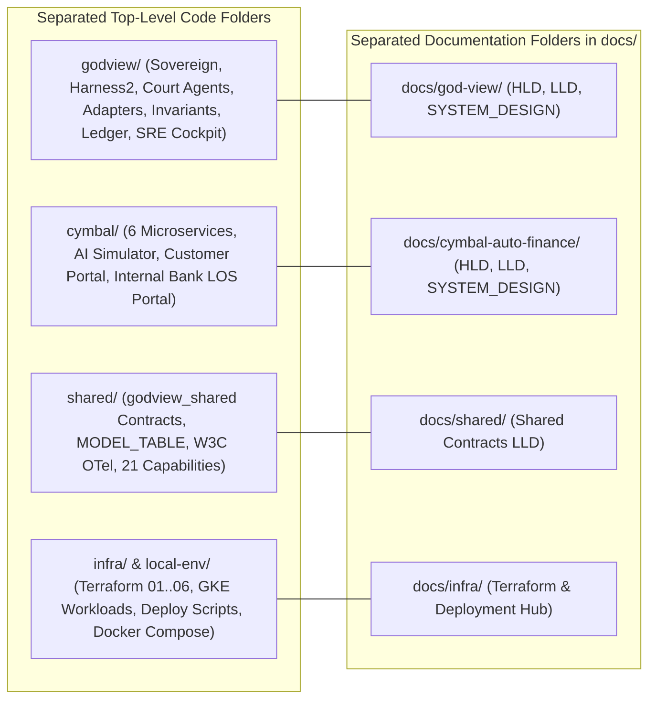

# God-View v4.0 + Harness² + Cymbal Auto Finance Monorepo

**Live GCP Project**: `general-ak` (`769002985772`, `us-central1` / `us-central1-a`)
**Global HTTPS Load Balancer (`god-view-edge`)**: `35.244.128.165` (`ak-demos.com`)
**Primary Reasoning & Harness² Proposer Model**: `gemini-4-argon` (`global`), with automatic HTTP 429 / quota / reserve fallback to `gemini-3.8-flash` (`global`)

---

## 1. Executive Summary & Strict Folder Separation

This repository contains two strictly separated application planes plus shared contracts and multi-tier Google Cloud infrastructure:

1. **[`godview/`](godview/README.md) — God-View v4.0 + Harness² Autonomous SRE Control Plane**:
   - A domain-neutral (`I-02`) SRE and Business Continuity organism featuring an "Eyes vs. Brains" architecture: deterministic 10-second `SentinelEngine` checks at **0 LLM tokens at rest**, a `gemini-4-argon` **Sovereign Orchestrator**, **5 Court Specialist Agents** (`application`, `data`, `business_line`, `change`, `platform`) evolved via Google Research's **Harness² (`arXiv:2610.14224`)** two-level recursive agent substrate (`c1..c8`), a deterministic **`TrustGate` (`L0–L4`)**, and the **God-View SRE Cockpit (`https://godview.ak-demos.com`)**.
2. **[`cymbal/`](cymbal/README.md) — Cymbal Auto Finance Customer Application & 5-Utility Banking Tenant**:
   - A 100% fictional Indian digital vehicle-loan origination platform spanning **Cloud Run v2**, **GKE Autopilot**, and **GCE VM** across 5 domain utilities (`kyc-model-armor-svc`, `underwriting-los-svc`, `commercial-fleet-credit-svc`, `motor-insurance-svc`, `core-banking-cibil-vm`) coordinated by `loan-orchestrator-api`, driven by `ai-customer-simulator`, and served through the **Customer Loan Portal (`https://cymbal.ak-demos.com`)** and **Internal Bank LOS Portal (`https://los.cymbal.ak-demos.com`)**.
3. **[`shared/`](shared/README.md) — Shared Contracts, OpenTelemetry W3C Baggage & Capability Registry (`godview_shared`)**:
   - Domain-neutral Pydantic contracts, `MODEL_TABLE`, W3C `traceparent` + `baggage` (`journey.id`, `customer.id`, `synthetic`), OIDC-authenticated OTLP span exporter, and the 21 `SIX_SENSES_CAPABILITIES`.
4. **[`infra/`](infra/README.md) & [`local-env/`](local-env/) — Multi-Tier GCP Terraform Platform & Hermetic Local Stack**:
   - 3-stage OpenTofu/Terraform platform (`220` GCP resources across 6 modules in `infra/terraform/platform/` + `10` GKE Autopilot resources in `infra/terraform/workloads/`), Cloud Build & air-gapped GCE VM tarball deployment pipelines (`infra/deploy/`), and offline hermetic `docker-compose.yml`.

---

## 2. Complete Documentation Index

### 2.1 Master Architecture & Design Specifications
- **[`docs/ARCHITECTURE.md` — Master Architecture Overview & Folder Navigation Guide](docs/ARCHITECTURE.md)**
- **[`docs/HLD.md` — Master High-Level Design (HLD)](docs/HLD.md)**
- **[`docs/LLD.md` — Master Low-Level Design (LLD)](docs/LLD.md)**
- **[`docs/SYSTEM_DESIGN.md` — Master End-to-End System Design & Deployment Architecture](docs/SYSTEM_DESIGN.md)**
- **[`docs/BRD.md` — Business Requirements Document (BRD)](docs/BRD.md)**
- **[`docs/SDD.md` — System & Solution Design Document (SDD)](docs/SDD.md)**
- **[`docs/GOD_VIEW_MCP_AGENT_SPEC.md` — God-View Agent, MCP Mesh & Vector Skill Specification](docs/GOD_VIEW_MCP_AGENT_SPEC.md)**
- **[`docs/TERRAFORM_GITOPS_SPEC.md` — Terraform & GitHub GitOps Specification](docs/TERRAFORM_GITOPS_SPEC.md)**
- **[`TDD.md` — Master Technical Design Document & Swarm Playbook](TDD.md)**
- **[`DEPLOY_RUNBOOK.md` — Live `general-ak` Deployment Runbook & Verification Receipts](DEPLOY_RUNBOOK.md)**

### 2.2 Separated Plane-Specific Documentation Folders
- **God-View v4.0 + Harness² SRE Control Plane (`docs/god-view/`)**:
  - [God-View Documentation Hub (`docs/god-view/README.md`)](docs/god-view/README.md)
  - [God-View High-Level Design (`docs/god-view/HLD.md`)](docs/god-view/HLD.md)
  - [God-View Low-Level Design (`docs/god-view/LLD.md`)](docs/god-view/LLD.md)
  - [God-View System Design (`docs/god-view/SYSTEM_DESIGN.md`)](docs/god-view/SYSTEM_DESIGN.md)
- **Customer Application — Cymbal Auto Finance (`docs/cymbal-auto-finance/`)**:
  - [Cymbal Auto Finance Documentation Hub (`docs/cymbal-auto-finance/README.md`)](docs/cymbal-auto-finance/README.md)
  - [Cymbal Auto Finance High-Level Design (`docs/cymbal-auto-finance/HLD.md`)](docs/cymbal-auto-finance/HLD.md)
  - [Cymbal Auto Finance Low-Level Design (`docs/cymbal-auto-finance/LLD.md`)](docs/cymbal-auto-finance/LLD.md)
  - [Cymbal Auto Finance System Design (`docs/cymbal-auto-finance/SYSTEM_DESIGN.md`)](docs/cymbal-auto-finance/SYSTEM_DESIGN.md)
- **Infrastructure & Shared Contracts (`docs/infra/` & `docs/shared/`)**:
  - [Infrastructure & Terraform Hub (`docs/infra/README.md`)](docs/infra/README.md)
  - [Shared Contracts & OTel Hub (`docs/shared/README.md`)](docs/shared/README.md)

---

## 3. Live `general-ak` Production URLs & Services

| Surface / Service | Live URL / Endpoint | Compute Substrate | Authentication |
| :--- | :--- | :--- | :--- |
| **URL 1: Customer Loan Portal** | `https://cymbal.ak-demos.com` | Cloud Run v2 (`customer-loan-portal-web`) | Public HTTPS + Cloud Armor WAF |
| **URL 2: Internal Bank LOS Portal** | `https://los.cymbal.ak-demos.com` | Cloud Run v2 (`internal-bank-los-web`) | Google Cloud Identity-Aware Proxy (IAP) |
| **URL 3: God-View SRE Cockpit** | `https://godview.ak-demos.com` | Cloud Run v2 (`god-view-sre-web`) | Google Cloud Identity-Aware Proxy (IAP) |
| **Public Loan API Gateway** | `https://cymbal.ak-demos.com/api/v1/*` (`api.cymbal.ak-demos.com`) | API Gateway (`god-view-loan-api-gw`) $\rightarrow$ `loan-orchestrator-api` | Public HTTPS + API Gateway OIDC (`godview-apigw-sa`) |
| **God-View Sovereign Control Plane** | `https://godview.ak-demos.com/api/v1/*` | Cloud Run v2 (`god-view-sovereign`, `min_instances=1`) | IAP + Service Account OIDC |
| **Utility 1: KYC & Model Armor** | `http://10.10.0.3:8080` | GKE Autopilot (`god-view-gke-cluster`, `namespace: cymbal`) | VPC Internal LB + `NetworkPolicy` |
| **Utility 2: Underwriting & LOS** | `http://10.10.0.2:8080` | GKE Autopilot (`god-view-gke-cluster`, `namespace: cymbal`) | VPC Internal LB + `NetworkPolicy` |
| **Utility 3: Commercial Fleet Credit** | `https://commercial-fleet-credit-svc-mcj3w7ujpq-uc.a.run.app` | Cloud Run v2 | Internal + Service Account OIDC |
| **Utility 4: Motor Insurance & FASTag** | `https://motor-insurance-svc-mcj3w7ujpq-uc.a.run.app` | Cloud Run v2 | Internal + Service Account OIDC |
| **Utility 5: Core Banking CIBIL & CBS** | `http://10.10.0.5:8085` | GCE VM (`core-banking-cibil-vm`, `us-central1-a`) | Private VPC Subnet (`10.10.0.0/20`) |
| **AI Customer Stream Simulator** | `https://ai-customer-simulator-mcj3w7ujpq-uc.a.run.app` | Cloud Run v2 | Cloud Scheduler OIDC (`godview-sense-sa`) |

---

## 4. Quickstart & Verification Commands

| Task | Command |
| :--- | :--- |
| **Run Brand Cleanliness Linter (`I-01`)** | `python3 scripts/lint_brands.py` (or `python3 shared/tools/lint_brands.py`) |
| **Run Domain-Neutral Core Linter (`I-02`)** | `python3 shared/tools/lint_neutrality.py` |
| **Run Full Python Test Suite (Hermetic)** | `GODVIEW_ENV=hermetic .venv/bin/pytest` |
| **Start Hermetic Local 11-Service Stack** | `docker compose up --build -d` |
| **Verify Live `general-ak` GCP Deployment** | `./infra/deploy/verify_live_gcp.sh` |
