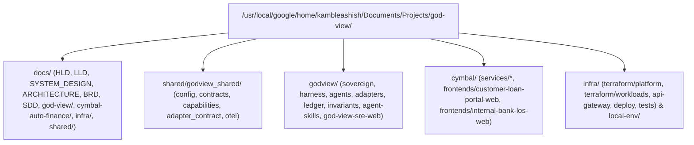
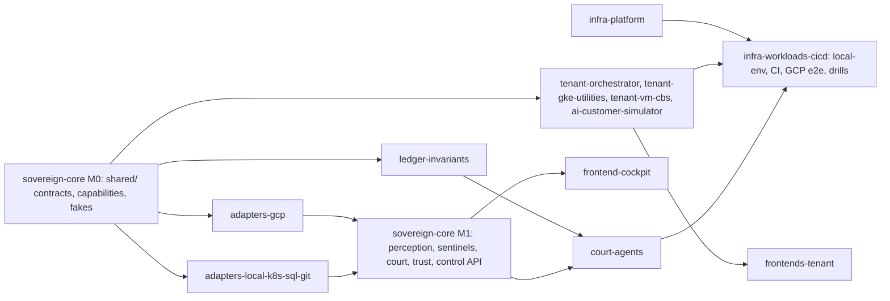

# Master Technical Design Document (TDD) & Swarm Implementation Playbook: God-View v4 — The Sovereign SRE Organism & the Cymbal Auto Finance Proving Ground

- **Document ID**: `GODVIEW-TDD-005 (Master Index & Swarm Playbook)`
- **Version**: `4.0 (Sovereign Organism — rewritten from GODVIEW-DESIGN-V4-ORGANISM; supersedes 3.0)`
- **Design source of truth**: [2026-10-16-god-view-organism-design.md](file:///usr/local/google/home/kambleashish/Documents/Projects/god-view/plans/2026-10-16-god-view-organism-design.md) — every number, name and model below is traceable to it; anything it is silent on is listed in §9, never invented silently
- **Repository Root**: `/usr/local/google/home/kambleashish/Documents/Projects/god-view`
- **Target environments (v1)**: GCP project `general-ak` (`769002985772`, `us-central1`; every Gemini 3.x/4 call at location `global`) + a hermetic local docker-compose + kind environment
- **Budget ceiling**: $600/month all-in (GCP Budget alerts at 50/80/100 %)
- **Complete 5-Document Engineering Suite**:
  1. [Business Requirements Document (`docs/BRD.md`)](file:///usr/local/google/home/kambleashish/Documents/Projects/god-view/docs/BRD.md) — Sovereign Organism vision, personas & surfaces, 5-utility vehicle-finance journeys, BR-01..BR-14, KPIs & SLOs
  2. [System & Solution Design Document (`docs/SDD.md`)](file:///usr/local/google/home/kambleashish/Documents/Projects/god-view/docs/SDD.md) — perception / court / eyes-vs-brains / ledger architecture, edge & network, security, failure modes, portability
  3. [God-View Agent Specification (`docs/GOD_VIEW_MCP_AGENT_SPEC.md`)](file:///usr/local/google/home/kambleashish/Documents/Projects/god-view/docs/GOD_VIEW_MCP_AGENT_SPEC.md) — Sovereign internals, court agent templates, senses, capability adapter layer, `INVARIANT.md` / `SKILL.md`, swarm protocol, trust ladder mechanics (owner of the Firestore / evidence-pack schemas)
  4. [Terraform & GitHub GitOps Spec (`docs/TERRAFORM_GITOPS_SPEC.md`)](file:///usr/local/google/home/kambleashish/Documents/Projects/god-view/docs/TERRAFORM_GITOPS_SPEC.md) — two Terraform roots, module inventory `01-project-iam` … `05-godview`, GitHub Actions via Workload Identity Federation, drift plumbing, pause / kill switch / hibernate as code (owner of module & resource names)
  5. **Master TDD (`TDD.md` — this file)** — build invariants, authoritative schemas, API & protocol contracts, UC-01..UC-26, monorepo ownership matrix, copy-pasteable worker briefs, 5-layer quality gate, phase plan

---

## 1. Non-Negotiable Invariants for All Build Workers

> [!IMPORTANT]
> Every author and verifier worker enforces these ten invariants. A verifier rejects any deliverable that violates one, regardless of test results.

| # | Invariant | How it is enforced in the repo |
| :-- | :-- | :-- |
| I-01 | **Domain cleanliness.** 100 % vehicle-finance domain (Cymbal Auto Finance). No brokerage, competitor, APM-vendor, real-bank or other third-party company brand anywhere in code, comments, seeds, UI or docs. Tools we use (Google Cloud, Terraform, GitHub, Datastream, OpenTelemetry, Prometheus, Kubernetes, kind, docker-compose, A2A, MCP, FastAPI, React, Pydantic) are fine | `make lint-brands` (case-insensitive deny-list grep over the whole repo) runs in CI and in every verifier pass |
| I-02 | **Zero hardcoded application / environment knowledge** in `godview/` (except the agent-written vault contents under `godview/invariants/` and `godview/agent-skills/`) and `shared/`. Perception is identity-only: the Sovereign infers project, region and reachable resources from its own credentials (ADC / workload identity / metadata server); the only optional input is `GODVIEW_HINT_REPO_URLS`, which widens scope and never narrows it. An Agent Registry is discovered, never assumed. No tenant service names, project IDs or hostnames in those trees — not even in tests | `make lint-neutrality` greps `godview/` (vaults excluded) and `shared/` for tenant service names, `general-ak`, `ak-demos`, `cymbal` → must return 0 hits; `godview/sovereign/tests/test_perception.py` boots the Sovereign with no env vars except `GODVIEW_ENV=hermetic` against `godview/adapters/local` fixtures |
| I-03 | **Environment-neutral core + discovered sense adapters.** Core speaks only open standards (OpenTelemetry, Prometheus text format, Kubernetes API, SQL `information_schema` + CDC, Git + OpenAPI / proto / JSON-schema, CloudEvents, A2A, MCP). Every cloud / vendor SDK import lives under `godview/adapters/<family>/` (`gcp`, `kubernetes`, `sql`, `git`, `channels`, `local`); each adapter reports `available / partial / unavailable` with evidence and never assumes another adapter | import-linter contract in `pyproject.toml` (`godview.sovereign`, `godview.agents`, `godview.ledger`, `shared` may not import `google.*`, `kubernetes`, `psycopg`, `github`) |
| I-04 | **Never read telemetry from the patient.** Cloud SQL `god-view-pg` holds tenant business tables only; `service_metric_rollups` and `otel_trace_spans` are deleted. The Sovereign pull-scrapes `/metrics` every 10 s; OTel exports to Cloud Monitoring / Cloud Trace; business facts land in BigQuery `godview_ledger`; the brain lives in Firestore `god-view-memory-db` | `shared/tests/test_contracts.py` asserts the exact 9-table list of §2.1; the `sql` adapter executes read-only statements only while sensing |
| I-05 | **Real tool names via the capability adapter layer.** Only the official MCP tools listed in §3.7 may be named as MCP tools; everything else God-View does is a labelled capability (`<family>.<verb>`) implemented by an adapter (SDK / API call). HashiCorp `terraform-mcp` is registry-docs / HCP-only — never drift detection or apply | `shared/godview_shared/capabilities.py` is the single registry that names MCP tools; `test_capabilities_allowlist` fails on any unknown tool name |
| I-06 | **Trust ladder enforced in code before any mutating call.** Every capability declares `mutating` and `min_level`; `TrustGate.authorize(agent_id, action_type, scope)` must return a `TrustDecision` before an adapter executes; L2 requires an `approval_id`; blast radius = 1 resource per action; money movement and customer communications are capped at L2 unless whitelisted; instant demotion on any bad outcome; `godview-act-sa` is impersonated only inside an authorized call | `godview/sovereign/tests/test_trust_ladder.py`; every adapter test proves a mutating capability without a `TrustDecision` raises `TrustViolation` |
| I-07 | **Synthetic marker + probe safety.** All simulator traffic carries header `X-Synthetic: true`, OTel baggage `synthetic=true`, `customers.is_ai_generated=true` and ledger `is_synthetic=true`. Agents probe only operations marked `x-godview-probe-safe: true` in a discovered OpenAPI contract or requests carrying the marker. Mutations only on resources labelled `godview_managed="true"`, never on anything the environment owner excluded | simulator + agent tests; chaos / remediation capabilities assert the label before acting |
| I-08 | **Per-agent token budgets and the $600 ceiling.** The Sovereign token governor meters every model call per agent per day; exhaustion degrades that agent to L1 until 00:00 IST; `gemini-4-argon` escalation only while the agent's remaining budget covers the escalation reserve; Scheduled Pause (17:00–09:00 IST), Traffic Kill Switch and Hibernate are first-class cost controls; specimen images only on 1 in 10 journeys | `godview/sovereign/tests/test_token_governor.py`; budget sentinel (§2.4) |
| I-09 | **Models exactly as design §11, Gemini 3.x/4 at location `global`.** `gemini-3.8-flash` (`global`; `thinking_level=LOW` personas, `MEDIUM` reasoning; fallbacks `gemini-2.5-flash` / `gemini-2.5-pro` at `us-central1`), `gemini-4-argon` (`global`, escalation), `gemini-nano-banana-2.1` (`global`; fallback `gemini-3-pro-image` at `global`, then `gemini-2.5-flash-image` at `us-central1`), `text-embedding-005` (`us-central1`, 768-dim). Model Armor, Firestore, Agent Engine stay regional in `us-central1` | `shared/godview_shared/config.py` is the only model table; `test_model_locations` fails if any Gemini 3.x/4 ID is paired with a regional location |
| I-10 | **Three web UIs in the ak-demos.com luminous white theme** (white canvas, dark-ink typography, subtle slate borders, Google four-colour gradient accents; no purple anywhere in the palette; no generic AI-template look — real product UI per the coordinator's UI/UX rules), React + TypeScript + Tailwind. URL 1 public; URL 2 and URL 3 behind IAP; **no public mutation endpoints** (chaos, replay, reconcile, kill switch, simulator control are IAM-only on the Sovereign or on tenant `/admin/v1`). The Cockpit calls the Sovereign only through `godview.ak-demos.com/api/*` behind IAP and renders only from live API data with zero hardcoded service / utility names | frontend tests render every tab from fixture API responses with randomised names; `infra/tests` asserts the API Gateway OpenAPI contains no `/admin` route |

---

## 2. Authoritative Data Specifications

### 2.1 Tenant Business Database: Cloud SQL `god-view-pg` (PostgreSQL 16, `db-g1-small`, single zone, private IP) — database `godview_lms`, user `app_user` (password in Secret Manager `cymbal-pg-app-password`)

Business data only (I-04). Logical decoding is on for Phase 2 Datastream CDC. `service_metric_rollups` and `otel_trace_spans` from v3 are **removed**.

| Table | Primary key | Columns | Purpose |
| :-- | :-- | :-- | :-- |
| `vehicles` | `vehicle_id VARCHAR(32)` | `make VARCHAR(64)`, `model VARCHAR(64)`, `category VARCHAR(32)` (`EV_SUV` \| `PASSENGER_SUV` \| `TWO_WHEELER` \| `COMMERCIAL_FLEET`), `ex_showroom_inr NUMERIC(12,2)`, `cdn_image_url TEXT`, `min_down_payment_pct NUMERIC(5,2)` | 8 seeded fictional vehicles; media served from the Cloud CDN backend bucket |
| `customers` | `customer_id UUID` | `full_name VARCHAR(128)`, `dob DATE`, `email VARCHAR(128)`, `phone VARCHAR(20)`, `city VARCHAR(64)`, `employment_type VARCHAR(32)`, `employer_name VARCHAR(128)`, `monthly_income_inr NUMERIC(12,2)`, `pan_number CHAR(10)`, `aadhaar_number CHAR(12)`, `is_ai_generated BOOLEAN NOT NULL DEFAULT false`, `ai_persona_json JSONB`, `created_at TIMESTAMPTZ` | Unified identity across the 5 utilities; `is_ai_generated` is the synthetic marker at rest |
| `kyc_documents` | `kyc_id UUID` | `customer_id UUID REFERENCES customers`, `loan_id UUID`, `kyc_mode VARCHAR(16)` (`IMAGE` \| `TEXT_ONLY`), `pan_gcs_uri TEXT`, `aadhaar_gcs_uri TEXT`, `pan_image_model VARCHAR(64)`, `aadhaar_image_model VARCHAR(64)`, `pan_verified BOOLEAN`, `aadhaar_verified BOOLEAN`, `model_armor_text_status VARCHAR(32)`, `model_armor_findings_json JSONB`, `verified_at TIMESTAMPTZ` | Utility 1; 9 in 10 synthetic journeys are `TEXT_ONLY`; images are specimen cards, never scanned by Model Armor |
| `loan_applications` | `loan_id UUID` | `customer_id UUID REFERENCES customers`, `vehicle_id VARCHAR(32) REFERENCES vehicles`, `utility_type VARCHAR(32)` (`RETAIL_AUTO_LOAN` \| `COMMERCIAL_FLEET_TOPUP`), `loan_amount_inr NUMERIC(12,2)`, `down_payment_inr NUMERIC(12,2)`, `tenure_months INT`, `interest_rate_pct NUMERIC(5,2)`, `emi_inr NUMERIC(10,2)`, `loan_purpose_text TEXT`, `employment_remarks TEXT`, `applicant_notes TEXT`, `status VARCHAR(32)` (`KYC_PENDING` \| `KYC_VERIFIED` \| `MODEL_ARMOR_BLOCKED` \| `APPROVED` \| `REJECTED` \| `INSURED` \| `DISBURSEMENT_PENDING` \| `DISBURSED`), `journey_id VARCHAR(64)`, `trace_id VARCHAR(64)`, `total_latency_ms INT`, `created_at TIMESTAMPTZ`, `updated_at TIMESTAMPTZ` | Utilities 2 & 3; the three text columns are the only Model Armor inputs; `status` is the canonical state machine mined by the Business-Line Agent |
| `underwriting_audits` | `audit_id UUID` | `loan_id UUID REFERENCES loan_applications`, `cibil_score INT`, `cibil_bureau_ref VARCHAR(64)`, `foir_pct NUMERIC(5,2)`, `ltv_pct NUMERIC(5,2)`, `rules_version VARCHAR(32)`, `gke_pod_name VARCHAR(128)`, `gce_vm_name VARCHAR(128)`, `decision VARCHAR(32)` (`APPROVED` \| `REJECTED`), `rejection_reason TEXT`, `evaluated_at TIMESTAMPTZ` | Utility 2 + 5 audit; `rules_version` = git SHA of `rules_engine.py`, the hook for change intelligence |
| `commercial_credit_lines` | `credit_line_id UUID` | `customer_id UUID REFERENCES customers`, `loan_id UUID REFERENCES loan_applications`, `vehicle_category VARCHAR(32)` (`TWO_WHEELER` \| `COMMERCIAL_FLEET`), `fleet_size INT`, `requested_limit_inr NUMERIC(12,2)`, `sanctioned_limit_inr NUMERIC(12,2)`, `utilisation_pct NUMERIC(5,2)`, `decision VARCHAR(32)`, `status VARCHAR(32)`, `trace_id VARCHAR(64)`, `evaluated_at TIMESTAMPTZ` | **New** — Utility 3 (`commercial-fleet-credit-svc`, its own Cloud Run service) |
| `insurance_policies` | `policy_id UUID` | `customer_id UUID REFERENCES customers`, `loan_id UUID REFERENCES loan_applications`, `policy_type VARCHAR(64)`, `fasttag_id VARCHAR(64)`, `premium_inr NUMERIC(10,2)`, `coverage_inr NUMERIC(12,2)`, `status VARCHAR(32)`, `trace_id VARCHAR(64)`, `issued_at TIMESTAMPTZ` | Utility 4 (`motor-insurance-svc`); absence of a row after HTTP 200 is the "200-but-no-policy" drill |
| `disbursements` | `disbursement_id UUID` | `loan_id UUID REFERENCES loan_applications`, `sanction_letter_no VARCHAR(64)`, `cbs_utr_number VARCHAR(64)`, `nach_mandate_id VARCHAR(64)`, `disbursed_amount_inr NUMERIC(12,2)`, `dealer_account_no VARCHAR(64)`, `status VARCHAR(32)` (`PENDING` \| `DISBURSED` \| `FAILED` \| `REPLAYED`), `attempts INT DEFAULT 0`, `replay_of UUID`, `disbursed_at TIMESTAMPTZ` | Utility 5 (`core-banking-cibil-vm`); `PENDING` + `FAILED` rows are the saga-replay queue |
| `chaos_fault_states` | `fault_id VARCHAR(64)` | `fault_class VARCHAR(16)` (`BUSINESS` \| `INFRA`), `fault_type VARCHAR(64)` (`foir_threshold_regression` \| `insurance_no_policy_write` \| `emi_rounding` \| `cibil_stub_900` \| `step_order_insurance_before_kyc` \| `cloudsql_lock_contention` \| `gke_oom_503` \| `gce_vm_latency_504`), `target_service VARCHAR(64)`, `is_active BOOLEAN`, `parameters_json JSONB`, `triggered_by VARCHAR(32)`, `activated_at TIMESTAMPTZ`, `expires_at TIMESTAMPTZ` | Opt-in drill state (never a 24/7 rotation); `foir_threshold_regression` is delivered as a real commit on a drill branch and recorded here for bookkeeping only |

### 2.2 Business Event Ledger: BigQuery dataset `godview_ledger` (`us-central1`)

Fed by (a) OTel business span attributes exported by `godview/ledger/exporter` now and (b) Datastream CDC from `god-view-pg` in Phase 2; both land in the same tables. Span attributes recognised by the exporter: `journey.id`, `customer.id`, `loan.id`, `decision`, `foir_pct`, `cibil_score`, `status_from`, `status_to`, `event_type`, `emi_inr`, `amount_inr`, `entity`, `entity_id`, `synthetic`.

| Table | Columns | Partition | Cluster |
| :-- | :-- | :-- | :-- |
| `events` | `event_id STRING`, `event_time TIMESTAMP`, `env_id STRING`, `journey_id STRING`, `trace_id STRING`, `span_id STRING`, `service STRING`, `operation STRING`, `event_type STRING` (`kyc.verified`, `loan.decided`, `credit_line.decided`, `insurance.issued`, `disbursement.settled`, `armor.blocked`, …), `customer_id STRING`, `loan_id STRING`, `entity STRING`, `entity_id STRING`, `decision STRING`, `foir_pct NUMERIC`, `cibil_score INT64`, `emi_inr NUMERIC`, `amount_inr NUMERIC`, `http_status INT64`, `duration_ms INT64`, `is_synthetic BOOL`, `source STRING` (`otel` \| `cdc` \| `probe`), `attributes JSON` | `event_time` (DAY) | `journey_id`, `service`, `event_type` |
| `state_transitions` | `transition_id STRING`, `transition_time TIMESTAMP`, `env_id STRING`, `entity STRING` (`loan_application` \| `disbursement` \| `insurance_policy` \| `credit_line` \| `kyc_document`), `entity_id STRING`, `journey_id STRING`, `status_from STRING`, `status_to STRING`, `actor_service STRING`, `source STRING` (`otel` \| `cdc`), `dwell_ms INT64`, `is_synthetic BOOL`, `attributes JSON` | `transition_time` (DAY) | `entity`, `journey_id`, `status_to` |
| `journeys` | `journey_id STRING`, `journey_name STRING`, `started_at TIMESTAMP`, `ended_at TIMESTAMP`, `env_id STRING`, `customer_id STRING`, `steps ARRAY<STRUCT<seq INT64, service STRING, operation STRING, at TIMESTAMP, status STRING, duration_ms INT64>>`, `observed_sequence STRING`, `conformance STRING` (`CONFORMANT` \| `SKIPPED` \| `REORDERED` \| `LOOPED` \| `STALLED`), `final_status STRING`, `rupee_value NUMERIC`, `total_duration_ms INT64`, `is_synthetic BOOL`, `journey_model_version STRING` | `started_at` (DAY) | `journey_name`, `conformance`, `final_status` |
| `kpi_rollups` | `window_start TIMESTAMP`, `window_end TIMESTAMP`, `env_id STRING`, `journey_name STRING`, `kpi STRING` (`approval_rate` \| `step_conversion` \| `ticket_size_inr` \| `rupees_per_hour` \| `emi_mean` \| `emi_stddev` \| `disbursement_latency_ms` \| `policy_issue_rate`), `segment STRING`, `value NUMERIC`, `baseline_value NUMERIC` (same hour-of-day baseline), `zscore NUMERIC`, `cusum NUMERIC`, `sample_n INT64`, `breach BOOL` | `window_start` (DAY) | `journey_name`, `kpi` |

### 2.3 Knowledge Graph & Vector Memory: Firestore Native DB `god-view-memory-db` (`us-central1`)

Aligned with the Agent Spec schema freeze (board #10): 13 top-level collections; all vectors are `text-embedding-005`, 768-dim, COSINE, each backed by a `google_firestore_index` with `vector_config` (four indexes). `env_id` is perception-derived (e.g. `gcp-general-ak`, `local-compose`), never configured.

| Collection | Document ID | Fields | Vector field |
| :-- | :-- | :-- | :-- |
| `discovered_services` | `{env_id}__{kind}.{name}` | `env_id`, `name`, `kind` (`cloud_run` \| `gke_workload` \| `gce_vm` \| `cloud_sql` \| `api_gateway` \| `bucket` \| `reasoning_engine` \| `other`), `adapter_family`, `locator`, `labels{}`, `inferred_role`, `role_confidence`, `classification` (`journey_linked` \| `other_read_only`), `routes[]`, `metrics_endpoint`, `repo_ref`, `tf_address`, `owner_agent_id`, `first_seen`, `last_seen`, `status` (`active` \| `gone`) | `purpose_embedding` |
| `discovered_edges` | `{src_service_id}__to__{dst_service_id}` | `src`, `dst`, `protocol`, `evidence` (`trace` \| `code` \| `config` \| `k8s`), `call_rate_baseline`, `first_seen`, `last_seen` | — |
| `discovered_entities` | `{env_id}__{entity}` | `name`, `correlation_keys[]`, `tables[]`, `owning_service_id`, `states[]`, `transitions[]`, `rules_ref[]`, `provenance` | — |
| `journeys` | `{journey_key}` (e.g. `vehicle_loan_origination`) | `name`, `steps[]`, `directly_follows{}`, `intended_order_source`, `conformance_rules[]`, `funnel_kpis[]`, `rupee_impact_model{}`, `owner_agent_id`, `status` | — |
| `court_agents` | `{agent_type}__{subject_key}` | `agent_type` (`application` \| `data` \| `business_line` \| `change` \| `platform`), `subject_ref`, `reasoning_engine`, `a2a_card_url`, `state` (`perceived` \| `spawning` \| `learning` \| `sentinel_compiled` \| `sleeping` \| `awake` \| `retiring` \| `archived`), `warmth_min_instances` (0 \| 1), `memory_bank_id`, `namespace`, `token_budget_daily`, `tokens_spent_today`, `last_wake_at`, `last_reflection_at`, `wakes_7d`, `spawned_at`, `retired_at`; subcollection `living_model/{rules \| state_machines \| decision_boundaries \| routes \| dependencies \| feature_flags \| commit_diffs}` | — |
| `trust_records` | `{agent_id}__{action_type}` | see §2.4 TrustRecord | — |
| `sentinels` | `snt-{class}-{slug}` | see §2.4 SentinelDefinition | — |
| `invariants` | `inv-{slug}` | `INVARIANT.md` frontmatter (§2.4) + `body_md`, `status`, `shadow_stats{runs, breaches, false_positive_rate}`, `sentinel_id`, `git_path`, `git_sha` | `statement_embedding` |
| `episodic_incidents` | `inc-{yyyymmdd}-{seq}` | `opened_at`, `closed_at`, `severity`, `symptom_summary`, `evidence_pack{}`, `lead_agent_id`, `participants[]`, `root_cause`, `causal_chain[]`, `actions[{audit_id}]`, `outcome` (`resolved` \| `mitigated` \| `false_positive`), `rupee_impact`, `affected_journeys[]`, `convergence{consensus, rounds, seconds, escalated_to_argon}`, `skills_used[]` | `symptom_embedding` |
| `procedural_skills` | `{skill_slug}` | `SKILL.md` frontmatter (`name`, `description`, `version`, `created_by`, `owner_agent_id`, `provenance`, `confidence_score`, `executions_count`, `avg_mttr_seconds`, `trigger{sentinel_classes[], symptom}`, `required_capabilities[]`, `steps[{capability, min_trust_level}]`, `blast_radius`, `reversal`, `verification`) + `body_md`, `gcs_uri` (`gs://general-ak-god-view-agent-skills/…`), `git_path` (`godview/agent-skills/…`), `provenance` (`agent_synthesized` \| `human_runbook`), `last_executed_at` | `trigger_embedding` |
| `change_events` | `chg-{repo}-{sha \| pr-N \| audit-id}` | `repo`, `kind` (`commit` \| `pr_opened` \| `pr_merged` \| `ci_run` \| `deploy` \| `audit_config_change` \| `tfstate_change` \| `operator_note`), `sha`, `pr_number`, `author`, `business_summary`, `risk_score`, `affected_services[]`, `affected_journeys[]`, `canary{window_start, window_end, verdict}`, `linked_incident_ids[]`, `occurred_at` | — |
| `cost_findings` | `cost-{yyyymmdd}-{slug}` | `resource`, `finding_type` (`idle_reasoning_engine` \| `oversized` \| `unused` \| `budget_threshold`), `monthly_usd_estimate`, `recommendation`, `status` (`open` \| `accepted` \| `dismissed`), `found_by`, `found_at` | — |
| `approvals` | `apr-{incident_id}-{step}` | see §2.4 ApprovalCard + `decision` (`pending` \| `approved` \| `rejected` \| `snoozed` \| `expired`), `decided_by`, `decided_at`, `audit_id` | — |

Audit records (`aud-{yyyymmdd}-{seq}`, written for every executed action): `incident_id`, `agent_id`, `trust_level`, `action_type`, `capability`, `target_resource`, `approver{principal, channel, at}` or `null`, `evidence_pack_id`, `sa_used` (`godview-act-sa`), `executed_at`, `result` (`success` \| `failed` \| `reverted`), `verification{}`, `reversal_recipe{}`, `reversed_at`.

### 2.4 JSON Contracts (Pydantic v2 models live in `shared/godview_shared/contracts/`; field names frozen by board #10)

```json
// EvidencePack (schema_version "1.0") — payload of every A2A `wake`; also stored in episodic_incidents.evidence_pack
{"schema_version": "1.0", "evidence_pack_id": "evp-20261016-0007", "incident_id": "inc-20261016-0003", "fired_at": "2026-10-16T08:35:10Z",
 "sentinel": {"id": "snt-invariant_sql-approved-implies-foir-and-cibil", "class": "invariant_sql", "source_ref": "inv-approved-implies-foir-and-cibil"},
 "breach": {"statement": "SELECT COUNT(*) … WHERE decision='APPROVED' AND (foir_pct > 60 OR cibil_score < 680)", "observed": {"count": 14, "window_s": 300}, "first_seen": "2026-10-16T08:35:00Z", "consecutive": 3},
 "baseline": {"model": "same_hour", "expected": 0, "stddev": 0.4},
 "affected": {"services": ["…"], "journeys": ["vehicle_loan_origination"], "journey_ids": ["…"], "rows": 212, "rupee_at_risk": 18400000},
 "correlated_changes": [{"change_event_id": "chg-<repo>-<sha>", "kind": "deploy", "occurred_at": "2026-10-16T08:34:00Z", "business_summary": "FOIR threshold 60 -> 40 in rules_engine.py (PR #42)"}],
 "golden_signals": {"status": "green", "p95_ms": 420, "error_rate_pct": 0.2},
 "recall": {"episodic": [{"incident_id": "inc-20261002-0001", "similarity": 0.91}], "skills": [{"skill_slug": "rollback-rules-regression", "similarity": 0.88}]},
 "budget": {"agent_tokens_remaining": 180000, "escalation_allowed": true},
 "target_agent_id": "application__<subject_key>", "trust_snapshot": {"git.create_rollback_pr": 3, "biz.reevaluate_application": 4}}
```

```json
// ApprovalCard — the approvals document, rendered as a Google Chat card (Approve / Reject / Snooze) and in the Cockpit Approvals inbox
{"approval_id": "apr-inc-20261016-0003-2", "incident_id": "inc-20261016-0003", "agent_id": "business_line__vehicle_loan_origination",
 "action_type": "biz.reevaluate_application", "capability": "biz.reevaluate_application", "target_resource": "loan_applications WHERE rules_version='<sha>' AND decision='APPROVED'",
 "trust_level_required": 4, "narrative": "Re-evaluate 212 applications approved under the regressed FOIR threshold", "evidence_pack_id": "evp-20261016-0007",
 "rupee_impact": 18400000, "reversal_recipe": {"capability": "biz.compensate_journey", "args": "…"}, "requested_at": "…", "expires_at": "…",
 "decision": "pending", "decided_by": null, "decided_at": null, "channel": "chat", "audit_id": null}
```

```json
// TrustRecord — one per (agent, action_type); thresholds N1=3, N2=5, N3=10; instant demotion on any bad outcome
{"agent_id": "data__god-view-pg", "action_type": "sql.terminate_backend", "level": 3,
 "counters": {"recommendations_correct": 7, "approved_executions": 5, "verified_outcomes": 5, "regressions": 0, "business_successes": 0},
 "thresholds": {"n1": 3, "n2": 5, "n3": 10}, "whitelisted": false, "last_promoted_at": "…", "last_demoted_at": null, "demotion_reason": null,
 "history": [{"at": "…", "from": 2, "to": 3, "reason": "n2 reached with 0 regressions"}]}
```

```json
// SentinelDefinition — compiled by agents, executed by the Sentinel Engine at 0 tokens
{"sentinel_id": "snt-invariant_sql-approved-implies-foir-and-cibil", "class": "invariant_sql", "source_ref": "inv-approved-implies-foir-and-cibil",
 "check": {"dialect": "bigquery", "statement": "SELECT COUNT(*) … WHERE decision='APPROVED' AND (foir_pct > 60 OR cibil_score < 680)"},
 "cadence_s": 10, "baseline": {"model": "same_hour", "window_days": 7},
 "wake_condition": {"operator": ">=", "threshold": 3, "consecutive": 1, "window_s": 300}, "target_agent_id": "application__<subject_key>",
 "state": "enforced", "compiled_by": "application__<subject_key>", "compiled_at": "…", "last_run_at": "…", "last_result": {"count": 0}, "consecutive_breaches": 0}
```

```yaml
# INVARIANT.md frontmatter (file: godview/invariants/<journey_key>/<name>/INVARIANT.md; body = rationale + provenance quotes)
---
name: approved-implies-foir-and-cibil
scope: {service: <discovered service slug>, entity: loan_application, journey: vehicle_loan_origination}
provenance: code                      # code | policy | observed
provenance_ref: "<repo>@<sha>:<path to rules_engine.py>"
check: {dialect: bigquery, statement: "SELECT COUNT(*) … WHERE decision='APPROVED' AND (foir_pct > 60 OR cibil_score < 680)", window_s: 300}
severity: sev2                        # sev1 | sev2 | sev3
wake_condition: {operator: ">=", threshold: 3, consecutive: 1, target_agent_id: application__<subject_key>}
confidence: 0.92
created_by: application__<subject_key>
version: 3
status: enforced                      # proposed -> shadow -> enforced -> retired
---
```

---

## 3. API & Protocol Contracts

### 3.1 Tenant public API — `loan-orchestrator-api` behind API Gateway `god-view-loan-api-gw` (`api.cymbal.ak-demos.com`)

| Method & path | Purpose | Notes |
| :-- | :-- | :-- |
| `GET /v1/vehicles` | Catalog (8 vehicles, CDN media URLs) | `x-godview-probe-safe: true` |
| `POST /v1/loans/apply` | Start a journey: KYC → underwriting (→ fleet credit for `COMMERCIAL_FLEET_TOPUP`) → insurance → CBS | Returns `loan_id`, `journey_id`; synthetic callers send `X-Synthetic: true` |
| `GET /v1/loans`, `GET /v1/loans/{loan_id}` | Journey & loan state | Pagination `?status=&limit=` |
| `GET /v1/kyc-documents/{customer_id}/{doc_type}` | Signed URL for a specimen card in `general-ak-god-view-kyc-vault` | `doc_type ∈ {pan, aadhaar}`; `TEXT_ONLY` journeys return 404 |
| `GET /v1/observability/topology`, `GET /v1/observability/traces/{trace_id}` | Tenant-side views used by URL 2 | Read-only |
| `GET /v1/telemetry/stream` | **SSE** (`text/event-stream`) of journey step events — replaces v3's WebSocket; no WebSocket through the gateway | Heartbeat every 15 s |
| `GET /metrics`, `GET /healthz` | Prometheus text format; scraped by the Sovereign every 10 s | Served on the service's internal ingress, **not** routed by the gateway |

### 3.2 Internal utility endpoints (private networking; W3C `traceparent` + `baggage` propagated)

| Service | Compute | Endpoint | Business attributes emitted on the span |
| :-- | :-- | :-- | :-- |
| `kyc-model-armor-svc` | GKE Autopilot, internal LB | `POST /internal/kyc/verify`, `GET /metrics`, `GET /healthz` | `event_type=kyc.verified` \| `armor.blocked`, `status_from/to` |
| `underwriting-los-svc` | GKE Autopilot, internal LB | `POST /internal/underwriting/evaluate` | `decision`, `foir_pct`, `cibil_score`, `emi_inr`, `rules_version` |
| `commercial-fleet-credit-svc` | Cloud Run (internal ingress) | `POST /internal/fleet-credit/evaluate` | `event_type=credit_line.decided`, `decision`, `amount_inr` |
| `motor-insurance-svc` | Cloud Run (internal ingress) | `POST /internal/insurance/issue` | `event_type=insurance.issued`, `amount_inr` (premium) |
| `core-banking-cibil-vm` | GCE `e2-micro`, port 8085 | `POST /internal/cibil-cbs/score-and-disburse`, `POST /internal/cibil-cbs/disburse` (idempotent by `loan_id`) | `cibil_score`, `event_type=disbursement.settled`, `amount_inr` |

### 3.3 Tenant admin API (orchestrator, internal ingress, ID token of `godview-act-sa`; **never** routed by the gateway)

| Method & path | Capability | Trust |
| :-- | :-- | :-- |
| `POST /admin/v1/disbursements/{loan_id}:replay` | `biz.replay_disbursement` — saga replay after CBS recovery | L4 |
| `POST /admin/v1/loans/{loan_id}:re-evaluate` | `biz.reevaluate_application` — re-run underwriting with current rules | L4 |
| `POST /admin/v1/journeys/{journey_id}:compensate` | `biz.compensate_journey` — cancel policy / reverse state | L4 |
| `GET /admin/v1/disbursements?status=PENDING\|FAILED` | read — stuck-disbursement queue | L0 |
| `POST /admin/v1/tenant/state` `{paused, reason}` | `tenant.set_paused` — orchestrator answers `503 TENANT_PAUSED` at ingress while paused | Sovereign-only |
| `POST /admin/v1/chaos/faults`, `DELETE /admin/v1/chaos/faults/{fault_id}` | `chaos.activate` / `chaos.clear` (Cymbal only, `godview_managed="true"`) | Sovereign-only |

Each admin operation is declared in the OpenAPI contract with `x-godview-admin-action: <capability>` and `x-godview-reversal: <recipe>` so Application Agents discover it from contracts, never from configuration. The simulator exposes the same pattern: `POST /v1/simulator/state {enabled}`, `POST /v1/simulator/journeys {count}` (IAM-only).

### 3.4 Sovereign control API — Cloud Run `god-view-sovereign` (IAM-only). Edge paths per board #9: `godview.ak-demos.com/api/*` → Sovereign behind IAP (humans from the Cockpit), `godview.ak-demos.com/public/*` → Sovereign without IAP (`/public/healthz`, `/public/webhooks/github` verified with HMAC secret `godview-github-webhook-secret`); Cloud Scheduler and the Chat app call the `run.app` URL with OIDC ID tokens

| Method & path | Behaviour |
| :-- | :-- |
| `POST /v1/perceive` `{reset}` / `GET /v1/perceive` | Run / read the self-awareness protocol: identity, environment signals, per-adapter `available / partial / unavailable` with evidence, discovery summary |
| `GET /v1/court`, `POST /v1/court/{agent_id}:wake\|retire\|warm\|cool` | Court roster (`court_agents`) and manual lifecycle controls; `warm` = PATCH Agent Engine `deploymentSpec.minInstances=1` |
| `GET /v1/sentinels`, `POST /v1/sentinels`, `PATCH /v1/sentinels/{id}` | List / compile / pause sentinels; `POST` body = `SentinelDefinition` or `{invariant_id}` |
| `GET /v1/incidents`, `GET /v1/incidents/{id}` | Incident list and full swarm transcript + convergence record |
| `POST /v1/approvals/{id}:approve`, `POST /v1/approvals/{id}:reject` | Human decision; IAP `X-Goog-Authenticated-User-Email` or Chat user id recorded as `approver.principal`; writes the audit record |
| `POST /v1/tenant/kill-switch` `{enabled, reason}` | Traffic Kill Switch: simulator `enabled=false`, tenant `paused=true` (`503 TENANT_PAUSED`), chaos cleared, optional Cloud Armor deny rule on `god-view-edge-policy`; emits `godview.operator.kill_switch`, which the Sentinel Engine treats as a planned operator action so the traffic drop raises no incident |
| `POST /v1/tenant/pause`, `POST /v1/tenant/resume` | Scheduled Pause at 17:00 IST / resume at 09:00 IST (Cloud Scheduler jobs `godview-tenant-pause` / `godview-tenant-resume`, `Asia/Kolkata`); pause also cools all warm agents to `min_instances=0` |
| `POST /v1/hibernate` `{enabled}` | Hibernate via Cloud Run Job `god-view-hibernate-job`: GKE deployments → 0, VM stop, Cloud SQL `activation_policy=NEVER`, agents `min_instances=0`, sentinel cadence 60 s; LB / Armor / DNS untouched; wake ≈ 5–8 min; emits `godview.operator.hibernate` |
| `GET /v1/chaos/drills`, `POST /v1/chaos/drills/{drill_id}:start\|stop` | The 8 drills of §2.1 on `godview_managed="true"` resources only |
| `GET /public/healthz`, `GET /metrics` | Heartbeat for the watcher-of-the-watcher uptime check + alert policy |

### 3.5 A2A message types (Agent Engine A2A `AgentCard` / `AgentExecutor`; payload fields frozen by board #10)

Common envelope on every message: `incident_id`, `from_agent_id`, `to_agent_id`, `round` (1–4), `sent_at`.

| Type | Direction | Payload |
| :-- | :-- | :-- |
| `wake` | Sovereign → agent | `evidence_pack` (§2.4 EvidencePack) |
| `interrogate` | agent → agent | `question`, `scope`, `deadline_s` |
| `brief` | agent → swarm | `living_model_delta` |
| `report` | agent → Sovereign | `root_cause`, `causal_chain[]`, `plan[{step, capability, target, trust_level_required, reversal}]`, `confidence` |
| `critique` | agent → agent | `hypothesis_id`, `counter_evidence`, `confidence_delta` |
| `handoff` | agent → agent / Sovereign | `new_lead_agent_id`, `reason` |

Swarm exit: consensus ≥ 0.85 **or** ≤ 4 rounds **or** ≤ 90 s, whichever first; the Sovereign writes `convergence{consensus, rounds, seconds, escalated_to_argon}` to `episodic_incidents`.

### 3.6 Nervous System CloudEvents (Pub/Sub topic `godview-nervous-system`, dead-letter `godview-nervous-system-dlq`; CloudEvents 1.0 JSON; `type` families frozen by board #10; extensions `godviewenvid`, `godviewsynthetic`)

| `type` | `source` | `data` |
| :-- | :-- | :-- |
| `godview.sensor.alert` / `uptime` / `log_metric` | Cloud Monitoring alert policy, uptime check, log-based metric; GCP Budget notifications arrive as `sensor.alert` with `data.source=billing_budget`, `threshold_pct` (50 \| 80 \| 100) | `policy`, `resource`, `state`, `started_at` |
| `godview.webhook.github.push` / `pull_request` / `workflow_run` | GitHub webhook via `/public/webhooks/github` | `repo`, `sha`, `pr_number`, `action` |
| `godview.audit.config_change` / `iam_change` | Cloud Audit Logs sink | `resource`, `method`, `principal`, `revision` |
| `godview.cdc.schema_change` / `row_batch` | Datastream (Phase 2) | `table`, `op`, `pks[]`, `batch_ref` |
| `godview.schedule.reflection` / `pause` / `resume` / `probe` | Cloud Scheduler jobs `godview-agent-reflection`, `godview-tenant-pause`, `godview-tenant-resume`, `godview-probe-run` | `job`, `scheduled_for` |
| `godview.sentinel.breach` / `recovered` | Sentinel Engine (the `discovery` class reports appeared / gone services here) | `sentinel_id`, `class`, `evidence_pack_id`, `target_agent_id` |
| `godview.court.spawn` / `retire` / `warm` | Court Manager | `agent_id`, `agent_type`, `subject_ref`, `warmth_min_instances` |
| `godview.operator.kill_switch` / `hibernate` / `note` | Sovereign control API | `enabled`, `reason`, `actor`, `window` |

### 3.7 Capability IDs referenced in this TDD (full table owned by the Agent Spec)

| Capability | Real tool / call | Family | Min level |
| :-- | :-- | :-- | :-- |
| `obs.list_timeseries`, `obs.get_trace`, `obs.list_traces`, `obs.query_logs_scoped` (`pageSize ≤ 50`) | `observability-mcp` → `list_timeseries`, `get_trace`, `list_traces`, `list_log_entries` | gcp | L0 |
| `k8s.list_clusters`, `k8s.get_cluster`, `k8s.get_resource`, `k8s.query_logs`, `k8s.get_log_schema`, `k8s.list_recommendations` | `gke-mcp` → `list_clusters`, `get_cluster`, `get_k8s_resource`, `query_logs`, `get_log_schema`, `list_recommendations` | gcp / kubernetes | L0 |
| `k8s.rollout_restart` | Kubernetes API (God-View adapter; no MCP tool exists) | kubernetes | L3 |
| `sql.list_tables`, `sql.list_active_queries`, `sql.get_query_plan`, `sql.blocking_tree`, `sql.integrity_check` | MCP Toolbox for Databases (postgres) → `list_tables`, `list_active_queries`, `get_query_plan`, `execute_sql` on `pg_locks` / `pg_stat_activity`, read-only `execute_sql` | sql | L0 |
| `sql.terminate_backend` | MCP Toolbox → `execute_sql` `SELECT pg_terminate_backend(pid)` | sql | L3 |
| `git.list_commits`, `git.get_commit`, `git.get_file_contents` | `github-mcp` → same names | git | L0 |
| `git.create_rollback_pr` | `github-mcp` recipe: `get_commit` → `get_file_contents` (parent) → `create_branch` → `push_files` → `create_pull_request` (+ `create_issue`) | git | L3 |
| `tf.drift_diff` / `tf.restore_attribute` / `tf.apply_dispatch` | tfstate from `gs://general-ak-god-view-tfstate` vs Cloud Run v2 / GKE / Compute APIs (God-View adapter) / GCP API restore / GitHub Actions `workflow_dispatch` | gcp, git | L0 / L3 / L2 |
| `run.restore_revision_config` | Cloud Run v2 API (God-View adapter) | gcp | L3 |
| `agent.set_min_instances` | Agent Engine `PATCH deploymentSpec.minInstances` (Sovereign only) | gcp | Sovereign |
| `biz.replay_disbursement`, `biz.reevaluate_application`, `biz.compensate_journey` | tenant `/admin/v1` (§3.3) via `x-godview-admin-action` discovery | channels-free, http | L4 |
| `comms.chat_card`, `comms.customer_notify` | Google Chat API cards (08:00–22:00 IST) / capped at L2, not whitelisted in v1 | channels | L1 / L2 |

---

## 4. Use Cases & Verification Matrix (UC-01..UC-26)

Target times come from design §13; `Sentinel tick` = 10 s. Business-logic drills (UC-04..UC-08) must be detected while every golden signal stays green.

| ID | Category | Trigger | Expected behaviour | Automated assertion | Target |
| :-- | :-- | :-- | :-- | :-- | :-- |
| UC-01 | Perception | `POST /v1/perceive {reset:true}` on GCP with identity only | Senses reported; all Cymbal services, `god-view-pg`, repos, LB / gateway discovered; roles inferred in one batched `gemini-3.8-flash` call; `godview_managed` vs read-only classification | `discovered_services` contains the 6 tenant services + 3 frontends; 0 env vars naming them | model + sentinels < 30 s |
| UC-02 | Perception | Same on local docker-compose + kind | Topology and the `vehicle_loan_origination` journey discovered through `godview/adapters/local` + `kubernetes` + `sql` + `git` | parity test: same `journeys.step_order` as UC-01 | < 30 s |
| UC-03 | Court | New service appears / disappears | Court Manager spawns the right agent type (App / Data / Change / Platform; Business-Line once journeys exist) on Agent Engine `min_instances=0` with an A2A card; disappearance → retire + memory archived | `court_agents` state machine; `godview.court.spawn` / `retire` events | agents live ≤ 10 min |
| UC-04 | Hero 1 — invariants | Drill `foir_threshold_regression`: real commit sets FOIR 60→40 in `rules_engine.py`, deployed 14:04 IST | Invariant `approved-implies-foir-and-cibil` breaches ×14 since 14:05 IST; swarm links PR #42; plan: rollback (L3), re-evaluate 212 applications (L4 approval), notify | `episodic_incidents.root_cause` cites the SHA; approval card issued; golden signals green | MTTD ≤ 15 s; MTTI ≤ 60 s |
| UC-05 | Hero 2 + 7 | Drill `insurance_no_policy_write`: `motor-insurance-svc` returns 200, writes nothing | Conformance: journeys end without `insurance.issued`; integrity SQL: `DISBURSED` loans without a policy row | `journeys.conformance=SKIPPED`; integrity finding; infra green | MTTD ≤ 15 s |
| UC-06 | Hero 3 + 1 | Drill `emi_rounding` | `emi_mean` / `emi_stddev` change-point; invariant `emi = f(principal, rate, tenure) ± 1` breaches | `kpi_rollups.breach=true`; invariant breach count > 0 | MTTD ≤ 15 s |
| UC-07 | Hero 3 | Drill `cibil_stub_900`: VM returns 900 for everyone | `approval_rate` CUSUM / z-score breach vs same-hour baseline; decision-boundary probe moved; causal narrative names the CBS stub | `kpi_rollups` breach + probe-plan sentinel delta | MTTD ≤ 15 s |
| UC-08 | Hero 2 | Drill `step_order_insurance_before_kyc` | Conformance violation `KYC < LOS < INS < CBS` | `journeys.conformance=REORDERED` | MTTD ≤ 15 s |
| UC-09 | Hero 5 | PR opened on the tenant repo; merge + deploy | Change Agent posts business-language risk review (affected journeys, suggested canary) before merge; business canary after deploy checks KPIs + invariants in the window | `change_events.risk_score`, `canary.verdict` set; webhook → `godview.webhook.github.*` | review ≤ 90 s after webhook |
| UC-10 | Hero 6 | VM recovers after UC-16 | Business-Line Agent queues `PENDING` / `FAILED` disbursements, proposes `biz.replay_disbursement` (L4) → approval card → execute via `/admin/v1/disbursements/{loan_id}:replay` → verify `DISBURSED` | `disbursements.status=REPLAYED`; approval audit trail | execute ≤ 90 s after approval |
| UC-11 | Hero 7 | Same PAN on N applications within minutes | Velocity rule fires; finding with ₹ exposure; no customer comms (capped L2) | integrity finding in incident; `comms.customer_notify` not called | ≤ 1 Sentinel tick |
| UC-12 | Hero 7 | Burst of prompt-injection applicants | Model Armor verdict stream clustered into one abuse incident, not N alerts | 1 incident, N `armor.blocked` events | MTTD ≤ 15 s |
| UC-13 | Hero 7 | Service logs a raw PAN / Aadhaar number | PII-in-logs detector (scoped `obs.query_logs_scoped`) raises finding with log name + service | finding references masked sample | ≤ 4 min |
| UC-14 | Infra drill | `cloudsql_lock_contention` | Data Agent: `sql.blocking_tree` → `sql.terminate_backend` at L3; Sovereign unaffected (reads nothing from the patient) | Sovereign `/healthz` 200 throughout; PID terminated; trust record updated | hot-fix MTTR ≤ 90 s |
| UC-15 | Infra drill | `gke_oom_503` | Platform Agent via `k8s.get_resource` / `k8s.query_logs`; `k8s.rollout_restart` at L3 | pod restarted; 503 rate recovers | MTTR ≤ 90 s |
| UC-16 | Infra drill | `gce_vm_latency_504` | Platform Agent isolates the VM; Business-Line Agent marks stuck journeys `STALLED` and queues UC-10 | `journeys.conformance=STALLED`; queue non-empty | MTTD ≤ 4 min |
| UC-17 | Trust | Replay of drills | Promotion after N1=3 correct recommendations (→L2), N2=5 approved executions with 0 regressions (→L3), N3=10 + whitelist (→L4); one bad outcome → instant demotion | `trust_records.history` shows each transition; demotion within the same incident | — |
| UC-18 | Controls | `POST /v1/tenant/kill-switch {enabled:true}` | Simulator stops, next request gets `503 TENANT_PAUSED`, chaos cleared, `godview.operator.kill_switch` emitted → treated as a planned operator action, traffic-drop sentinel suppressed | no incident opened; event present | next request |
| UC-19 | Controls | Cloud Scheduler 17:00 IST / 09:00 IST | Pause: simulator off, chaos off, warm agents → 0; sentinels continue; resume restores | `court_agents.warmth_min_instances` all 0 at 17:01 IST | at tick |
| UC-20 | Controls | `POST /v1/hibernate {enabled:true}` then `{enabled:false}` | Cost floor reached; URLs unchanged; wake restores services | GKE replicas 0, VM `TERMINATED`, SQL `NEVER`; after wake UC-24 passes | wake ≈ 5–8 min |
| UC-21 | Warmth | Traffic window 09:00–17:00 IST, hottest 2–3 agents | `agent.set_min_instances` → 1 (1 vCPU / 2 GiB) at window start or after repeated incidents; back to 0 at 17:00 IST | Agent Engine `deploymentSpec.minInstances` observed | at tick |
| UC-22 | Budget | Agent exhausts `token_budget_daily` | Governor degrades that agent to L1; proposals continue, execution stops; reset at 00:00 IST | `trust_records.level` effective = 1; `sensor.alert` with `source=billing_budget` handled | ≤ 1 Sentinel tick |
| UC-23 | Cost | Platform Agent first reflection | `cost_findings` for idle Reasoning Engines in `general-ak` (4 vCPU / 4 GiB default, `min_instances=1`) with monthly estimate | ≥ 1 `idle_reasoning_engine` finding | first reflection |
| UC-24 | Tenant | Human completes a journey on URL 1 | KYC → underwriting → insurance → CBS across LB, gateway, Cloud Run, GKE, VM, Cloud SQL, GCS under one `journey_id`; SSE shows steps | `journeys.conformance=CONFORMANT`, `is_synthetic=false` | see §9 (P95 target) |
| UC-25 | Guardrail | Injection in `loan_purpose_text` | `kyc-model-armor-svc` scans text only → `MODEL_ARMOR_BLOCKED`; images never scanned | `kyc_documents.model_armor_text_status`; no image scan call | — |
| UC-26 | Cockpit | Open URL 3 behind IAP | Org-chart, living models, Invariants board, Journey Explorer, swarm transcripts, Approvals inbox, Change feed, Cost & drift, Chaos drawer — all from live Sovereign API data | render test with randomised service names passes; IAP header present | — |

---

## 5. Monorepo Structure & Strict Ownership Matrix

Owner decision (board #19): God-View components live in their own `godview/` subfolder, the proving-ground tenant in `cymbal/`; only `shared/`, `infra/`, `local-env/`, `docs/`, `plans/`, `.github/` and the repo-root tooling files sit at the top level.



- `/usr/local/google/home/kambleashish/Documents/Projects/god-view/`
  - `TDD.md`, `README.md`, `DEPLOY_RUNBOOK.md`, `pyproject.toml`, `Makefile`, `docker-compose.yml`, `.gitignore`, `.github/workflows/`
  - `docs/` — Master specs (`ARCHITECTURE.md`, `HLD.md`, `LLD.md`, `SYSTEM_DESIGN.md`, `BRD.md`, `SDD.md`, `GOD_VIEW_MCP_AGENT_SPEC.md`, `TERRAFORM_GITOPS_SPEC.md`) + separated plane folders (`docs/god-view/`, `docs/cymbal-auto-finance/`, `docs/infra/`, `docs/shared/`)
  - `shared/godview_shared/` — `config.py`, `contracts/`, `capabilities.py`, `adapter_contract.py`, `otel.py`
  - `godview/` — Environment-neutral SRE product (`I-02`): `sovereign/`, `harness/` (Harness² `c1..c8`), `agents/`, `adapters/`, `ledger/`, `invariants/`, `agent-skills/`, `god-view-sre-web/`
  - `cymbal/` — Proving-ground customer application: `services/{loan-orchestrator-api,kyc-model-armor-svc,underwriting-los-svc,commercial-fleet-credit-svc,motor-insurance-svc,core-banking-cibil-vm,ai-customer-simulator}/` and `frontends/{customer-loan-portal-web,internal-bank-los-web}/`
  - `infra/` & `local-env/` — `terraform/platform/`, `terraform/workloads/`, `api-gateway/`, `deploy/`, `tests/`

| Worker | Owns | Must not touch | Verified by |
| :-- | :-- | :-- | :-- |
| sovereign-core | `shared/`, `godview/sovereign/`, `pyproject.toml` | `godview/adapters/`, `godview/agents/`, `cymbal/` | backend-verifier |
| adapters-gcp | `godview/adapters/gcp/`, `godview/adapters/channels/` | `shared/` (request changes via board) | backend-verifier |
| adapters-local-k8s-sql-git | `godview/adapters/kubernetes/`, `godview/adapters/sql/`, `godview/adapters/git/`, `godview/adapters/local/` | `shared/` | backend-verifier |
| ledger-invariants | `godview/ledger/`, `godview/invariants/`, `godview/agent-skills/` | `godview/sovereign/` | backend-verifier |
| court-agents | `godview/agents/` | `godview/sovereign/`, `godview/adapters/` | agents-verifier |
| ai-customer-simulator | `cymbal/services/ai-customer-simulator/` | other services | agents-verifier |
| tenant-orchestrator | `cymbal/services/loan-orchestrator-api/` | other services | agents-verifier |
| tenant-gke-utilities | `cymbal/services/kyc-model-armor-svc/`, `cymbal/services/underwriting-los-svc/` | other services | agents-verifier |
| tenant-vm-cbs | `cymbal/services/core-banking-cibil-vm/`, `cymbal/services/commercial-fleet-credit-svc/`, `cymbal/services/motor-insurance-svc/` | other services | infra-verifier |
| frontends-tenant | `cymbal/frontends/customer-loan-portal-web/`, `cymbal/frontends/internal-bank-los-web/` | `godview/god-view-sre-web/` | frontend-verifier |
| frontend-cockpit | `godview/god-view-sre-web/` | `cymbal/frontends/` | frontend-verifier |
| infra-platform | `infra/terraform/platform/`, `infra/api-gateway/`, `infra/tests/test_terraform_platform.py` | workloads, workflows | infra-verifier |
| infra-workloads-cicd | `infra/terraform/workloads/`, `.github/`, `Makefile`, `docker-compose.yml`, `.gitignore`, `local-env/`, remaining `infra/tests/` | platform root | infra-verifier |

---

## 6. Swarm Execution Plan

### 6.1 Model policy & build order

- Owner decision (board #19). **Code authors** run on Argon: `swarm{action:"add", name, brief, model:"gemini-launch-candidate-high"}`. On `429 RESOURCE_EXHAUSTED`, switch that author in place with `swarm{action:"model", name:"<worker>", model:"gemini-3.8-flash-high"}`; it keeps its conversation. **All verifiers** run on `opus-5.5-high`. These are swarm worker model names, not Vertex model IDs (the product's models are fixed by §I-09).
- Every author follows TDD: RED (write the named test file first, run it, see it fail) → GREEN (minimal implementation) → REFACTOR (keep green). Authors post results, not status, and @mention only the peer who acts next.



### 6.2 Copy-pasteable worker briefs

#### 1. `sovereign-core`
```text
You own shared/, godview/sovereign/ and pyproject.toml. Touch nothing else. Read TDD.md (§1, §2.3, §2.4, §3.4–3.7, §4), docs/GOD_VIEW_MCP_AGENT_SPEC.md (§1–3, §9–10), docs/SDD.md (§2, §4).
Milestone M0 (post first, others are blocked on it): RED shared/tests/test_contracts.py — Pydantic v2 models for every §2.2/§2.3 row, EvidencePack, ApprovalCard, TrustRecord, SentinelDefinition, INVARIANT.md frontmatter, the 6 A2A message types, the CloudEvents types of §3.6; the exact 9-table list of §2.1; capabilities.py allowlist test (only the official MCP tool names of §3.7); test_model_locations (no Gemini 3.x/4 ID with a regional location); SenseAdapter ABC; in-memory fakes for Firestore (cosine KNN), BigQuery, Pub/Sub, Agent Engine. GREEN → REFACTOR → post "@all M0 shared/ landed: <public symbols>".
Milestone M1: RED godview/sovereign/tests/{test_perception,test_sentinel_engine,test_court_manager,test_trust_ladder,test_token_governor,test_control_api}.py — identity-only boot against godview/adapters/local fixtures with no env vars but GODVIEW_ENV=hermetic; 6-step self-awareness protocol with available/partial/unavailable; 10 s Sentinel Engine running the 8 check kinds with same-hour baselines and evidence-pack emission; CloudEvents router; Court Manager spawn/retire/warm (PATCH min_instances 0↔1 for 09:00–17:00 IST) and token governor (exhaustion → L1 until 00:00 IST); TrustGate with N1=3/N2=5/N3=10, instant demotion, blast radius 1, L2 approval ids, money/customer-comms caps; §3.4 endpoints incl. kill switch emitting godview.operator.kill_switch (planned operator action), pause/resume, hibernate (60 s cadence) via god-view-hibernate-job, /public/webhooks/github with HMAC (godview-github-webhook-secret), drills on godview_managed="true" only; container port 8080.
Run: pytest shared/tests godview/sovereign/tests -q; make lint-neutrality; make lint-brands. Post "@backend-verifier sovereign-core ready — <tests, coverage, open issues>".
```

#### 2. `adapters-gcp`
```text
You own godview/adapters/gcp/ and godview/adapters/channels/. Touch nothing else; request shared/ changes from @sovereign-core on the board. Read TDD.md (§1, §3.6, §3.7), docs/GOD_VIEW_MCP_AGENT_SPEC.md (§5, §6), docs/SDD.md (§2).
RED godview/adapters/gcp/tests/test_gcp_adapters.py and godview/adapters/channels/tests/test_channels.py (recorded HTTP fixtures; no live calls in unit tests): SenseAdapter implementations for Asset Inventory, Cloud Run v2, GKE, Compute, Cloud SQL Admin, Monitoring, Trace, Logging/Audit sink, Pub/Sub, BigQuery, Datastream (Phase 2 stub reporting unavailable), Firestore, Agent Engine (deploy, PATCH deploymentSpec.minInstances), Agent Registry (optional: discovered, never assumed), Model Armor, IAM; MCP clients for observability-mcp, gke-mcp, MCP Toolbox for Databases (postgres) and github-mcp bound through capabilities.py using ONLY the real tool names of §3.7; capability implementations obs.*, k8s.get_resource/query_logs/list_recommendations, run.restore_revision_config, tf.drift_diff (tfstate from gs://general-ak-god-view-tfstate vs live curated attributes), tf.restore_attribute, agent.set_min_instances; every mutating capability refuses to run without a TrustDecision; Google Chat card adapter (ApprovalCard → card JSON, Approve/Reject/Snooze callbacks → /v1/approvals) honouring 08:00–22:00 IST queueing, plus email fallback.
GREEN → REFACTOR. Run: pytest godview/adapters/gcp godview/adapters/channels -q; make lint-neutrality. Post "@backend-verifier adapters-gcp ready — <adapters, capabilities, fixture coverage>".
```

#### 3. `adapters-local-k8s-sql-git`
```text
You own godview/adapters/kubernetes/, godview/adapters/sql/, godview/adapters/git/, godview/adapters/local/. Touch nothing else. Read TDD.md (§1, §3.7, §7), docs/SDD.md (§2, §10), docs/GOD_VIEW_MCP_AGENT_SPEC.md (§5, §6).
RED godview/adapters/{kubernetes,sql,git,local}/tests/test_*_adapter.py: kubernetes — API-server discovery (works on GKE and kind), events, metrics-server, Prometheus scrape, capability k8s.rollout_restart (mutating, L3, TrustDecision required); sql — PostgreSQL information_schema, pg_stat_statements, pg_locks blocking tree, logical-decoding readiness, read-only enforcement while sensing, sql.terminate_backend (L3) via the Toolbox execute_sql path or direct driver when no Toolbox is discovered; git — generic Git + GitHub webhooks/contract reading (OpenAPI/proto/JSON-schema, x-godview-probe-safe and x-godview-admin-action extensions), git.create_rollback_pr 5-call recipe; local — docker-compose project discovery (labels, ports, /metrics), kind cluster, local Postgres DSNs found in discovered config, local Git remotes.
Zero hardcoded service names: fixtures use randomised names. GREEN → REFACTOR. Run: pytest godview/adapters -q; make lint-neutrality. Post "@backend-verifier adapters-local-k8s-sql-git ready — <families, availability states covered>".
```

#### 4. `court-agents`
```text
You own godview/agents/. Touch nothing else. Read TDD.md (§2.3, §2.4, §3.5, §3.7, §4), docs/GOD_VIEW_MCP_AGENT_SPEC.md (§4, §5, §7–§10).
RED godview/agents/tests/test_court_agents.py (Agent Engine fake from shared/fakes; LLM calls mocked): common base (Memory Bank private, knowledge-graph namespace public, swarm protocol client for wake/interrogate/brief/report/critique/handoff, exit at consensus ≥ 0.85 or ≤ 4 rounds or ≤ 90 s, daily reflection, INVARIANT.md + SKILL.md authoring with frontmatter validation, escalation to gemini-4-argon at global only when budget allows); Application Agent (entities, rules, state machines, routes, dependencies, decision boundaries from code + contracts + synthetic interrogation on x-godview-probe-safe operations with X-Synthetic: true); Data Agent (schema + lineage, integrity SQL, lock/slow-query sentinels, CDC wake); Business-Line Agent (directly-follows graph from godview_ledger.journeys, conformance rules, funnel KPIs, ₹ impact, replay/compensation plans at L4 via discovered /admin/v1 actions); Change Agent (business-language PR review, risk score, canary window, rollback recipe); Platform Agent (golden-signal gates, tf.drift_diff, budget sentinels, cost_findings incl. idle Reasoning Engines); each type ships an A2A AgentCard JSON and a deployment spec (min_instances=0, 1 vCPU / 2 GiB).
All reasoning calls: gemini-3.8-flash at location global, thinking_level=MEDIUM, fallback gemini-2.5-pro at us-central1. GREEN → REFACTOR. Run: pytest godview/agents -q; make lint-neutrality. Post "@agents-verifier court-agents ready — <agent types, compiled sentinel kinds, card paths>".
```

#### 5. `ledger-invariants`
```text
You own godview/ledger/, godview/invariants/, godview/agent-skills/. Touch nothing else. Read TDD.md (§2.2, §2.4, §4 UC-04..UC-08), docs/GOD_VIEW_MCP_AGENT_SPEC.md (§7, §8), docs/SDD.md (§5).
RED godview/ledger/tests/test_ledger.py and godview/invariants/tests/test_invariant_compiler.py (BigQuery fake): DDL for the 4 §2.2 tables with the stated partitioning/clustering; OTel→BigQuery exporter mapping the span attributes of §2.2 to events/state_transitions and stitching journeys by journey.id; KPI SQL for every kpi_rollups.kpi with same-hour-of-day baselines, CUSUM and z-score; process mining (directly-follows graph, SKIPPED/REORDERED/LOOPED/STALLED); INVARIANT.md loader/validator (frontmatter of §2.4), compiler INVARIANT.md → SentinelDefinition (ids snt-{class}-{slug}) for dialect bigquery|postgres|python, status proposed→shadow→enforced→retired with shadow_stats; godview/agent-skills/ SKILL.md loader with frontmatter + sync to gs://general-ak-god-view-agent-skills; seed invariants from design §6.2 (approved-implies-foir-and-cibil, disbursement-requires-sanction-and-approval, insurance-requires-approved-or-disbursed, step-order KYC<LOS<INS<CBS, emi-formula ±1).
GREEN → REFACTOR. Run: pytest godview/ledger godview/invariants -q. Post "@backend-verifier ledger-invariants ready — <tables, KPIs, seed invariants compiled>".
```

#### 6. `tenant-orchestrator`
```text
You own cymbal/services/loan-orchestrator-api/. Touch nothing else. Read TDD.md (§2.1, §3.1–3.3, §4 UC-18, UC-24), docs/BRD.md (§3), docs/SDD.md (§6).
RED tests/test_orchestrator.py: schema.sql with exactly the 9 tables of §2.1 and 8 seeded vehicles; journey coordinator KYC → underwriting (→ fleet credit when COMMERCIAL_FLEET_TOPUP) → insurance → CBS propagating customer_id, journey_id, traceparent + baggage (journey.id, customer.id, synthetic); business span attributes of §2.2 on every step; §3.1 routes incl. SSE /v1/telemetry/stream (15 s heartbeat) and /metrics on internal ingress; §3.3 /admin/v1 routes with x-godview-admin-action / x-godview-reversal in openapi.json, replay idempotent by loan_id, 503 TENANT_PAUSED while paused; chaos hooks for insurance_no_policy_write (pass-through flag to insurance), step_order_insurance_before_kyc and emi_rounding; X-Synthetic: true → customers.is_ai_generated=true.
GREEN → REFACTOR; Dockerfile (1 vCPU / 512 MiB, concurrency 80). Run: pytest cymbal/services/loan-orchestrator-api -q; make lint-brands. Post "@agents-verifier @frontends-tenant tenant-orchestrator ready — <openapi.json path, routes, chaos hooks>".
```

#### 7. `tenant-gke-utilities`
```text
You own cymbal/services/kyc-model-armor-svc/ and cymbal/services/underwriting-los-svc/. Touch nothing else. Read TDD.md (§2.1, §3.2, §4 UC-04, UC-07, UC-14, UC-15, UC-25), docs/SDD.md (§8).
RED cymbal/services/kyc-model-armor-svc/tests/test_kyc_model_armor.py: POST /internal/kyc/verify scans ONLY loan_purpose_text, employment_remarks, applicant_notes with Model Armor template cymbal-text-guard (us-central1) + deterministic fallback rules; specimen images are NEVER sent to Model Armor or any model (metadata/PNG header checks only); TEXT_ONLY mode; emits event_type kyc.verified | armor.blocked; /metrics.
RED cymbal/services/underwriting-los-svc/tests/test_underwriting_los.py: POST /internal/underwriting/evaluate computes EMI/FOIR/LTV, calls core-banking-cibil-vm:8085 propagating traceparent + baggage, approves iff cibil_score ≥ 680 and foir_pct ≤ 60 (threshold constants in rules_engine.py with rules_version = git SHA), HTTP 200 business rejections, span attributes decision/foir_pct/cibil_score/emi_inr; chaos hooks gke_oom_503 and cloudsql_lock_contention (hold a lock on loan_applications for the drill duration).
GREEN → REFACTOR; Dockerfiles for 0.25 vCPU / 512 MiB pods, container port 8080, namespace cymbal. Run: pytest cymbal/services/kyc-model-armor-svc cymbal/services/underwriting-los-svc -q. Post "@agents-verifier tenant-gke-utilities ready — <endpoints, chaos hooks, Model Armor template id var>".
```

#### 8. `tenant-vm-cbs`
```text
You own cymbal/services/core-banking-cibil-vm/, cymbal/services/commercial-fleet-credit-svc/, cymbal/services/motor-insurance-svc/. Touch nothing else. Read TDD.md (§2.1, §3.2, §4 UC-05, UC-07, UC-10, UC-16), docs/SDD.md (§6).
RED cymbal/services/core-banking-cibil-vm/tests/test_cibil_cbs.py: persona-seeded CIBIL 300–900, sanction letter, NACH mandate, UTR, disbursements rows with status PENDING→DISBURSED, idempotent POST /internal/cibil-cbs/disburse for replays, chaos hooks cibil_stub_900 and gce_vm_latency_504 (6 s + 504s leaving PENDING/FAILED rows); systemd unit + startup script for an e2-micro with no external IP, port 8085 (the two Cloud Run utilities listen on 8080).
RED cymbal/services/commercial-fleet-credit-svc/tests/test_fleet_credit.py: POST /internal/fleet-credit/evaluate writes commercial_credit_lines, event_type credit_line.decided.
RED cymbal/services/motor-insurance-svc/tests/test_motor_insurance.py: POST /internal/insurance/issue writes insurance_policies (incl. fasttag_id) only when loan status ∈ {APPROVED, DISBURSED}; chaos hook insurance_no_policy_write returns 200 without writing.
GREEN → REFACTOR; Dockerfiles. Run: pytest cymbal/services/core-banking-cibil-vm cymbal/services/commercial-fleet-credit-svc cymbal/services/motor-insurance-svc -q. Post "@infra-verifier tenant-vm-cbs ready — <endpoints, chaos hooks, systemd paths>".
```

#### 9. `ai-customer-simulator`
```text
You own cymbal/services/ai-customer-simulator/. Touch nothing else. Read TDD.md (§1 I-07/I-08/I-09, §3.3, §4 UC-18, UC-19), docs/BRD.md (BR-01), design §9 "AI customer stream".
RED tests/test_simulator.py (model calls mocked): personas via gemini-3.8-flash at location global with thinking_level=LOW (fallback gemini-2.5-flash at us-central1); ≈ 300 journeys/day only inside 09:00–17:00 IST (≈ 37/hour, one every ~100 s with jitter), honouring POST /v1/simulator/state {enabled} instantly (kill switch, pause) and POST /v1/simulator/journeys {count} bursts; exactly 1 in 10 journeys IMAGE mode with gemini-nano-banana-2.1 at global (fallback gemini-3-pro-image at global, then gemini-2.5-flash-image at us-central1) rendering watermarked "SPECIMEN · NOT A GOVERNMENT DOCUMENT" cards with checksum-invalid numbers and no official emblems, uploaded to gs://general-ak-god-view-kyc-vault; the other 9 TEXT_ONLY; every request carries X-Synthetic: true and baggage synthetic=true; an adversarial-applicant generator for UC-12/UC-25; duplicate-PAN burst for UC-11.
GREEN → REFACTOR; Dockerfile (Cloud Run, min 0). Run: pytest cymbal/services/ai-customer-simulator -q; make lint-brands. Post "@agents-verifier ai-customer-simulator ready — <cadence maths, image path, control endpoints>".
```

#### 10. `frontends-tenant`
```text
You own cymbal/frontends/customer-loan-portal-web/ (URL 1) and cymbal/frontends/internal-bank-los-web/ (URL 2). Touch nothing else. Read TDD.md (§1 I-10, §3.1, §4 UC-24), docs/BRD.md (§2, §3); consume cymbal/services/loan-orchestrator-api/openapi.json via generated TypeScript types.
RED src/__tests__/*.test.tsx (vitest): URL 1 — showroom from /v1/vehicles with CDN media, EMI/LTV/FOIR calculator, journey wizard (KYC text-only or specimen upload → loan → optional fleet top-up → insurance → disbursement) driven by SSE /v1/telemetry/stream, no simulator or chaos controls (those live in the Cockpit); URL 2 — KPI ribbon, live LOS queue, KYC vault inspector with text-only Model Armor verdict badge, underwriting / credit-line / insurance / disbursement ledgers, replay queue view (read-only), IAP user chip.
Theme: ak-demos.com luminous white (white canvas, dark-ink typography, subtle slate borders, Google four-colour gradient accents), React + TypeScript + Tailwind; no purple anywhere in the palette; no generic AI-template look — real product UI (see the UI/UX rules the coordinator will attach). GREEN → REFACTOR. Run: npm test && npm run build in both apps; production Dockerfiles. Post "@frontend-verifier frontends-tenant ready — <routes, API calls, build output sizes>".
```

#### 11. `frontend-cockpit`
```text
You own godview/god-view-sre-web/ (URL 3, "God-View Cockpit"). Touch nothing else. Read TDD.md (§1 I-02/I-10, §2.3, §3.4, §4 UC-26), docs/BRD.md (§2), design §10.
RED src/__tests__/cockpit.test.tsx (vitest, fixtures with randomised service/agent names): tabs — Organism org-chart (court_agents with trust level + warmth), each agent's living semantic model, Business Invariants board (status, provenance, shadow_stats, history), Journey Explorer (process map, conformance, ₹ at risk), Incident swarm transcripts with convergence record, Approvals inbox (approve/reject/snooze → /v1/approvals), Change feed (PR reviews, canaries), Cost & drift panel (cost_findings, tf.drift_diff results), Chaos drills drawer + Traffic Kill Switch red button + Pause/Hibernate controls (Cymbal only). No BFF: the bundle calls same-origin /api/* which the LB routes to the Sovereign behind IAP (board #9); the Sovereign reads the IAP identity for approvals. Static bundle served on container port 8080.
Zero hardcoded service, utility or agent names; every label comes from API data. Theme: ak-demos.com luminous white (white canvas, dark-ink typography, subtle slate borders, Google four-colour gradient accents), React + TypeScript + Tailwind; no purple anywhere in the palette; no generic AI-template look — real product UI (see the UI/UX rules the coordinator will attach). GREEN → REFACTOR. Run: npm test && npm run build; Dockerfile. Post "@frontend-verifier frontend-cockpit ready — <tabs, /api/* calls, fixture strategy>".
```

#### 12. `infra-platform`
```text
You own infra/terraform/platform/, infra/api-gateway/ and infra/tests/test_terraform_platform.py. Touch nothing else. Read docs/TERRAFORM_GITOPS_SPEC.md fully, TDD.md (§1, §3.1, §3.4), design §9, §12, §14.
RED infra/tests/test_terraform_platform.py (terraform init -backend=false, validate, plan -out → JSON assertions; no apply in CI): names exactly as the module freeze (board #9): 01-project-iam (APIs; SAs godview-sense-sa, godview-act-sa, godview-runtime-sa, godview-apigw-sa, godview-deploy-sa; WIF pool github-pool / provider github-provider), 02-network-edge (god-view-vpc, god-view-subnet, PSA, god-view-nat, firewall matrix, LB god-view-lb-ip / god-view-edge / god-view-edge-cert for cymbal, los.cymbal, api.cymbal and godview on ak-demos.com, records in existing zone ak-demos-com as a data source, Cloud CDN backend bucket, Cloud Armor god-view-edge-policy, serverless NEGs, edge paths godview.ak-demos.com/api/* → Sovereign behind IAP and /public/* without IAP), 03-data (god-view-pg POSTGRES_16 db-g1-small ZONAL private IP, db godview_lms, user app_user, secret cymbal-pg-app-password; Firestore god-view-memory-db with the 4 vector indexes of §2.3; godview_ledger tables of §2.2; buckets general-ak-god-view-{kyc-vault,cdn-assets,agent-skills,tfstate,agent-staging}; secrets godview-github-app-key, godview-github-webhook-secret; Datastream placeholder flagged Phase 2), 04-tenant-compute (god-view-gke-cluster Autopilot private nodes, core-banking-cibil-vm e2-micro us-central1-a no external IP, tenant Cloud Run 1 vCPU/512 MiB min 0 max 3 conc 80, API Gateway god-view-loan-api-gw / api god-view-loan-api from openapi-spec.yaml.tftpl with no /admin routes, Model Armor template cymbal-text-guard), 05-godview (god-view-sovereign min_instances=1 max 1 instance 1 vCPU CPU always allocated, godview-nervous-system + godview-nervous-system-dlq, Scheduler jobs godview-tenant-pause at 17:00 IST / godview-tenant-resume at 09:00 IST (Asia/Kolkata) + godview-probe-run + godview-agent-reflection, Cloud Run Job god-view-hibernate-job, uptime check + heartbeat alert + notification channel, billing budget 50/80/100 % of $600, IAP for URL 2/3, Agent Engine staging + SA bindings, Artifact Registry god-view-containers); labels godview_managed="true", tf_module, tenant on every resource.
GREEN → REFACTOR. Run: pytest infra/tests/test_terraform_platform.py -q; terraform fmt -check. Post "@infra-verifier infra-platform ready — <modules, outputs consumed by workloads, estimated monthly cost>".
```

#### 13. `infra-workloads-cicd`
```text
You own infra/terraform/workloads/, .github/workflows/, Makefile, docker-compose.yml, .gitignore, local-env/ and infra/tests/{test_workloads_and_local_env,test_gcp_e2e,test_drills}.py. Touch nothing else. Read docs/TERRAFORM_GITOPS_SPEC.md (§3, §4, §6, §8), TDD.md (§4, §7, §8), docs/SDD.md (§10).
RED infra/tests/test_workloads_and_local_env.py: workloads root (also targets kind locally) — namespace cymbal, Deployments/Services (internal LB annotation), 0.25 vCPU / 512 MiB requests, 1 replica, NetworkPolicy, Workload Identity (godview-runtime-sa) for kyc-model-armor-svc and underwriting-los-svc; local-env — docker-compose (Postgres 16, the 6 cymbal/services, simulator, godview/sovereign, Prometheus, chat-mock) + kind cluster hosting the two GKE utilities + seed + local Git remote; Makefile targets of §7; workflows terraform-platform.yml, terraform-workloads.yml, services-ci-cd.yml via Workload Identity Federation (no JSON keys) pushing us-central1-docker.pkg.dev/general-ak/god-view-containers/<svc>:<sha>, pinning images by bot commits to images.auto.tfvars, and exposing workflow_dispatch reconcile with -target.
Then infra/tests/test_gcp_e2e.py (pytest -m gcp against the deployed URLs) and infra/tests/test_drills.py (pytest -m drill: starts each §2.1 drill via /v1/chaos/drills and asserts the UC-04..UC-16 rows of §4 from Firestore/BigQuery).
GREEN → REFACTOR. Run: make test-unit test-contract local-up test-local-e2e. Post "@infra-verifier infra-workloads-cicd ready — <workflows, local-env parity gaps, e2e markers>".
```

#### 14. `backend-verifier`
```text
You verify sovereign-core, adapters-gcp, adapters-local-k8s-sql-git and ledger-invariants. You never edit their files. When one posts "ready": run its pytest command from a clean checkout, then make lint-brands, make lint-neutrality, and the import-linter contracts; check every §1 invariant that applies (I-02 identity-only boot and no tenant names under godview/ or shared/, I-03 no vendor SDK outside godview/adapters/, I-04 no telemetry tables, I-05 only the §3.7 MCP tool names, I-06 TrustDecision before every mutating capability, I-08 governor, I-09 model locations); check §2.2–§2.4 field names match exactly. Post "@<author> <slice> verify rev N: PASS" or a numbered list of findings with file:line; re-check on "rev N". When all four pass, post "@coordinator backend slice PASS (revs …)".
```

#### 15. `agents-verifier`
```text
You verify court-agents, ai-customer-simulator, tenant-orchestrator and tenant-gke-utilities. You never edit their files. Checks: pytest of the named test files; I-01 brands; I-07 synthetic marker on every simulator request and probe-safety on every Application Agent probe; I-09 every model call uses the §I-09 table (Gemini 3.x/4 at global); swarm exit conditions (≥ 0.85 / ≤ 4 rounds / ≤ 90 s); A2A message fields of §3.5; §3.1–§3.3 routes and OpenAPI extensions present; Model Armor text-only with no image scan path; cadence maths (300/day in 09:00–17:00 IST, 1 in 10 images). Post "@<author> <slice> verify rev N: PASS" or numbered findings with file:line; re-check on "rev N"; when all four pass, post "@coordinator agents slice PASS (revs …)".
```

#### 16. `frontend-verifier`
```text
You verify frontends-tenant and frontend-cockpit. You never edit their files. Checks: npm test && npm run build from clean node_modules; TypeScript strict; theme tokens (white canvas, dark-ink typography, subtle slate borders, four-colour gradient accents only as accents; no purple anywhere; no generic AI-template look — real product UI per the coordinator's UI/UX rules); I-10 — no mutation controls on URL 1, IAP user handling on URL 2/3, Cockpit renders every tab from fixture data with randomised names (grep src/ for tenant service names must be empty); SSE client reconnect; accessibility basics (labels, contrast). Post "@<author> <slice> verify rev N: PASS" or numbered findings with file:line; re-check on "rev N"; when both pass, post "@coordinator frontend slice PASS (revs …)".
```

#### 17. `infra-verifier`
```text
You verify infra-platform, infra-workloads-cicd and tenant-vm-cbs. You never edit their files. Checks: terraform fmt/validate/plan JSON assertions pass; sizes exactly as design §9 (db-g1-small ZONAL, e2-micro no external IP, Cloud Run 1 vCPU/512 MiB min 0 max 3 conc 80, pods 0.25 vCPU/512 MiB ×1, Sovereign min_instances=1); architecture never reduced (LB + CDN + Armor + NAT + PSA + IAP present); no /admin routes in the gateway OpenAPI; labels on every resource; WIF only, no JSON keys; pause/resume Scheduler jobs at 17:00 IST / 09:00 IST (Asia/Kolkata); hibernate variables; local-env parity table honest; tenant-vm-cbs endpoints and chaos hooks per §3.2. Post "@<author> <slice> verify rev N: PASS" or numbered findings with file:line; re-check on "rev N"; when all three pass, post "@coordinator infra slice PASS (revs …)".
```

---

## 7. 5-Layer Quality Gate

| Layer | Scope | Command | Pass criterion |
| :-- | :-- | :-- | :-- |
| L1 Unit (hermetic) | Every package; `godview/adapters/local` + `shared/godview_shared/fakes` (in-memory Firestore with cosine KNN, BigQuery, Pub/Sub, Agent Engine); LLM calls mocked | `make test-unit` → `GODVIEW_ENV=hermetic pytest -m "not contract and not local_e2e and not gcp and not drill" -q` + `npm test` in each frontend | 100 % green; `make lint-brands lint-neutrality` clean; import-linter clean |
| L2 Contract | Pydantic models ↔ OpenAPI of every service ↔ generated TypeScript types ↔ API Gateway template; CloudEvents and A2A schemas | `make test-contract` → `pytest -m contract -q` (schemathesis against each `openapi.json`) + `npm run typecheck` | No drift between `shared/godview_shared/contracts`, the `cymbal/services/*/openapi.json` files and `infra/api-gateway/openapi-spec.yaml.tftpl` |
| L3 Local-environment e2e | docker-compose + kind: identity-only perception, journeys, sentinels, one business drill, one infra drill, chat-mock approval | `make local-up` (compose up + `kind create cluster --config local-env/kind/cluster.yaml` + seed) then `make test-local-e2e` → `pytest -m local_e2e -q` | UC-02, UC-03, UC-04, UC-15, UC-18 pass locally |
| L4 GCP e2e | Deployed URLs in `general-ak` | `pytest -m gcp -q --api-url https://api.cymbal.ak-demos.com --cockpit-url https://godview.ak-demos.com --sovereign-url <god-view-sovereign run.app>` (ID tokens from ADC) | UC-01, UC-24, UC-25, UC-26 pass; Sovereign heartbeat alert policy healthy |
| L5 Drill verification | UC matrix on the live tenant, 09:00–17:00 IST, Cymbal `godview_managed="true"` only | `make drills` → `pytest -m drill infra/tests/test_drills.py -q` | UC-04..UC-23 assertions within the §4 targets; false-positive business alerts < 5 % over the run |

---

## 8. Phase Plan (workers ↔ design §15)

| Phase | Workers active | Deliverables | Exit criteria (design §15) | UCs |
| :-- | :-- | :-- | :-- | :-- |
| **0 — Foundations** | sovereign-core (M0 + perception, Sentinel Engine, Nervous System, control API), adapters-gcp, adapters-local-k8s-sql-git, ledger-invariants (ledger DDL + exporter), tenant-orchestrator, tenant-gke-utilities, tenant-vm-cbs, ai-customer-simulator, frontends-tenant, frontend-cockpit (IAP skeleton + org-chart), infra-platform, infra-workloads-cicd (local-env, CI) | Identity-only perception in both environments; sentinels running at 0 tokens; Cymbal tenant v2 with business span attributes + synthetic marker; Chat adapter | Boot with identity only → topology + journeys discovered on GCP and locally; sentinels running; Chat alert delivered | UC-01, UC-02, UC-18, UC-19, UC-24, UC-25 |
| **1 — The court & heroes 1–3** | court-agents (all 5 types), sovereign-core (Court Manager, trust L0–L2, token governor), ledger-invariants (INVARIANT.md compiler, process mining, KPI change-points), frontend-cockpit (Invariants board, Journey Explorer, transcripts, Approvals inbox), tenant drills D1–D5 | Agent Engine court; living models; `INVARIANT.md` authoring + compilation; swarm with exit conditions; L0–L2 approvals | All 5 business-logic drills caught with infra green; approvals flow works end-to-end | UC-03..UC-08, UC-17 (to L2), UC-22, UC-26 |
| **2 — Act & learn** | court-agents (heroes 5–7, skills, postmortems), adapters-gcp + infra-platform (Datastream CDC, tfstate drift engine, Agent Engine warmth), sovereign-core (L3–L4, earned warmth, hibernate), frontend-cockpit (Change feed, Cost & drift), infra-workloads-cicd (drill suite) | Heroes 5–7; CDC; trust records L3–L4; earned warmth; SKILL.md; cost intelligence; drift engine | Replay of stuck disbursements executed after approval; L3 auto-remediation verified on the infra drills | UC-09..UC-16, UC-17 (to L4), UC-20, UC-21, UC-23 |
| **3 — Deferred** | — | Policy⇄code⇄runtime 3-way drift with a regulators agent; NL "ask-the-business" console; further channel / Git / database adapters; second cloud | — | — |

---

## 9. Open Points (design is silent; decide before the affected worker starts)

| # | Point | TDD default until decided | Owner |
| :-- | :-- | :-- | :-- |
| 1 | Human journey latency target for UC-24 (design §13 has no end-to-end tenant SLO; the feasibility review accepted P95 < 3.5 s excluding image generation) | assert P95 < 3.5 s excluding image generation | coordinator |
| 2 | Agent Engine cold-start latency with `min_instances=0` (design §16.3) drives the UC-03 "≤ 10 min" and MTTI ≤ 60 s budgets | measure in Phase 1 week 1; earned warmth is the mitigation | court-agents |
| 3 | Datastream on Cloud SQL PG16 (design §16.4): until Phase 2, `state_transitions.source='cdc'` rows do not exist and conformance relies on OTel attributes only | OTel-only in Phases 0–1 | adapters-gcp, infra-platform |
| 4 | BigQuery write path (design §16.5): collector exporter vs app-side streaming insert | `godview/ledger/exporter` as a Sovereign-side OTel collector exporter; switch to the Storage Write API from the app if it proves lossy | ledger-invariants |
| 5 | Google Chat app with interactive cards under the organisation (design §16.6) | if unavailable at Phase 0 exit, approvals run through the Cockpit inbox + email adapter | adapters-gcp |
| 6 | Reasoning Engine quota in `general-ak` (29 exist, design §16.2): the Cymbal court alone needs ≥ 10 agents | request increase before Phase 1 | infra-platform |
| 7 | Default `token_budget_daily` per agent type and the `gemini-4-argon` escalation reserve (design fixes the mechanism, not the numbers) | Terraform variables with no default; governor refuses to start without them | coordinator |
| 8 | Simulator cadence mechanism (Cloud Scheduler per-minute tick vs Sovereign-driven calls) and which Terraform module owns the job | Cloud Scheduler tick every minute 09:00–16:59 IST launching a journey with probability 300/480 | tf-spec-author |
| 9 | Firestore vector indexes: the Agent Spec freeze (#10) defines four vector fields, the module freeze (#9) lists two (`symptom_embedding`, `trigger_embedding`) — `03-data` must also index `discovered_services.purpose_embedding` and `invariants.statement_embedding`; loan `status` enum and A2A envelope fields are TDD additions on top of #10 | §2.3 (four indexes) | tf-spec-author, agent-spec-author |
| 10 | Reachability of `/metrics` on Cloud Run internal ingress from the Sovereign's Direct VPC egress (design assumes yes) | verify in UC-01; fallback is Cloud Monitoring (`obs.list_timeseries`) with ≤ 4 min MTTD | adapters-gcp |
