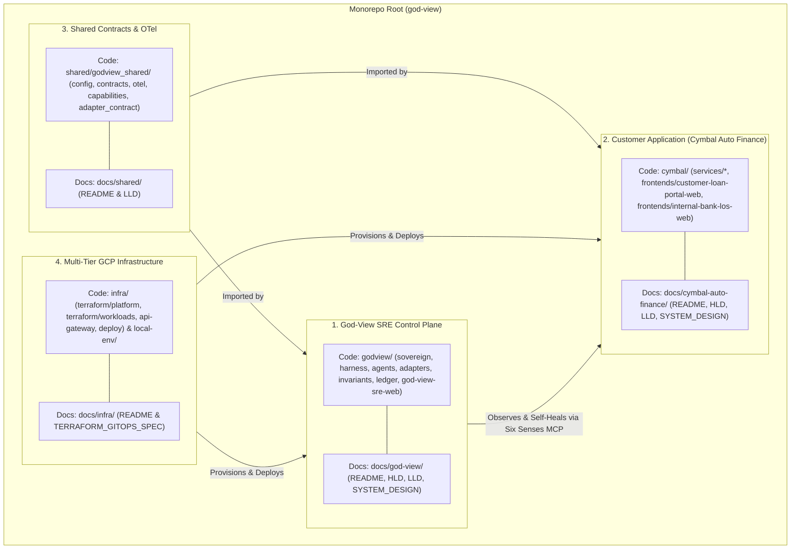
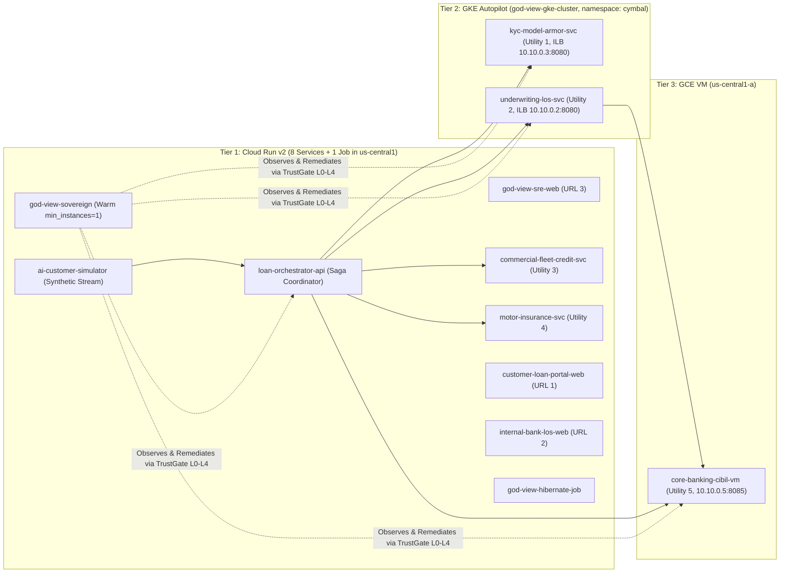

# God-View v4.0 + Harness² + Cymbal Auto Finance — Master Architecture Overview

**Document ID**: `GV-ARCH-v4.0`
**Version**: `4.0.0` (Harness² Recursive Agent Harness Integration)
**Target GCP Project**: `general-ak` (`769002985772`, `us-central1` / `us-central1-a`)
**Live Edge Domain**: `ak-demos.com` (`35.244.128.165`)
**Primary Reasoning & Harness Proposer Model**: `gemini-4-argon` (`global` endpoint), with automatic HTTP 429 / quota / reserve fallback to `gemini-3.8-flash` (`global` endpoint)

---

## 1. Repository & Documentation Separation Map

This repository is structured into **four strictly separated top-level planes**, each with its own dedicated source folder and its own dedicated documentation folder under `docs/`:

### 1.1 Folder-by-Folder Navigation Table

| Plane | Code Directory | Dedicated Docs Folder | Unified Master Docs |
| :--- | :--- | :--- | :--- |
| **God-View v4.0 + Harness² SRE Control Plane** | [`godview/`](file:///usr/local/google/home/kambleashish/Documents/Projects/god-view/godview) | [`docs/god-view/`](file:///usr/local/google/home/kambleashish/Documents/Projects/god-view/docs/god-view/README.md) ([HLD](god-view/HLD.md), [LLD](god-view/LLD.md), [System Design](god-view/SYSTEM_DESIGN.md)) | [Master HLD](HLD.md) · [Master LLD](LLD.md) · [Master System Design](SYSTEM_DESIGN.md) · [MCP & Agent Spec](GOD_VIEW_MCP_AGENT_SPEC.md) |
| **Customer Application (Cymbal Auto Finance)** | [`cymbal/`](file:///usr/local/google/home/kambleashish/Documents/Projects/god-view/cymbal) | [`docs/cymbal-auto-finance/`](file:///usr/local/google/home/kambleashish/Documents/Projects/god-view/docs/cymbal-auto-finance/README.md) ([HLD](cymbal-auto-finance/HLD.md), [LLD](cymbal-auto-finance/LLD.md), [System Design](cymbal-auto-finance/SYSTEM_DESIGN.md)) | [Master HLD](HLD.md) · [Master LLD](LLD.md) · [BRD](BRD.md) · [SDD](SDD.md) |
| **Shared Contracts & Telemetry** | [`shared/godview_shared/`](file:///usr/local/google/home/kambleashish/Documents/Projects/god-view/shared/godview_shared) | [`docs/shared/`](file:///usr/local/google/home/kambleashish/Documents/Projects/god-view/docs/shared/README.md) | [Master LLD §1.1](LLD.md) · [TDD](../TDD.md) |
| **Multi-Tier GCP Infrastructure & GitOps** | [`infra/`](file:///usr/local/google/home/kambleashish/Documents/Projects/god-view/infra), [`local-env/`](file:///usr/local/google/home/kambleashish/Documents/Projects/god-view/local-env) | [`docs/infra/`](file:///usr/local/google/home/kambleashish/Documents/Projects/god-view/docs/infra/README.md) | [Terraform & GitOps Spec](TERRAFORM_GITOPS_SPEC.md) · [Deploy Runbook](../DEPLOY_RUNBOOK.md) |

---

## 2. End-to-End Architectural Synthesis

### 2.1 The Three Live Production Portals (`ak-demos.com`)

| Portal URL | Cloud Run Service | Source Path | Auth & Ingress | Purpose |
| :--- | :--- | :--- | :--- | :--- |
| **`https://cymbal.ak-demos.com`** | `customer-loan-portal-web` | [`cymbal/frontends/customer-loan-portal-web/`](file:///usr/local/google/home/kambleashish/Documents/Projects/god-view/cymbal/frontends/customer-loan-portal-web) | Public HTTPS + Cloud Armor WAF + API Gateway (`god-view-loan-api-gw`) | Customer vehicle showroom, EMI/FOIR/LTV calculator, and 5-step loan origination wizard with live SSE step progress. |
| **`https://los.cymbal.ak-demos.com`** | `internal-bank-los-web` | [`cymbal/frontends/internal-bank-los-web/`](file:///usr/local/google/home/kambleashish/Documents/Projects/god-view/cymbal/frontends/internal-bank-los-web) | Google Cloud Identity-Aware Proxy (IAP) | Bank officer underwriting queue, GCS signed-URL KYC specimen vault, multi-utility ledgers, saga replay queue, and trace waterfall. |
| **`https://godview.ak-demos.com`** | `god-view-sre-web` | [`godview/god-view-sre-web/`](file:///usr/local/google/home/kambleashish/Documents/Projects/god-view/godview/god-view-sre-web) | Google Cloud Identity-Aware Proxy (IAP) | Autonomous SRE Cockpit: Six Senses organism view, Court Agent Living Models, Harness² `c1..c8` inspector, Sentinels, DFG journeys, incidents, L3/L4 approvals, cost/drift, and Chaos Drills Drawer. |

### 2.2 The 11 Deployed Services Across 3 Compute Tiers in `general-ak`

### 2.3 Harness² Recursive Agent Substrate Summary (`godview/harness/`)

Every Court Specialist Agent (`application`, `data`, `business_line`, `change`, `platform`) is powered by **Harness² (`arXiv:2610.14224`)** over `GODVIEW_SURFACE` (`c1..c8`):
- **Default Proposer & Reasoning Model**: **`gemini-4-argon` @ `global`**, with automatic fallback to **`gemini-3.8-flash` @ `global`** on HTTP 429/503 or `TokenBudgetGovernor` reserve exhaustion.
- **Level-1 Task Recursion**: Runs `INV` (invariant/guardrail tightening), `DOM` (domain skills/scripts), and `AGG` (cross-candidate synthesis) proposers within a per-incident `BudgetLedger` ($R = 4{,}000$ tokens, $P = 3{,}000$ tokens, `always_on_max = 12,000` chars).
- **Level-2 Harnessing Recursion**: Nightly at `03:30 IST` (`godview-agent-reflection`), `run_selection` and `reflect_adoption` consolidate winning `HarnessTree`s into `CloudSyncedLibrary` (`gs://general-ak-god-view-agent-skills/harness2/<domain>/` and Firestore `procedural_skills` + `court_agents/{domain}/living_model`).
