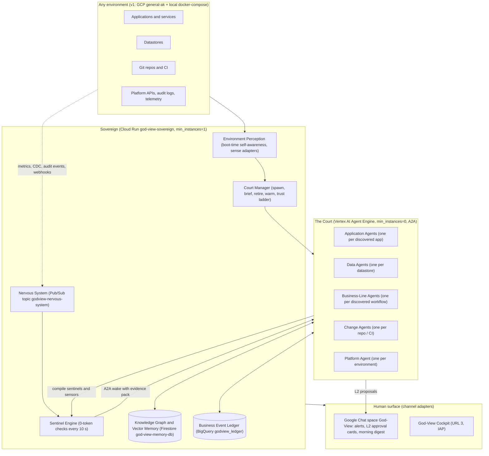
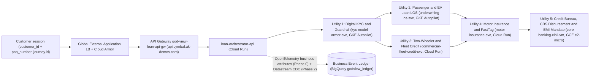

# Business Requirements Document (BRD): God-View — The Sovereign AI SRE Organism & its Cymbal Auto Finance Proving Ground

- **Document ID**: `GODVIEW-BRD-001`
- **Version**: `4.0 (Sovereign Organism — supersedes 3.0)`
- **Design Authority**: every decision, number, name, model and SLO in this document is taken from the validated v4 design (`GODVIEW-DESIGN-V4-ORGANISM`, 2026-10-16). Where that design is silent, the gap is listed in [Section 7](#7-open-points) rather than filled in.
- **Repository Root**: `/usr/local/google/home/kambleashish/Documents/Projects/god-view`
- **Target Environment (v1)**: GCP project `general-ak` (`769002985772`, `us-central1`) + a hermetic local docker-compose environment
- **Budget Ceiling**: \$600 / month all-in
- **Related Documents**:
  - [God-View v4 Design: The Sovereign SRE Organism (`plans/2026-10-16-god-view-organism-design.md`)](file:///usr/local/google/home/kambleashish/Documents/Projects/god-view/plans/2026-10-16-god-view-organism-design.md)
  - [System & Solution Design Document (`docs/SDD.md`)](file:///usr/local/google/home/kambleashish/Documents/Projects/god-view/docs/SDD.md)
  - [God-View Agent, MCP Mesh & Vector Skill Spec (`docs/GOD_VIEW_MCP_AGENT_SPEC.md`)](file:///usr/local/google/home/kambleashish/Documents/Projects/god-view/docs/GOD_VIEW_MCP_AGENT_SPEC.md)
  - [Terraform & GitHub GitOps Spec (`docs/TERRAFORM_GITOPS_SPEC.md`)](file:///usr/local/google/home/kambleashish/Documents/Projects/god-view/docs/TERRAFORM_GITOPS_SPEC.md)
  - [Master Technical Design Document & Swarm Playbook (`TDD.md`)](file:///usr/local/google/home/kambleashish/Documents/Projects/god-view/TDD.md)

---

## 1. Executive Summary & Vision

God-View is **a single agent that can be deployed into any company's environment, becomes aware of that environment on its own, grows a court of specialist agents that each come to understand one application the way its long-time owner would, and reasons across them as the company's sovereign operator.** Its differentiator is business- and workflow-logic intelligence: it detects what infrastructure tooling cannot — *HTTP 200, pods healthy, P95 fine, business broken* — and it repairs at the level of the business workflow, not only the pod. Infrastructure logs, metrics and traces are table stakes; God-View spends its LLM reasoning on the business semantics above them.

### 1.1 Why infrastructure-only observability fails a business

| # | Failure mode | What it looks like in a vehicle-finance platform |
| :-- | :-- | :-- |
| 1 | **Green-but-broken blindness** — golden signals say healthy while business rules are violated | Loans `APPROVED` with FOIR above the policy limit; the insurance service returns `200` but writes no policy; every bureau pull returns `900`. Every dashboard stays green. |
| 2 | **No notion of the workflow** — a journey is a trace, not a process | Steps skipped or reordered (insurance before KYC), journeys stuck between sanction and disbursement, ₹ at risk unknown. |
| 3 | **Change and causality blindness** — a KPI drift is never tied to the commit, config or deploy that caused it | A one-line threshold change in the rules engine moves the approval rate and nobody links the two; PRs are reviewed in code terms, never in business terms. |
| 4 | **Hand-wired and forgetful** — service maps, alert rules and dashboards are configured per service, break on every deploy, and remediation stops at the pod | Restarting a pod does not replay the disbursements that were stuck while it was down; nothing learned in one incident survives to the next. |

### 1.2 The two planes

| Plane | What it is | Where it runs (v1) | Role |
| :-- | :-- | :-- | :-- |
| **Plane A — Cymbal Auto Finance tenant** | A vehicle-finance super-app: five business utilities, two frontends, an API edge and one PostgreSQL system of record, built as a real-world production topology kept at the smallest sizes (no HA, no multi-zone), instrumented with OpenTelemetry business attributes and a synthetic-traffic marker; chaos drills re-centred on business-logic faults | `general-ak`: Global External Application LB + Cloud CDN + Cloud Armor + API Gateway + Cloud Run + GKE Autopilot + Compute Engine + Cloud SQL + GCS over private networking | The instrumented **proving ground**; pre-promoted to trust level L4 because it is ours and chaos-safe |
| **Plane B — God-View (the product)** | An **environment-neutral** Sovereign plus a court of specialist agents. The core speaks only open standards (OpenTelemetry, Prometheus `/metrics`, Kubernetes API, SQL `information_schema` + CDC, Git + OpenAPI / proto / JSON-schema, CloudEvents, A2A, MCP) and perceives the environment through discovered sense adapters | Sovereign on Cloud Run service `god-view-sovereign` (`min_instances=1`); court on Vertex AI Agent Engine (`min_instances=0`); Knowledge Graph & Vector Memory in Firestore Native DB `god-view-memory-db` (768-dim KNN); Business Event Ledger in BigQuery dataset `godview_ledger`; Nervous System on Pub/Sub topic `godview-nervous-system` | **Deployable anywhere with identity alone**; v1 proves GCP and a hermetic local docker-compose environment |

> [!IMPORTANT]
> Nothing in Plane B depends on Plane A. GCP resource names in this document describe the v1 proving ground and the v1 hosting choice; the product requirement is that the same core, unchanged, boots in any environment its identity can reach.

---

## 2. Target Personas & Surfaces

All tenant URLs are served by one Global External Application LB with Google-managed certificates on `ak-demos.com` subdomains (Cloud DNS zone `ak-demos-com`), fronted by Cloud Armor. Human channels are adapters of the organism, not part of its core.

| Surface | Address & access | Target persona | Business objectives |
| :-- | :-- | :-- | :-- |
| **URL 1** — `customer-loan-portal-web` (Cloud Run) | `cymbal.ak-demos.com`; public, CDN-accelerated | External retail / fleet customer; demo operator | Browse the Cloud CDN-served vehicle catalog (passenger EVs, SUVs, two-wheelers, commercial fleet); run a multi-utility journey in one session (KYC → loan → insurance / FastTag → e-Mandate and disbursement); fire manual single / burst / adversarial AI-customer triggers (the automatic stream itself runs 09:00–17:00 IST) |
| **URL 2** — `internal-bank-los-web` (Cloud Run) | `los.cymbal.ak-demos.com`; IAP | Bank credit underwriter, KYC auditor, operations officer | Live Loan Origination System queue across all five utilities; inspect specimen Aadhaar / PAN cards from `gs://general-ak-god-view-kyc-vault` with extracted identity fields; audit Model Armor text verdicts; review FOIR / LTV, bureau score, sanction letter, NACH e-Mandate, CBS UTR and policy issuance |
| **URL 3** — `god-view-sre-web` = **"God-View Cockpit"** (Cloud Run) | `godview.ak-demos.com`; IAP | CTO, VP of Engineering, SRE lead, enterprise executive | Organism org-chart (spawned agents, trust levels, warmth); each agent's living semantic model; Business Invariants board; Journey Explorer (process map, conformance, ₹ at risk); incident swarm transcripts; approvals inbox; change feed (PR reviews, canaries); cost & drift panel; chaos drills drawer (Cymbal only); Traffic Kill Switch red button |
| **Google Chat space "God-View"** | Chat app via the `channels` adapter; human-comms window 08:00–22:00 IST | On-call SRE, approvers, CTO | Incident alerts with narrative + evidence; L2 approval cards (Approve / Reject / Snooze); morning digest; kill-switch command; alerts outside the window are queued, Sev-1 pages only if explicitly enabled |

---

## 3. Multi-Utility Business Domain & Journeys

A single authenticated customer (`customer_id` + `pan_number`) executes one journey (`journey.id`) that fans out across **five distinct backend utilities**, orchestrated by `loan-orchestrator-api` behind API Gateway `god-view-loan-api-gw` (`api.cymbal.ak-demos.com`, OIDC to the orchestrator, SSE for live telemetry — no WebSocket through the gateway). The intended step order is **KYC < LOS < INS < CBS**. Every service emits OpenTelemetry business attributes (`decision`, `foir_pct`, `cibil_score`, `status_from/to`, `journey.id`, `customer.id`) that land in the Business Event Ledger from Phase 0; in Phase 2 the ledger is extended with zero-app-change Datastream CDC from Cloud SQL (every state transition with timing). Both feed the same partitioned tables (`events`, `state_transitions`, `journeys`, `kpi_rollups`), which are what God-View reasons over. God-View has **no prior knowledge** of any of this — it discovers it.

| Business utility | Service | Compute tier (smallest size, architecture never reduced) | Business transaction & data recorded |
| :-- | :-- | :-- | :-- |
| **Utility 1: Digital KYC & Guardrail** | `kyc-model-armor-svc` | GKE Autopilot (`god-view-gke-cluster`, private nodes + Cloud NAT; 0.25 vCPU / 512 MiB requests, 1 replica, internal LB Service) | Validates PAN (`[A-Z]{5}[0-9]{4}[A-Z]{1}`) and 12-digit Aadhaar fields; for 1 in 10 journeys verifies the specimen card PNGs in `gs://general-ak-god-view-kyc-vault`; runs **text-only Model Armor** on `loan_purpose_text`, `employment_remarks`, `applicant_notes` |
| **Utility 2: Retail Passenger & EV Loan LOS** | `underwriting-los-svc` | GKE Autopilot (same cluster and size) | Evaluates FOIR, LTV, vehicle depreciation tier and interest pricing for passenger cars and EVs; emits `decision` and `foir_pct` |
| **Utility 3: Commercial & Two-Wheeler Credit Line** | `commercial-fleet-credit-svc` | Cloud Run — **its own service** (1 vCPU / 512 MiB, min 0, max 3, concurrency 80, ingress internal + load balancer) | Working-capital vehicle top-ups, two-wheeler micro-loans, pre-closure / refinance for existing borrowers |
| **Utility 4: Motor Insurance & FastTag Add-On** | `motor-insurance-svc` | Cloud Run — **its own service** (same size) | Zero-depreciation comprehensive motor insurance, credit-shield cover, FastTag wallet linkage; writes the policy record and emits `insurance.issued` |
| **Utility 5: Credit Bureau & Core Banking Settlement** | `core-banking-cibil-vm` | Compute Engine `e2-micro` (10 GB standard disk, no external IP, egress via Cloud NAT, port 8085) | Legacy credit-bureau pull (score `300–900`), sanction letter, NACH e-Mandate registration, CBS NEFT / RTGS dealer disbursement with UTR |
| Orchestrator & system of record | `loan-orchestrator-api` → Cloud SQL `god-view-pg` | Cloud Run (same size); PostgreSQL 16, `db-g1-small`, single zone, no HA, private IP only, 10 GB SSD, daily backup, no PITR, `pg_stat_statements`, logical decoding on; credentials in Secret Manager | Journey state machine and step order; the transactional state that Datastream CDC replicates into the ledger from Phase 2 |

**Edge and network:** serverless NEGs to the Cloud Run frontends and API Gateway; a Cloud CDN backend bucket (`general-ak-god-view-cdn-assets`) for vehicle-catalog media; Cloud Armor WAF (SQLi, XSS, LFI / RFI) + per-IP rate limiting whose verdict stream feeds the abuse-semantics hero; HTTP→HTTPS redirect; custom-mode VPC with Private Service Access, Direct VPC egress for Cloud Run, least-privilege firewall rules; IAP on URL 2 and URL 3. GCS buckets: `general-ak-god-view-{kyc-vault,cdn-assets,agent-skills,tfstate}`. All AI-customer traffic carries `X-Synthetic: true` + `is_ai_generated=true`; probes are allowed only on these paths.

**Business-logic chaos drills (opt-in, Cymbal only, never a 24/7 rotation):** FOIR-threshold regression commit (60→40); insurance returns `200` but writes no policy; EMI rounding bug; bureau stub returns `900` for everyone; step-order bug (insurance before KYC) — all with infrastructure green — plus three infrastructure faults: Cloud SQL lock contention, GKE OOM / `503`, GCE VM latency / `504`.

---

## 4. Business Requirements Matrix

> [!NOTE]
> Models are the ones verified live in `general-ak` on 2026-10-16: every Gemini 3.x / 4 model resolves only at location `global`; `text-embedding-005` (768-dim), Model Armor, Firestore and Agent Engine stay in `us-central1`. Hero numbering follows the design (heroes 1, 2, 3, 5, 6, 7 — there is no hero 4).

| Req ID | Priority | Phase | Requirement | Business requirement description | Acceptance criteria |
| :-- | :-- | :-- | :-- | :-- | :-- |
| **BR-01** | P0 | 0 | **Continuous synthetic customer traffic inside the business window** | The Cymbal tenant is driven by an AI-customer stream of ≈ 300 journeys/day inside a fixed 09:00–17:00 IST window (≈ 37/hour, one every ~100 s), with realistic Indian borrower personas generated by `gemini-3.8-flash` (`global`, `thinking_level=LOW`). Only **1 in 10 journeys** carries Aadhaar / PAN images — live `gemini-nano-banana-2.1` (`global`), fallback `gemini-3-pro-image` (`global`) — watermarked `SPECIMEN · NOT A GOVERNMENT DOCUMENT`, checksum-invalid numbers, no official emblems; the other nine are text-only KYC. All AI-customer traffic carries `X-Synthetic: true` and `is_ai_generated=true`. Manual single / burst / adversarial triggers remain available on URL 1 and the Cockpit. | Per window the Business Event Ledger records ≈ 300 journeys with `is_ai_generated=true`, ≈ 1 in 10 with images, and 0 scheduler-originated journeys between 17:00 IST and 09:00 IST; every synthetic request carries the marker; image-bearing and text-only journeys both complete KYC. |
| **BR-02** | P0 | 0 | **Text-only Model Armor guardrail** | Model Armor (`us-central1`) inspects only the three applicant text fields `loan_purpose_text`, `employment_remarks`, `applicant_notes` for prompt injection and jailbreaks; specimen images are never scanned. The verdict stream is a first-class input to the abuse-semantics hero (BR-11). | Every adversarial text payload from the adversarial trigger is blocked and its verdict is visible in URL 2; Model Armor receives 0 image requests. |
| **BR-03** | P0 | 0 | **Zero-config environment perception and portability** | The Sovereign boots with **identity only** (ADC / workload identity / mounted secrets): no telemetry DSN, no service names, no topology map, no utility names; optional hints (repo URLs) only widen scope. Its self-awareness protocol answers *who am I → where am I → what senses do I have → what exists → who should watch it*, then re-perceives continuously (new service / table / repo → spawn; disappearance → retire with memory archived). Senses come from the adapter families `gcp` / `kubernetes` / `sql` / `git` / `channels` / `local`, each reporting `available / partial / unavailable` with evidence and never assuming each other (an Agent Registry is used only if discovered). Business roles are inferred with one batched `gemini-3.8-flash` call, embedded with `text-embedding-005` (`us-central1`) and persisted in the Knowledge Graph. | The same core, with no change beyond identity, boots in `general-ak` **and** in the local docker-compose environment (kind, local PostgreSQL, local Git) and discovers the topology, the five utilities and the loan journey in both; model + sentinels < 30 s, agents live ≤ 10 min; the adapter report shows each family's availability with evidence. |
| **BR-04** | P0 | 1 | **The court of specialist agents** | The Court Manager spawns long-lived agents on Vertex AI Agent Engine (`deployment_spec.min_instances=0`, A2A `AgentCard` / `AgentExecutor`): one **Application Agent** per discovered app, one **Data Agent** per datastore, one **Business-Line Agent** per discovered cross-app workflow, one **Change Agent** per repo / CI, one **Platform Agent** per environment. Each owns a living model, a private Memory Bank, a namespace in the shared Knowledge Graph, scoped tool bindings, a trust record, a daily reflection wake and an A2A card. An Application Agent perceives through **seven senses**: code (read-only repo), contracts (OpenAPI / API Gateway config, protos, schemas), synthetic interrogation (probe plans against probe-safe `X-Synthetic: true` endpoints to learn empirical decision boundaries), change-plane (Audit Logs, PRs, CI, tfstate), scoped observability, the Data Agent (read replica + Datastream CDC) and human docs / chat — nothing environment-specific is hardcoded. Collaboration: coordinator at rest, swarm under incident (exit at consensus ≥ 0.85, ≤ 4 rounds or ≤ 90 s), hierarchical + human-in-the-loop for remediation. Reasoning on `gemini-3.8-flash` (`global`, `thinking_level=MEDIUM`); escalation to `gemini-4-argon` (`global`) gated by the per-agent token budget. | The Cockpit org-chart shows one agent per discovered app / datastore / workflow / repo / platform with its trust level and warmth; adding a service to the tenant spawns an agent and removing it retires the agent with memory archived; every incident swarm transcript shows the exit condition that ended it. |
| **BR-05** | P0 | 0 | **Eyes vs brains — 0 LLM tokens at rest** | Monitoring never depends on an awake LLM. The **Sentinel Engine** inside the Sovereign (`min_instances=1`, ~1 vCPU) executes compiled checks every 10 s — invariant SQL over the ledger, KPI change-point tests, journey conformance, probe plans, golden-signal gates — and keeps in-flight journey state and baselines. **Platform-native sensors** authored by agents (Monitoring alert policies, log-based metrics, uptime checks, BigQuery scheduled queries, Cloud Scheduler probes, GitHub webhooks, Audit-Log sinks) feed the Nervous System. Agents are woken over A2A **with an evidence pack** (what fired, since when, correlated changes, affected journeys and ₹). Freshness is event-driven (commit, deploy audit event, CDC schema change). God-View never reads telemetry from the patient's database; no bulk log streaming into an LLM in the resting loop, while bounded, filtered log / trace queries are legitimate during an investigation. **Earned warmth**: the Sovereign PATCHes `min_instances=1` (1 vCPU / 2 GiB) for the 2–3 hottest agents during 09:00–17:00 IST or after repeated incidents, and back to 0 outside it. A Monitoring uptime check + heartbeat alert watches the watcher. | During healthy operation the token-spend KPI for monitoring is 0 for every agent; MTTD ≤ 15 s on the instrumented tenant and ≤ 4 min on platform-metric-only services; every wake carries an evidence pack; a Sovereign outage pages via Chat / email; the Cloud SQL lock-contention drill leaves the Sovereign's sentinels unaffected. |
| **BR-06** | P0 | 1 | **Hero 1 — LLM-authored business invariants** | Application and Data Agents read code, schema and policy text and author `INVARIANT.md` files (YAML frontmatter: scope, SQL / Python check, severity, wake condition, provenance), versioned in Git, indexed in Firestore and compiled into the Sentinel Engine. Examples: `APPROVED ⇒ foir ≤ 60 ∧ cibil ≥ 680`; `disbursement ⇒ sanction_letter ∧ audit.decision = APPROVED`; `insurance ⇒ loan.status ∈ {APPROVED, DISBURSED}`; step order `KYC < LOS < INS < CBS`. Daily reflection retires stale invariants and proposes new ones. | The FOIR-threshold regression drill is caught as an invariant breach while infrastructure is green, with a causal link to the PR; the Business Invariants board shows status, provenance and history for every invariant; false-positive business alerts stay < 5 % of alerts/week. |
| **BR-07** | P0 | 1 | **Hero 2 — Workflow conformance (process mining)** | The Business-Line Agent mines the directly-follows graph per `journey.id` from the ledger, derives the *intended* process from code, and flags skipped or reordered steps, loops, dwell-time anomalies and cohort stalls; conformance checks and stuck-journey detectors are compiled into sentinels. | "Insurance returns `200` but writes no policy" is flagged because journeys complete without `insurance.issued`, and "insurance before KYC" is flagged as a step-order violation — both with infrastructure green; the Journey Explorer shows the process map, conformance and ₹ at risk per cohort. |
| **BR-08** | P0 | 1 | **Hero 3 — Business-KPI change-point with causal explanation** | Sentinels run CUSUM / z-score tests on approval rate, step conversion, ticket size and ₹/hour against same-hour baselines at 0 tokens; on breach the swarm correlates with commits, config / audit events, infrastructure incidents and data drift and produces a quantified narrative (cause, affected journeys, ₹ impact). | "Bureau stub returns `900` for everyone" is detected as an approval-rate change-point with a moved decision-boundary probe; the EMI rounding bug is detected as KPI drift in the EMI / ticket distribution plus a breach of `emi = f(principal, rate, tenure) ± 1`; each narrative names the cause; MTTI ≤ 60 s on the recall path. |
| **BR-09** | P1 | 2 | **Hero 5 — Change intelligence: PR risk review + business canary** | The Change Agent reviews PRs in business language before merge (risk, affected journeys, suggested canary) through `github-mcp`, correlates deploy audit events with incidents, and after each deploy runs a **business canary** (KPIs + invariants inside the canary window). Rollback is a PR, never a direct push: `get_commit` → `get_file_contents` → `create_branch` → `push_files` → `create_pull_request`. Large diffs may escalate to `gemini-4-argon` within the token budget. | The FOIR regression PR receives a business-language risk review before merge; its business canary fails after deploy; a rollback PR is opened via `github-mcp`; the change feed shows review, canary and rollback. |
| **BR-10** | P1 | 2 | **Hero 6 — Business remediation: saga replay / compensation** | The Business-Line Agent plans saga replay or compensation (for example replaying stuck disbursements after CBS recovery) through **allowlisted application admin APIs discovered from contracts**, gated by the Trust Ladder — money movement stays ≤ L2 unless whitelisted. Every action records evidence, actor (agent + trust level + approver), a reversal recipe and an audit entry; successful remediations are written back as `SKILL.md` files (`gs://general-ak-god-view-agent-skills`) and postmortem notes. | After the GCE VM latency / `504` drill recovers, stuck disbursements are queued and replayed after a 1-click approval; KPIs and invariants are verified to recover; a `SKILL.md` and a postmortem note appear in the Cockpit. |
| **BR-11** | P1 | 2 | **Hero 7 — Data-integrity and abuse semantics** | The Data Agent compiles integrity SQL (orphans, duplicates, loans `DISBURSED` without a policy), velocity rules (same PAN × N), injection-attempt clustering over the Model Armor verdict stream and Cloud Armor verdicts, and PII-in-logs detectors into 0-token sentinels. | The "200 but no policy" drill also surfaces as an integrity breach (`DISBURSED` without policy); an adversarial burst is clustered into one abuse incident naming the offending PANs / IPs; a PII-in-logs finding wakes the Data Agent. |
| **BR-12** | P0 (L0–L2), P1 (L3–L4) | 1–2 | **Earned-autonomy Trust Ladder with hard rules** | Authority is earned **per agent and per action type**: L0 Observe (default; read-only, no writing probes) → L1 Recommend (after self-consistency checks) → L2 Act-with-approval (after N₁ = 3 correct recommendations; 1-click card in Chat / Cockpit) → L3 Autonomous reversible infra (after N₂ = 5 approved executions with verified outcomes and 0 regressions: restart revision, scale back, terminate blocking PID, restore tfstate attribute) → L4 Autonomous business actions (after N₃ = 10 L3 / L2 successes **and** an explicit whitelist per action type). Instant demotion on any bad outcome; global kill switch; blast radius = 1 resource per action; every action logged with evidence and a reversal recipe. **Hard rules**: money movement and customer communications capped at L2 unless whitelisted; synthetic probes only through a discovered synthetic marker or non-prod endpoints; no mutations on resources the environment owner has excluded — in the shared `general-ak` project, chaos and remediation are allowlisted to resources labelled `godview_managed="true"` (tenant `cymbal` or `godview`, per the Terraform & GitHub GitOps Spec), and discovery classifies everything else as `other_read_only` rather than `journey_linked` (per the Agent Spec). Identity split: `godview-sense-sa` (read-only senses) vs `godview-act-sa` (impersonated only for approved / eligible actions). The Cymbal tenant starts at L4. | The Cockpit shows the trust level per agent per action type; in the FOIR incident the L3 step (rollback) executes autonomously while the L4 step (re-evaluate the affected applications) produces an approval card; a bad outcome demotes the agent instantly; no action exists without evidence, actor and reversal recipe; nothing mutates outside the permitted scope. |
| **BR-13** | P0 | 0–2 | **Duty cycle and cost governance** | **Scheduled Pause (17:00–09:00 IST)**: Cloud Scheduler flips the tenant to *paused* at 17:00 IST and back at 09:00 IST (daily by default; weekdays-only is a flag) — AI-customer scheduler off, chaos off, hot agents back to `min_instances=0`; the LB keeps serving manual traffic; sentinels keep watching at 0 tokens. **Traffic Kill Switch**: one IAM-only control (`POST /v1/tenant/kill-switch`, Cockpit red button, Chat command) usable any time — halts the AI-customer scheduler immediately, the orchestrator rejects new transactions with `503 TENANT_PAUSED` at ingress (Cloud Armor may additionally deny all but allowlisted IPs), chaos drills pause, in-flight journeys may drain; God-View annotates it as a planned operator action. **Hibernate**: cost floor for multi-day idle periods — GKE deployments → 0 replicas, VM stopped, Cloud SQL `activation_policy=NEVER`, Cloud Run scale-to-zero, all agents `min_instances=0`, sentinels throttled to 60 s; LB / Armor / DNS stay up so URLs never change; the Sovereign stays up. **Budget**: hard ceiling \$600 / month; GCP Budget alerts at 50 / 80 / 100 %; per-agent daily token budgets enforced by the Sovereign; cost is a first-class signal reported by the Platform Agent (for example idle Reasoning Engines); levers: pre-generated specimen pool (−\$60–110), weekdays-only traffic (−20 %). | Active month ≈ \$305–485, hibernated month ≈ \$100–165, never above the ceiling; kill switch → new transactions refused with `503 TENANT_PAUSED` immediately and no incident raised for the traffic drop; Hibernate wake-up ≈ 5–8 min with unchanged URLs; an agent that exhausts its daily token budget degrades to L1 and is shown as such on the Cockpit. |
| **BR-14** | P0 | 0–1 | **Human surface** | Channels are adapters. **Google Chat space "God-View"**: incident alerts with narrative + evidence, L2 approval cards (Approve / Reject / Snooze), morning digest; respects 08:00–22:00 IST (queued outside the window; Sev-1 pages only if explicitly enabled). **God-View Cockpit** (URL 3, IAP, rebuilt around the organism): organism org-chart, living semantic models, Business Invariants board, Journey Explorer, incident swarm transcripts, approvals inbox, change feed, cost & drift panel, chaos drills drawer (Cymbal only). No public mutation endpoints anywhere — chaos, replay and reconcile are A2A / IAM-only. | An approval card in Chat completes the incident lifecycle end to end (Approve → execute → verify recovery → postmortem + trust-record update); an alert raised at 23:00 IST is queued until 08:00 IST unless Sev-1 paging is enabled; URL 3 is unreachable without IAP; every mutation endpoint rejects unauthenticated public calls. |

**Tooling honesty (binds BR-05, BR-09, BR-10, BR-12).** Agents reach the environment through a **capability adapter layer** that maps capability names to real tools or SDK calls; the catalogue never invents tool names.

| Real tool surface | Tools God-View calls as-is | Capabilities God-View adds in its capability adapter layer (labelled as such) |
| :-- | :-- | :-- |
| `observability-mcp` | `list_log_entries`, `list_timeseries`, `list_traces`, `get_trace` | Bounded, filtered exemplar-trace and golden-signal queries; `/metrics` pull-scrape by the Sovereign |
| `gke-mcp` | `list_clusters`, `get_cluster`, `get_k8s_resource`, `query_logs`, `get_log_schema`, `list_recommendations` | Rollout restart and scale-back through the Kubernetes API (L3) |
| MCP Toolbox for Databases (postgres prebuilt) | `list_tables`, `execute_sql`, `list_active_queries`, `get_query_plan` | Blocking-tree inspection and `pg_terminate_backend` via `execute_sql` (L3); integrity SQL; CDC via Datastream |
| `github-mcp` | `list_commits`, `get_commit`, `get_file_contents`, `create_branch`, `push_files`, `create_issue`, `create_pull_request` | Business-language PR review; the five-call rollback-PR recipe; GitHub webhooks into the Nervous System |
| Terraform | `terraform-mcp` for registry / provider documentation only — it is registry-docs / HCP-only and offers **no drift detection and no `apply`** | tfstate-vs-live attribute diff from `gs://general-ak-god-view-tfstate`; fast API restore (≤ 45 s API call, inside the ≤ 90 s Hot-fix MTTR SLO of §5.1); authoritative `terraform apply` via GitHub Actions `workflow_dispatch` under Workload Identity Federation |

---

## 5. KPIs & SLOs

### 5.1 Service-level objectives (design §13)

| SLO | Target | Condition |
| :-- | :-- | :-- |
| Cold-start perception → court spawned | model + sentinels < 30 s; agents live ≤ 10 min | Agent Engine deploy time |
| MTTD (instrumented tenant) | ≤ 15 s | Sentinel cadence 10 s |
| MTTD (platform-metric-only services) | ≤ 4 min | Cloud Monitoring ingestion lag |
| MTTI (recall path) | ≤ 60 s | includes agent cold start |
| Hot-fix MTTR (L3 API-level) | ≤ 90 s | — |
| IaC reconcile | ≤ 8 min | GitHub Actions apply |
| False-positive business alerts | < 5 % of alerts/week | invariant provenance + reflection pruning |

### 5.2 Business KPIs the God-View Cockpit must show

| Cockpit KPI | Definition | Source | What it governs |
| :-- | :-- | :-- | :-- |
| Journey completion rate | Journeys reaching CBS disbursement ÷ journeys started, per window and cohort | Business Event Ledger `journeys` | Conformance and stuck-journey detectors (BR-07) |
| Approval rate | `APPROVED` decisions ÷ all decisions, per utility (U2 / U3) | Ledger `events` (`decision`), `kpi_rollups` | CUSUM / z-score change-point vs same-hour baseline (BR-08) |
| ₹ at risk | Sum of principal of journeys stuck, failed or affected by an open incident | Ledger `journeys` + the Business-Line Agent's ₹ impact model | Alert narratives, approval cards, Journey Explorer |
| Invariant breach count | Breaches per invariant per window, with provenance | Sentinel Engine results indexed in the Knowledge Graph | Business Invariants board; false-positive SLO |
| MTTD / MTTI / MTTR by path | Instrumented vs platform-metric-only; recall vs novel; L3 hot-fix vs IaC reconcile | Episodic incident records in the Knowledge Graph | The SLOs in §5.1 |
| Token spend per agent per day | LLM tokens consumed per agent against its daily budget, and 0 at rest for monitoring | Sovereign budget enforcement | Degrade-to-L1 rule (BR-13); eyes-vs-brains proof (BR-05) |

---

## 6. Phasing & Out-of-Scope

### 6.1 Phases (design §15)

| Phase | Scope | Exit criteria |
| :-- | :-- | :-- |
| **0 — Foundations** | Environment Perception + adapter contract (`gcp`, `kubernetes`, `sql`, `git`, `channels`, `local`); Sovereign with Sentinel Engine + Nervous System; Knowledge Graph + Business Event Ledger; Cymbal tenant v2 with business attributes + synthetic marker; local docker-compose environment; IAP Cockpit skeleton; Chat adapter | Boot with identity only → topology + journeys discovered in both environments; sentinels running; Chat alert delivered |
| **1 — The court & heroes 1–3** | Court Manager spawning Agent Engine agents (Application / Data / Change / Platform / Business-Line); living models; `INVARIANT.md` authoring + compilation; process mining; KPI change-points; incident swarm with exit conditions; Trust Ladder L0–L2; business-logic chaos drills | All 5 business-logic drills caught with infrastructure green; approvals flow works end to end |
| **2 — Act & learn** | Heroes 5–7; Datastream CDC; Trust Ladder L3–L4 with trust records; earned warmth; `SKILL.md` skills; postmortems; cost intelligence; tfstate drift engine | Replay of stuck disbursements executed after approval; L3 auto-remediation verified on the infrastructure drills |
| **3 — Deferred** | Policy⇄code⇄runtime 3-way drift with a regulators agent; natural-language "ask-the-business" console; additional chat, Git-hosting and relational-database adapters; a second cloud | — |

### 6.2 Out of scope for v1

- Phase 3 deferrals above: policy⇄code⇄runtime 3-way drift, the natural-language console, further adapters, other clouds.
- High availability or multi-zone anything; 24/7/365 synthetic traffic; a 24/7 chaos rotation (drills are opt-in and Cymbal-only).
- Drift detection or `terraform apply` through `terraform-mcp` (registry-docs / HCP-only); WebSocket through API Gateway (SSE instead); public `*.run.app` URLs as the product surface; public mutation endpoints of any kind.
- Telemetry tables inside the business Cloud SQL (God-View never reads from the patient); bulk log streaming into LLMs in the resting loop.
- Model Armor on images; realistic government documents of any kind — only watermarked, checksum-invalid specimen cards.

---

## 7. Open Points

Items the v4 design is silent on and this BRD therefore does not decide:

1. **Morning digest delivery time** inside the 08:00–22:00 IST window.
2. **Tenant-level SLOs retired from v3.0** (end-to-end journey P95 latency, transaction availability) — design §13 lists none; confirm whether the Cockpit should still show them as informational KPIs.

Resolved by sibling documents rather than by the design, and therefore not open: the blast-radius allowlist (`godview_managed="true"` labels and `journey_linked` / `other_read_only` discovery classification — Terraform & GitHub GitOps Spec, Agent Spec; see BR-12), the Git home of `INVARIANT.md` files (Agent Spec), and the `kpi_rollups` schema together with ledger partitioning and retention (Agent Spec, TDD).
