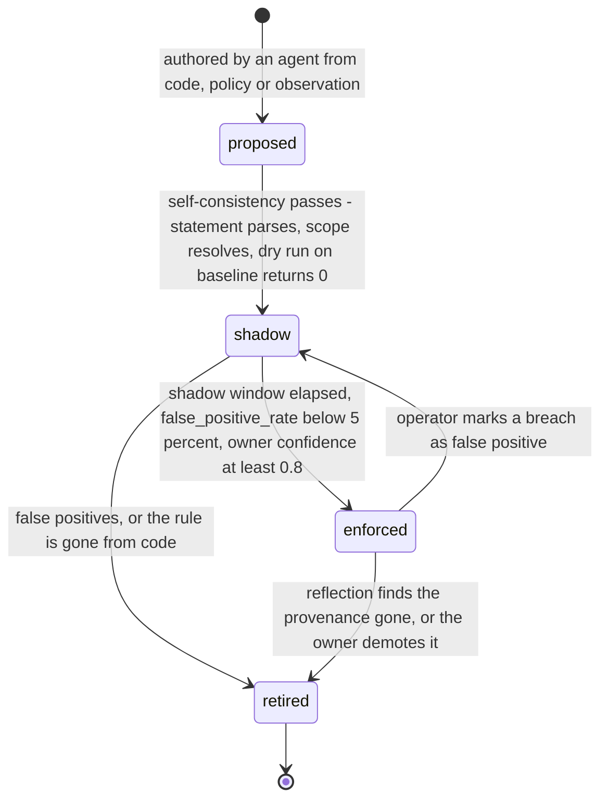
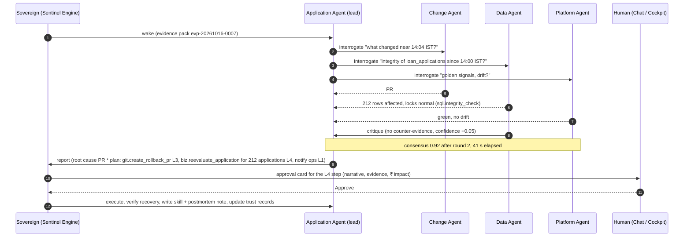

# God-View Agent Specification: Sovereign, Court Agents, Senses, Trust Ladder, Invariants & Swarm Protocol

- **Document ID**: `GODVIEW-AGENT-SPEC-003`
- **Version**: `4.0 (Sovereign Organism — supersedes 3.0)`
- **Repository Root**: `/usr/local/google/home/kambleashish/Documents/Projects/god-view`
- **Design authority**: [2026-10-16-god-view-organism-design.md](file:///usr/local/google/home/kambleashish/Documents/Projects/god-view/plans/2026-10-16-god-view-organism-design.md) (`GODVIEW-DESIGN-V4-ORGANISM`) — where this document and the design disagree, the design wins.
- **Runtime summary**: Sovereign = Cloud Run service `god-view-sovereign` (`min_instances=1`, 1 vCPU); court agents = Vertex AI Agent Engine (`deployment_spec.min_instances=0`, A2A `AgentCard` / `AgentExecutor`, Sessions + Memory Bank); brain = Firestore Native DB `god-view-memory-db` (768-dim KNN, `text-embedding-005` @ `us-central1`); ledger = BigQuery dataset `godview_ledger` (`events`, `state_transitions`, `journeys`, `kpi_rollups`); reasoning = `gemini-3.8-flash` @ `global` (`thinking_level=MEDIUM`); escalation = `gemini-4-argon` @ `global`.
- **Related Documents**:
  - [Business Requirements Document (`docs/BRD.md`)](file:///usr/local/google/home/kambleashish/Documents/Projects/god-view/docs/BRD.md)
  - [System & Solution Design Document (`docs/SDD.md`)](file:///usr/local/google/home/kambleashish/Documents/Projects/god-view/docs/SDD.md)
  - [Terraform & GitHub GitOps Spec (`docs/TERRAFORM_GITOPS_SPEC.md`)](file:///usr/local/google/home/kambleashish/Documents/Projects/god-view/docs/TERRAFORM_GITOPS_SPEC.md)
  - [Master Technical Design Document & Swarm Playbook (`TDD.md`)](file:///usr/local/google/home/kambleashish/Documents/Projects/god-view/TDD.md)

## 1. Zero-Config Perception Contract

God-View is deployed with **identity only**. No service names, telemetry DSNs, repository lists or registry endpoints are configured; the Sovereign infers everything from what its credentials can reach, following the six-step self-awareness protocol of design §3.

| Credential / signal the Sovereign already has | What it infers (adapter family) | Evidence recorded |
| :-- | :-- | :-- |
| ADC / workload identity of `godview-sense-sa` | Project id and number (metadata server, token info); reachable APIs via `testIamPermissions`-style probes per adapter (`gcp`) | per-adapter health `available / partial / unavailable` |
| Cloud Asset Inventory, Cloud Run v2, GKE, Compute, Cloud SQL Admin, API Gateway, GCS, Pub/Sub, BigQuery, Firestore, Agent Engine listings; Kubernetes service account / cluster credentials | Topology candidates: services, workloads, VMs, databases, buckets, gateways, Reasoning Engines (`gcp`); cluster, namespaces, Deployments, Services, events, metrics-server, Prometheus scrape targets (`kubernetes`) | `discovered_services` with `locator` + `labels` |
| Secret Manager secrets and container env the identity may read | SQL DSNs → `information_schema`, `pg_stat_*`, logical-decoding availability (`sql`) | kind `cloud_sql`, `discovered_entities` |
| Container image labels, CI provenance, tfstate objects, Git remotes | Repositories and CI (`git`) | `repo_ref`, `tf_address` |
| Google Chat app installation, email identity | Human channels and the 08:00–22:00 IST operating window (`channels`) | channel adapter health |
| Docker socket, kind kubeconfig, local Postgres, local Git | The hermetic local environment (`local`) | same documents, `env_id = local-compose` |
| **Agent Registry** | Reported **only if the adapter finds one**; when present, court agents are auto-catalogued there; when absent, `court_agents` in Firestore is the registry of record | adapter health `available / unavailable` |

**Optional hints only widen scope.** `GODVIEW_HINT_REPO_URLS` (extra repository URLs; the only hint named in TDD I-02) and `GODVIEW_HINT_EXCLUDE` (resource patterns the environment owner excludes from any mutation; proposed, §12) are the only accepted hints; neither is required and neither may narrow discovery.

> [!IMPORTANT]
> **Nothing environment-specific is hardcoded.** No file under `godview/sovereign/`, `godview/agents/`, `godview/adapters/` or `shared/` may contain a tenant service name, table, route, repository, project id or registry endpoint. Adapters never assume each other exists; **an agent registry is discovered, never assumed**; model ids and locations come from one config object (`gemini-3.8-flash` @ `global`, `text-embedding-005` @ `us-central1`), never from prompts. The Cymbal Auto Finance tenant is simply the first environment the organism happens to perceive.

Perception output: `discovered_services`, `discovered_edges`, `discovered_entities` and (once the ledger has traffic) `journeys` populated; business roles inferred with **one batched** `gemini-3.8-flash` call plus one batched embedding call; Court Manager spawn plan emitted. SLO: model + sentinels < 30 s, agents live ≤ 10 min (design §13).

## 2. Sovereign Internals

One Cloud Run service, four organs (Environment Perception, Sentinel Engine, Nervous System, Court Manager) over two stores (Knowledge Graph & Vector Memory, Business Event Ledger). It spends **0 LLM tokens at rest**: tokens are spent only by woken court agents and by the batched role-inference call at perception time.

### 2.1 Sentinel Engine

| Check class | Compiled from | Runs against | Breach example |
| :-- | :-- | :-- | :-- |
| `invariant_sql` | `INVARIANT.md` (dialect `bigquery` / `postgres` / `python`) | `godview_ledger` tables; read-only SQL on the datastore; in-process journey state | `APPROVED ⇒ FOIR ≤ 60 ∧ CIBIL ≥ 680` violated 14× in 5 min |
| `kpi_changepoint` | Business-Line / Application Agent KPI definitions | `godview_ledger.kpi_rollups` — CUSUM and z-score vs same-hour baseline | approval rate 71 % → 38 % |
| `journey_conformance` | Business-Line Agent process model (directly-follows graph, intended order) | in-flight journey state + `godview_ledger.state_transitions` | insurance step before KYC; journeys completing without `insurance.issued` |
| `probe_plan` | Application Agent probe plans (§5.2) | `probe_safe` routes with the synthetic marker | FOIR decision boundary moved 60 → 40 |
| `golden_signal_gate` | Platform Agent SLOs | Sovereign pull-scrape of every discovered `/metrics` endpoint every 10 s; `list_timeseries` for platform-metric-only services | p95 > 3.5 s, 5xx > 2 % |
| `drift_diff` | Platform Agent curated attribute set | tfstate in `gs://general-ak-god-view-tfstate` vs live attributes via GCP / Kubernetes APIs (≤ 60 s) | `max_instances` 3 → 10 on a Cloud Run service |
| `budget` | Court Manager token budgets; GCP Budget alerts 50 / 80 / 100 % | per-agent token counters; billing export | agent exhausted its daily budget → degraded to L1 |
| `discovery` | perception itself (design §3 step 6) | adapter list calls + Audit-Log create / delete events | new Cloud Run service → spawn; service gone → retire |

- **Cadence**: 10 s default (MTTD ≤ 15 s on the instrumented tenant); `drift_diff` ≤ 60 s; every class throttled to 60 s under Hibernate; `discovery` is event-driven from Audit Logs plus a periodic sweep.
- **Baseline model**: same-hour-of-day baselines (mean, stddev, CUSUM state) per KPI and golden signal, held in Sovereign memory and persisted on `sentinels.baseline`; in-flight journey state lives in memory and is rebuilt from the ledger on restart. Probe rows (`source = 'probe'` in the ledger) never enter baselines.
- **Wake condition**: `{operator, threshold, consecutive, window_s}` with hysteresis; one open incident per sentinel; breaches inside a window annotated as a *planned operator action* (Traffic Kill Switch, Scheduled Pause, Hibernate, opt-in chaos drill, operator note) are recorded but never wake an agent; a sentinel compiled from a `shadow` invariant runs and records results but cannot wake anyone (§7.3).

### 2.2 Nervous System (Pub/Sub topic `godview-nervous-system`)

Everything that is not a pull-scrape arrives as a CloudEvent on one topic; the Sovereign is the only subscriber and fans out internally.

| Family | `type` values (prefix `godview.`) | Producer |
| :-- | :-- | :-- |
| `sensor` | `sensor.alert`, `sensor.uptime`, `sensor.log_metric` | Monitoring alert policies, uptime checks, log-based metrics authored by agents |
| `webhook` | `webhook.github.push`, `webhook.github.pull_request`, `webhook.github.workflow_run` | GitHub webhooks (git adapter endpoint) |
| `audit` | `audit.config_change`, `audit.iam_change` | Cloud Audit Logs sink (Cloud Run, GKE, Compute, Cloud SQL, IAM) |
| `cdc` | `cdc.schema_change`, `cdc.row_batch` | Datastream → BigQuery (Phase 2), surfaced by the Data Agent |
| `schedule` | `schedule.reflection`, `schedule.pause`, `schedule.resume`, `schedule.probe` | Cloud Scheduler jobs `godview-agent-reflection`, `godview-tenant-pause`, `godview-tenant-resume`, `godview-probe-run` |
| `sentinel` | `sentinel.breach`, `sentinel.recovered` | Sentinel Engine (internal) |
| `court` | `court.spawn`, `court.retire`, `court.warm` | Court Manager (internal) |
| `operator` | `operator.kill_switch`, `operator.hibernate`, `operator.note` | Sovereign control API, Chat commands |

```json
{"specversion": "1.0", "type": "godview.webhook.github.push", "source": "//adapters/git/github/<owner>/god-view",
 "id": "a1b2c3d-push", "time": "2026-10-16T14:04:12+05:30", "subject": "refs/heads/main",
 "data": {"sha": "a1b2c3d", "pr_number": 42, "files": ["cymbal/services/underwriting-los-svc/app/rules_engine.py"]}}
{"specversion": "1.0", "type": "godview.sentinel.breach", "source": "//sovereign/sentinel-engine",
 "id": "snt-invariant_sql-approved-implies-foir-and-cibil:20261016T140510", "time": "2026-10-16T14:05:10+05:30", "subject": "inv-approved-implies-foir-and-cibil",
 "data": {"consecutive": 3, "observed": {"count": 14, "window_s": 300}, "evidence_pack_id": "evp-20261016-0007"}}
```

### 2.3 Court Manager

| Rule | Behaviour |
| :-- | :-- |
| Spawn | One Application Agent per discovered app, one Data Agent per datastore, one Change Agent per repository / CI, one Business-Line Agent per discovered cross-app workflow (once journeys exist in the ledger), one Platform Agent per environment. Deploys the type template (§4) on Agent Engine with `min_instances=0`, writes `court_agents/{id}`, publishes the A2A card; catalogues in an Agent Registry **only if one was discovered** |
| Brief | First wake = A2A `brief` with namespace, subject locator, bound capabilities and trust records (all L0 in a new environment; the Cymbal tenant is pre-promoted to L4) |
| Retire | Subject absent from discovery for the retire grace window → `retiring`: its sentinels are retired, its Memory Bank is consolidated into the knowledge-graph namespace, state `archived` (memory kept) |
| Warmth | All agents `min_instances=0`. Inside the tenant traffic window (09:00–17:00 IST) or after repeated incidents the Court Manager PATCHes `deployment_spec.min_instances=1` (1 vCPU / 2 GiB) for the **2–3 hottest** agents (ranked by `wakes_7d`) and back to 0 at 17:00 IST, under Hibernate, or when the budget sentinel fires |
| Reflection | One off-peak wake per agent per day (`schedule.reflection`): consolidate Memory Bank → knowledge graph, re-probe boundaries, retire stale invariants, propose new ones |

### 2.4 Token-budget governor

Every court agent carries `token_budget_daily` (set by the Court Manager; defaults in §12) and `tokens_spent_today`; the Sovereign meters every wake. At 100 % the agent is **degraded to L1** for the rest of the day (recommend only, no execution, no escalation). Escalation to `gemini-4-argon` is permitted only when `budget.escalation_allowed` is true in the evidence pack (remaining budget ≥ the estimated escalation cost). GCP Budget alerts at 50 / 80 / 100 % of the $600 / month ceiling arrive as `sensor.alert` events and progressively disable warmth, then escalation, then all non-incident wakes; cost is a first-class signal.

## 3. Knowledge Graph & Vector Memory (`god-view-memory-db`)

Three memories, one Firestore Native database, every vector field 768-dim `text-embedding-005` (`us-central1`) behind a COSINE KNN index. Each court agent writes only inside its namespace (`namespace == agent_id` on documents it owns) and reads the whole graph.

| Memory | Collection | Document id | Key fields | Vector field |
| :-- | :-- | :-- | :-- | :-- |
| Semantic | `discovered_services` | `{env_id}__{kind}.{name}` | `env_id`, `name`, `kind` (`cloud_run` / `gke_workload` / `gce_vm` / `cloud_sql` / `api_gateway` / `bucket` / `reasoning_engine` / `other`), `adapter_family`, `locator`, `labels{}`, `inferred_role`, `role_confidence`, `classification` (`journey_linked` / `other_read_only`), `routes[]`, `metrics_endpoint`, `repo_ref`, `tf_address`, `owner_agent_id`, `first_seen`, `last_seen`, `status` | `purpose_embedding` |
| Semantic | `discovered_edges` | `{src_service_id}__to__{dst_service_id}` | `src`, `dst`, `protocol`, `evidence` (`trace` / `code` / `config` / `k8s`), `call_rate_baseline`, `first_seen`, `last_seen` | — |
| Semantic | `discovered_entities` | `{env_id}__{entity}` | `name`, `correlation_keys[]`, `tables[]`, `owning_service_id`, `states[]`, `transitions[]`, `rules_ref[]`, `provenance` | — |
| Semantic | `journeys` | `{journey_key}` | `name`, `steps[]`, `directly_follows{}`, `intended_order_source`, `conformance_rules[]`, `funnel_kpis[]`, `rupee_impact_model{}`, `owner_agent_id`, `status` | — |
| Semantic | `court_agents` | `{agent_type}__{subject_key}` | `agent_type`, `subject_ref`, `reasoning_engine`, `a2a_card_url`, `state` (`perceived` / `spawning` / `learning` / `sentinel_compiled` / `sleeping` / `awake` / `retiring` / `archived`), `warmth_min_instances`, `memory_bank_id`, `namespace`, `token_budget_daily`, `tokens_spent_today`, `last_wake_at`, `last_reflection_at`, `wakes_7d`, `spawned_at`, `retired_at`; subcollection `living_model/{rules, state_machines, decision_boundaries, routes, dependencies, feature_flags, commit_diffs}` | — |
| Semantic | `trust_records` | `{agent_id}__{action_type}` | `level` (0–4), `counters{recommendations_correct, approved_executions, verified_outcomes, regressions, business_successes}`, `thresholds{n1: 3, n2: 5, n3: 10}`, `whitelisted`, `last_promoted_at`, `last_demoted_at`, `demotion_reason`, `history[{at, from, to, reason}]` | — |
| Semantic | `sentinels` | `snt-{class}-{slug}` | `class`, `source_ref`, `check{dialect, statement}`, `cadence_s`, `baseline{model, window_days}`, `wake_condition{operator, threshold, consecutive, window_s}`, `target_agent_id`, `state` (`shadow` / `enforced` / `paused` / `retired`), `compiled_by`, `compiled_at`, `last_run_at`, `last_result`, `consecutive_breaches` | — |
| Semantic | `invariants` | `inv-{slug}` (slug = frontmatter `name`) | `INVARIANT.md` frontmatter (§7) + `body_md`, `status`, `shadow_stats{runs, breaches, false_positive_rate}`, `sentinel_id`, `git_path`, `git_sha` | `statement_embedding` |
| Episodic | `episodic_incidents` | `inc-{yyyymmdd}-{seq}` | `opened_at`, `closed_at`, `severity`, `symptom_summary`, `evidence_pack{}`, `lead_agent_id`, `participants[]`, `root_cause`, `causal_chain[]`, `actions[{audit_id}]`, `outcome` (`resolved` / `mitigated` / `false_positive`), `rupee_impact`, `affected_journeys[]`, `convergence{consensus, rounds, seconds, escalated_to_argon}`, `skills_used[]` | `symptom_embedding` |
| Episodic | `change_events` | `chg-{repo}-{sha or pr-N or audit-id}` | `repo`, `kind` (`commit` / `pr_opened` / `pr_merged` / `ci_run` / `deploy` / `audit_config_change` / `tfstate_change` / `operator_note`), `sha`, `pr_number`, `author`, `business_summary`, `risk_score`, `affected_services[]`, `affected_journeys[]`, `canary{window_start, window_end, verdict}`, `linked_incident_ids[]`, `occurred_at` | — |
| Episodic | `cost_findings` | `cost-{yyyymmdd}-{slug}` | `resource`, `finding_type` (`idle_reasoning_engine` / `oversized` / `unused` / `budget_threshold`), `monthly_usd_estimate`, `recommendation`, `status` (`open` / `accepted` / `dismissed`), `found_by`, `found_at` | — |
| Episodic | `approvals` | `apr-{incident_id}-{step}` | `incident_id`, `agent_id`, `action_type`, `capability`, `target_resource`, `trust_level_required`, `narrative`, `evidence_pack_id`, `rupee_impact`, `reversal_recipe{}`, `requested_at`, `expires_at`, `decision` (`pending` / `approved` / `rejected` / `snoozed` / `expired`), `decided_by`, `decided_at`, `channel` (`chat` / `cockpit`), `audit_id` | — |
| Procedural | `procedural_skills` | `{skill_slug}` | `SKILL.md` frontmatter (§8) + `body_md`, `gcs_uri`, `git_path`, `owner_agent_id`, `provenance` (`agent_synthesized` / `human_runbook`), `last_executed_at` | `trigger_embedding` |

Recall on every wake: `find_nearest` on `episodic_incidents.symptom_embedding` (limit 3) and `procedural_skills.trigger_embedding` (limit 1, similarity ≥ 0.88) with the evidence pack's symptom text; hits travel inside the pack (`recall`) so the agent starts from precedent. Private working memory is the Agent Engine **Memory Bank**, consolidated into the namespace at reflection.

## 4. Court Agent Templates

Common to every type: ADK app on Agent Engine; A2A `AgentCard` + `AgentExecutor`; Sessions + Memory Bank; `gemini-3.8-flash` @ `global`, `thinking_level=MEDIUM`; tools bound only through the capability adapter layer (§6); trust records per action type (§10); one daily reflection wake; the deployment spec below (values the design does not fix are marked *proposed*).

```yaml
# godview/agents/<type>/deployment.yaml — Agent Engine deployment_spec (aiplatform v1beta1 ReasoningEngine)
deployment_spec:
  min_instances: 0                              # range [0, 75]; Court Manager PATCHes 0 <-> 1 (earned warmth)
  max_instances: 1                              # proposed; range [1, 1000]
  resource_limits: {cpu: "1", memory: "2Gi"}    # cpu in {1, 2, 4, 6, 8}
  container_concurrency: 4                      # proposed; env carries GODVIEW_AGENT_ID and GODVIEW_MODEL_LOCATION=global
```

### 4.1 Application Agent — one per discovered app (e.g. `application__underwriting-los-svc`)
- **Purpose & default senses**: understand one service the way its long-time owner would and compile that understanding into sentinels, through code (read-only repo), contracts (OpenAPI / API Gateway config / protos / schemas), synthetic interrogation, change-plane, scoped observability and human docs / chat.
- **Living model** (`court_agents/{id}/living_model/*`): `entities` (names, fields, correlation keys); `rules` `{id, expression, source_path, source_sha, confidence}` (e.g. `foir_pct <= 60`); `state_machines` `{entity, states[], transitions[{from, to, trigger, route}]}`; `routes` `{method, path, auth, probe_safe, admin, writes[]}`; `dependencies` (outbound calls, tables, topics); `feature_flags`; `decision_boundaries` `{input, boundary, method: bisection, learned_at, confidence}`; `commit_diffs` ("what changed in business terms" per SHA).
- **Capabilities bound**: `git.*` read, `probe.execute`, `obs.*`, `k8s.get_resource`, `comms.chat_card`; mutations (`run.restore_revision_config`, `k8s.rollout_restart`, `git.create_rollback_pr`, `git.merge_pr`) only as its trust records allow.
- **Compiles for the Sovereign**: `INVARIANT.md` files, probe plans, SLOs, KPI definitions, wake conditions. **Reflection**: re-diff code since the last reflection, re-run boundary probes, retire invariants whose `shadow_stats.false_positive_rate` exceeds 5 %, propose invariants for new rules, consolidate Memory Bank.

```json
{"name": "application__underwriting-los-svc", "version": "4.0.0",
 "description": "God-View Application Agent for underwriting-los-svc (vehicle-loan underwriting)",
 "url": "https://<reasoning-engine-a2a-endpoint>", "capabilities": {"streaming": false, "pushNotifications": false},
 "skills": [
  {"id": "explain_business_change", "name": "Explain a commit or PR in business terms", "tags": ["change"]},
  {"id": "answer_interrogation", "name": "Answer a swarm question about rules, routes, entities or boundaries", "tags": ["swarm"]},
  {"id": "author_invariant", "name": "Propose INVARIANT.md candidates from code, policy or observation", "tags": ["invariants"]},
  {"id": "run_probe_plan", "name": "Execute a probe plan under the synthetic marker and report boundaries", "tags": ["probe"]},
  {"id": "propose_remediation", "name": "Produce a trust-gated remediation plan with a reversal recipe", "tags": ["remediation"]}]}
```

### 4.2 Data Agent — one per datastore (e.g. `data__god-view-pg`)
- **Purpose & living model**: know the datastore the way its long-time DBA would — schema + lineage (which service writes which table), state-transition model mined from CDC, integrity rules (orphans, duplicates, velocity such as same PAN × N), hot paths, lock / slow-query baselines.
- **Senses & capabilities**: read path (read replica where the environment has one, otherwise a read-only role with `statement_timeout` on the primary), CDC (Datastream → BigQuery, Phase 2), `pg_stat_statements`, migrations in the repository; `sql.list_tables`, `sql.integrity_check`, `sql.list_active_queries`, `sql.get_query_plan`, `sql.blocking_tree`, `ledger.query`; `sql.terminate_backend` per trust record.
- **Compiles**: integrity SQL invariants (`bigquery` / `postgres`), lock and slow-query sentinels, CDC schema-change wake. **Reflection**: refresh baselines, re-derive lineage, propose integrity invariants.

### 4.3 Business-Line Agent — one per discovered workflow (e.g. `business_line__vehicle_loan_origination`)
- **Purpose & living model**: own one cross-app business workflow end to end — process model (directly-follows graph from `godview_ledger.state_transitions` per `journey.id`), intended order derived from code (`KYC < LOS < INS < CBS` on the Cymbal tenant), conformance rules, funnel KPIs, ₹ impact model, replay / compensation playbooks bound to **allowlisted admin APIs discovered from contracts**.
- **Senses & capabilities**: ledger + journey store; interviews Application Agents with A2A `interrogate`; `ledger.query`, `comms.chat_card`; `biz.replay_disbursement`, `biz.compensate_journey`, `biz.reevaluate_application` at L4 only.
- **Compiles**: conformance checks, funnel change-point tests, stuck-journey detectors. **Reflection**: re-mine the process model, recompute ₹ impact coefficients, retire rules no longer supported by code.

### 4.4 Change Agent — one per repository / CI (e.g. `change__github.<owner>.god-view`)
- **Purpose & living model**: turn every change into business language and risk — diff summary per commit, risk model per code area, deploy ↔ incident correlation, rollback recipes.
- **Senses & capabilities**: GitHub API + webhooks, CI runs, Audit Logs (deploy events), tfstate object generations; `git.list_commits`, `git.get_commit`, `git.get_file_contents`, `git.pr_comment`, `git.create_issue`; `git.create_rollback_pr` (L3), `git.merge_pr` (L3, REST adapter), `tf.apply_dispatch` (L2 / L3).
- **Compiles**: "deploy happened" events, canary windows (business canary = KPIs + invariants inside the window), PR review triggers; PR risk review on large diffs may escalate to `gemini-4-argon` under budget. **Reflection**: recalibrate the risk model against incidents linked in `change_events`.

### 4.5 Platform Agent — one per environment (e.g. `platform__gcp-general-ak`)
- **Purpose & living model**: keep the environment itself honest — golden-signal SLOs, curated drift attribute set per resource type (replicas, min / max instances, concurrency, image, env, machine type, tier, IAM bindings), quotas, cost model, IAM baseline.
- **Senses & capabilities**: Cloud Monitoring, Asset Inventory, Billing export, tfstate in GCS, Cloud Run / GKE / Compute APIs; `obs.*`, `k8s.*` read, `asset.list`, `tfstate.read`, `tf.drift_diff`, `cost.query`; `k8s.rollout_restart`, `k8s.scale`, `run.restore_revision_config`, `tf.restore_attribute` (L3), `tf.apply_dispatch`.
- **Compiles**: golden-signal gates, drift diffs, budget sentinels, cost findings (first task in `general-ak`: Reasoning Engines idling at the 4 vCPU / 4 GiB default with `min_instances=1`). **Reflection**: re-baseline golden signals, refresh the drift attribute set from new tfstate.

## 5. Senses in Detail

### 5.1 Code, contracts, change-plane, observability, data, humans

| Sense | Mechanism | What it produces |
| :-- | :-- | :-- |
| Code reading & semantic-model extraction | Read-only `git.get_file_contents` / `git.list_commits` on the discovered repository (never a clone with write credentials). One batched `gemini-3.8-flash` MEDIUM call per module group; re-extraction is event-driven (`webhook.github.push`) and limited to changed files | Living-model sections with **provenance** (`path@sha`, line range) for every rule, state machine, route and dependency; anything without provenance gets `confidence < 0.5` and may only yield `proposed` invariants |
| Contract reading | OpenAPI (API Gateway config under `infra/api-gateway/`, service `/openapi.json`), protos, JSON schemas | `routes` with `auth`, `writes[]` and the two safety flags: `probe_safe` (route honours the synthetic marker) and `admin` (replay / compensation endpoints, usable by `biz.*` capabilities only) |
| Change-plane | Cloud Audit Logs (sink → Nervous System) for Cloud Run `ReplaceService`, Kubernetes API writes on GKE, Compute, Cloud SQL flags, IAM; GitHub webhooks (`push`, `pull_request`, `workflow_run`); CI runs; tfstate object generations in `gs://general-ak-god-view-tfstate` | `change_events` correlated to services and journeys through the living models; the evidence pack carries the correlated changes preceding `first_seen` |
| Scoped observability | Bounded, filtered queries only: `list_timeseries` for the affected resource and window; `list_traces` / `get_trace` for one or two exemplars; `list_log_entries` / `query_logs` with resource and severity filters and `pageSize ≤ 50`. No bulk log streaming into any model in the resting loop; the Sovereign never reads telemetry from the tenant database | Golden-signal evidence and exemplar traces inside the evidence pack |
| Data Agent read path & CDC | `information_schema`, `pg_stat_statements`, `pg_locks` / `pg_stat_activity` through MCP Toolbox on a read-only role (replica if present); Datastream CDC (Phase 2) lands every row-level state transition in `godview_ledger.state_transitions` with timing, zero application changes | State-transition model, integrity baselines; a CDC schema change wakes the Data Agent |
| Human docs & chat | Runbooks, READMEs and policy text in the repository, chunked and embedded; messages addressed to the app in the Chat space "God-View" (e.g. "planned maintenance 14:00–14:30 IST") | Procedures → `procedural_skills` (`provenance: human_runbook`); policy statements (credit policy "FOIR ≤ 60 %") → `INVARIANT.md` candidates (`provenance: policy`); operator messages → `change_events` of kind `operator_note` that suppress incidents in their window |

### 5.2 Synthetic interrogation protocol

```yaml
# probe plan — compiled into a probe_plan sentinel, executed by the Sovereign on schedule and on deploy
name: underwriting-foir-boundary
target: {service: underwriting-los-svc, route: "POST /internal/underwriting/evaluate", probe_safe: true}
marker: {headers: {"X-Synthetic": "true"}, body: {is_ai_generated: true}}
grid: {foir_pct: [30, 40, 50, 55, 60, 61, 65, 80], cibil_score: [600, 650, 679, 680, 700, 800]}
method: bisection                     # refine around the last learned boundary
expected: {boundary: {foir_pct: 60, cibil_score: 680}, tolerance: 0}
schedule: {cron: "*/30 9-16 * * *", tz: "Asia/Kolkata", also_on: [deploy, reflection]}
budget: {max_calls_per_run: 12, max_rps: 0.5}
```

- **Probe-safety rules**: probes only on routes flagged `probe_safe` **and** only with the discovered synthetic marker (`X-Synthetic: true` + `is_ai_generated=true`) or on non-prod endpoints; write-probes need ≥ L1 for the owning agent; probe rows are excluded from KPI baselines; transactional probes stop under the Traffic Kill Switch and Scheduled Pause; rate caps per plan.
- **Decision-boundary learning**: bisection over the grid finds thresholds (FOIR 60, CIBIL 680) and stores them as `decision_boundaries` with confidence. **Drift detection**: a re-probe (schedule, deploy, reflection) whose boundary differs from the learned one by more than `tolerance` emits `sentinel.breach` (class `probe_plan`) with the diff in the evidence pack; a CIBIL stub returning 900 for everyone shows up as a vanished CIBIL boundary.

## 6. Capability Adapter Layer

Agents call **capabilities**, never tools directly. Each capability resolves, per environment, to an official MCP tool or to an SDK / API call inside a sense adapter family; the resolver records which one was used in the audit record. Trust = minimum ladder level of the calling agent's trust record for that action type. Capability ids are the canonical registry shared with TDD §3.7 (`shared/godview_shared/capabilities.py`); this table replaces the v3 tool catalogue, whose names did not exist.

| Capability | Resolves to | Kind | Family | Trust |
| :-- | :-- | :-- | :-- | :-- |
| `obs.list_timeseries` / `obs.list_traces` / `obs.get_trace` / `obs.query_logs_scoped` | observability-mcp `list_timeseries` / `list_traces` / `get_trace` / `list_log_entries` (filtered, `pageSize ≤ 50`) | official MCP | gcp | L0 |
| `k8s.list_clusters` / `k8s.get_cluster` / `k8s.query_logs` / `k8s.get_log_schema` / `k8s.list_recommendations` | gke-mcp same-named tools | official MCP | gcp | L0 |
| `k8s.get_resource` | gke-mcp `get_k8s_resource` on GKE; Kubernetes API on kind | official MCP / God-View adapter | kubernetes | L0 |
| `sql.list_tables` / `sql.list_active_queries` / `sql.get_query_plan` | MCP Toolbox for Databases (postgres prebuilt) same-named tools | official MCP | sql | L0 |
| `sql.integrity_check` | MCP Toolbox `execute_sql` on a read-only role (`SELECT` only, `statement_timeout`): integrity SQL and ad-hoc reads | official MCP | sql | L0 |
| `sql.blocking_tree` | MCP Toolbox `execute_sql` over `pg_locks` joined to `pg_stat_activity` with `pg_blocking_pids()` | God-View composite over official MCP | sql | L0 |
| `git.list_commits` / `git.get_commit` / `git.get_file_contents` | github-mcp same-named tools | official MCP | git | L0 |
| `metrics.scrape` | HTTP GET `/metrics` (Prometheus exposition) | God-View adapter | kubernetes / gcp / local | L0 |
| `asset.list` / `tfstate.read` / `cost.query` / `ledger.query` | Cloud Asset Inventory API / GCS object read / BigQuery billing export / BigQuery `godview_ledger` | God-View adapter (SDK) | gcp | L0 |
| `tf.drift_diff` | tfstate attributes vs live GCP / Kubernetes API attributes — custom engine; **not** HashiCorp terraform-mcp, which is registry-docs / HCP only | God-View adapter | gcp / kubernetes | L0 |
| `probe.execute` | HTTP call to a `probe_safe` route carrying the synthetic marker | God-View adapter | gcp / local | L0 read-only; L1 if it writes |
| `comms.chat_card` | Google Chat API cards (alerts, approval cards, digest), 08:00–22:00 IST window | God-View adapter | channels | L1 |
| `comms.customer_notify` | customer communication through the tenant's own channel; capped at L2, not whitelisted in v1 | God-View adapter | channels | L2 |
| `git.create_issue` / `git.propose_files` | github-mcp `create_issue`; `create_branch` → `push_files` → `create_pull_request` (invariants, skills) | official MCP (1 / 3 calls) | git | L1 |
| `git.create_rollback_pr` | github-mcp `get_commit` → `get_file_contents` (parent versions) → `create_branch` → `push_files` → `create_pull_request` (+ `create_issue`) | official MCP (5 calls) | git | L3 (design §8 step 1) |
| `git.pr_comment` | GitHub REST API pull-request review comment | God-View adapter | git | L1 |
| `git.merge_pr` | GitHub REST API merge | God-View adapter | git | L3 |
| `k8s.rollout_restart` / `k8s.scale` | Kubernetes API (Deployment template annotation / scale subresource) | God-View adapter | kubernetes | L3 |
| `run.restore_revision_config` / `tf.restore_attribute` | Cloud Run Admin API v2 / Compute / Cloud SQL Admin / Kubernetes API restoring the tfstate value of one attribute | God-View adapter | gcp / kubernetes | L3 |
| `sql.terminate_backend` | MCP Toolbox `execute_sql` → `SELECT pg_terminate_backend(pid)` on the act role | official MCP (act SA) | sql | L3 |
| `tf.apply_dispatch` | GitHub Actions `workflow_dispatch` of `terraform-platform.yml` with `-target`, via REST API | God-View adapter | git | L2; L3 for a previously approved drift |
| `biz.replay_disbursement` / `biz.compensate_journey` / `biz.reevaluate_application` | tenant admin APIs discovered from contracts (`admin: true`, allowlisted) | God-View adapter | gcp / local | L4 |
| `agent.set_min_instances` | Agent Engine API PATCH `deployment_spec.min_instances` | God-View adapter | gcp | Sovereign-internal |

Every mutating capability runs as `godview-act-sa` (impersonated per approved or eligible action), touches one resource, and must return a reversal recipe before the audit record is written.

## 7. `INVARIANT.md` Specification

### 7.1 Frontmatter schema

| Field | Type / values | Notes |
| :-- | :-- | :-- |
| `name` | slug | Firestore id `inv-{slug}`; file `godview/invariants/{journey_key}/{name}/INVARIANT.md` |
| `scope` | `{service, entity, journey}` | any subset; resolves to `discovered_*` / `journeys` ids |
| `provenance` | `code` / `policy` / `observed` | `observed` rules start with lower `confidence` |
| `provenance_ref` | string | `path@sha#Lx-Ly`, policy document locator, or an `episodic_incidents` id |
| `check` | `{dialect: bigquery / postgres / python, statement, window_s}` | `bigquery` over `godview_ledger`; `postgres` over the read path; `python` over in-flight journey state |
| `severity` | `sev1` / `sev2` / `sev3` | drives card formatting and paging eligibility |
| `wake_condition` | `{operator, threshold, consecutive, target_agent_id}` | evaluated on the check result every cadence |
| `confidence` | 0–1 | author's confidence that violations are real business defects |
| `created_by` | agent id + model | e.g. `application__underwriting-los-svc (gemini-3.8-flash, MEDIUM)` |
| `version` | semver | bumped on every change to `check` |
| `status` | `proposed` / `shadow` / `enforced` / `retired` | lifecycle (§7.3) |

### 7.2 Example

```markdown
---
name: approved-implies-foir-and-cibil
scope: {service: underwriting-los-svc, entity: loan_application, journey: vehicle_loan_origination}
provenance: code
provenance_ref: "cymbal/services/underwriting-los-svc/app/rules_engine.py@9f1c2ab#L41-L58"
check:
  dialect: bigquery
  window_s: 300
  statement: |
    SELECT COUNT(*) AS violations FROM `general-ak.godview_ledger.events`
    WHERE event_type = 'loan.decided' AND decision = 'APPROVED'
      AND (foir_pct > 60 OR cibil_score < 680) AND source != 'probe'
      AND event_time >= TIMESTAMP_SUB(CURRENT_TIMESTAMP(), INTERVAL 300 SECOND)
severity: sev1
wake_condition: {operator: ">=", threshold: 1, consecutive: 2, target_agent_id: application__underwriting-los-svc}
confidence: 0.93
created_by: application__underwriting-los-svc (gemini-3.8-flash, MEDIUM)
version: 1.0.0
status: enforced
---

# APPROVED ⇒ FOIR ≤ 60 ∧ CIBIL ≥ 680

**Business meaning**: an APPROVED underwriting decision requires a fixed-obligation-to-income ratio of at most 60 % and a bureau score of at least 680 (credit policy, enforced in `rules_engine.py`). **₹ at risk** = sum of `loan_amount` over violations.
**On breach**: wake the owning Application Agent; the swarm checks the change-plane first — threshold edits are the usual cause.
```

### 7.3 Lifecycle and compilation



Compilation: the owning agent proposes the file with `git.propose_files` (`godview/invariants/{journey_key}/{name}/INVARIANT.md`), indexes it in `invariants` and creates one `sentinels` document (`class: invariant_sql`, `check` copied verbatim, `cadence_s: 10`, `state` = `shadow` or `enforced`). The Sentinel Engine runs `bigquery` statements against `godview_ledger`, `postgres` statements through `sql.integrity_check`, and `python` statements in-process over in-flight journey state; a result satisfying `wake_condition` for `consecutive` cadences emits `sentinel.breach` with an evidence pack addressed to `target_agent_id`.

## 8. `SKILL.md` Specification

```markdown
---
name: diagnose-and-heal-postgres-lock-contention
description: Isolates and resolves PostgreSQL lock contention that stalls vehicle-loan underwriting journeys, through the capability adapter layer only.
version: 1.2.0
created_by: data__god-view-pg (gemini-3.8-flash, MEDIUM)
owner_agent_id: data__god-view-pg
provenance: agent_synthesized
confidence_score: 0.94
executions_count: 3
avg_mttr_seconds: 48
trigger:
  sentinel_classes: [golden_signal_gate, journey_conformance]
  symptom: "p95 above 3.5 s on underwriting or orchestrator routes, error rate below 10 %, pods ready, journeys dwelling in LOS"
required_capabilities: [obs.list_traces, obs.get_trace, sql.blocking_tree, sql.list_active_queries, k8s.get_resource, sql.terminate_backend]
steps: [{capability: obs.get_trace, min_trust_level: 0}, {capability: sql.blocking_tree, min_trust_level: 0}, {capability: k8s.get_resource, min_trust_level: 0}, {capability: sql.terminate_backend, min_trust_level: 3}]
blast_radius: one backend pid
reversal: none required — the terminated statement is retried by the orchestrator saga
verification: p95 below 1 s on the next three 10 s scrapes and no journey stuck in LOS for more than 60 s
---

# Skill: Diagnose & Heal PostgreSQL Lock Contention in Loan Underwriting
**Trigger**: the golden-signal gate flags p95 > 3.5 s on underwriting or orchestrator routes while GKE readiness is green and journeys dwell in the LOS step.
**Diagnosis (bounded, no raw log scraping)**
1. `obs.get_trace` on one exemplar from `obs.list_traces` (affected service, last 5 min) — confirm the `db.query` span is > 80 % of the trace.
2. `sql.blocking_tree` → MCP Toolbox `execute_sql`: `SELECT a.pid, a.wait_event_type, a.query, pg_blocking_pids(a.pid) AS blocked_by FROM pg_stat_activity a JOIN pg_locks l ON l.pid = a.pid WHERE NOT l.granted;` then `sql.list_active_queries` for the root blocker's age.
3. `k8s.get_resource` (gke-mcp) on the `underwriting-los-svc` Deployment and Pods — rule out OOM or CPU throttling as the real cause.
**Remediation & verification**
1. `sql.terminate_backend` → `execute_sql`: `SELECT pg_terminate_backend(<root_blocker_pid>);` (L3, act SA, one pid).
2. Verify as declared; on success bump `executions_count` and `avg_mttr_seconds`; on failure open an approval for a human-led step and demote the action type (§10).
```

### 8.1 Evolution rules
1. A skill is synthesised only after an incident with `outcome: resolved`, or ingested from a human runbook; it is written to `procedural_skills`, mirrored to `gs://general-ak-god-view-agent-skills/skills/{slug}/SKILL.md`, and proposed to GitHub under `godview/agent-skills/{slug}/SKILL.md` with `git.propose_files`.
2. Recall by `trigger_embedding` (similarity ≥ 0.88, limit 1); a hit is executed step by step, each step gated by the caller's trust record for that capability.
3. **A novel skill's first mutating step always requires a 1-click approval**, whatever the trust record says.
4. Success: `executions_count += 1`, `confidence_score` moves toward the observed success rate, patch-level `version` bump when steps change. Failure: `confidence_score` decays, the action type is demoted, and two consecutive failures retire the skill pending reflection review.
5. Every step names a capability from §6; a skill naming a raw tool or an unknown capability fails validation and is never stored.

## 9. Incident Swarm Protocol

**Dispatch**: the Sentinel Engine builds the evidence pack, runs KNN recall and sends A2A `wake` to `target_agent_id` (the **lead**). The lead picks peers from the pack (`affected.services` → their Application Agents, the datastore's Data Agent, the repository's Change Agent, the environment's Platform Agent) and opens round 1.

```json
{"evidence_pack_id": "evp-20261016-0007", "schema_version": "1.0", "incident_id": "inc-20261016-0003", "fired_at": "2026-10-16T14:05:10+05:30",
 "sentinel": {"id": "snt-invariant_sql-approved-implies-foir-and-cibil", "class": "invariant_sql", "source_ref": "inv-approved-implies-foir-and-cibil"},
 "breach": {"statement": "APPROVED with foir_pct > 60 or cibil_score < 680", "observed": {"count": 14, "window_s": 300}, "first_seen": "2026-10-16T14:05:00+05:30", "consecutive": 3},
 "baseline": {"model": "same_hour", "expected": 0, "stddev": 0},
 "affected": {"services": ["underwriting-los-svc", "loan-orchestrator-api"], "journeys": ["vehicle_loan_origination"], "journey_ids": ["j-7f3a", "j-7f41"], "rows": 212, "rupee_at_risk": 18400000},
 "correlated_changes": [{"change_event_id": "chg-god-view-a1b2c3d", "kind": "deploy", "occurred_at": "2026-10-16T14:04:12+05:30", "business_summary": "PR #42: FOIR approval threshold changed 60 -> 40 in rules_engine.py"}],
 "golden_signals": {"status": "green", "p95_ms": 420, "error_rate_pct": 0.1},
 "recall": {"episodic": [{"incident_id": "inc-20260930-0002", "similarity": 0.91}], "skills": [{"skill_slug": "rollback-business-rule-regression", "similarity": 0.86}]},
 "budget": {"agent_tokens_remaining": 180000, "escalation_allowed": true},
 "target_agent_id": "application__underwriting-los-svc", "trust_snapshot": {"git.create_rollback_pr": 3, "biz.reevaluate_application": 2}}
```

| A2A message | Fields | Rule |
| :-- | :-- | :-- |
| `wake` | `evidence_pack` | Sovereign → lead; starts the 90 s clock |
| `brief` | `living_model_delta` | Court Manager → agent on first wake; agent → swarm when its living model changed since the last incident |
| `interrogate` | `question`, `scope`, `deadline_s` | lead → peers in parallel; one question per peer per round |
| `critique` | `hypothesis_id`, `counter_evidence`, `confidence_delta` | any peer may challenge the current top hypothesis |
| `handoff` | `new_lead_agent_id`, `reason` | the lead changes when a peer's evidence dominates (a lock tree makes the Data Agent lead) |
| `report` | `root_cause`, `causal_chain[]`, `plan[{step, capability, target, trust_level_required, reversal}]`, `confidence` | lead → Sovereign; closes the swarm |

**Rounds**: each round = parallel `interrogate` → answers and critiques → the lead re-scores its hypothesis set. **Exit** when consensus (top-hypothesis confidence agreed by all participants) ≥ 0.85, **or** 4 rounds, **or** 90 s elapsed, whichever comes first; on timeout the lead reports its best hypothesis with `confidence < 0.85` and the plan is capped at L1. **Escalation**: if after round 2 the top hypothesis is below 0.6 and `budget.escalation_allowed`, the lead re-synthesises once on `gemini-4-argon` @ `global`. **Convergence record** `{consensus, rounds, seconds, escalated_to_argon}` plus the transcript are written to `episodic_incidents` and shown in the Cockpit swarm transcripts. **Hierarchical remediation**: the Sovereign gates each plan step by the trust ladder (§10), executes eligible steps, requests approval for the rest.



## 10. Trust Ladder Mechanics

Trust is tracked **per agent and per action type** in `trust_records/{agent_id}__{action_type}`. A new environment starts every record at L0; the Cymbal proving-ground tenant is pre-promoted to L4 because it is ours and chaos-safe.

| Level | Meaning | Promotion rule (defaults) |
| :-- | :-- | :-- |
| L0 Observe | read-only senses; no probes that write | default |
| L1 Recommend | proposals with evidence; artefacts only (Chat post, issue, PR opened) | living model passes self-consistency checks |
| L2 Act-with-approval | execute after a 1-click approval card | `recommendations_correct ≥ N1 = 3` |
| L3 Autonomous reversible infra | restart revision, scale back, terminate blocking pid, restore a tfstate attribute, open the rollback PR (`git.create_rollback_pr`) | `approved_executions ≥ N2 = 5` with verified outcomes and `regressions = 0` |
| L4 Autonomous business actions | replay / compensate workflows, data corrections | `business_successes ≥ N3 = 10` (L3 / L2 successes) **and** explicit whitelist per action type |

- **Demotion**: instant on any bad outcome (reverted action, regression inside the verification window, false positive that caused an action): the level drops one step, counters reset, `history[]` records the reason; deeper demotion is an open point (§12).
- **Hard rules**: money movement and customer communications are capped at L2 unless whitelisted; probes only through the synthetic marker or non-prod endpoints; blast radius = 1 resource per action; mutations only on resources the environment owner has not excluded (Cymbal allowlist: label `godview_managed="true"`); budget exhaustion degrades to L1; a novel skill's first mutating step needs approval; every action carries evidence and a reversal recipe. Identity split: senses run as `godview-sense-sa`; every mutation impersonates `godview-act-sa` for that single call.
- **Approval card** (Chat space "God-View" inside 08:00–22:00 IST, queued outside it, Sev-1 pages only if explicitly enabled; mirrored in the Cockpit Approvals inbox at `godview.ak-demos.com`): title + severity; narrative; evidence summary (sentinel, counts, since when); causal chain with change links; ₹ impact; proposed action (capability, target, blast radius); reversal recipe; trust context (agent, level, record); **Approve / Reject / Snooze**; expiry; deep link to the incident.
- **Kill switches**: the **Traffic Kill Switch** halts synthetic traffic and new tenant transactions (`503 TENANT_PAUSED`), stops probes and chaos, and is annotated as a planned operator action so the traffic drop raises no incident. The design's **global kill switch** for autonomy makes every trust record behave as L1: pending approvals expire, no new executions start, in-flight actions finish their current step and verification only; both are IAM-only (Sovereign control API, Cockpit, Chat command).

```json
{"audit_id": "aud-20261016-0031", "incident_id": "inc-20261016-0003",
 "agent_id": "application__underwriting-los-svc", "trust_level": 3, "action_type": "git.create_rollback_pr", "capability": "git.create_rollback_pr",
 "target_resource": "github.com/<owner>/god-view/pull/43", "approver": null,
 "evidence_pack_id": "evp-20261016-0007", "sa_used": "godview-act-sa", "executed_at": "2026-10-16T14:06:02+05:30",
 "result": "success", "verification": {"invariant": "inv-approved-implies-foir-and-cibil", "violations_after": 0, "window_s": 300},
 "reversal_recipe": {"capability": "git.create_rollback_pr", "target": "pull/43 (revert the revert)"}, "reversed_at": null}
```

## 11. Evaluation

Each hero capability is proven by an opt-in chaos drill on the Cymbal tenant while infrastructure stays green, or by one of the three infra drills. Targets are the design §13 SLOs: MTTD ≤ 15 s (instrumented), ≤ 4 min (platform-metric-only), MTTI ≤ 60 s including cold start, hot-fix MTTR ≤ 90 s, IaC reconcile ≤ 8 min.

| Drill | Infra view | Hero proven | Expected detection path | Target |
| :-- | :-- | :-- | :-- | :-- |
| FOIR-threshold regression commit (60 → 40) | Green | 1 invariants, 3 KPI causality, 5 change intelligence | `probe_plan` (boundary moved) + `kpi_changepoint` (approval rate) + `invariant_sql`; business canary fails inside the deploy window → Application + Change Agent → causal link to the PR → `git.create_rollback_pr` (L3 on Cymbal) | MTTD ≤ 15 s, MTTI ≤ 60 s, MTTR ≤ 90 s |
| Insurance returns 200 but writes no policy | Green | 2 conformance, 7 integrity | `journey_conformance` (journeys complete without `insurance.issued`) + Data Agent integrity SQL (DISBURSED without policy) → Business-Line + Application Agent (`motor-insurance-svc`) | MTTD ≤ 15 s |
| EMI rounding bug | Green | 3 KPI change-point, 1 invariants | `kpi_changepoint` on EMI / ticket-size distribution + `python` invariant `emi = f(principal, rate, tenure) ± 1` | MTTD ≤ 15 s |
| CIBIL stub returns 900 for everyone | Green | 3 KPI causality, synthetic interrogation | approval-rate change-point + `probe_plan` shows the CIBIL boundary vanished → Application Agent (`core-banking-cibil-vm`) + Data Agent (score distribution) | MTTD ≤ 15 s, MTTI ≤ 60 s |
| Step-order bug (insurance before KYC) | Green | 2 conformance | `journey_conformance` violation of the intended order `KYC < LOS < INS < CBS` → Business-Line Agent | MTTD ≤ 15 s |
| Cloud SQL lock contention | Red | infra remediation, fate isolation | `golden_signal_gate` p95 → Data Agent `sql.blocking_tree` → L3 `sql.terminate_backend`; Sovereign unaffected (reads nothing from the patient) | MTTR ≤ 90 s |
| GKE OOM / 503 | Red | infra remediation | `golden_signal_gate` → Platform Agent `k8s.get_resource` + `k8s.query_logs` → L3 `k8s.rollout_restart` | MTTR ≤ 90 s |
| GCE VM latency / 504 | Red | 6 business remediation | `golden_signal_gate` (`/metrics` scrape; Monitoring fallback ≤ 4 min) → Platform Agent; Business-Line Agent queues stuck disbursements → L4 `biz.replay_disbursement` after recovery, with approval | detection ≤ 15 s / ≤ 4 min; replay after approval |

Pass criteria per drill: evidence pack produced; swarm converged inside the exit conditions; the Chat card (when one is needed) carries ₹ impact; trust records and `episodic_incidents` updated; false-positive business alerts stay below 5 % of alerts per week across the drill series.

## 12. Open points

| # | Point | Why open |
| :-- | :-- | :-- |
| 1 | `GODVIEW_HINT_EXCLUDE` (owner exclusion patterns) is proposed here; TDD I-02 names `GODVIEW_HINT_REPO_URLS` as the only optional input | the design names owner exclusions ("resources the environment owner has not excluded") but not the mechanism |
| 2 | Default `token_budget_daily` per agent type and the escalation cost estimate | the design mandates per-agent budgets without numbers |
| 3 | Unspecified defaults: same-hour baseline window (days), invariant shadow-window length, retire grace window, discovery sweep period, `max_instances` / `container_concurrency` per agent (proposed 1 / 4) | the design fixes only `min_instances`, 1 vCPU / 2 GiB and the 10 s cadence |
| 4 | Demotion depth (one step vs reset to L0), who holds whitelist authority for L4 action types, and what in-flight actions do when the global autonomy kill switch fires | the design says "instant demotion", "explicit whitelist" and "global kill switch" without detail |
| 5 | Data Agent read path on Cymbal: design §4 lists a read replica, §9 provisions none (cheapest option) — v1 uses a read-only role on the primary | needs confirmation |
| 6 | Spawn cap and treatment of `other_read_only` workloads in a shared project such as `general-ak` | the design spawns per app and requests a Reasoning Engine quota increase; no cap given |
| 7 | `git.pr_comment` and `git.merge_pr` use the GitHub REST API because they fall outside the approved github-mcp tool set | confirm, or extend the approved set |
