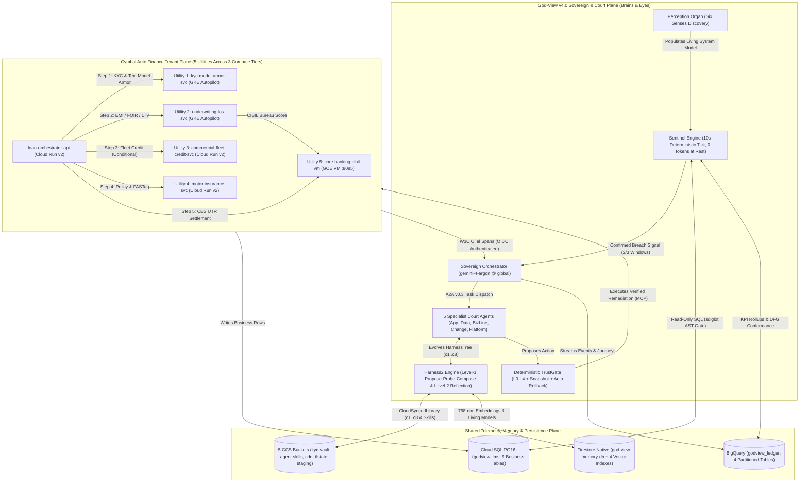
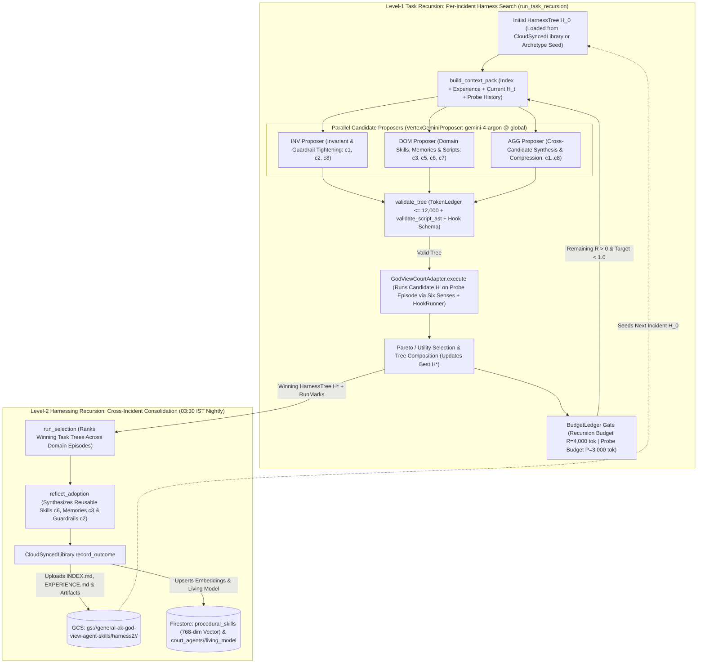
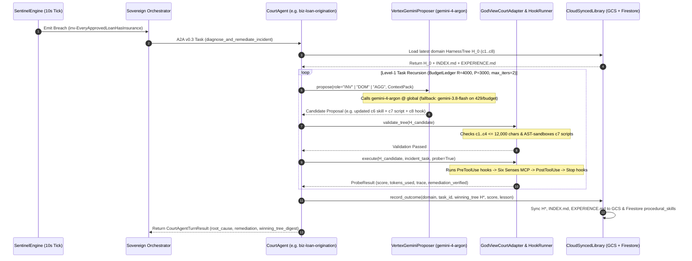
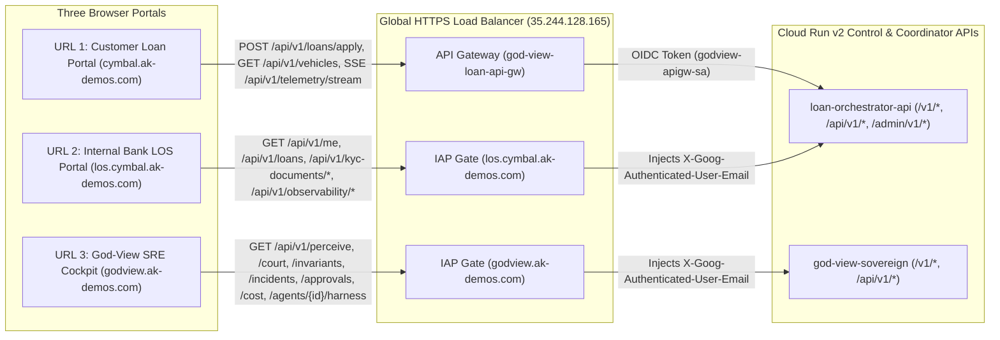
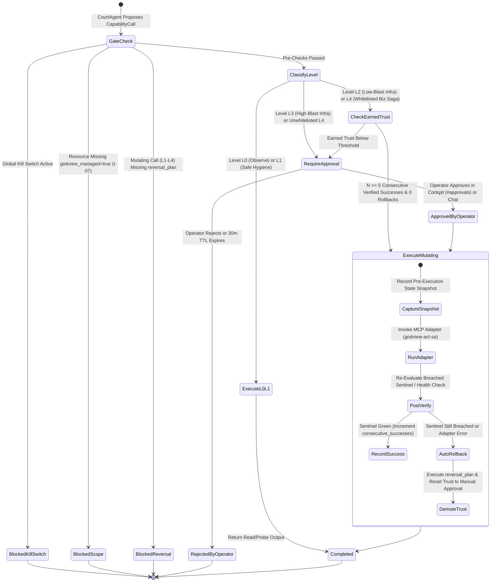

# God-View v4.0 + Harness² + Cymbal Auto Finance — High-Level Design (HLD)

**Document ID**: `GV-HLD-v4.0`
**Version**: `4.0.0` (Harness² Recursive Agent Harness Integration)
**Target GCP Project**: `general-ak` (`769002985772`, `us-central1` / `us-central1-a`)
**Live Edge Domain**: `ak-demos.com` (`35.244.128.165`)
**Primary Reasoning & Harness Proposer Model**: `gemini-4-argon` (`global` endpoint), with automatic HTTP 429 / quota / reserve fallback to `gemini-3.8-flash` (`global` endpoint)
**Related Specifications**: [Architecture Overview](ARCHITECTURE.md) | [Low-Level Design (LLD)](LLD.md) | [System Design & Deployment](SYSTEM_DESIGN.md) | [Software Design Document (SDD)](SDD.md) | [Business Requirements (BRD)](BRD.md) | [MCP & Agent Spec](GOD_VIEW_MCP_AGENT_SPEC.md) | [Terraform & GitOps Spec](TERRAFORM_GITOPS_SPEC.md) | [Technical Design (TDD)](../TDD.md)

---

## 1. Executive & Architectural Overview

**God-View v4.0** is an autonomous, business-aware Site Reliability Engineering (SRE) and Business Continuity organism built on Google Cloud Platform (`general-ak`). Unlike traditional infrastructure monitors that only observe HTTP status codes, CPU utilization, or pod restarts, God-View correlates **infrastructure health** with **business state transitions, financial invariants, and process conformance** across distributed microservices.

To prove its capabilities end-to-end without coupling to any single vertical in its core engine, this monorepo ships two strictly separated planes:

1. **The God-View v4.0 Sovereign & Court Organism (`godview/`, `shared/godview_shared/`)**:
   - **Eyes vs. Brains Separation ("Zero Tokens at Rest")**: Deterministic compiled **Sentinels** (`SentinelEngine`) evaluate business invariants, CUSUM/EWMA statistical drift, and Directly-Follows Graph (DFG) process-mining conformance every **10 seconds** at **0 LLM tokens**.
   - **The Sovereign Control Plane (`god-view-sovereign`)**: Wakes only on a confirmed Sentinel breach, Cloud Audit Log mutation (`godview-nervous-system`), or operator command. It governs a **Court of 5 Domain Specialist Agents** (`application`, `data`, `business_line`, `change`, `platform`) via the Agent-to-Agent (**A2A v0.3**) protocol and the Model Context Protocol (**MCP**).
   - **Harness² Recursive Agent Harness (`godview/harness/`, `arXiv:2610.14224`)**: Every Court Specialist Agent's diagnostic and remediation loop is governed by Google Research's two-level recursive harnessing framework (**Level-1 Task Recursion**: `Propose -> Probe -> Compose` using `INV`, `DOM`, and `AGG` proposers on **`gemini-4-argon` @ `global`** under a strict `BudgetLedger` of $R=4{,}000$ tokens and $P=3{,}000$ tokens; **Level-2 Harnessing Recursion**: nightly `run_selection` + `reflect_adoption` consolidating winning `HarnessTree`s `c1..c8` into `CloudSyncedLibrary` across GCS and Firestore).
2. **The Proving-Ground Tenant — Cymbal Auto Finance (`cymbal/`)**:
   - A 100% fictional Indian digital vehicle-financing platform spanning **three compute substrates** (**Cloud Run v2**, **GKE Autopilot**, and **GCE VM**) and **five domain utilities** orchestrated by `loan-orchestrator-api`:
     - **Utility 1 (`kyc-model-armor-svc`, GKE Autopilot)**: PAN & Aadhaar identity validation, PNG magic-header specimen verification, and **Text-Only Google Cloud Model Armor** (`cymbal-text-guard`) prompt-injection scanning.
     - **Utility 2 (`underwriting-los-svc`, GKE Autopilot)**: Deterministic reducing-balance EMI, Fixed Obligation to Income Ratio (FOIR $\le 60\%$), Loan-to-Value (LTV $\le 90\%$), and CIBIL credit score ($\ge 680$) evaluation.
     - **Utility 3 (`commercial-fleet-credit-svc`, Cloud Run v2)**: Commercial fleet working-capital credit lines (`COMMERCIAL_FLEET`) and two-wheeler micro-loan (`TWO_WHEELER`) sanctioning.
     - **Utility 4 (`motor-insurance-svc`, Cloud Run v2)**: Comprehensive motor insurance policy issuance and FASTag wallet linkage.
     - **Utility 5 (`core-banking-cibil-vm`, GCE VM)**: Deterministic CIBIL credit bureau scoring (`300–900`) and idempotent Core Banking Settlement (CBS UTR generation, NACH e-Mandate, and Sanction Letter issuance).

### 1.1 Architectural Pillars

| Architectural Pillar | Design Mechanism | Operational Guarantee |
| :--- | :--- | :--- |
| **Eyes vs. Brains Split** | Deterministic 10 s `SentinelEngine` ("Eyes") vs. event-driven `gemini-4-argon` Court ("Brains") | **0 LLM tokens consumed at rest**; LLM reasoning wakes strictly on confirmed invariant breaches or operator commands. |
| **Harness² Recursive Evolution** | Explicit `HarnessTree` (`c1..c8`) evolved via Level-1 (`INV`/`DOM`/`AGG`) and Level-2 (`run_selection` + `reflect_adoption`) | Court Agents self-optimize prompts, guardrails, skills, AST-sandboxed scripts, and hooks within an `always_on_max = 12,000` budget. |
| **Domain-Neutral Core (`I-02`)** | `godview/` and `shared/godview_shared/` discover services, entities, and invariants dynamically via the Six Senses | Zero hardcoded tenant names (`cymbal`, `cibil`, `foir`, `aadhaar`) inside the God-View core engine (`lint_neutrality.py` enforced). |
| **Deterministic Safety (`TrustGate`)** | 5-level Trust Ladder (`L0` Observe $\rightarrow$ `L4` Bounded Business Remediation) + pre-execution snapshot + post-verification rollback | No agent can bypass `TrustGate`, mutate IAM/KMS (`I-06`), touch unmanaged resources (`I-07`), or execute non-SELECT SQL (`I-05`). |
| **Earned Warmth FinOps** | 1 Cloud Run warm instance (`god-view-sovereign`), scale-to-zero siblings, and 5 Cloud Scheduler IST jobs | Full multi-tier GCP production topology operates under a hard **$150/month** ($600/mo org budget envelope) ceiling. |

### 1.2 "Eyes vs. Brains" Dual-Plane Architecture Diagram

---

## 2. End-to-End System Context & Multi-Tier GCP Topology (`general-ak`)

All production infrastructure is provisioned deterministically via OpenTofu/Terraform (`infra/terraform/platform` — **220 resources** across 6 modules, plus `infra/terraform/workloads` — **10 Kubernetes resources** in namespace `cymbal`) in project `general-ak` (`769002985772`, region `us-central1`, zone `us-central1-a`).

### 2.1 Multi-Tier GCP Infrastructure Topology Diagram

```mermaid
flowchart TB
    subgraph Internet["External Users & Operators"]
        Borrower["Retail / Fleet Borrower Browser"]
        BankOps["Bank Operations Officer (Google Identity)"]
        SRELead["SRE / CTO Operator (Google Identity)"]
    end

    subgraph EdgeLayer["Global Edge, DNS, WAF, CDN & Identity-Aware Proxy"]
        DNS["Cloud DNS Managed Zone: ak-demos-com"]
        GLB["Global External Application LB (god-view-edge: 35.244.128.165)"]
        SSL["Google-Managed SSL Cert (god-view-edge-cert: ACTIVE)"]
        WAF["Cloud Armor Security Policy (god-view-edge-policy: OWASP + Rate Limit)"]
        CDN["Cloud CDN (general-ak-god-view-cdn-assets)"]
        IAP["Identity-Aware Proxy (OAuth2 Header Verification)"]
        APIGW["API Gateway (god-view-loan-api-gw-9t9witd8.uc.gateway.dev)"]

        Borrower -->|"HTTPS"| DNS
        BankOps -->|"HTTPS"| DNS
        SRELead -->|"HTTPS"| DNS
        DNS --> GLB
        GLB --- SSL
        GLB --- WAF
        GLB -->|"Static Vehicle SVGs"| CDN
        GLB -->|"cymbal.ak-demos.com/api/*"| APIGW
        GLB -->|"los.cymbal.ak-demos.com & godview.ak-demos.com"| IAP
    end

    subgraph VPC["VPC Network: god-view-vpc (Subnet 10.10.0.0/20 + Direct VPC Egress)"]
        direction TB

        subgraph CloudRunTier["Cloud Run v2 Tier (us-central1)"]
            CR_Portal["customer-loan-portal-web (URL 1 Frontend)"]
            CR_LOSWeb["internal-bank-los-web (URL 2 Frontend)"]
            CR_SREWeb["god-view-sre-web (URL 3 SRE Cockpit)"]
            CR_Orch["loan-orchestrator-api (Journey Coordinator)"]
            CR_Fleet["commercial-fleet-credit-svc (Utility 3)"]
            CR_Ins["motor-insurance-svc (Utility 4)"]
            CR_Sim["ai-customer-simulator (Synthetic Borrower Stream)"]
            CR_Sov["god-view-sovereign (min_instances=1 Warm Control Plane)"]
            CR_HibJob["god-view-hibernate-job (Cloud Run v2 Job)"]
        end

        subgraph GKETier["GKE Autopilot Tier: god-view-gke-cluster (Namespace: cymbal)"]
            ILB_KYC["Internal TCP/HTTP LB (10.10.0.3:8080)"]
            Pod_KYC["kyc-model-armor-svc (Utility 1 Pods)"]
            ILB_LOS["Internal TCP/HTTP LB (10.10.0.2:8080)"]
            Pod_LOS["underwriting-los-svc (Utility 2 Pods)"]
            ILB_KYC --> Pod_KYC
            ILB_LOS --> Pod_LOS
        end

        subgraph GCETier["GCE VM Tier (us-central1-a)"]
            VM_CBS["core-banking-cibil-vm (e2-micro, 10.10.0.5:8085, systemd cibil-cbs)"]
        end

        subgraph DataAndAI["Managed Datastores, Event Bus & Vertex AI"]
            CloudSQL[("Cloud SQL PG16: god-view-pg (10.186.0.3, DB: godview_lms)")]
            Firestore[("Firestore Native: god-view-memory-db (4 Vector Indexes)")]
            BigQuery[("BigQuery Dataset: godview_ledger (4 Tables)")]
            Buckets[("5 GCS Buckets: kyc-vault, cdn-assets, agent-skills, tfstate, agent-staging")]
            PubSub[["Pub/Sub: godview-nervous-system + DLQ + Audit Log Sink"]]
            Scheduler["5 Cloud Scheduler Jobs (Asia/Kolkata IST)"]
            ModelArmor["Vertex AI Model Armor (cymbal-text-guard)"]
            VertexModels["Vertex AI Models (gemini-4-argon & gemini-3.8-flash @ global)"]
        end
    end

    GLB -->|"cymbal.ak-demos.com"| CR_Portal
    IAP -->|"los.cymbal.ak-demos.com"| CR_LOSWeb
    IAP -->|"godview.ak-demos.com"| CR_SREWeb
    APIGW -->|"OIDC (godview-apigw-sa)"| CR_Orch
    IAP -->|"los.cymbal.ak-demos.com/api/*"| CR_Orch
    IAP -->|"godview.ak-demos.com/api/*"| CR_Sov

    CR_Sim -->|"X-Synthetic: true"| CR_Orch
    CR_Orch -->|"10.10.0.3:8080"| ILB_KYC
    CR_Orch -->|"10.10.0.2:8080"| ILB_LOS
    CR_Orch -->|"Internal OIDC"| CR_Fleet
    CR_Orch -->|"Internal OIDC"| CR_Ins
    CR_Orch -->|"10.10.0.5:8085"| VM_CBS
    Pod_LOS -->|"10.10.0.5:8085"| VM_CBS
    Pod_KYC -->|"sanitizeUserPrompt"| ModelArmor

    CR_Orch -->|"app_user (Read/Write)"| CloudSQL
    CR_Fleet -->|"app_user (Read/Write)"| CloudSQL
    CR_Ins -->|"app_user (Read/Write)"| CloudSQL
    VM_CBS -->|"app_user (Read/Write)"| CloudSQL

    CR_Sov -->|"godview_readonly (SELECT Only)"| CloudSQL
    CR_Sov <--> Firestore
    CR_Sov <--> BigQuery
    CR_Sov <--> Buckets
    CR_Sov <--> VertexModels
    PubSub -->|"Push: /v1/nervous-system/push"| CR_Sov
    Scheduler -->|"OIDC Triggers"| CR_Sov
    Scheduler -->|"OIDC Tick"| CR_Sim
```

### 2.2 Live `general-ak` Infrastructure Inventory

All resource identifiers below match `infra/terraform/platform/outputs.json` and the live `general-ak` deployment:

| Tier / Subsystem | Resource Name / Identifier | Endpoint / Network Address | Role & Configuration |
| :--- | :--- | :--- | :--- |
| **Cloud DNS** | `ak-demos-com` | `cymbal.`, `los.cymbal.`, `api.cymbal.`, `godview.ak-demos.com` | Routes all 4 FQDNs to Global LB IP `35.244.128.165`. |
| **Global External LB** | `god-view-edge` | `35.244.128.165:443` | Global HTTPS LB with Managed SSL (`god-view-edge-cert`), Cloud Armor (`god-view-edge-policy`), Cloud CDN, and IAP. |
| **API Gateway** | `god-view-loan-api-gw` | `god-view-loan-api-gw-9t9witd8.uc.gateway.dev` | Public API ingress for `cymbal.ak-demos.com/api/*` and `api.cymbal.ak-demos.com`; authenticates to `loan-orchestrator-api` as `godview-apigw-sa`. |
| **Cloud Run v2 (Warm)** | `god-view-sovereign` | `https://god-view-sovereign-mcj3w7ujpq-uc.a.run.app` | Sovereign control plane (`min_instances=1`, 1 vCPU / 512 MiB always-allocated CPU for the 10 s Sentinel loop). |
| **Cloud Run v2 (URL 3)** | `god-view-sre-web` | `https://god-view-sre-web-mcj3w7ujpq-uc.a.run.app` | God-View SRE Cockpit SPA served at `https://godview.ak-demos.com` behind IAP. |
| **Cloud Run v2 (API)** | `loan-orchestrator-api` | `https://loan-orchestrator-api-mcj3w7ujpq-uc.a.run.app` | 5-Utility Loan Origination Saga Coordinator (`min_instances=0`, `max_instances=5`). |
| **Cloud Run v2 (Util 3)** | `commercial-fleet-credit-svc` | `https://commercial-fleet-credit-svc-mcj3w7ujpq-uc.a.run.app` | Commercial Fleet (`COMMERCIAL_FLEET`) & Two-Wheeler (`TWO_WHEELER`) credit utility. |
| **Cloud Run v2 (Util 4)** | `motor-insurance-svc` | `https://motor-insurance-svc-mcj3w7ujpq-uc.a.run.app` | Motor Insurance policy & FASTag issuance utility. |
| **Cloud Run v2 (Sim)** | `ai-customer-simulator` | `https://ai-customer-simulator-mcj3w7ujpq-uc.a.run.app` | Synthetic borrower traffic generator (`gemini-2.5-flash` personas + `gemini-3.1-flash-image-preview` specimen cards). |
| **Cloud Run v2 (URL 1)** | `customer-loan-portal-web` | `https://customer-loan-portal-web-mcj3w7ujpq-uc.a.run.app` | Public Customer Loan Portal SPA served at `https://cymbal.ak-demos.com`. |
| **Cloud Run v2 (URL 2)** | `internal-bank-los-web` | `https://internal-bank-los-web-mcj3w7ujpq-uc.a.run.app` | Internal Bank LOS Portal SPA served at `https://los.cymbal.ak-demos.com` behind IAP. |
| **Cloud Run v2 Job** | `god-view-hibernate-job` | `us-central1` | Scales GKE deployments and stops/starts `core-banking-cibil-vm` during off-hours or emergency hibernation. |
| **GKE Autopilot** | `god-view-gke-cluster` | Control Plane `35.232.94.232` (`namespace: cymbal`) | Runs `kyc-model-armor-svc` (ILB `10.10.0.3:8080`) and `underwriting-los-svc` (ILB `10.10.0.2:8080`) with `NetworkPolicy` isolation. |
| **GCE VM (Util 5)** | `core-banking-cibil-vm` | `10.10.0.5:8085` (`us-central1-a`, `e2-micro`) | Private-IP-only VM running `cibil-cbs.service` (`systemd`) for CIBIL bureau scoring & CBS UTR settlement. |
| **Cloud SQL PG16** | `god-view-pg` | `10.186.0.3:5432` (Database: `godview_lms`) | Private Service Access (`10.186.0.0/16`); 9 business tables; `app_user` (RW) and `godview_readonly` (`SELECT` only). |
| **Firestore Native** | `god-view-memory-db` | `nam5` (`us-central1`) | 13 collections + 4 768-dim `COSINE` flat vector indexes (`text-embedding-005`). |
| **BigQuery** | `godview_ledger` | `US` (`general-ak.godview_ledger`) | 4 DAY-partitioned, clustered tables: `events`, `state_transitions`, `journeys`, `kpi_rollups`. |
| **5 GCS Buckets** | `general-ak-god-view-*` | `us-central1` | `kyc-vault` (7d lifecycle), `cdn-assets`, `agent-skills`, `tfstate` (versioned), `agent-staging`. |
| **Pub/Sub Nervous System** | `godview-nervous-system` | Topic + DLQ + `godview-sovereign-push` | Receives Cloud Audit Logs via sink `godview-audit-to-nervous-system` and pushes to `/v1/nervous-system/push`. |
| **Cloud Scheduler** | 5 Cron Jobs (`Asia/Kolkata`) | `godview-tenant-pause`, `-resume`, `-probe-run`, `-agent-reflection`, `-simulator-tick` | Automates 09:00–17:00 IST active window, 5-min synthetic probes, 03:30 IST nightly Harness² reflection, and 1-min simulator ticks. |

---

## 3. Harness² Recursive Agent Harness Architecture (`godview/harness/`)

God-View v4.0 embeds Google Research's **Harness²** framework (*"Harnessing Harnessing Agents: Recursive Evolution of Agent Substrates"*, `arXiv:2610.14224`) directly into `godview/harness/`. Instead of treating an SRE agent's system prompt, tool descriptions, skills, helper scripts, and pre/post hooks as static boilerplate, Harness² models the entire agent substrate as a versioned, content-addressed **`HarnessTree`** over an 8-category **`ArtifactSurface` (`GODVIEW_SURFACE`, `c1..c8`)**.

### 3.1 The 8-Category God-View Artifact Surface (`GODVIEW_SURFACE`)

Defined in [`godview/harness/substrate.py`](file:///usr/local/google/home/kambleashish/Documents/Projects/god-view/godview/harness/substrate.py), `GODVIEW_SURFACE` partitions every Court Specialist Agent's harness into two loading regimes:

1. **Always-On Categories (`c1..c4`)**: Injected into every reasoning turn, bounded by a strict hard cap of **`always_on_max = 12,000` tokens/characters** (`TokenLedger`) to prevent prompt bloat and context rot.
2. **On-Demand / Event-Driven Categories (`c5..c8`)**: Loaded selectively when a task matches a skill trigger, delegated to a sub-agent, executed via the AST-sandboxed script runner, or invoked automatically on `PreToolUse` / `PostToolUse` / `Stop` lifecycle events.

| Category ID | Name | Loading Regime | Canonical Path Pattern | Role in God-View Court Specialist Agents |
| :--- | :--- | :--- | :--- | :--- |
| **`c1`** | `prompts` | Always-On | `systemprompt.md` | Archetype identity, diagnostic workflow (`Sense -> Hypothesize -> Verify -> Remediate`), and output schema. |
| **`c2`** | `guardrails` | Always-On | `guardrails.md` | Hard operational invariants: `sqlglot` SELECT-only SQL (`I-05`), `TrustGate` L0–L4 ladder, `godview_managed="true"` scope (`I-07`), and zero IAM/KMS self-escalation (`I-06`). |
| **`c3`** | `memories` | Always-On | `LongTermMEMORY.md` | Distilled domain topology, service dependencies, baseline latencies, and high-signal lessons from prior incidents. |
| **`c4`** | `tool_descriptions` | Always-On | `tool_descriptions/tool_guidance.md` | Concise decision table mapping symptom classes to the 21 `SIX_SENSES_CAPABILITIES` MCP tools and their required `reversal_plan`. |
| **`c5`** | `sub_agents` | On-Demand | `sub_agents/<name>/AGENT.md` | Specialized sub-agent delegation specs (e.g., `trace_correlator`, `sql_reconciler`, `dfg_conformance_inspector`). |
| **`c6`** | `skills` | On-Demand | `skills/<name>/SKILL.md` | Step-by-step procedural playbooks (e.g., `cibil-504-saga-replay`, `insurance-silent-skip-remediation`, `foir-drift-gitops-pr`). |
| **`c7`** | `scripts` | On-Demand | `scripts/<name>.py` | Deterministic Python diagnostic helpers validated by `validate_script_ast` (pure stdlib math/JSON/stat checks; bans network/subprocess/writes). |
| **`c8`** | `hooks` | Event-Driven | `hooks.json` | Declarative `PreToolUse`, `PostToolUse`, and `Stop` guard hooks executed in-process by `HookRunner`. |

### 3.2 Two-Level Recursive Architecture (`Level-1` Task Recursion & `Level-2` Harnessing Recursion)

### 3.3 Level-1 & Level-2 Sequence Diagram

---

## 4. Three Frontend Portals Architecture

The monorepo serves **three distinct React 18 + TypeScript + Vite + Tailwind CSS Single-Page Applications (SPAs)** through the Global External Application Load Balancer (`35.244.128.165`), each tailored to a specific persona and security boundary:

| Portal | URL / Hostname | Cloud Run Service | Source Directory | Auth Boundary | Primary User Persona |
| :--- | :--- | :--- | :--- | :--- | :--- |
| **URL 1: Customer Loan Portal** | `https://cymbal.ak-demos.com` | `customer-loan-portal-web` | `cymbal/frontends/customer-loan-portal-web/` | Public HTTPS + Cloud Armor WAF; `/api/*` via API Gateway (`god-view-loan-api-gw`) | Retail EV/SUV/Two-Wheeler borrowers & Commercial Fleet operators |
| **URL 2: Internal Bank LOS Portal** | `https://los.cymbal.ak-demos.com` | `internal-bank-los-web` | `cymbal/frontends/internal-bank-los-web/` | Google Cloud **Identity-Aware Proxy (IAP)** (`X-Goog-Authenticated-User-Email`) | Bank Underwriting Officers, KYC Auditors & CBS Operations |
| **URL 3: God-View SRE Cockpit** | `https://godview.ak-demos.com` | `god-view-sre-web` | `godview/god-view-sre-web/` | Google Cloud **Identity-Aware Proxy (IAP)** + Operator RBAC | SRE Leads, Platform Architects & CTOs |

### 4.1 Portal Routing & Backend Communication Diagram

### 4.2 Summary of Capabilities by Portal

1. **URL 1 — Customer Loan Portal (`cymbal.ak-demos.com`)**:
   - **Vehicle Showroom (`#showroom`)**: Displays all 8 Cymbal catalog vehicles (`VEH-EV-001` through `VEH-FLT-002`) with Cloud CDN SVG imagery, category filtering (`EV_SUV`, `PASSENGER_SUV`, `TWO_WHEELER`, `COMMERCIAL_FLEET`), and indicative EMIs.
   - **EMI & Eligibility Calculator (`#calculator`)**: Interactive reducing-balance EMI, FOIR %, and LTV % estimator with real-time eligibility feedback.
   - **5-Step Loan Journey Wizard (`#journey`)**: End-to-end loan application submission supporting `TEXT_ONLY` and `IMAGE` specimen modes, real-time **Server-Sent Events (`SSE`)** step progression (`KYC -> LOS -> FLEET_CREDIT -> INS -> CBS`), graceful `MODEL_ARMOR_BLOCKED` prompt-injection banners, and `503 TENANT_PAUSED` off-hours banners.
   - **My Applications (`#applications`)**: Session-isolated view (`sessionStorage` key `cymbal_session_loan_ids`) so borrowers only see applications submitted in their own browser session.
2. **URL 2 — Internal Bank LOS Portal (`los.cymbal.ak-demos.com`)**:
   - **Executive KPI Ribbon**: Real-time Total Applications (Human vs. AI Synthetic split), Underwriting Approval Rate, Model Armor Blocks, Stuck Disbursements, Disbursement ₹ At Risk, and Mean Saga Latency.
   - **Live LOS Queue (`#queue`)**: Filterable, keyboard-navigable underwriting queue with live SSE status updates.
   - **KYC Vault Inspector (`#vault`)**: Displays 15-minute GCS V4 signed URLs for watermarked PAN & Aadhaar specimen cards (`SPECIMEN · NOT A GOVERNMENT DOCUMENT`) alongside Model Armor text scan verdicts (`images_sent_to_model_armor: false`).
   - **Multi-Utility Ledgers (`#ledgers`)**: Consolidated audit views across Underwriting (`underwriting_audits`), Commercial Fleet Credit (`commercial_credit_lines`), Motor Insurance (`insurance_policies`), and Core Banking Disbursements (`disbursements`).
   - **Saga Replay Queue (`#replay`)**: Operational view of stuck (`PENDING` / `FAILED`) disbursements awaiting idempotent CBS UTR settlement replay.
   - **Service Topology & Traces (`#topology`)**: Live 5-utility golden signals (`p95_ms`, `error_rate_pct`, `requests_per_min`, active chaos faults) and W3C trace waterfall with DFG conformance (`CONFORMANT`, `REORDERED`, `SKIPPED`, `STALLED`).
3. **URL 3 — God-View SRE Cockpit (`godview.ak-demos.com`)**:
   - **Organism Court (`#organism`)**: Live Six Senses perception status, 10 s Sentinel heartbeat (`0 tok at rest`), and the 5 Court Specialist Agents with wake/suspend controls.
   - **Living Models & Harness² Inspector (`#agent/<id>`)**: Inspects each Court Agent's Living System Model, Trust Ladder records (`L0–L4`), and live **Harness² `HarnessTree` (`c1..c8`)**, `TokenLedger` utilization (`<= 12,000`), and `EXPERIENCE.md` log.
   - **Invariants & Sentinels (`#invariants`)**: Business invariant catalog (`inv-emi-matches-formula`, `inv-foir-under-cap`, `inv-cibil-score-valid`, `inv-EveryApprovedLoanHasInsurance`, `inv-EveryDisbursedLoanHasUTR`, `inv-LoanStepOrder`) with one-click Sentinel compilation and state toggles.
   - **Journeys & Process Mining (`#journeys`)**: DFG conformance matrix comparing intended (`KYC -> LOS -> INS -> CBS`) vs. observed trace sequences.
   - **Incidents & Harness² RunMarks (`#incidents`)**: Full incident timeline, multi-agent Court consensus (`CourtSwarmSession`), Harness² `RunMark` telemetry, and verified remediation receipts.
   - **Approvals (`#approvals`)**: Human-in-the-loop approval queue for `L3` (High-Blast-Radius Infra) and non-whitelisted `L4` (Business Saga Remediation) actions.
   - **Changes & Nervous System (`#changes`)**: Real-time Cloud Audit Log and Git commit timeline correlated against active incidents.
   - **Cost & Drift (`#cost`)**: Daily/monthly LLM token spend (`TokenBudgetGovernor`), FinOps recommendations, and live Terraform state drift (`gs://general-ak-god-view-tfstate`).
   - **Controls & Chaos Drills Drawer (`#controls`)**: Global Operator Kill Switch (`ENGAGE KILL SWITCH`), Tenant Pause/Resume, Emergency Hibernate, AI Simulator burst controls, and one-click **Chaos Drills** (Scenarios 1, 2, 3 + infra faults).

---

## 5. Security, IAM Least-Privilege, Deterministic TrustGate (`L0–L4`), and FinOps

### 5.1 Five Dedicated Service Accounts & Zero Service-Account Keys

God-View enforces strict IAM separation across **5 purpose-built Google Cloud Service Accounts** (`infra/terraform/platform/modules/01-foundation/main.tf`). Zero JSON service-account keys exist anywhere in the project; CI/CD uses **Workload Identity Federation (`github-pool/github-provider`)** and runtime services use attached Cloud Run / GKE Workload Identity / GCE VM metadata credentials.

| Service Account Email | Plane / Role | Assigned IAM Roles & Scope | Hard Security Restrictions |
| :--- | :--- | :--- | :--- |
| **`godview-sense-sa@general-ak.iam.gserviceaccount.com`** | **Eyes (Read-Only Discovery, Sentinels & Scheduler)** | `monitoring.viewer`, `logging.viewer`, `cloudtrace.user`, `cloudasset.viewer`, `bigquery.dataViewer`, `bigquery.jobUser`, `datastore.viewer`, `storage.objectViewer` (`tfstate`, `agent-skills`), `run.invoker` | Cannot mutate any GCP resource, Cloud SQL table, or GKE deployment; connects to Postgres exclusively as `godview_readonly`. |
| **`godview-act-sa@general-ak.iam.gserviceaccount.com`** | **Hands (TrustGate Remediation Executor)** | `run.developer`, `container.developer`, `compute.instanceAdmin.v1`, `datastore.user`, `bigquery.dataEditor`, `storage.objectAdmin` (`agent-skills`, `agent-staging`), `aiplatform.user` | Only invoked inside `TrustGate.execute()`; **explicitly denied** `roles/resourcemanager.projectIamAdmin`, `roles/iam.securityAdmin`, and `roles/cloudkms.admin` (`I-06`). |
| **`godview-runtime-sa@general-ak.iam.gserviceaccount.com`** | **Cymbal Tenant Runtime** | `cloudsql.client`, `storage.objectAdmin` (`kyc-vault`), `aiplatform.user`, `modelarmor.user`, `logging.logWriter`, `monitoring.metricWriter`, `cloudtrace.agent`, `run.invoker` | Attached to Cymbal Cloud Run services, GKE pods (via Workload Identity `cymbal/cymbal-runtime-ksa`), and `core-banking-cibil-vm`. |
| **`godview-apigw-sa@general-ak.iam.gserviceaccount.com`** | **API Gateway Ingress Identity** | `run.invoker` on `loan-orchestrator-api` | Single-purpose OIDC invoker for `god-view-loan-api-gw`. |
| **`godview-deploy-sa@general-ak.iam.gserviceaccount.com`** | **GitOps CI/CD & Cloud Build** | `run.admin`, `container.admin`, `compute.admin`, `artifactregistry.writer`, `cloudbuild.builds.builder`, `iam.serviceAccountUser` | Bound via WIF (`github-pool`); never used by runtime workloads. |

### 5.2 Deterministic TrustGate (`L0–L4`) State Machine

Every action proposed by a Court Specialist Agent must pass through [`TrustGate`](file:///usr/local/google/home/kambleashish/Documents/Projects/god-view/godview/sovereign/trust_ladder/__init__.py) before any adapter is called:

| Trust Level | Name | Representative Capabilities | Autonomous Execution Rule |
| :--- | :--- | :--- | :--- |
| **`L0`** | **Observe & Probe** | `gcp.CloudLogging.query`, `sql.Postgres.readonly_query`, `k8s.Pod.logs`, `git.Repo.log_and_blame` | Always autonomous (`godview-sense-sa`). |
| **`L1`** | **Safe Hygiene & Annotations** | `biz.list_stuck_disbursements`, synthetic probe validation, incident tagging | Autonomous with audit log entry. |
| **`L2`** | **Low-Blast-Radius Infra** | `gcp.CloudRun.update_traffic`, `k8s.Deployment.rollout_restart`, `k8s.Deployment.scale`, `gcp.ComputeEngine.reset_instance` | Autonomous once `consecutive_successes >= 5` and `rollbacks == 0` (pre-seeded for demo drills); requires mandatory `reversal_plan`. |
| **`L3`** | **High-Blast-Radius Infra & Code** | `git.GitHub.create_remediation_pr`, `tenant.set_paused`, schema/firewall changes | Always requires explicit Human-in-the-Loop approval (`#approvals`) or merges via GitOps PR. |
| **`L4`** | **Bounded Business Remediation** | `biz.replay_disbursement`, `biz.reevaluate_application`, `biz.compensate_journey` | Requires both operator whitelist (`whitelisted=true`) and earned trust (`N >= 5`), plus an idempotent compensation `reversal_plan`. |

### 5.3 FinOps & "Earned Warmth" Budget Governance

God-View enforces a multi-layered FinOps architecture so the entire 11-service multi-tier deployment stays under **$150/month** ($600/mo ceiling):

1. **Compute Earned Warmth**:
   - Only `god-view-sovereign` keeps `min_instances = 1` (`1 vCPU / 512 MiB`, ~$14/month) so its in-process 10 s `SentinelEngine` runs continuously without cold starts.
   - All other 7 Cloud Run services run with `min_instances = 0` and scale to zero when idle.
   - Five Cloud Scheduler jobs in `Asia/Kolkata` (`09:00–17:00 IST`) automatically pause tenant traffic at 17:00 IST (`godview-tenant-pause`) and resume at 09:00 IST (`godview-tenant-resume`).
2. **TokenBudgetGovernor & Model Tiering (`shared/godview_shared/config.py`)**:
   - **Primary Reasoning & Harness² Proposer**: `gemini-4-argon` @ `global` (`$1.50/day` Sovereign cap; `$4.50/day` total Court ceiling; `$0.75/day` for `application`, `business_line`, `change`; `$0.50/day` for `data`, `platform`).
   - **Automatic Fallback Model**: `gemini-3.8-flash` @ `global` when HTTP 429/503 occurs or when a Court Agent enters its final **20% escalation reserve**.
   - **Harness² Per-Incident `BudgetLedger`**: Caps Level-1 task recursion at $R = 4{,}000$ proposer tokens and $P = 3{,}000$ probe execution tokens (`max_iterations = 2`).
   - **AI Customer Simulator Caps**: Hard limit of **200 synthetic journeys/day**, with **85% `TEXT_ONLY`** (`gemini-2.5-flash`) and **15% `IMAGE`** (`gemini-3.1-flash-image-preview`, max 30 image pairs/day cached in `gs://general-ak-god-view-kyc-vault`).
