# God-View v4.0 + Harness² + Cymbal Auto Finance — Low-Level Design (LLD)

**Document ID**: `GV-LLD-v4.0`
**Version**: `4.0.0` (Harness² Recursive Agent Harness Integration)
**Target GCP Project**: `general-ak` (`769002985772`, `us-central1` / `us-central1-a`)
**Primary Reasoning & Harness Proposer Model**: `gemini-4-argon` (`global` endpoint), with automatic HTTP 429 / quota / reserve fallback to `gemini-3.8-flash` (`global` endpoint)
**Separated Folder Docs**: [God-View SRE Control Plane LLD](god-view/LLD.md) | [Cymbal Auto Finance Customer Application LLD](cymbal-auto-finance/LLD.md) | [Shared Contracts LLD](shared/README.md)
**Related Specifications**: [Architecture Overview](ARCHITECTURE.md) | [High-Level Design (HLD)](HLD.md) | [System Design & Deployment](SYSTEM_DESIGN.md) | [Software Design Document (SDD)](SDD.md) | [Technical Design (TDD)](../TDD.md)

---

## 1. Module-by-Module & Class-Level Specifications

The monorepo is organized into four physically separated top-level code directories:
- [`shared/godview_shared/`](file:///usr/local/google/home/kambleashish/Documents/Projects/god-view/shared/godview_shared) — Domain-neutral contracts, `MODEL_TABLE`, OpenTelemetry W3C baggage & OIDC span exporter, and 21 `SIX_SENSES_CAPABILITIES`.
- [`godview/`](file:///usr/local/google/home/kambleashish/Documents/Projects/god-view/godview) — Sovereign control plane (`sovereign/`), Harness² recursive agent substrate (`harness/`), 5 Court Specialist Agents (`agents/`), MCP adapters (`adapters/`), invariant compiler (`invariants/`), BigQuery/DFG ledger (`ledger/`), and SRE Cockpit SPA (`god-view-sre-web/`).
- [`cymbal/`](file:///usr/local/google/home/kambleashish/Documents/Projects/god-view/cymbal) — Customer application microservices (`cymbal/services/*`) and browser portals (`cymbal/frontends/customer-loan-portal-web/`, `cymbal/frontends/internal-bank-los-web/`).
- [`infra/`](file:///usr/local/google/home/kambleashish/Documents/Projects/god-view/infra) — 3-stage Terraform platform (`infra/terraform/platform/`), GKE workloads (`infra/terraform/workloads/`), API Gateway spec (`infra/api-gateway/`), and deployment scripts (`infra/deploy/`).

---

### 1.1 `shared/godview_shared/` — Shared Contracts, OTel & Capabilities

#### Class Diagram (`shared/godview_shared/`)

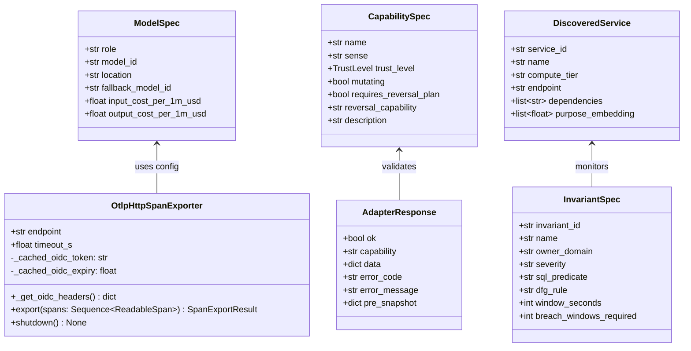

#### Key Files & Contracts in `shared/godview_shared/`

| File Path | Key Symbols | Low-Level Contract & Implementation Details |
| :--- | :--- | :--- |
| [`shared/godview_shared/config.py`](file:///usr/local/google/home/kambleashish/Documents/Projects/god-view/shared/godview_shared/config.py) | `MODEL_TABLE`, `BudgetConstants`, `GodViewSettings` | Defines `MODEL_TABLE["primary_reasoning"] = ModelSpec(model_id="gemini-4-argon", location="global", fallback_model_id="gemini-3.8-flash")`, `escalation_reasoning` (`gemini-4-argon` @ `global`), `fast_utility` (`gemini-2.5-flash`), `specimen_image` (`gemini-3.1-flash-image-preview`), and `embedding` (`text-embedding-005`, 768-dim). Enforces `$1.50/day` Sovereign cap, `$4.50/day` Court cap, and `$150/month` ceiling. |
| [`shared/godview_shared/contracts/__init__.py`](file:///usr/local/google/home/kambleashish/Documents/Projects/god-view/shared/godview_shared/contracts/__init__.py) | `TENANT_BUSINESS_TABLES`, `TrustLevel`, `SentinelState`, `IncidentRecord`, `ApprovalRequest`, `LivingSystemModel` | Canonical Pydantic v2 models shared across Sovereign, Court Agents, and MCP adapters. Enforces `TENANT_BUSINESS_TABLES` (exact 9 PostgreSQL tables). |
| [`shared/godview_shared/otel.py`](file:///usr/local/google/home/kambleashish/Documents/Projects/god-view/shared/godview_shared/otel.py) | `extract_baggage_context`, `inject_baggage_headers`, `set_business_span_attributes`, `OtlpHttpSpanExporter` | Propagates W3C `traceparent` + `baggage` (`journey.id`, `customer.id`, `synthetic`). `OtlpHttpSpanExporter._get_oidc_headers()` caches a 50-minute Google OIDC ID token from the metadata server when exporting spans to `https://god-view-sovereign-.../v1/traces` and logs transient export failures at `DEBUG` so Cloud Logging never records false-positive `ERROR` entries. |
| [`shared/godview_shared/capabilities.py`](file:///usr/local/google/home/kambleashish/Documents/Projects/god-view/shared/godview_shared/capabilities.py) | `SIX_SENSES_CAPABILITIES`, `get_capability_spec` | Registers all **21 MCP capabilities** across the Six Senses with their `TrustLevel` (`L0`–`L4`), `mutating` flag, and mandatory `reversal_capability`. |
| [`shared/godview_shared/adapter_contract.py`](file:///usr/local/google/home/kambleashish/Documents/Projects/god-view/shared/godview_shared/adapter_contract.py) | `BaseSenseAdapter`, `AdapterCallRequest`, `AdapterResponse` | Abstract base class for all MCP adapters; enforces `godview_managed="true"` resource label verification (`I-07`) and structured `AdapterResponse` envelopes. |

---

### 1.2 `godview/sovereign/` — Sovereign Control Plane, Sentinels & TrustGate

#### Class Diagram (`godview/sovereign/`)

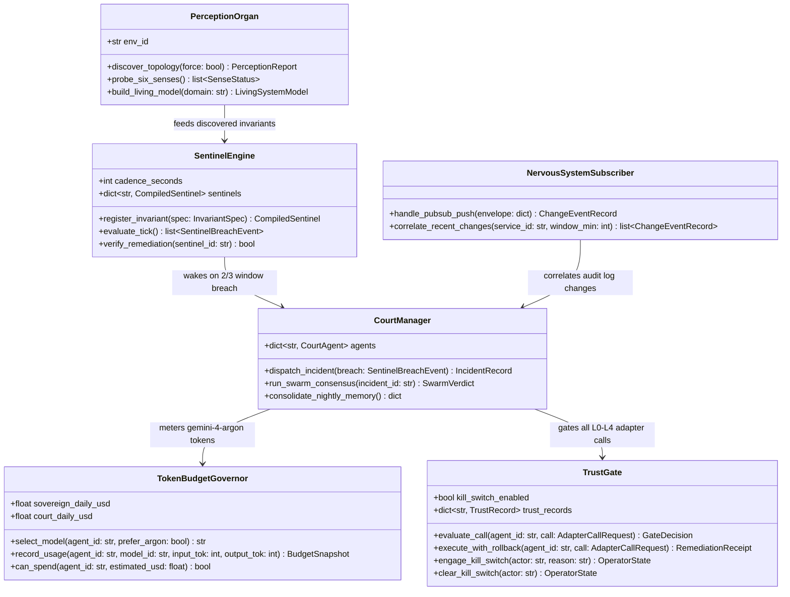

#### Key Modules & Endpoints in `godview/sovereign/`

| Module Path | Key Classes / Functions | Responsibilities & Implementation Details |
| :--- | :--- | :--- |
| [`godview/sovereign/perception/__init__.py`](file:///usr/local/google/home/kambleashish/Documents/Projects/god-view/godview/sovereign/perception/__init__.py) | `PerceptionOrgan`, `SenseProbeResult` | Executes the **Six Senses** startup and on-demand discovery: (1) Runtime Sense (Cloud Run, GKE, GCE VM), (2) Telemetry Sense (OTel traces & Prometheus `/metrics`), (3) Data Sense (`information_schema` & BigQuery `godview_ledger`), (4) Code & Git Sense (OpenAPI specs & commits), (5) Change Sense (Cloud Audit Logs), and (6) Cost & Drift Sense (Billing & `default.tfstate`). |
| [`godview/sovereign/sentinel_engine/__init__.py`](file:///usr/local/google/home/kambleashish/Documents/Projects/god-view/godview/sovereign/sentinel_engine/__init__.py) | `SentinelEngine`, `CompiledSentinel`, `CusumEwmaDetector` | Evaluates all active Sentinels every **10 seconds** at **0 LLM tokens**. Uses `2-of-3` sliding window confirmation before waking the Sovereign or Court Agents. Supports SQL invariants (via `sqlglot` AST gate), BigQuery KPI rollups, DFG process-mining conformance, and two-sided CUSUM ($k=0.5\sigma, h=4.0\sigma$) + EWMA ($\lambda=0.2$) drift detection. |
| [`godview/sovereign/trust_ladder/__init__.py`](file:///usr/local/google/home/kambleashish/Documents/Projects/god-view/godview/sovereign/trust_ladder/__init__.py) | `TrustGate`, `TrustRecord`, `RemediationReceipt` | Deterministic execution gate enforcing `L0–L4` autonomy rules, operator kill switch (`kill_switch_enabled`), `godview_managed="true"` scope (`I-07`), mandatory `reversal_plan` on `L1–L4`, pre-execution state snapshots, post-remediation Sentinel verification, and automatic rollback + trust demotion on failure. |
| [`godview/sovereign/court_manager/__init__.py`](file:///usr/local/google/home/kambleashish/Documents/Projects/god-view/godview/sovereign/court_manager/__init__.py) | `CourtManager`, `TokenBudgetGovernor` | Manages lifecycle of the 5 Court Specialist Agents (`app-loan-orchestrator`, `data-ledger-pg`, `biz-loan-origination`, `change-gitops`, `platform-gcp-mesh`), routes breaches to primary/secondary specialists, governs `gemini-4-argon` (`global`) vs. `gemini-3.8-flash` (`global`) selection, and triggers nightly `CloudSyncedLibrary` reflection. |
| [`godview/sovereign/nervous_system/__init__.py`](file:///usr/local/google/home/kambleashish/Documents/Projects/god-view/godview/sovereign/nervous_system/__init__.py) | `NervousSystemSubscriber` | Consumes Pub/Sub push messages from `godview-sovereign-push` (`godview-nervous-system`), decodes base64 Cloud Audit Log `protoPayload` entries, and records `audit_config_change` events for the Change Specialist (`change-gitops`). |
| [`godview/sovereign/control_api/__init__.py`](file:///usr/local/google/home/kambleashish/Documents/Projects/god-view/godview/sovereign/control_api/__init__.py) | `create_sovereign_app` | FastAPI control plane mounted at both `/v1/*` and `/api/v1/*`: `/perceive`, `/court`, `/invariants`, `/sentinels`, `/journeys`, `/incidents`, `/approvals`, `/changes`, `/cost`, `/drills`, `/controls/kill-switch`, `/tenant/pause`, `/tenant/resume`, `/lifecycle/tenant-pause`, `/lifecycle/tenant-resume`, `/probes/run`, `/memory/reflect`, `/nervous-system/push`, `/traces`, and Harness² inspection routes (`/agents/{id}/harness`, `/agents/{id}/experience`, `/incidents/{id}/harness-run`, `/sovereign/reflect`). |

---

### 1.3 `godview/harness/` — Harness² Recursive Agent Substrate (`arXiv:2610.14224`)

#### Class Diagram (`godview/harness/`)

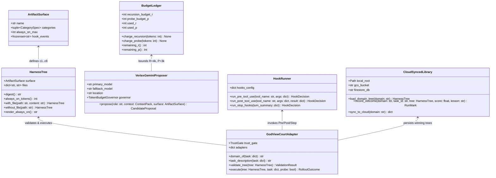

#### Key Files & Contracts in `godview/harness/`

| File Path | Key Classes / Functions | Low-Level Contract & Implementation Details |
| :--- | :--- | :--- |
| [`godview/harness/core/spec.py`](file:///usr/local/google/home/kambleashish/Documents/Projects/god-view/godview/harness/core/spec.py) & [`tree.py`](file:///usr/local/google/home/kambleashish/Documents/Projects/god-view/godview/harness/core/tree.py) | `CategorySpec`, `ArtifactSurface`, `HarnessTree`, `render_tree`, `autotrigger` | Immutable, SHA-256 content-addressed tree of agent harness artifacts (`c1..c8`). Computes `always_on_tokens()` over `c1..c4` and matches on-demand skills (`c6`) and sub-agents (`c5`) via `autotrigger()`. |
| [`godview/harness/core/ledger.py`](file:///usr/local/google/home/kambleashish/Documents/Projects/god-view/godview/harness/core/ledger.py) | `TokenLedger`, `BudgetLedger`, `BudgetExhausted` | Enforces `always_on_max = 12,000` characters/tokens for `c1..c4` and per-incident recursion budget $R = 4{,}000$ tokens, probe execution budget $P = 3{,}000$ tokens. |
| [`godview/harness/core/recursion.py`](file:///usr/local/google/home/kambleashish/Documents/Projects/god-view/godview/harness/core/recursion.py) & [`selection.py`](file:///usr/local/google/home/kambleashish/Documents/Projects/god-view/godview/harness/core/selection.py) | `run_parallel`, `run_sequential`, `trivial_selection`, `reflect_adoption` | Implements Level-1 Task Recursion (`Propose -> Probe -> Compose` across `INV`, `DOM`, `AGG` proposers) and Level-2 Harnessing Recursion (`run_selection` + `reflect_adoption`). |
| [`godview/harness/substrate.py`](file:///usr/local/google/home/kambleashish/Documents/Projects/god-view/godview/harness/substrate.py) | `GODVIEW_SURFACE`, `validate_script_ast`, `HookRunner`, `GodViewSubstrate` | Defines `c1..c8`. `validate_script_ast(path, src)` parses `c7` Python scripts with `ast.parse()` and rejects forbidden imports (`subprocess`, `socket`, `httpx`, `urllib`, `requests`, `shutil`, `ctypes`), dynamic execution (`eval`, `exec`, `compile`, `__import__`), and write-mode `open()`. `HookRunner` executes `PreToolUse`, `PostToolUse`, and `Stop` hooks from `c8` (`hooks.json`). |
| [`godview/harness/vertex_proposer.py`](file:///usr/local/google/home/kambleashish/Documents/Projects/god-view/godview/harness/vertex_proposer.py) | `VertexGeminiProposer` | Calls Vertex AI **`gemini-4-argon` @ `global`** for `INV`, `DOM`, and `AGG` harness mutations, falling back automatically to **`gemini-3.8-flash` @ `global`** on HTTP 429/503 or `TokenBudgetGovernor` reserve threshold. |
| [`godview/harness/adapter.py`](file:///usr/local/google/home/kambleashish/Documents/Projects/god-view/godview/harness/adapter.py) | `GodViewCourtAdapter` | Bridges Harness² `BenchmarkAdapter` to God-View's 21 `SIX_SENSES_CAPABILITIES` and `TrustGate`. In probe/shadow mode, blocks unapproved L3/L4 mutations while scoring diagnostic accuracy, tool efficiency, and invariant verification. |
| [`godview/harness/cloud_library.py`](file:///usr/local/google/home/kambleashish/Documents/Projects/god-view/godview/harness/cloud_library.py) | `CloudSyncedLibrary` | Persists `<domain>/INDEX.md`, `<domain>/EXPERIENCE.md`, and `<domain>/harnesses/<task_id>/` locally and synchronizes them to `gs://general-ak-god-view-agent-skills/harness2/<domain>/` and Firestore `procedural_skills` + `court_agents/{domain}/living_model`. |

---

### 1.4 `godview/agents/`, `godview/adapters/`, `godview/invariants/`, and `godview/ledger/`

#### Class Diagram (`godview/agents/` & `godview/invariants/` & `godview/ledger/`)

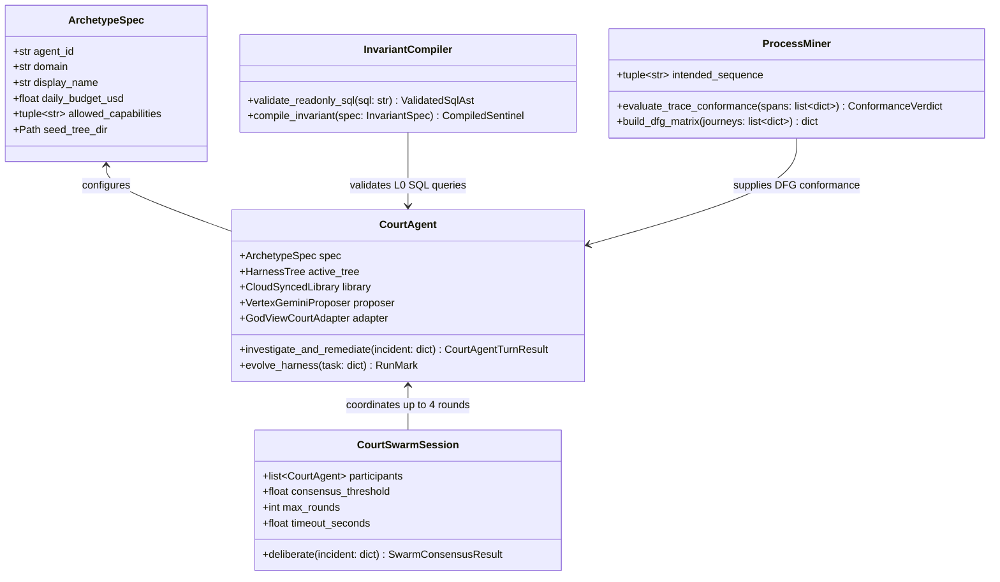

#### The 5 Court Specialist Archetypes (`godview/agents/archetypes.py` & `base_trees/`)

| Agent ID | Domain (`Archetype`) | Daily Budget | Seed `c7` Diagnostic Script (`base_trees/<domain>/scripts/`) | Primary Capabilities & Remediation Focus |
| :--- | :--- | :--- | :--- | :--- |
| **`app-loan-orchestrator`** | `application` | `$0.75/day` | `check_cibil_segment_offsets.py` | W3C trace correlation, service error/latency attribution, Cloud Run traffic rollback (`L2`), GKE deployment restart (`L2`). |
| **`data-ledger-pg`** | `data` | `$0.50/day` | `check_cibil_score_offsets.py` | Read-only PostgreSQL reconciliation (`sql.Postgres.readonly_query` via `sqlglot` AST gate), `pg_stat_activity` lock contention analysis, BigQuery ledger checks. |
| **`biz-loan-origination`** | `business_line` | `$0.75/day` | `check_dlq_saga_stall.py` | Financial & saga invariants (`inv-emi-matches-formula`, `inv-EveryApprovedLoanHasInsurance`, `inv-EveryDisbursedLoanHasUTR`, `inv-LoanStepOrder`), `L4` saga replay (`biz.replay_disbursement`), re-evaluation (`biz.reevaluate_application`), and compensation (`biz.compensate_journey`). |
| **`change-gitops`** | `change` | `$0.75/day` | `check_commit_regression.py` | Correlates `godview-nervous-system` Cloud Audit Logs and Git blame (`git.Repo.log_and_blame`), authors surgical remediation PRs (`git.GitHub.create_remediation_pr`, `L3`). |
| **`platform-gcp-mesh`** | `platform` | `$0.50/day` | `check_prompt_drift_cusum.py` | GKE pod OOM/503 scaling (`k8s.Deployment.scale`), GCE VM health/reset (`gcp.ComputeEngine.reset_instance`), Model Armor prompt-injection surge analysis, and Terraform drift (`gcp.Terraform.plan_drift_check`). |

#### MCP Adapters (`godview/adapters/`) & Invariant/Ledger Engines (`godview/invariants/`, `godview/ledger/`)

- **`godview/invariants/compiler.py`**: Parses every SQL query through **`sqlglot` (`dialect="postgres"`)** and rejects any AST containing `Insert`, `Update`, `Delete`, `Drop`, `Alter`, `Create`, `Truncate`, `Grant`, `Revoke`, `Copy`, `Call`, `Transaction`, or `Locking` (`FOR UPDATE` / `FOR SHARE`) nodes, plus bans `pg_sleep`, `dblink`, and multi-statement queries (`I-05`).
- **`godview/ledger/process_mining.py` & `kpi.py`**: Computes Directly-Follows Graph (DFG) edges across `godview_ledger.state_transitions` and classifies journeys as `CONFORMANT` (`KYC -> LOS -> [FLEET_CREDIT] -> INS -> CBS`), `REORDERED` (e.g., `INS` before `KYC`), `SKIPPED` (e.g., `DISBURSED` without `INS`), or `STALLED` (`DISBURSEMENT_PENDING` > 120 s).
- **`godview/adapters/{gcp,kubernetes,sql,git,local,channels}/`**: Implements the 21 `SIX_SENSES_CAPABILITIES` over GCP Cloud Run/Compute/Logging/Monitoring/Terraform state, Kubernetes `AppsV1Api`/`CoreV1Api`, read-only PostgreSQL (`SET TRANSACTION READ ONLY; statement_timeout = '3000ms'`), GitHub PR creation, and Google Chat webhook notifications.

---

### 1.5 `cymbal/services/` — Customer Application Microservices & AI Simulator

#### Class Diagram (`cymbal/services/`)

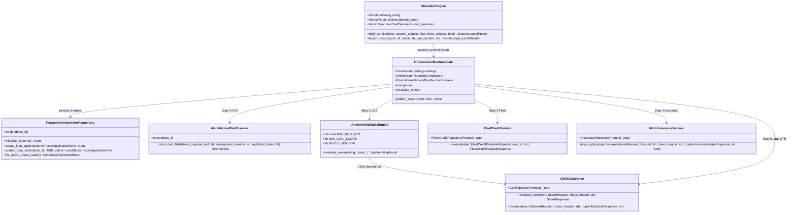

#### Microservice Endpoint & Wire Contract Specification Table

| Service (`cymbal/services/*`) | Compute Tier & Port | HTTP Endpoints | Core Business Logic, Idempotency & Chaos Fault Switches |
| :--- | :--- | :--- | :--- |
| **`loan-orchestrator-api`** | Cloud Run v2 (`:8080`) | Public (`/v1` & `/api/v1`): `GET /vehicles`, `GET /me`, `POST /loans/apply`, `GET /loans`, `GET /loans/{loan_id}`, `GET /kyc-documents/{customer_id}/{doc_type}`, `GET /observability/topology`, `GET /observability/traces/{trace_id}`, `GET /telemetry/stream`. Admin (`/admin/v1`): `POST /disbursements/{loan_id}:replay`, `POST /loans/{loan_id}:re-evaluate`, `POST /journeys/{journey_id}:compensate`, `GET /disbursements`, `POST /tenant/state`, `POST /tenant/pause`, `POST /tenant/resume`, `POST /chaos/faults`, `DELETE /chaos/faults/{fault_id}` | Coordinates the 5-utility saga; computes reducing-balance EMI via `calculate_emi_inr()`; uses PostgreSQL advisory lock `pg_advisory_lock(84920174)` and `to_regclass()` pre-checks during `initialize_schema()` so Cloud SQL logs 0 `ERROR`/`WARNING` entries. Injects `emi_rounding` (`UC-06`), `insurance_no_policy_write` (`UC-05`), and `step_order_insurance_before_kyc` (`UC-08`). |
| **`kyc-model-armor-svc`** (Utility 1) | GKE Autopilot (`10.10.0.3:8080`) | `POST /internal/kyc/verify`, `POST /internal/chaos/faults`, `DELETE /internal/chaos/faults/{fault_type}`, `GET /internal/chaos/faults`, `GET /healthz`, `GET /metrics` | Validates PAN (`^[A-Z]{5}[0-9]{4}[A-Z]$`) and 12-digit Aadhaar; verifies PNG magic header (`\x89PNG\r\n\x1a\n`) on specimen cards; scans **only the 3 text fields** (`loan_purpose_text`, `employment_remarks`, `applicant_notes`) via Vertex AI Model Armor template `cymbal-text-guard` (`images_sent_to_model_armor = False`). Supports `gke_oom_503` (`UC-15`). |
| **`underwriting-los-svc`** (Utility 2) | GKE Autopilot (`10.10.0.2:8080`) | `POST /internal/underwriting/evaluate`, `POST /internal/chaos/faults`, `DELETE /internal/chaos/faults/{fault_type}`, `GET /internal/chaos/faults`, `GET /healthz`, `GET /metrics` | Calls Utility 5 (`core-banking-cibil-vm`) for CIBIL score; evaluates `cibil_score >= 680`, `foir_pct <= 60.00%` (or buggy `75.00%` under `foir_threshold_regression`), and `ltv_pct <= 90.00%`. Rejects caller-supplied `cibil_score` unless `X-Synthetic: true` or baggage `synthetic=true`. Supports `gke_oom_503` and `foir_threshold_regression`. |
| **`commercial-fleet-credit-svc`** (Utility 3) | Cloud Run v2 (`:8080`) | `POST /internal/fleet-credit/evaluate`, `GET /healthz`, `GET /metrics` | Evaluates working-capital credit lines for `COMMERCIAL_FLEET` and `TWO_WHEELER` applications (`sanctioned_limit_inr`, `utilisation_pct`, `fleet_size`) and writes to `commercial_credit_lines`. |
| **`motor-insurance-svc`** (Utility 4) | Cloud Run v2 (`:8080`) | `POST /internal/insurance/issue`, `GET /healthz`, `GET /metrics` | Verifies loan status is `APPROVED` (returns `409 LOAN_NOT_APPROVED` otherwise), calculates 3-year comprehensive premium (`2.5%` of principal), links FASTag wallet (`FT-CYM-*`), and writes `insurance_policies`. Under `insurance_no_policy_write` (`UC-05`), returns `200 OK` without persisting a row to `insurance_policies` ("HTTP 200 but business broken"). |
| **`core-banking-cibil-vm`** (Utility 5) | GCE VM (`10.10.0.5:8085`) | `POST /internal/cibil-cbs/score`, `POST /internal/cibil-cbs/disburse`, `POST /internal/cibil-cbs/score-and-disburse`, `GET /internal/cibil-cbs/disbursements`, `GET /internal/cibil-cbs/disbursements/{loan_id}`, `GET /healthz`, `GET /metrics` | Computes deterministic SHA-256 persona-seeded CIBIL score in `[300, 899]` (or constant `900` under `cibil_stub_900`, `UC-07`); executes idempotent CBS disbursement (`SANC-2026-*`, `NACH-2026-*`, `CBS-UTR-2026-*`). Under `gce_vm_latency_504` (`UC-16`), sleeps `6.0 s`, records `PENDING`/`FAILED` row, and raises `504 CBS_GATEWAY_TIMEOUT`. |
| **`ai-customer-simulator`** | Cloud Run v2 (`:8080`) | `POST /v1/simulator/tick`, `POST /v1/simulator/state`, `POST /v1/simulator/journeys`, `POST /v1/simulator/journeys/adversarial`, `POST /v1/simulator/journeys/duplicate-pan`, `GET /v1/simulator/status` (also mounted under `/api/v1/simulator/*`) | Generates synthetic Indian borrower personas via `gemini-2.5-flash` with checksum-invalid PANs and `9999*` Aadhaar numbers; generates watermarked (`SPECIMEN · NOT A GOVERNMENT DOCUMENT`) PNG cards on 15% of journeys via `gemini-3.1-flash-image-preview`; attaches cached Google OIDC ID tokens (`AdcTokenProvider`) when calling `loan-orchestrator-api`. |

#### Legacy 120-Byte CIBIL TUDF Fixed-Width Wire Format & Offset Diagnostic Contract

When `underwriting-los-svc` and the Court Application/Data Specialists (`check_cibil_segment_offsets.py`, `check_cibil_score_offsets.py`) inspect CIBIL bureau segment frames:

| Byte Offset Range | Field Name | Length (Bytes) | Encoding / Format | Description & Invariant Rule |
| :--- | :--- | :--- | :--- | :--- |
| `0..11` | `segment_header` | `12` | ASCII (`TUDF2026CIBL`) | Fixed 12-byte bureau segment magic header. |
| `12..21` | `pan_number` | `10` | ASCII (`A-Z0-9`) | 10-character borrower PAN identifier. |
| `22..37` | `cibil_bureau_ref` | `16` | ASCII (`CIBIL-2026-XXXXXX`) | Deterministic 16-byte bureau reference number. |
| `38..40` | `cibil_score` | `3` | ASCII digits (`300`–`900`) | 3-byte integer CIBIL score; must satisfy `300 <= score <= 900` and variance $> 0$ across borrowers (`inv-cibil-score-valid`). |
| `41..52` | `monthly_income_paise` | `12` | Zero-padded ASCII integer | Borrower monthly income in INR paise. |
| `53..64` | `existing_emi_paise` | `12` | Zero-padded ASCII integer | Existing monthly debt obligations in INR paise. |
| `65..96` | `gce_vm_name` | `32` | Space-padded ASCII | Originating GCE VM hostname (`core-banking-cibil-vm`). |
| `97..116` | `evaluated_at_iso` | `20` | ISO-8601 UTC (`YYYY-MM-DDTHH:MM:SSZ`) | Bureau evaluation timestamp. |
| `117..119` | `crc_trailer` | `3` | ASCII (`END`) | Frame termination marker (total frame size = **120 bytes**). |

---

### 1.6 Frontend Component Trees & State Management

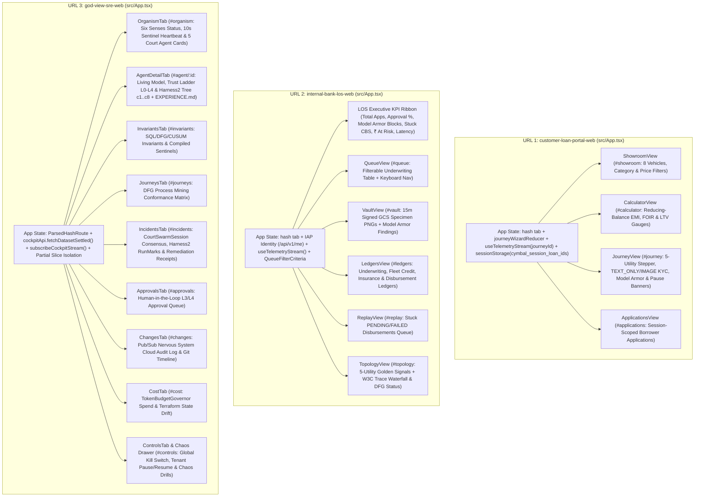

---

## 2. Data Model & Storage Schemas (`erDiagram`s)

### 2.1 Cloud SQL PostgreSQL 16 (`godview_lms` — Exactly 9 Business Tables)

Provisioned on `general-ak:us-central1:god-view-pg` (`10.186.0.3`, Private Service Access `10.186.0.0/16`). `app_user` holds read/write DML privileges for Cymbal tenant microservices; `godview_readonly` holds `SELECT`-only privileges with `default_transaction_read_only = on` and `statement_timeout = 3000` ms for God-View's Data Sense (`I-05`).

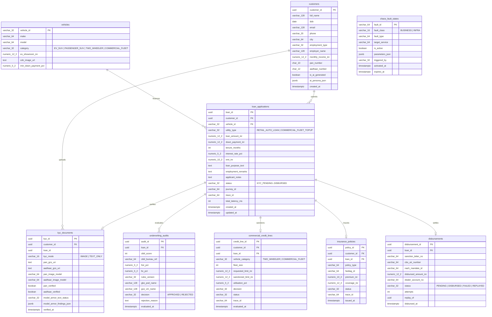

### 2.2 BigQuery Analytical Ledger (`general-ak.godview_ledger` — 4 Partitioned & Clustered Tables)

Defined in [`godview/ledger/ddl.sql`](file:///usr/local/google/home/kambleashish/Documents/Projects/god-view/godview/ledger/ddl.sql) and provisioned in `infra/terraform/platform/modules/02-data/main.tf`:

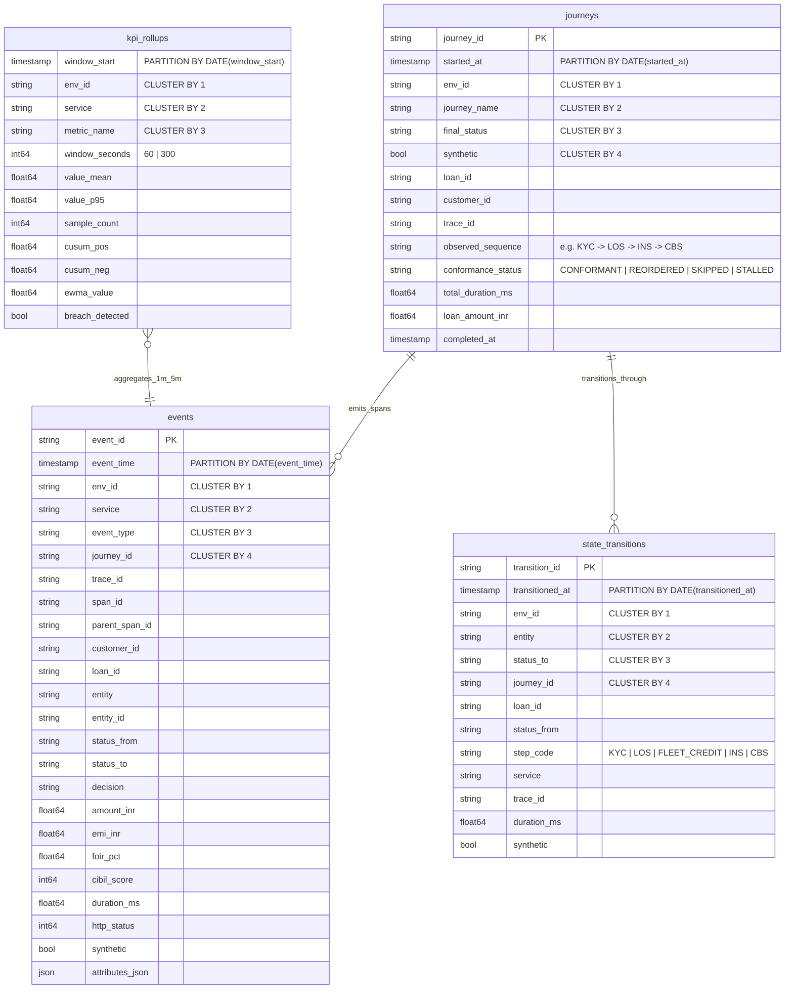

### 2.3 Firestore Native Memory & Vector Database (`god-view-memory-db`)

Provisioned in `nam5` (`us-central1`) with **13 collections** and **4 flat `768`-dimensional `COSINE` vector indexes** (`text-embedding-005`):

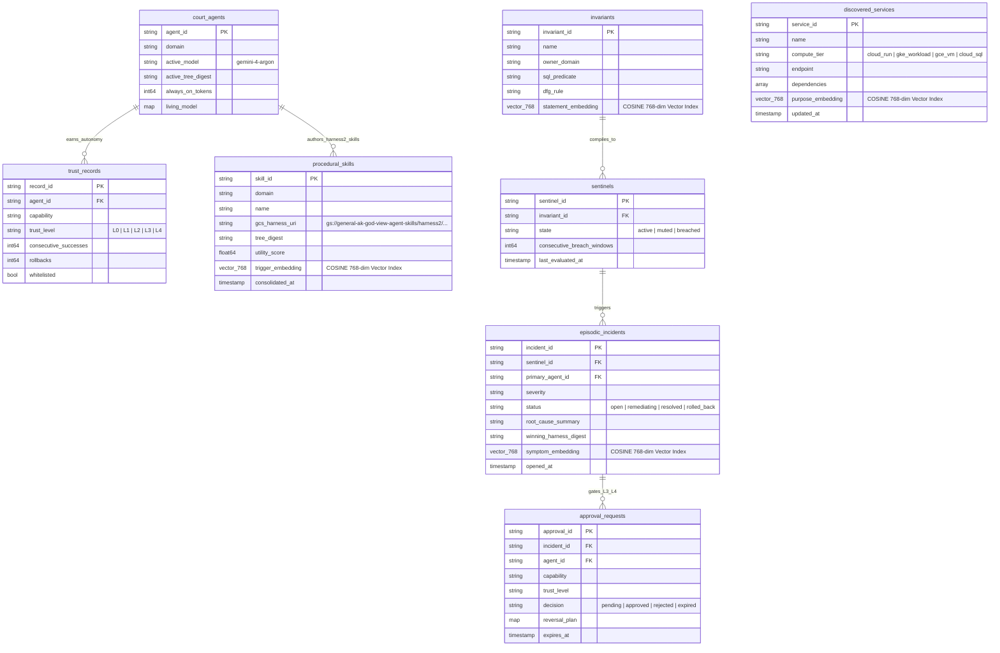

---

## 3. Wire-Level Sequence Diagrams (`sequenceDiagram`)

### 3.1 Multi-Utility Loan Application Saga (Customer Portal $\rightarrow$ 5 Utilities $\rightarrow$ Cloud SQL & BigQuery)

```mermaid
sequenceDiagram
    autonumber
    actor Customer as Borrower Browser (cymbal.ak-demos.com)
    participant APIGW as API Gateway (god-view-loan-api-gw)
    participant Orch as loan-orchestrator-api (Cloud Run v2)
    participant KYC as Utility 1: kyc-model-armor-svc (GKE 10.10.0.3)
    participant Armor as Vertex AI Model Armor (cymbal-text-guard)
    participant LOS as Utility 2: underwriting-los-svc (GKE 10.10.0.2)
    participant CBS as Utility 5: core-banking-cibil-vm (GCE VM 10.10.0.5:8085)
    participant Fleet as Utility 3: commercial-fleet-credit-svc (Cloud Run v2)
    participant Ins as Utility 4: motor-insurance-svc (Cloud Run v2)
    participant PG as Cloud SQL PG16 (godview_lms)
    participant Sov as god-view-sovereign (/v1/traces -> BigQuery)

    Customer->>APIGW: POST /api/v1/loans/apply (LoanApplyRequest)
    APIGW->>Orch: Forward POST /api/v1/loans/apply + OIDC Token (godview-apigw-sa)
    Orch->>PG: UPSERT customers & INSERT loan_applications (status=KYC_PENDING, emi_inr)

    Note over Orch,KYC: Step 1 — KYC & Text-Only Model Armor Verification (W3C traceparent + baggage)
    Orch->>KYC: POST /internal/kyc/verify (PAN, Aadhaar, PNG headers, 3 text fields)
    KYC->>KYC: Validate PAN/Aadhaar regex & PNG 8-byte magic header (never sends image bytes to LLM)
    KYC->>Armor: sanitizeUserPrompt(loan_purpose_text, employment_remarks, applicant_notes)
    Armor-->>KYC: Model Armor Verdict (CLEAN or MODEL_ARMOR_BLOCKED)
    KYC-->>Orch: KycVerifyResponse (status=KYC_VERIFIED, event_type=kyc.verified)
    Orch->>PG: UPSERT kyc_documents & UPDATE loan_applications (status=KYC_VERIFIED)

    Note over Orch,CBS: Step 2 — Retail Underwriting & CIBIL Bureau Pull
    Orch->>LOS: POST /internal/underwriting/evaluate (income, EMI, tenure, LTV, PAN)
    LOS->>CBS: POST /internal/cibil-cbs/score (pan_number, persona_seed)
    CBS-->>LOS: ScoreResponse (cibil_score in 300..899, cibil_bureau_ref, gce_vm_name)
    LOS->>LOS: Verify cibil_score >= 680, foir_pct <= 60.0%, ltv_pct <= 90.0%
    LOS-->>Orch: UnderwritingEvaluateResponse (decision=APPROVED, foir_pct, ltv_pct)
    Orch->>PG: INSERT underwriting_audits & UPDATE loan_applications (status=APPROVED)

    opt utility_type == COMMERCIAL_FLEET_TOPUP (Step 3 — Commercial Fleet Credit)
        Orch->>Fleet: POST /internal/fleet-credit/evaluate (fleet_size, requested_limit_inr, cibil_score)
        Fleet->>PG: INSERT commercial_credit_lines (status=SANCTIONED)
        Fleet-->>Orch: FleetCreditEvaluateResponse (decision=APPROVED, sanctioned_limit_inr)
    end

    Note over Orch,Ins: Step 4 — Comprehensive Motor Insurance & FASTag Issuance
    Orch->>Ins: POST /internal/insurance/issue (loan_id, loan_status=APPROVED, coverage_inr)
    Ins-->>Orch: InsuranceIssueResponse (policy_id, fasttag_id, premium_inr, status=ACTIVE)
    Orch->>PG: INSERT insurance_policies & UPDATE loan_applications (status=INSURED)

    Note over Orch,CBS: Step 5 — Idempotent Core Banking Settlement (CBS UTR & NACH e-Mandate)
    Orch->>CBS: POST /internal/cibil-cbs/disburse (loan_id, disbursed_amount_inr, dealer_account_no)
    CBS->>PG: UPSERT disbursements (cbs_utr_number, sanction_letter_no, nach_mandate_id, status=DISBURSED)
    CBS-->>Orch: DisburseResponse (status=DISBURSED, cbs_utr_number, attempts=1)
    Orch->>PG: UPDATE loan_applications (status=DISBURSED, total_latency_ms)

    Orch--)Sov: Async OTLP HTTP Span Export (/v1/traces with cached Google OIDC Bearer token)
    Orch-->>APIGW: 200 OK LoanJourneyDetailResponse (full 5-utility dossier)
    APIGW-->>Customer: 200 OK LoanJourneyDetailResponse + SSE step events
```

### 3.2 Sentinel Breach $\rightarrow$ Sovereign Wake $\rightarrow$ Harness² `INV`/`DOM`/`AGG` Loop $\rightarrow$ TrustGate Remediation & GitOps PR

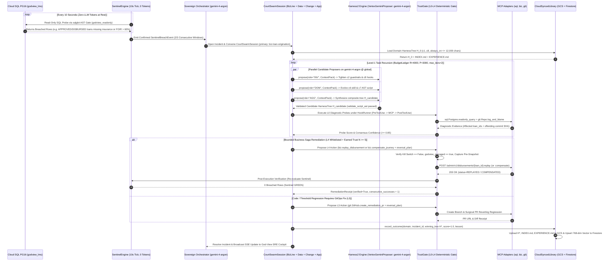
