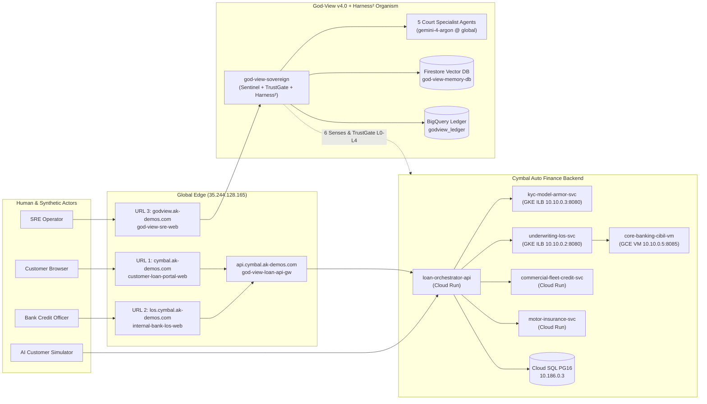

# God-View v4.0 & Cymbal Auto Finance — Live URLs & Operator Interaction Guide

> **Note:** This guide provides every live URL, endpoint, UI walkthrough, and CLI/API command to interact with **God-View v4.0** (Sovereign AI SRE Organism + **Harness²** Recursive Agent Harness on `gemini-4-argon` @ `global`) and its proving-ground tenant **Cymbal Auto Finance** deployed in GCP project `general-ak` (`us-central1`).

## 1. Live Web Application & Edge URLs (`ak-demos.com` & Cloud Run)

### 1.1 Primary Public & Edge-Routed URLs (Global External Application Load Balancer `35.244.128.165`)

| Portal / Endpoint | Global Edge Domain (`ak-demos.com`) | Direct Cloud Run / Gateway URL | Auth & Security Posture | Purpose |
| :--- | :--- | :--- | :--- | :--- |
| **URL 1: Customer Loan Portal** | `https://cymbal.ak-demos.com` | `https://customer-loan-portal-web-mcj3w7ujpq-uc.a.run.app` | Public (`Cloud Armor WAF` + `Cloud CDN`) | Customer-facing 5-utility vehicle finance application portal (Two-Wheeler, Passenger EV, Commercial Fleet, Refinance, Motor Insurance) with Aadhaar/PAN upload & live status tracking |
| **URL 2: Internal Bank LOS Portal** | `https://los.cymbal.ak-demos.com` | `https://internal-bank-los-web-mcj3w7ujpq-uc.a.run.app` | Edge IAP (`admin@kambleashish.altostrat.com`) / Cloud Run URL | Credit officer & underwriting workbench: loan queue, CIBIL 120-byte bureau inspector, FOIR/LTV calculator, manual review overrides, and dead-letter saga replay |
| **URL 3: God-View SRE Cockpit** | `https://godview.ak-demos.com` | `https://god-view-sre-web-mcj3w7ujpq-uc.a.run.app` | Edge IAP (`admin@kambleashish.altostrat.com`) / Cloud Run URL | Sovereign AI SRE Command Center: 6-Senses Topology, Business Invariants Board, Journey Conformance Explorer, Court Agents & **Harness²** Studio, Chaos Engineering Lab, TrustGate Approvals, and FinOps/Drift Control |
| **Public Loan API Edge** | `https://api.cymbal.ak-demos.com` | `https://god-view-loan-api-gw-9t9witd8.uc.gateway.dev` | Cloud Armor OWASP WAF + API Gateway | Managed API Gateway routing customer and partner REST/SSE loan requests to `loan-orchestrator-api` |
| **God-View Sovereign API** | `https://godview.ak-demos.com/api` | `https://god-view-sovereign-mcj3w7ujpq-uc.a.run.app` | Cloud Run OIDC (`roles/run.invoker`) / Edge IAP | Always-on Sovereign Control Plane (`0` LLM tokens at rest; 10s Sentinel Engine, TrustGate `L0–L4`, Harness² Reflection & Court Agent A2A Coordinator) |

### 1.2 Backend Microservices, Databases & Internal Endpoints (`general-ak`)

| Service / Resource | Runtime / Tier | Endpoint / Connection Identifier | Role in Architecture |
| :--- | :--- | :--- | :--- |
| **`loan-orchestrator-api`** | Cloud Run v2 (`us-central1`) | `https://loan-orchestrator-api-mcj3w7ujpq-uc.a.run.app` | 5-step multi-utility loan saga orchestrator, chaos state manager, and PostgreSQL (`godview_lms`) writer |
| **`commercial-fleet-credit-svc`** | Cloud Run v2 (`us-central1`) | `https://commercial-fleet-credit-svc-mcj3w7ujpq-uc.a.run.app` | Utility 3: Commercial fleet credit appraisal, GST/invoice PDF parser, DSCR & fleet-size limit evaluator |
| **`motor-insurance-svc`** | Cloud Run v2 (`us-central1`) | `https://motor-insurance-svc-mcj3w7ujpq-uc.a.run.app` | Utility 4: Motor insurance IDV, NCB, and premium binder generator |
| **`ai-customer-simulator`** | Cloud Run v2 (`us-central1`) | `https://ai-customer-simulator-mcj3w7ujpq-uc.a.run.app` | Synthetic customer persona engine (`09:00–17:00 IST`, ~300 journeys/day, 1-in-10 Aadhaar/PAN image journeys) |
| **`kyc-model-armor-svc`** | GKE Autopilot (`god-view-gke-cluster`, `cymbal` ns) | Internal Load Balancer: `http://10.10.0.3:8080` | Utility 1: Text-only Model Armor prompt-injection & PII guard (`cymbal-text-guard`) + KYC validation |
| **`underwriting-los-svc`** | GKE Autopilot (`god-view-gke-cluster`, `cymbal` ns) | Internal Load Balancer: `http://10.10.0.2:8080` | Utility 2: FOIR/LTV underwriting policy engine & CIBIL bureau client |
| **`core-banking-cibil-vm`** | GCE VM (`e2-micro`, `us-central1-a`) | Internal VPC IP: `http://10.10.0.5:8085` | Legacy Core Banking & 120-byte fixed-width CIBIL bureau scoring service |
| **`god-view-pg`** | Cloud SQL PostgreSQL 16 | Private IP: `10.186.0.3:5432` (`general-ak:us-central1:god-view-pg`) | Transactional database `godview_lms` (9 tables, `app_user` read-write + `godview_readonly` 5s timeout sense role) |
| **`god-view-memory-db`** | Firestore Native Mode | Database ID: `god-view-memory-db` (`us-central1`) | Agent Long-Term Memory, Living Semantic Models, and 4× 768-dim (`text-embedding-005`) KNN vector indexes |
| **`godview_ledger`** | BigQuery Dataset (`US`) | `general-ak.godview_ledger` | Analytical CDC & Observability Ledger (`journey_events`, `invariant_evaluations`, `change_events`, `cost_findings`) |



## 2. Interacting with the Three Web Portals

### 2.1 URL 1 — Customer Loan Portal (`https://cymbal.ak-demos.com` or `https://customer-loan-portal-web-mcj3w7ujpq-uc.a.run.app`)
1. **Browse the Vehicle Catalog & Utility Lines (`#catalog`):**
   - Filter across **Two-Wheeler**, **Passenger EV**, **Commercial Fleet**, **Refinance**, and **Motor Insurance**.
   - Inspect live ex-showroom pricing, battery/range specs, and indicative EMI calculations.
2. **Submit a Multi-Utility Loan Application (`#apply`):**
   - Enter borrower details (Full Name, 10-character PAN e.g. `ABCDE1234F`, 12-digit Aadhaar, Monthly Income, Existing EMI obligations, and Loan Amount/Tenure).
   - **Text-Only vs. Document Upload:** Toggle synthetic PAN/Aadhaar card preview or submit text-only KYC; watch the live 5-step saga progress bar (`KYC_CHECK` → `CIBIL_BUREAU` → `UNDERWRITING_LOS` → `FLEET_CREDIT` / `MOTOR_INSURANCE` → `DISBURSEMENT_READY`).
3. **Track Application Status & Repayment Schedule (`#status`):**
   - Look up any `loan_id` to inspect the sanction letter, amortized EMI schedule, insurance policy binder number, and step-by-step audit trail.

### 2.2 URL 2 — Internal Bank LOS Workbench (`https://los.cymbal.ak-demos.com` or `https://internal-bank-los-web-mcj3w7ujpq-uc.a.run.app`)
1. **Underwriting Pipeline & Queue (`#queue`):**
   - View real-time loan applications grouped by status (`APPROVED`, `MANUAL_REVIEW`, `REJECTED`, `DLQ_STALLED`) and utility line.
2. **120-Byte CIBIL Bureau & FOIR Inspector (`#inspector`):**
   - Click any application to inspect the raw **120-byte fixed-width CIBIL wire response** (`[0:24]` Name, `[24:34]` PAN, `[34:37]` Score `300..900`, `[37:45]` DPD, `[45:120]` Enquiry/Account segments), computed **FOIR** (Fixed Obligation to Income Ratio), and **LTV** (Loan-to-Value).
   - When Chaos Scenario 1 (CIBIL 2-byte PAN overflow shift) is active, you can visually see the score slice `[34:37]` shift into alphanumeric bytes and drop prime borrowers to fallback score `300`.
3. **Manual Underwriting Override & Dead-Letter Replay (`#overrides` / `#dlq`):**
   - Credit officers can approve/reject `MANUAL_REVIEW` applications with mandatory audit notes or trigger saga compensation/replay on stuck `DLQ_STALLED` fleet applications.

### 2.3 URL 3 — God-View SRE Cockpit (`https://godview.ak-demos.com` or `https://god-view-sre-web-mcj3w7ujpq-uc.a.run.app`)
The SRE Cockpit is organized into hash-routed operational workspaces:
1. **Organism & 6-Senses Topology (`#topology`):**
   - Live graph of discovered services, GKE pods, GCE VMs, Cloud SQL, BigQuery, and the 5 Court Specialist Agents (`application`, `data`, `business_line`, `change`, `platform`) running on **`gemini-4-argon` @ `global`** (`0` tokens at rest when Sentinels are green).
2. **Business Invariants & Sentinel Board (`#invariants`):**
   - Inspect machine-checked SQL/Python/CUSUM/DFG business invariants (`INV-CIBIL-001`, `INV-PROMPT-002`, `INV-DLQ-003`, `INV-FOIR-004`, `INV-INS-005`) evaluated every 10 seconds by the 0-token Sentinel Engine.
3. **Journey Conformance & Process Mining Explorer (`#journeys`):**
   - Directly-Follows Graph (DFG) of multi-utility loan sagas highlighting silent "HTTP 200 but business broken" anomalies (e.g., loans marked `APPROVED` without an insurance policy binder or prime borrowers rejected with score `300`).
4. **Court Agents & Harness² Recursive Studio (`#agents` / `#memory`):**
   - Inspect each Court Agent's **Harness² `c1..c8` component tree** (`systemprompt.md`, `guardrails.md`, `LongTermMEMORY.md`, `tool_descriptions/tool_guidance.md`, `sub_agents/`, `skills/`, `scripts/`, `hooks.json`), `always_on` character budget (`used / 12,000`), `BudgetLedger` ($R=4k, P=3k$), and distilled `<experience>` lessons (`EXPERIENCE.md` + `INDEX.md`).
5. **Chaos Engineering & Failure Scenario Lab (`#chaos`):**
   - One-click injection and reset for the 3 flagship "HTTP 200 but Business Broken" scenarios and infrastructure faults:
     - **Scenario 1 (`cibil_byte_shift`):** Injects a 2-byte field alignment shift in the 120-byte CIBIL wire format (`HTTP 200`, prime borrowers silently scored `300` and rejected).
     - **Scenario 2 (`prompt_drift_injection`):** Injects adversarial prompt drift + synthetic KYC bypass attempts against `kyc-model-armor-svc`.
     - **Scenario 3 (`fleet_pdf_oom_dlq`):** Triggers memory pressure & dead-letter queue saga stall on `commercial-fleet-credit-svc`.
6. **TrustGate Approvals & Earned Autonomy Ladder (`#approvals` / `#trust`):**
   - Review `L2` human-in-the-loop remediation cards (Approve / Reject buttons), inspect `L0 -> L4` earned autonomy track records per agent, or toggle the **Global Kill Switch** / **Traffic Pause** / **Hibernate Mode**.
7. **FinOps, Token Budget & Terraform Drift Studio (`#cost`):**
   - Live tracking against the **\$600/month** budget ceiling, per-agent daily token spend (`\$0.50–\$0.75/day`), idle Reasoning Engine detector, and 1-click Terraform GitOps drift reconciliation.

## 3. CLI & REST API Cookbook (Interacting via `curl` & `gcloud`)

Because internal Cloud Run services enforce IAM (`roles/run.invoker` — zero unauthenticated `allUsers` on backend services), obtain an OIDC bearer token via `gcloud` before calling direct Cloud Run backend endpoints:

```bash
export PROJECT_ID="general-ak"
export SOVEREIGN_URL="https://god-view-sovereign-mcj3w7ujpq-uc.a.run.app"
export ORCH_URL="https://loan-orchestrator-api-mcj3w7ujpq-uc.a.run.app"
export APIGW_URL="https://god-view-loan-api-gw-9t9witd8.uc.gateway.dev"
export SIM_URL="https://ai-customer-simulator-mcj3w7ujpq-uc.a.run.app"
export TOKEN="$(gcloud auth print-identity-token)"
```

### 3.1 Verify Sovereign Health, 6-Senses Perception & Default Argon Model
```bash
# 1. Sovereign Health & Sentinel Cadence
curl -sS -H "Authorization: Bearer ${TOKEN}" "${SOVEREIGN_URL}/public/healthz" | jq .

# 2. Trigger 6-Senses Environment Perception (verifies reasoning_model = "gemini-4-argon")
curl -sS -X POST -H "Authorization: Bearer ${TOKEN}" \
  -H "Content-Type: application/json" \
  -d '{"namespace": "cymbal"}' \
  "${SOVEREIGN_URL}/api/v1/perceive" | jq .
```

### 3.2 Inspect Harness² Component Trees (`c1..c8`) & Experience Library
```bash
# 1. Inspect the Application Court Agent's live Harness² c1..c8 tree & character budget
curl -sS -H "Authorization: Bearer ${TOKEN}" \
  "${SOVEREIGN_URL}/api/v1/agents/application/harness" | jq .

# 2. Inspect distilled EXPERIENCE.md and INDEX.md for a Court domain
curl -sS -H "Authorization: Bearer ${TOKEN}" \
  "${SOVEREIGN_URL}/api/v1/agents/application/experience" | jq .

# 3. Trigger a Harness² Level-1 + Level-2 Reflection cycle across active Court Agents
curl -sS -X POST -H "Authorization: Bearer ${TOKEN}" \
  -H "Content-Type: application/json" \
  -d '{"domain": "application", "task_id": "scenario-1-cibil-byte-shift", "k": 1}' \
  "${SOVEREIGN_URL}/api/v1/sovereign/reflect" | jq .
```

### 3.3 Submit a Loan Application & Trigger a Chaos Drill via API
```bash
# 1. Submit a clean Two-Wheeler EV Loan Application through API Gateway
curl -sS -X POST "${APIGW_URL}/v1/loans/apply" \
  -H "Content-Type: application/json" \
  -d '{
    "applicant_name": "Aarav Sharma",
    "pan": "ABCDE1234F",
    "aadhaar_last4": "4821",
    "monthly_income_inr": 95000,
    "existing_emi_inr": 5000,
    "vehicle_id": "VEH-EV-2W-01",
    "utility_type": "TWO_WHEELER_EV",
    "requested_amount_inr": 145000,
    "tenure_months": 36,
    "include_motor_insurance": true
  }' | jq .

# 2. Launch a Chaos Drill (e.g., Scenario 1: Silent CIBIL 120-Byte Alignment Shift)
curl -sS -X POST -H "Authorization: Bearer ${TOKEN}" \
  -H "Content-Type: application/json" \
  -d '{"scenario_id": "drill-cibil-byte-shift", "action": "start"}' \
  "${SOVEREIGN_URL}/api/v1/drills" | jq .
```

### 3.4 Duty-Cycle Controls (Traffic Pause, Resume & Full Hibernate)
```bash
# Pause synthetic traffic & chaos outside 09:00-17:00 IST (Sentinels keep watching at 0 tokens)
curl -sS -X POST -H "Authorization: Bearer ${TOKEN}" "${SOVEREIGN_URL}/v1/tenant/pause" | jq .

# Resume synthetic traffic & normal duty cycle
curl -sS -X POST -H "Authorization: Bearer ${TOKEN}" "${SOVEREIGN_URL}/v1/tenant/resume" | jq .

# Run full Automated Smoke & E2E Verification Suite from the repo root
./infra/deploy/smoke.sh --with-mutations
```
