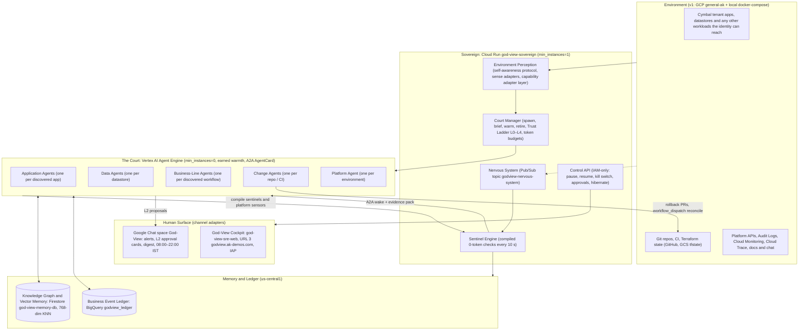
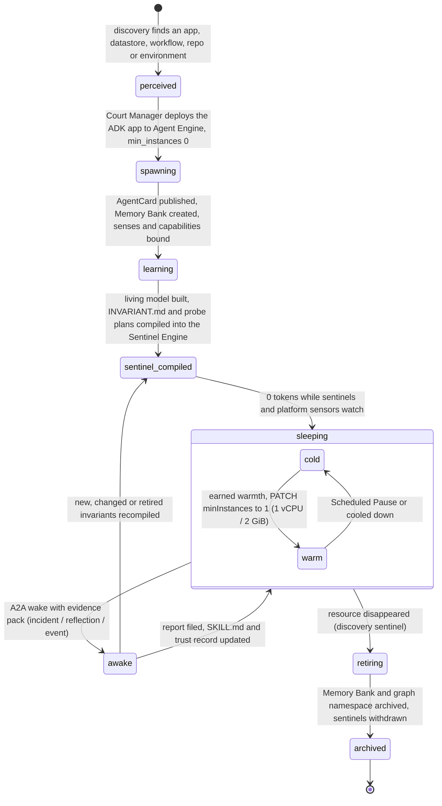
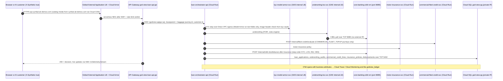
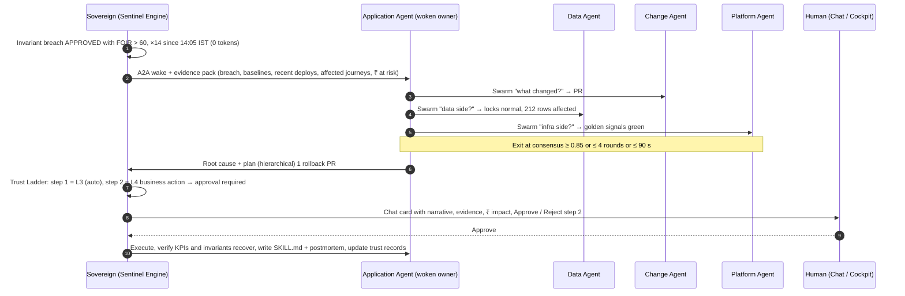
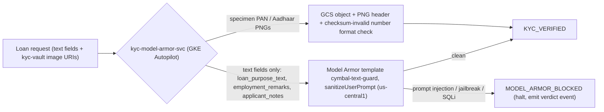

# System & Solution Design Document (SDD): God-View v4 — Sovereign SRE Organism, Environment Perception, the Court & the Cymbal Proving Ground
- **Document ID**: `GODVIEW-SDD-002`
- **Version**: `4.0 (Sovereign Organism — rewritten from the validated v4 design; supersedes 2.0/3.0)`
- **Repository Root**: `/usr/local/google/home/kambleashish/Documents/Projects/god-view`
- **Target Environments (v1)**: GCP project `general-ak` (`769002985772`, `us-central1`) + a hermetic local docker-compose environment
- **Source of Truth**: [God-View v4 Design: The Sovereign SRE Organism (`plans/2026-10-16-god-view-organism-design.md`)](file:///usr/local/google/home/kambleashish/Documents/Projects/god-view/plans/2026-10-16-god-view-organism-design.md) — every decision, number, name, model and SLO in this SDD is taken from it; anything it does not decide is listed in §11
- **Related Documents**:
  - [Master Architecture Overview (`docs/ARCHITECTURE.md`)](file:///usr/local/google/home/kambleashish/Documents/Projects/god-view/docs/ARCHITECTURE.md)
  - [High-Level Design (`docs/HLD.md`)](file:///usr/local/google/home/kambleashish/Documents/Projects/god-view/docs/HLD.md) · [God-View HLD (`docs/god-view/HLD.md`)](file:///usr/local/google/home/kambleashish/Documents/Projects/god-view/docs/god-view/HLD.md) · [Cymbal Auto Finance HLD (`docs/cymbal-auto-finance/HLD.md`)](file:///usr/local/google/home/kambleashish/Documents/Projects/god-view/docs/cymbal-auto-finance/HLD.md)
  - [Low-Level Design (`docs/LLD.md`)](file:///usr/local/google/home/kambleashish/Documents/Projects/god-view/docs/LLD.md) · [God-View LLD (`docs/god-view/LLD.md`)](file:///usr/local/google/home/kambleashish/Documents/Projects/god-view/docs/god-view/LLD.md) · [Cymbal Auto Finance LLD (`docs/cymbal-auto-finance/LLD.md`)](file:///usr/local/google/home/kambleashish/Documents/Projects/god-view/docs/cymbal-auto-finance/LLD.md)
  - [System Design & Deployment Architecture (`docs/SYSTEM_DESIGN.md`)](file:///usr/local/google/home/kambleashish/Documents/Projects/god-view/docs/SYSTEM_DESIGN.md)
  - [Business Requirements Document (`docs/BRD.md`)](file:///usr/local/google/home/kambleashish/Documents/Projects/god-view/docs/BRD.md)
  - [God-View Agent, MCP Mesh & Vector Skill Spec (`docs/GOD_VIEW_MCP_AGENT_SPEC.md`)](file:///usr/local/google/home/kambleashish/Documents/Projects/god-view/docs/GOD_VIEW_MCP_AGENT_SPEC.md)
  - [Terraform & GitHub GitOps Spec (`docs/TERRAFORM_GITOPS_SPEC.md`)](file:///usr/local/google/home/kambleashish/Documents/Projects/god-view/docs/TERRAFORM_GITOPS_SPEC.md)
  - [Master Technical Design Document & Swarm Playbook (`TDD.md`)](file:///usr/local/google/home/kambleashish/Documents/Projects/god-view/TDD.md)

> [!IMPORTANT]
> v4 replaces the v3.0 "observability platform for a demo" with an **organism**: one always-on **Sovereign** that perceives whatever environment it is deployed into, grows a **court** of long-lived specialist agents, and reasons across them with **business- and workflow-logic intelligence** — *HTTP 200, pods healthy, P95 fine, business broken*. Cymbal Auto Finance is the instrumented proving-ground tenant, kept at real-world topology and the smallest sizes. Production-grade engineering, demo duty cycle (traffic 09:00–17:00 IST, Scheduled Pause, Traffic Kill Switch, Hibernate), hard budget ceiling $600/month.

## 1. End-to-End Architecture

| Plane | Components | Runtime | Detailed in |
| :-- | :-- | :-- | :-- |
| **P0 Change plane** | GitHub repository, GitHub Actions (WIF, no JSON keys), Terraform roots `infra/terraform/platform` + `infra/terraform/workloads`, state in `gs://general-ak-god-view-tfstate` | GitHub + GCS | TF Spec |
| **P1 Tenant (Cymbal Auto Finance)** | Global External Application LB, Cloud CDN, Cloud Armor, API Gateway `god-view-loan-api-gw`, Cloud Run services, GKE Autopilot `god-view-gke-cluster`, GCE `core-banking-cibil-vm`, Cloud SQL `god-view-pg`, GCS buckets `general-ak-god-view-{kyc-vault,cdn-assets}` | `general-ak`, `us-central1` | §6 |
| **P2 Perception** | sense adapter families `gcp` / `kubernetes` / `sql` / `git` / `channels` / `local`; capability adapter layer over official MCP servers and SDK calls | inside the Sovereign and every court agent | §2, Agent Spec §6 |
| **P3 Sovereign** | Sentinel Engine, Nervous System, Court Manager, Trust Ladder, Control API | Cloud Run `god-view-sovereign`, `min_instances=1`, 1 vCPU, CPU always allocated | §4 |
| **P4 The Court** | Application, Data, Business-Line, Change, Platform Agents | Vertex AI Agent Engine (`us-central1`, staging bucket `general-ak-god-view-agent-staging`), `min_instances=0`, A2A | §3, Agent Spec §4 |
| **P5 Memory & Ledger** | Firestore `god-view-memory-db`, BigQuery `godview_ledger`, per-agent Memory Bank, vaults in GCS `general-ak-god-view-agent-skills` + Git | `us-central1` | §5, TDD §2 |
| **P6 Human surface** | Chat space "God-View", God-View Cockpit (URL 3, IAP), email | channel adapters | §8, design §10 |

## 2. Environment Perception Layer
### 2.1 Boot-time self-awareness protocol (zero configuration, identity only)
| # | Question | Mechanism | Output |
| :-- | :-- | :-- | :-- |
| 1 | **Who am I?** | Resolve identity (ADC / workload identity / mounted secrets); enumerate what it can reach with `testIamPermissions`-style probes per adapter | identity record + permission map |
| 2 | **Where am I?** | Environment signals: metadata server, Kubernetes service account, cloud API reachability, Git remotes, Docker socket, Prometheus endpoints, SQL DSNs in discovered config | environment fingerprint (`gcp`, `local`, or both) |
| 3 | **What senses do I have?** | Every sense adapter reports `available` / `partial` / `unavailable` **with evidence**; adapters never assume each other | sense matrix |
| 4 | **What exists?** | Discovery through the available adapters → initial knowledge graph; business roles inferred in **one batched `gemini-3.8-flash` (`global`) call**; embedded with `text-embedding-005` (768-dim, `us-central1`); persisted to Firestore. Everything found is classified `journey_linked` (transactional apps sharing the discovered correlation keys) or `other_read_only` (the rest of the project, never mutated) | graph nodes, edges, journey candidates |
| 5 | **Who should watch it?** | Court Manager spawn plan: one Application Agent per app, one Data Agent per datastore, one Change Agent per repo, Business-Line Agents once journeys are discovered, one Platform Agent per environment | Agent Engine deployments |
| 6 | **Re-perceive continuously** | Discovery is itself a sentinel: new service / table / repo → spawn; disappearance → retire with memory archived | lifecycle events on the Nervous System |

SLO (design §13): model + sentinels live **< 30 s** after boot; agents live **≤ 10 min** (Agent Engine deploy time). Optional hints (e.g. repo URLs) only **widen** scope; nothing environment-specific is hardcoded, and an Agent Registry is **discovered, never assumed**.

### 2.2 Sense-adapter contract
| Method | Returns | Rules |
| :-- | :-- | :-- |
| `discover()` | candidate graph nodes (services, datastores, clusters, VMs, repos, topics, agents) and edges, each with evidence | read-only, paginated, idempotent |
| `senses()` | which sense categories the adapter feeds: code, contracts, synthetic interrogation, change-plane, scoped observability, data (replica / CDC), human docs / chat | declared, then verified by `health()` |
| `capabilities()` | capability names → real tool or SDK binding → minimum Trust Ladder level | the only path to a mutating call |
| `health()` | availability state `available` / `partial` / `unavailable` + evidence + checked-at | re-evaluated continuously; a flip is a Nervous System event |

### 2.3 Adapter families (v1)
| Family | Adapters | Notes |
| :-- | :-- | :-- |
| `gcp` | Cloud Asset Inventory, Cloud Run v2, GKE, Compute, Cloud SQL Admin, Cloud Monitoring, Cloud Trace, Cloud Logging (Audit Logs), Pub/Sub, BigQuery, Datastream, Firestore, Agent Engine, **Agent Registry (optional, discovered)**, Model Armor, IAM | official MCP servers used through the capability adapter layer (§2.4) |
| `kubernetes` | API server, events, metrics-server, Prometheus scrape | works on GKE and kind |
| `sql` | PostgreSQL (`information_schema`, `pg_stat_*`, `pg_locks`, logical decoding) | MySQL later |
| `git` | GitHub (API + webhooks), generic Git | GitLab later |
| `channels` | Google Chat (cards), email; Slack later | operating-window aware (08:00–22:00 IST) |
| `local` | docker-compose discovery, kind, local Postgres, local Git | hermetic second environment (§10) |

**Core speaks only open standards**: OpenTelemetry (traces / metrics / baggage), Prometheus `/metrics`, Kubernetes API, SQL `information_schema` + logical replication / CDC, Git + OpenAPI / proto / JSON Schema, CloudEvents, A2A, MCP.

### 2.4 Official GCP MCP servers through the capability adapter layer
Agents and the Sovereign call **capabilities**; the adapter layer resolves each to a real MCP tool or to an SDK call. Capability names below are descriptive; the authoritative mapping lives in Agent Spec §6. HashiCorp `terraform-mcp` is a registry-documentation / HCP Terraform server: God-View never claims drift detection, `plan` or `apply` through it (at most a provider-docs lookup). `gcloud-mcp` is available in the `gcp` family; v1 binds no capability to it.

| God-View capability (adapter layer) | Realised by | Server / family | Min. trust |
| :-- | :-- | :-- | :-- |
| Time-series and exemplar traces for golden-signal gates and slow or failed journey steps | `list_timeseries`; `list_traces` → `get_trace` | observability-mcp / `gcp` | L0 |
| Scoped log query (filtered, bounded page size; never bulk streaming in the resting loop) | `list_log_entries`; on GKE `query_logs` + `get_log_schema` | observability-mcp, gke-mcp / `gcp`, `kubernetes` | L0 |
| Cluster and workload inspection (OOM, restarts, events, recommendations) | `list_clusters`, `get_cluster`, `get_k8s_resource`, `list_recommendations` | gke-mcp / `kubernetes` | L0 |
| Schema, lock blocking tree, slow queries, query plans | `list_tables`, `execute_sql` on `pg_locks` / `pg_stat_activity` / `pg_stat_statements`, `list_active_queries`, `get_query_plan` | MCP Toolbox for Databases, postgres prebuilt / `sql` | L0 |
| Terminate a blocking backend | `execute_sql` → `pg_terminate_backend(pid)` | MCP Toolbox / `sql` | L3 |
| Reversible infra actions with no MCP tool: restart revision, rollout restart, scale back, restore a tfstate attribute (replicas, min / max instances, concurrency, image, env) | Kubernetes and Cloud Run Admin APIs via SDK — **God-View adapter** | `kubernetes`, `gcp` | L3 |
| Business-language diff and deploy ↔ incident correlation | `list_commits`, `get_commit`, `get_file_contents` | github-mcp / `git` | L0 |
| Rollback PR (five-call recipe; `git.create_rollback_pr` in TDD §3.7) | `get_commit` → `get_file_contents` at the parent → `create_branch` → `push_files` → `create_pull_request` (+ `create_issue` for the postmortem) | github-mcp / `git` | L3 (design §8 step 1) |
| tfstate-vs-live attribute drift diff, then fast API restore (≤ 90 s) or authoritative reconcile (≤ 8 min) | **God-View engine** reads `terraform.tfstate` from GCS and compares a curated attribute set through live APIs; restore via the SDK adapter above; reconcile via GitHub Actions `workflow_dispatch` → `terraform apply` | `gcp`, `git` | L0 detect, L3 restore, L2 / L3 reconcile |

## 3. The Court
### 3.1 Agent types
| Agent | Spawned per | Living model it owns | Default senses | Compiles for the Sovereign |
| :-- | :-- | :-- | :-- | :-- |
| **Application Agent** | discovered app / service | entities, rules, state machines, routes, dependencies, feature flags, "what changed in business terms" per commit, empirical decision boundaries | code (read-only repo), contracts (OpenAPI / API Gateway config, protos, schemas), **synthetic interrogation** (probe plans on probe-safe endpoints), change-plane (Audit Logs, PRs, CI, tfstate), scoped observability, human docs / chat | invariant checks, probe plans, SLOs, KPI definitions, wake conditions |
| **Data Agent** | datastore | schema + lineage (which app writes which table), state-transition model from CDC, integrity rules, hot paths, lock / slow-query baselines | read replica where one exists, CDC (Datastream → BigQuery), `pg_stat_statements`, migrations | integrity SQL, lock / slow-query sentinels, CDC schema-change wake |
| **Business-Line Agent** | discovered cross-app workflow | process model (directly-follows graph), conformance rules, funnel KPIs, ₹ impact model, replay / compensation playbooks | ledger + journey store; interviews Application Agents over A2A | conformance checks, funnel change-point tests, stuck-journey detectors |
| **Change Agent** | repo / CI | business-language diff summaries, risk model per code area, deploy ↔ incident correlation, rollback recipes | GitHub API + webhooks, CI runs, Audit Logs | "deploy happened" events, canary windows, PR review triggers |
| **Platform Agent** | environment / project | golden signals, tfstate-vs-live drift, quotas, **cost** (e.g. idle Reasoning Engines), IAM drift | Monitoring, Asset Inventory, Billing export, tfstate in GCS | golden-signal gates, drift diffs, budget sentinels |

Runtime: ADK apps on Vertex AI Agent Engine (`us-central1`), `deployment_spec.min_instances = 0`, A2A `AgentCard` served by an `AgentExecutor`, auto-catalogued in Agent Registry **only when one is discovered**. Each agent carries a trust record (per agent **and** per action type, L0–L4, instant demotion), a daily token budget (exhausted → degrades to L1) and a daily reflection wake.

Models (every Gemini 3.x / 4 model resolves at location `global` in `general-ak`, configured in `shared/godview_shared/config.py`): **Primary reasoning, Sovereign orchestration, all 5 Court Agents, and Harness² `VertexGeminiProposer` default to Argon (`gemini-4-argon` @ `global`)**, with automatic fallback to `gemini-3.8-flash` (`global`) on HTTP 429, quota, or `TokenBudgetGovernor` reserve threshold; AI customer personas run on `gemini-2.5-flash` (`us-central1` / `global`); specimen KYC cards run on `gemini-3.1-flash-image-preview` (`global`); embeddings run on `text-embedding-005` (`us-central1`, 768-dim).

### 3.2 Agent lifecycle

### 3.3 Per-agent memory
| Memory | Where | Visibility | Content |
| :-- | :-- | :-- | :-- |
| **Memory Bank** | Agent Engine, per agent | private | working memory, in-progress interrogations, draft invariants |
| **Knowledge Graph namespace** | Firestore `god-view-memory-db` (collections per Agent Spec §3: `discovered_services`, `discovered_edges`, `discovered_entities`, `journeys`, `court_agents`, `trust_records`, `sentinels`, `invariants`, `episodic_incidents`, `procedural_skills`, `change_events`, `cost_findings`, `approvals`) | public to the court | semantic model, episodic incidents (768-dim KNN), procedural skills index, trust record |
| **Vaults & Harness² Cloud Library** | GCS `general-ak-god-view-agent-skills` (`harness2/<domain>/`) + Git (`godview/invariants/`, `godview/agent-skills/`, `godview/agents/base_trees/`) | public, versioned | `INVARIANT.md`, `SKILL.md`, `INDEX.md`, `EXPERIENCE.md`, and `HarnessTree` (`c1..c8`) |

### 3.4 Harness² Recursive Agent Substrate (`godview/harness/`, `arXiv:2610.14224`)
Every Court Specialist Agent's substrate is governed by Google Research's **Harness²** framework (`godview/harness/`):
- **8-Category `GODVIEW_SURFACE` (`c1..c8` in `godview/harness/substrate.py`)**:
  - **Always-On (`c1..c4`, hard cap `always_on_max = 12,000` chars via `TokenLedger`)**: `c1` `systemprompt.md`, `c2` `guardrails.md`, `c3` `LongTermMEMORY.md`, `c4` `tool_descriptions/tool_guidance.md`.
  - **On-Demand & Event-Driven (`c5..c8`)**: `c5` `sub_agents/*/AGENT.md`, `c6` `skills/*/SKILL.md`, `c7` `scripts/*.py` (validated via `validate_script_ast` AST sandbox), and `c8` `hooks.json` (`PreToolUse`, `PostToolUse`, `Stop` executed in-process by `HookRunner`).
- **Level-1 Task Recursion (`Propose -> Probe -> Compose`)**: On an incident wake, `VertexGeminiProposer` (`gemini-4-argon` @ `global`, fallback `gemini-3.8-flash` @ `global`) runs `INV` (invariant/guardrail tightening), `DOM` (domain skill/script synthesis), and `AGG` (cross-candidate composition) proposers within a strict `BudgetLedger` ($R = 4{,}000$ recursion tokens, $P = 3{,}000$ probe tokens) evaluated by `GodViewCourtAdapter`.
- **Level-2 Harnessing Recursion (`run_selection` + `reflect_adoption`)**: During the nightly `03:30 IST` reflection (`POST /v1/memory/reflect` / `POST /v1/sovereign/reflect`), winning `HarnessTree`s across episodes are consolidated into `CloudSyncedLibrary`, updating `<domain>/INDEX.md`, `<domain>/EXPERIENCE.md`, `gs://general-ak-god-view-agent-skills/harness2/<domain>/`, and Firestore `procedural_skills` + `court_agents/{domain}/living_model`.

## 4. Eyes vs. Brains Runtime
### 4.1 Sentinel Engine (always-on, 0 tokens)
Executes compiled checks every **10 s** (throttled to 60 s under Hibernate); keeps in-flight journey state and **same-hour baselines** in memory, checkpointed to Firestore; business KPI rollups land in `godview_ledger.kpi_rollups`. This cadence is what makes MTTD **≤ 15 s** on the instrumented tenant (≤ 4 min for platform-metric-only services, bounded by Cloud Monitoring ingestion lag). The six hero capabilities split across this boundary: business invariants, workflow conformance, KPI change-point detection and integrity & abuse rules run here at 0 tokens; causal explanation, PR risk review and the business canary (change intelligence), saga replay / compensation (business remediation) and injection clustering run in the court on events. Policy ⇄ code ⇄ runtime 3-way drift and the natural-language "ask-the-business" console are deferred (design §15).

| Check class (`sentinels.class`, Agent Spec §3) | Evaluates | Reads | Compiled by |
| :-- | :-- | :-- | :-- |
| `invariant_sql` | `INVARIANT.md` checks (dialect `bigquery` / `postgres` / `python`), e.g. `APPROVED ⇒ foir ≤ 60 ∧ cibil ≥ 680`, `disbursement ⇒ sanction_letter ∧ audit.decision = APPROVED`, step order `KYC < LOS < INS < CBS` | BigQuery ledger | Application / Data Agents |
| `kpi_changepoint` | CUSUM / z-score on approval rate, step conversion, ticket size, ₹/hour vs. same-hour baselines | `kpi_rollups` + memory | Business-Line Agents |
| `journey_conformance` | directly-follows graph per journey id: skipped / reordered steps, loops, dwell-time anomalies, cohort stalls | `journeys`, `state_transitions` | Business-Line Agents |
| `probe_plan` | probe plans against probe-safe endpoints (synthetic marker), decision-boundary drift | tenant APIs | Application Agents |
| `golden_signal_gate` | latency, error, saturation gates from the 10 s `/metrics` pull-scrape | Sovereign scrape | Platform Agent |
| `drift_diff` | tfstate-vs-live curated attribute diff | GCS tfstate + live APIs | Platform Agent |
| `budget` | per-agent token budgets, GCP Budget alerts at 50 / 80 / 100 % of $600 | Billing export, Sovereign counters | Platform Agent, Court Manager |
| `discovery` | new / vanished resources → spawn / retire | adapters | Court Manager |

### 4.2 Nervous System event taxonomy (Pub/Sub topic `godview-nervous-system` + `godview-nervous-system-dlq`; CloudEvents types prefixed `godview.`, per Agent Spec #10 / TDD §3)
| Family | Producers | Examples | Consumer |
| :-- | :-- | :-- | :-- |
| `sensor.*` (alert, uptime, log_metric) | Monitoring alert policies, log-based metrics, uptime checks, BigQuery scheduled queries, Cloud Scheduler probes (all authored by agents) | golden-signal breach, Cloud Armor verdict spike, Model Armor block rate | Sentinel Engine |
| `webhook.github.*` (push, pull_request, workflow_run) | GitHub, delivered to `godview.ak-demos.com/public/*` with HMAC | PR opened → Change Agent review; deploy → business canary window | Court Manager wake |
| `audit.*` (config_change, iam_change) | Cloud Audit Logs sink | Cloud Run revision update, GKE deployment patch, IAM binding change | drift + change correlation |
| `cdc.*` (schema_change, row_batch) | Datastream (Phase 2) | schema change → Data Agent wake; state transition → ledger | Data Agent |
| `schedule.*` (pause, resume, probe, reflection) | Cloud Scheduler jobs `godview-tenant-pause`, `godview-tenant-resume`, `godview-probe-run`, `godview-agent-reflection` | 17:00 IST pause, 09:00 IST resume | Control API, Court Manager |
| `sentinel.*`, `court.*`, `operator.*` | the Sovereign itself | breach / recovered; spawn / retire / warm; kill_switch / hibernate / note | court, Cockpit, audit trail |

### 4.3 Wake protocol
A breach never streams raw data to an LLM. The Sentinel Engine assembles an **evidence pack**, the Court Manager picks the owner agent, and the A2A `wake` carries the pack (`evp-{yyyymmdd}-{seq}`, schema in Agent Spec §9 / TDD §2). Outline: `sentinel` (id, class, source_ref) · `breach` (statement, observed count and window, first_seen, consecutive — e.g. `APPROVED` with FOIR > 60, ×14 since 14:05 IST) · `baseline` (same-hour model, expected, stddev) · `affected` (services, journeys, rows, `rupee_at_risk`) · `correlated_changes` (change events: commits, PRs, deploys, audit config changes in the window) · `golden_signals` (status, p95, error rate of the journey path) · `recall` (KNN hits in `episodic_incidents` and `procedural_skills`) · `budget` (tokens remaining, escalation allowed) · `trust_snapshot` (level per action type). Event-driven freshness uses the same path: commit → Change / Application Agent wakes and re-diffs; deploy audit event → wake; CDC schema change → Data Agent wakes.

### 4.4 Always-on duties of the Sovereign
| Duty | Mechanism | Window |
| :-- | :-- | :-- |
| **Earned warmth** | Sovereign PATCHes Agent Engine `deploymentSpec.minInstances` 0 → 1 (1 vCPU / 2 GiB) for the 2–3 hottest agents, back to 0 afterwards (range `[0, 75]` verified) | 09:00–17:00 IST, or after repeated incidents |
| **Daily reflection** | one off-peak A2A wake per agent (Scheduler job `godview-agent-reflection`): consolidate Memory Bank, re-probe, retire stale invariants, propose new ones | outside 09:00–17:00 IST |
| **Watcher of the watcher** | Cloud Monitoring uptime check on `god-view-sovereign` + heartbeat alert policy, paging via Chat / email | 24/7 |
| **Scheduled Pause** | Scheduler jobs `godview-tenant-pause` / `godview-tenant-resume` → Control API `/v1/tenant/pause` and `/v1/tenant/resume`: AI-customer scheduler off, chaos off, warm agents → 0; LB keeps serving humans; sentinels keep watching at 0 tokens | 17:00–09:00 IST (weekdays-only is a flag) |
| **Traffic Kill Switch** | IAM-only (`POST /v1/tenant/kill-switch`, Cockpit red button, Chat command): scheduler halted, orchestrator answers `503 TENANT_PAUSED` at ingress, optional Cloud Armor deny-all-but-allowlist, chaos paused, in-flight journeys may drain; annotated as a *planned operator action* so the traffic drop raises no incident | any time |
| **Hibernate** | Control API `/v1/hibernate` → Cloud Run Job `god-view-hibernate-job`: GKE deployments → 0 replicas, VM stopped, Cloud SQL `activation_policy=NEVER`, Cloud Run scale-to-zero, all agents `min_instances=0`, sentinels at 60 s; LB / Armor / DNS stay up; wake ≈ 5–8 min; Sovereign stays up | multi-day idle |

## 5. Data Architecture
### 5.1 Three stores and why
| Store | Identity | Holds | Never holds | Readers |
| :-- | :-- | :-- | :-- | :-- |
| **Tenant business DB** | Cloud SQL `god-view-pg` (database `godview_lms`), PostgreSQL 16, `db-g1-small`, single zone, no HA, private IP via PSA, 10 GB SSD, daily backup, no PITR, `pg_stat_statements`, logical decoding on; credentials in Secret Manager | tenant business tables only (TDD §2a): `vehicles`, `customers`, `kyc_documents`, `loan_applications`, `underwriting_audits`, `insurance_policies`, `disbursements`, `commercial_credit_lines`, `chaos_fault_states` | **any telemetry** — v3's `service_metric_rollups` and `otel_trace_spans` are removed | tenant services (read / write); Data Agent (bounded read-only via MCP Toolbox) |
| **Knowledge Graph & Vector Memory** | Firestore Native DB `god-view-memory-db` (`us-central1`; the project's `(default)` DB is Datastore-mode, hence a named DB) with four `vector_config` indexes (`discovered_services.purpose_embedding`, `invariants.statement_embedding`, `episodic_incidents.symptom_embedding`, `procedural_skills.trigger_embedding`; COSINE) | semantic graph, episodic incidents (768-dim KNN on `text-embedding-005`), procedural skills index, sentinels, trust records, court registry, approvals, baselines | tenant business rows | Sovereign, court, Cockpit |
| **Business Event Ledger** | BigQuery dataset `godview_ledger`: `events`, `state_transitions`, `journeys`, `kpi_rollups` (time-partitioned; `journeys` 1 → n `events` and `state_transitions` by `journey_id`, `kpi_rollups` aggregated per window; columns, partitioning and clustering in TDD §2b) | business facts from OTel attributes now, CDC rows in Phase 2, KPI rollups | raw logs, bulk traces | Sentinel invariant SQL, Business-Line / Data Agents, Cockpit Journey Explorer |

**Never read from the patient.** No God-View eye depends on the tenant database: golden signals come from the Sovereign's own `/metrics` pull-scrape, business facts from the ledger, memory from Firestore. When `god-view-pg` locks up (chaos drill), the Sentinel Engine keeps evaluating and the Data Agent diagnoses the lock from outside — the fate-sharing that broke v3 cannot recur.

### 5.2 Feeding and telemetry paths
| Path | When | Mechanism |
| :-- | :-- | :-- |
| Business facts → ledger | now | OTel span attributes emitted by the tenant (`decision`, `foir_pct`, `cibil_score`, `status_from` / `status_to`, `journey.id`, `customer.id`, `synthetic` — stored as `is_synthetic` in the ledger, `customers.is_ai_generated` in Cloud SQL) exported to BigQuery; collector exporter vs. app-side streaming insert is design §16 item 5 |
| State transitions → ledger | Phase 2 | Datastream CDC from Cloud SQL (`cloudsql.logical_decoding=on`, publication + replication slot, private connectivity) — zero app changes; same partitioned tables |
| Golden signals | now | Sovereign pull-scrapes Prometheus `/metrics` from every discovered endpoint every 10 s — no database in the path |
| Traces and platform metrics | now | OTel → Cloud Trace / Cloud Monitoring (what `observability-mcp` queries natively) |

## 6. Edge, Network & Compute Design
### 6.1 Edge (real-world topology, smallest sizes)
| Element | Design |
| :-- | :-- |
| **Load balancer** | one Global External Application LB (URL map `god-view-edge`), one global static IP `god-view-lb-ip`, HTTP → HTTPS redirect |
| **Certificates & DNS** | one Google-managed certificate `god-view-edge-cert` for `cymbal.ak-demos.com` (URL 1), `los.cymbal.ak-demos.com` (URL 2), `api.cymbal.ak-demos.com` (API Gateway), `godview.ak-demos.com` (URL 3); records in the existing Cloud DNS zone `ak-demos-com` in `general-ak` |
| **Backends** | serverless NEGs → `customer-loan-portal-web`, `internal-bank-los-web`, `god-view-sre-web`, API Gateway `god-view-loan-api-gw`, and `god-view-sovereign` on `godview.ak-demos.com/api/*` (IAP) and `/public/*` (healthz + GitHub webhook with HMAC, no IAP); backend bucket `general-ak-god-view-cdn-assets` with Cloud CDN for vehicle catalog media |
| **Cloud Armor** | one security policy `god-view-edge-policy`: preconfigured WAF rules (SQLi, XSS, LFI / RFI), per-IP rate limiting, geo-visibility; deny-all-but-allowlist rule toggled by the Traffic Kill Switch; verdict stream feeds the integrity & abuse hero |
| **IAP** | on the URL 2 and URL 3 backend services (Cockpit and Sovereign `/api/*`); URL 1 is the tenant's public app |

### 6.2 Network
Custom-mode VPC `god-view-vpc`, one `us-central1` subnet `god-view-subnet`, Private Service Access for Cloud SQL private IP, **private GKE Autopilot nodes + Cloud NAT** `god-view-nat` (one gateway, auto-IP), **Direct VPC egress** for every Cloud Run service (tenant and Sovereign), no external IPs on nodes or the VM.

| # | Source | Destination | Port | Purpose |
| :-- | :-- | :-- | :-- | :-- |
| 1 | `loan-orchestrator-api` (Direct VPC egress) | GKE internal LB Services `kyc-model-armor-svc`, `underwriting-los-svc` (namespace `cymbal`) | TCP 8080 | journey steps KYC, LOS |
| 2 | GKE pods (`underwriting-los-svc`) and `loan-orchestrator-api` (Direct VPC egress) | `core-banking-cibil-vm` | TCP 8085 | CIBIL pull (LOS); disbursement and replay via `POST /internal/cibil-cbs/disburse` (orchestrator, TDD §3.2) |
| 3 | all tenant workloads (Cloud Run via Direct VPC egress, GKE pods) | Cloud SQL `god-view-pg` (PSA range) | TCP 5432 | business persistence |
| 4 | `god-view-sovereign` (Direct VPC egress) | every discovered `/metrics` endpoint (Cloud Run internal, GKE internal LBs, VM) | TCP 8080, VM 8085 | 10 s pull-scrape (added by v4; TF Spec module `02-network-edge`) |
| 5 | GKE nodes, VM | Internet via Cloud NAT | TCP 443 | image pulls, Google APIs — the only egress; inbound from the Internet to nodes, VM or Cloud SQL is denied (no external IPs; ingress only through the LB) |

### 6.3 Per-service sizes (architecture never reduced, only sizes)
| Workload | Runtime | Size | Scale / ingress |
| :-- | :-- | :-- | :-- |
| `loan-orchestrator-api`, `commercial-fleet-credit-svc` (Utility 3), `motor-insurance-svc` (Utility 4), `customer-loan-portal-web`, `internal-bank-los-web` (+ `god-view-sre-web`, the Cockpit, sized per TF Spec module `05-godview`) | Cloud Run | 1 vCPU / 512 MiB | min 0, max 3, concurrency 80, ingress internal + load balancer |
| `kyc-model-armor-svc` (Utility 1), `underwriting-los-svc` (Utility 2) | GKE Autopilot `god-view-gke-cluster`, namespace `cymbal`, private nodes | 0.25 vCPU / 512 MiB requests | 1 replica each, internal LB Services, HPA off |
| `core-banking-cibil-vm` (Utility 5) | Compute Engine, `us-central1-a` | `e2-micro` (Always-Free-eligible), 10 GB standard disk, no external IP | 1 VM, port 8085, egress via Cloud NAT |
| `god-view-pg` | Cloud SQL PostgreSQL 16 | `db-g1-small` shared-core, 10 GB SSD | single zone, no HA, daily backup, no PITR |
| `god-view-sovereign` | Cloud Run | 1 vCPU, CPU always allocated | `min_instances=1`, max 1 instance |
| court agents | Vertex AI Agent Engine | 1 vCPU / 2 GiB when warm | `min_instances=0`; 2–3 warm during 09:00–17:00 IST |

### 6.4 Streaming: SSE instead of WebSocket
API Gateway WebSockets are Public Preview only (`--enable-streaming`, immutable at gateway creation, not in the Terraform provider). Live telemetry therefore uses **Server-Sent Events** at `/v1/telemetry/stream` through `god-view-loan-api-gw`; the Cockpit consumes the Sovereign's streams the same way. No WebSocket passes through the gateway.

### 6.5 Tenant request path

## 7. Collaboration Patterns
| Mode | When | Who talks | Exit |
| :-- | :-- | :-- | :-- |
| **Coordinator at rest** | no breach | Sovereign + Sentinel Engine only; the court sleeps at 0 tokens | — |
| **Swarm under incident** | sentinel breach → A2A wake | the woken owner interrogates Data / Change / Platform / Business-Line peers in rounds of claim → critique → hand-off; `gemini-4-argon` escalation for novel incidents when the token budget allows | **consensus ≥ 0.85, or ≤ 4 rounds, or ≤ 90 s** |
| **Hierarchical + human-in-the-loop remediation** | plan agreed | Sovereign ranks each plan step against the Trust Ladder: L3 steps execute (blast radius 1 resource), L2 / L4 steps become Chat / Cockpit approval cards; then verify, write `SKILL.md` + postmortem note, update trust records | KPIs / invariants recovered |

## 8. Security & Identity
| Control | Design |
| :-- | :-- |
| **Perimeter** | everything enters through the LB + Cloud Armor; URL 2 and URL 3 behind IAP; **no public mutation endpoints** — chaos, replay, reconcile, pause / resume, kill switch and hibernate exist only on the Sovereign Control API (IAM-only) or over A2A |
| **Identity split** | `godview-sense-sa` (Sovereign + agents, read-only, broad: senses, scrapes, MCP read tools) vs. `godview-act-sa` (scoped write, impersonated only for approved or ladder-eligible actions); `godview-runtime-sa` for tenant Cloud Run / GKE Workload Identity / VM; `godview-apigw-sa` for gateway → orchestrator OIDC; `godview-deploy-sa` for GitHub Actions (TF Spec module `01-project-iam`) |
| **CI identity** | GitHub Actions through Workload Identity Federation (pool `github-pool`, provider `github-provider`, no JSON keys); GitHub App token scoped to the repos God-View discovers |
| **Synthetic marker & probe safety** | all AI-customer traffic carries `X-Synthetic: true` + `is_ai_generated=true`; probes only on these paths or non-prod endpoints; blast radius 1 resource per action; money movement and customer communications capped at L2 unless whitelisted; mutations and chaos only on resources labelled `godview_managed="true"` (`tenant="cymbal"` or `"godview"`, TF Spec #9) that perception classified `journey_linked`; everything else is `other_read_only`; Cymbal tenant pre-promoted to L4 |
| **Secrets** | Secret Manager only: `cymbal-pg-app-password`, `godview-github-app-key`, `godview-github-webhook-secret` (+ Chat app credentials), mounted at runtime |
| **Audit trail** | every action records evidence, actor (agent + trust level + approver), reversal recipe and an audit log entry (record schema: Agent Spec §10); `approvals` and `trust_records` in Firestore; instant demotion on a bad outcome; global kill switch |
| **Cockpit → Sovereign** | the Cockpit reaches the Control API only through the LB at `godview.ak-demos.com/api/*` behind IAP; `/public/*` exposes only healthz and the HMAC-verified GitHub webhook; a browser never holds a God-View credential |

### 8.1 Text-only Model Armor with image bypass

Images are never scanned: specimen KYC cards (watermarked `SPECIMEN · NOT A GOVERNMENT DOCUMENT`, checksum-invalid numbers, no official emblems; generated for 1 in 10 journeys by `gemini-nano-banana-2.1` at `global`) would trigger false-positive "synthetic government ID" refusals in image-level safety filters and reject every synthetic journey. Text-only scanning keeps adversarial text blocked while legitimate synthetic transactions succeed; the Model Armor verdict stream also feeds the integrity & abuse hero.

## 9. Failure Modes & Isolation
| Failure | What still works | What degrades | Who responds |
| :-- | :-- | :-- | :-- |
| **Cloud SQL lock contention** (chaos drill) | Sovereign, sentinels, ledger, memory — God-View reads nothing from the patient | tenant writes stall; journeys dwell at the affected step | Data Agent: blocking tree via `execute_sql` on `pg_locks`; L3 `pg_terminate_backend` |
| **GKE OOM / 503** on a utility | everything outside that step; probes mark the step red | KYC or LOS step fails, conformance shows a stuck cohort | Platform Agent via `get_k8s_resource` / `query_logs`; L3 rollout restart (SDK capability) |
| **VM latency / 504** | all other steps; stuck disbursements queued | disbursement step; ₹ at risk grows | Platform Agent; Business-Line Agent queues replay for L4 after recovery |
| **Sovereign down** | platform-native sensors keep firing into Pub/Sub (events retained); tenant unaffected; Cloud Run restarts the instance (`min_instances=1`) | no sentinel evaluation or A2A wakes until it returns; MTTD falls back to the ≤ 4 min platform-metric path | watcher of the watcher pages via Chat / email |
| **Agent Engine cold start** | sentinel evaluation continues; the evidence pack waits in the wake | MTTI recall path ≤ 60 s includes the cold start; warm agents avoid it in the traffic window | Court Manager (earned warmth) |
| **BigQuery ingestion / scheduled-query delay** | golden-signal gates, probes, in-flight journey state in memory | `invariant_sql`, `journey_conformance`, `kpi_changepoint` checks lag; alerts carry data freshness | Platform Agent flags the lag |
| **Google Chat outage** | L3 autonomous actions; Cockpit Approvals inbox (URL 3); email adapter | L2 / L4 approvals wait for the Cockpit or email; alerts queue and replay | channels adapter fails over per operating window |

## 10. Portability
| Concern | GCP | Local docker-compose | Parity |
| :-- | :-- | :-- | :-- |
| Tenant database | Cloud SQL `god-view-pg` | `postgres:16` with `pg_stat_statements`, `wal_level=logical`, same schema and seed | `sql` adapter identical |
| Kubernetes utilities | GKE Autopilot `god-view-gke-cluster` | kind cluster with the same manifests as `infra/terraform/workloads` | `kubernetes` adapter identical |
| Tenant services and VM | Cloud Run (orchestrator, Utilities 3 / 4, three frontends, AI customer simulator), GCE `core-banking-cibil-vm` | compose services from the same container images; the VM utility as a container on port 8085 | same code |
| Source control | GitHub (API + webhooks) | local bare Git remote, generic Git adapter (polling instead of webhooks) | `git` adapter, reduced |
| Metrics | Sovereign pull-scrape + Cloud Monitoring / Cloud Trace | Sovereign pull-scrape + Prometheus | scrape path identical |
| Human channel | Google Chat space "God-View" | mock channel (HTTP receiver rendering cards) | `channels` adapter |
| Sovereign and perception | Cloud Run `god-view-sovereign`; `gcp` + `kubernetes` + `sql` + `git` + `channels` | `god-view-sovereign` container; `local` + `kubernetes` + `sql` + `git` + `channels` | identical code, same contract (§2.2), same graph |
| Edge | Global LB, Cloud CDN, Cloud Armor, API Gateway, IAP | none (direct ports) | not reproduced; edge is tenant topology, not core |
| Court runtime, Knowledge Graph, Ledger | Agent Engine, Firestore, BigQuery | open point (§11); unit tests use in-memory fakes (TDD §7) | — |
| Chaos drills | five business-logic + three infra faults | five business-logic faults; SQL lock and OOM reproducible on Postgres / kind | high |

## 11. Open points
1. **Sovereign reachability for machines**: humans and webhooks reach `god-view-sovereign` through the LB paths of TF Spec #9; A2A calls from Agent Engine and Cloud Scheduler invocations still need a decision (IAP-secured `/api/*` with SA OIDC tokens vs. direct Cloud Run invocation) — as does whether MCP servers run as stdio inside the Sovereign / agent containers or as remote endpoints.
2. **API Gateway → orchestrator with ingress "internal + load balancer"** (design §9): verify that gateway traffic is accepted; fallback is ingress "all" with OIDC-only invocation.
3. **Sovereign memory size** and `god-view-sre-web` size: design gives 1 vCPU for the Sovereign only; TF Spec module `05-godview` to decide.
4. **Data Agent read replica**: listed as a default sense (design §4) but the tenant has no replica at v1 sizing (single zone, no HA); confirm "replica where one exists" is acceptable.
5. **Local substitutes** for Agent Engine (court agents as local A2A containers), Firestore and BigQuery (emulator / Postgres-dialect ledger) — design names only Postgres, kind, Git, Prometheus and a mock channel.
6. Design §16 items still to verify before build: Reasoning Engine quota (29 exist in `general-ak`), Agent Engine cold-start latency at `min_instances=0`, Datastream on Cloud SQL PG16, the OTel → BigQuery write path, the Chat app with interactive cards.
