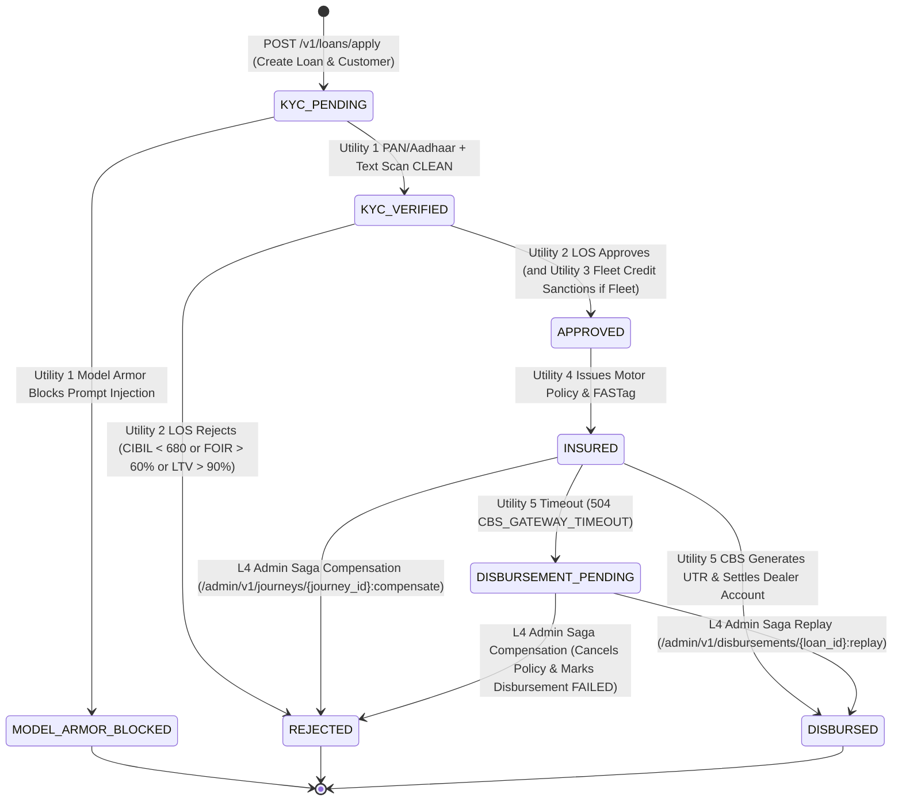
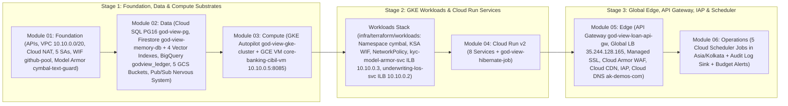
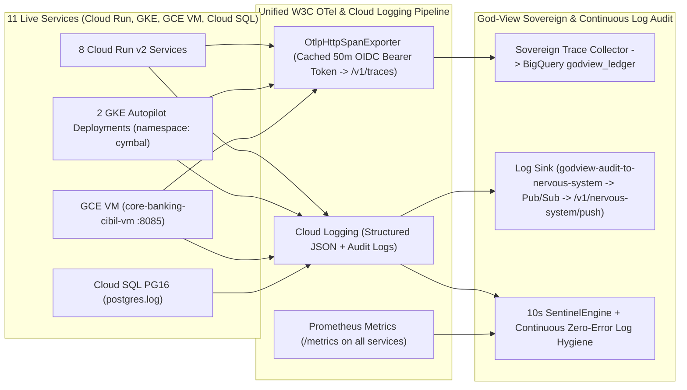

# God-View v4.0 + Harness² + Cymbal Auto Finance — System Design & Deployment Architecture

**Document ID**: `GV-SYS-DESIGN-v4.0`
**Version**: `4.0.0` (Harness² Recursive Agent Harness Integration)
**Target GCP Project**: `general-ak` (`769002985772`, `us-central1` / `us-central1-a`)
**Live Edge Domain**: `ak-demos.com` (`35.244.128.165`)
**Primary Reasoning & Harness Proposer Model**: `gemini-4-argon` (`global` endpoint), with automatic HTTP 429 / quota / reserve fallback to `gemini-3.8-flash` (`global` endpoint)
**Separated Folder Docs**: [God-View SRE System Design](god-view/SYSTEM_DESIGN.md) | [Cymbal Auto Finance System Design](cymbal-auto-finance/SYSTEM_DESIGN.md) | [Infrastructure & GitOps Hub](infra/README.md)
**Related Specifications**: [Architecture Overview](ARCHITECTURE.md) | [High-Level Design (HLD)](HLD.md) | [Low-Level Design (LLD)](LLD.md) | [Software Design Document (SDD)](SDD.md) | [Terraform & GitOps Spec](TERRAFORM_GITOPS_SPEC.md) | [Technical Design (TDD)](../TDD.md)

---

## 1. System Requirements, Scale & Latency SLOs, and Consistency Models

### 1.1 Service Level Objectives (SLOs) & Operational Targets

| Subsystem / Plane | Metric / SLO | Target Threshold | Enforcement & Verification Mechanism |
| :--- | :--- | :--- | :--- |
| **Sentinel Detection Loop (`SentinelEngine`)** | Evaluation cadence & idle token burn | **10.0 s tick**, **0 LLM tokens at rest** | In-process async loop on warm `god-view-sovereign` (`min_instances=1`); verified by `/api/v1/perceive` (`tokens_at_rest == 0`). |
| **Breach-to-Detection Latency** | Time from invariant violation to confirmed `SentinelBreachEvent` | **$\le 30\text{ s}$** (`2-of-3` 10 s windows) | Sliding window confirmation in `SentinelEngine.evaluate_tick()`. |
| **Court Swarm Diagnosis & Consensus** | Multi-agent root-cause consensus (`CourtSwarmSession`) | **$\le 90\text{ s}$**, **$\le 4$ rounds**, confidence **$\ge 0.85$** | Governed by `CourtSwarmSession` and Harness² `BudgetLedger` ($R=4{,}000, P=3{,}000$ tokens). |
| **Customer Loan Origination Saga (`POST /v1/loans/apply`)** | End-to-end 5-utility p95 latency (normal path) | **$\le 800\text{ ms}$** p95 (`KYC -> LOS -> INS -> CBS`) | Measured via `loan_applications.total_latency_ms` and Prometheus `http_request_duration_seconds_bucket`. |
| **Read-Only Data Sense Queries (`godview_readonly`)** | Statement timeout & transaction isolation | **$\le 3{,}000\text{ ms}$**, `READ ONLY` | Enforced at both PostgreSQL role level (`ALTER ROLE godview_readonly`) and `sqlglot` AST gate (`I-05`). |
| **Monthly Cloud & AI Spend Ceiling** | Total GCP infrastructure + Vertex AI token cost | **$\le \$150/\text{month}$** (`$600/mo` hard org cap) | Enforced by `TokenBudgetGovernor` (`$1.50/day` Sovereign, `$4.50/day` Court), scale-to-zero Cloud Run, and 09:00–17:00 IST scheduler window. |

### 1.2 Consistency, Idempotency & Saga Compensation Models

The Cymbal Auto Finance loan origination journey executes across 5 distributed utilities without distributed two-phase locking (2PC). Instead, it uses an **Orchestrated Forward-Recovery & Compensating Saga** pattern coordinated by `loan-orchestrator-api`:

1. **Idempotent CBS Disbursement Replay (`POST /admin/v1/disbursements/{loan_id}:replay`)**:
   - Keyed deterministically on `loan_id`. If `disbursements.status` is already `DISBURSED` or `REPLAYED`, both `loan-orchestrator-api` and `core-banking-cibil-vm` return the existing `cbs_utr_number` (`CBS-UTR-2026-*`), `sanction_letter_no` (`SANC-2026-*`), and `nach_mandate_id` (`NACH-2026-*`) with `idempotent_replay = True`, preventing double-disbursal.
   - If the prior attempt timed out (`status = PENDING` or `FAILED`), replay increments `attempts`, links `replay_of = existing.disbursement_id`, issues the deterministic UTR, transitions `disbursements.status -> REPLAYED`, and transitions `loan_applications.status -> DISBURSED`.
2. **Compensating Saga Transaction (`POST /admin/v1/journeys/{journey_id}:compensate`)**:
   - Invoked by `biz-loan-origination` (`L4`) when a journey violates a business invariant (e.g., `step_order_insurance_before_kyc` or `insurance_no_policy_write` or post-approval underwriting regression).
   - Atomically cancels any active `insurance_policies` row (`status = CANCELLED`), reverses any pending/failed `disbursements` row (`status = FAILED`), and transitions `loan_applications.status -> REJECTED`.
3. **Zero-Error Multi-Worker Schema Initialization (`pg_advisory_lock`)**:
   - `PostgresOrchestratorRepository.initialize_schema()` acquires PostgreSQL session advisory lock `pg_advisory_lock(84920174)`, sets `client_min_messages TO ERROR`, and pre-checks `to_regclass('public.<table_name>')` and `pg_roles` before running DDL so concurrent Cloud Run worker processes never emit `duplicate key` or `role already exists` errors in `postgres.log`.

---

## 2. Three-Stage Terraform Platform, GKE Workloads & Deployment Pipeline

### 2.1 Three-Stage Terraform Architecture (`infra/terraform/platform/` & `workloads/`)

All **220 GCP platform resources** and **10 GKE Kubernetes resources** are managed via OpenTofu/Terraform with remote state stored in `gs://general-ak-god-view-tfstate`:

| Terraform Stack / Module | Directory Path | Resource Count | Key Provisioned Resources |
| :--- | :--- | :--- | :--- |
| **Module 01: Foundation** | [`infra/terraform/platform/modules/01-foundation`](file:///usr/local/google/home/kambleashish/Documents/Projects/god-view/infra/terraform/platform/modules/01-foundation) | `68` | Project APIs, `god-view-vpc` (`10.10.0.0/20`), PSA range `10.186.0.0/16`, Cloud Router/NAT, Artifact Registry `god-view-images`, 5 SAs (`godview-{sense,act,runtime,apigw,deploy}-sa`), WIF `github-pool`, Model Armor `cymbal-text-guard`. |
| **Module 02: Data** | [`infra/terraform/platform/modules/02-data`](file:///usr/local/google/home/kambleashish/Documents/Projects/god-view/infra/terraform/platform/modules/02-data) | `42` | Cloud SQL PG16 `god-view-pg` (`10.186.0.3`), Firestore `god-view-memory-db` + 4 768-dim vector indexes, BigQuery `godview_ledger` + 4 tables, 5 GCS buckets, Secret Manager secrets, Pub/Sub `godview-nervous-system` + DLQ. |
| **Module 03: Compute** | [`infra/terraform/platform/modules/03-compute`](file:///usr/local/google/home/kambleashish/Documents/Projects/god-view/infra/terraform/platform/modules/03-compute) | `18` | GKE Autopilot `god-view-gke-cluster`, reserved internal IPs `10.10.0.2` (LOS ILB), `10.10.0.3` (KYC ILB), `10.10.0.5` (`core-banking-cibil-vm` GCE `e2-micro` VM). |
| **GKE Workloads** | [`infra/terraform/workloads`](file:///usr/local/google/home/kambleashish/Documents/Projects/god-view/infra/terraform/workloads) | `10` | Namespace `cymbal`, KSA `cymbal-runtime-ksa` (Workload Identity bound to `godview-runtime-sa`), `NetworkPolicy` (`10.10.0.0/20` ingress), `kyc-model-armor-svc` & `underwriting-los-svc` Deployments + Internal LoadBalancer Services. |
| **Module 04: Cloud Run** | [`infra/terraform/platform/modules/04-cloud-run`](file:///usr/local/google/home/kambleashish/Documents/Projects/god-view/infra/terraform/platform/modules/04-cloud-run) | `34` | 8 Cloud Run v2 Services (`god-view-sovereign` warm `min_instances=1`; 7 scale-to-zero siblings) + `god-view-hibernate-job` + IAM invoker bindings. |
| **Module 05: Edge** | [`infra/terraform/platform/modules/05-edge`](file:///usr/local/google/home/kambleashish/Documents/Projects/god-view/infra/terraform/platform/modules/05-edge) | `44` | API Gateway `god-view-loan-api-gw`, Global IP `35.244.128.165`, Managed SSL `god-view-edge-cert`, Cloud Armor `god-view-edge-policy`, Serverless NEGs, IAP backends, Cloud CDN, Cloud DNS `ak-demos-com`. |
| **Module 06: Operations** | [`infra/terraform/platform/modules/06-operations`](file:///usr/local/google/home/kambleashish/Documents/Projects/god-view/infra/terraform/platform/modules/06-operations) | `14` | 5 Cloud Scheduler jobs (`godview-tenant-pause`, `-resume`, `-probe-run`, `-agent-reflection`, `-simulator-tick`), Pub/Sub push subscription `godview-sovereign-push`, Cloud Audit Log sink `godview-audit-to-nervous-system`. |

### 2.2 Cloud Build & GCE VM Tarball Deployment Pipeline (`infra/deploy/`)

- **Container Image Build & Rollout (`infra/deploy/build_and_push.sh`)**:
  - Builds all 10 container images (`god-view-sovereign`, `god-view-sre-web`, `loan-orchestrator-api`, `kyc-model-armor-svc`, `underwriting-los-svc`, `commercial-fleet-credit-svc`, `motor-insurance-svc`, `ai-customer-simulator`, `customer-loan-portal-web`, `internal-bank-los-web`) via Google Cloud Build (`infra/deploy/cloudbuild.yaml`) and pushes them to `us-central1-docker.pkg.dev/general-ak/god-view-images/<service>:latest`.
  - Updates all 8 Cloud Run v2 services and rolls out both GKE Autopilot deployments in `namespace: cymbal`.
- **Air-Gapped GCE VM Tarball Deployment (`infra/deploy/deploy_vm_payload.sh`)**:
  - Because `core-banking-cibil-vm` (`10.10.0.5:8085`) has **no public IP**, `cymbal/services/core-banking-cibil-vm/build_payload.sh` packages `godview_shared-4.0.0-py3-none-any.whl` and `core_banking_cibil_vm-4.0.0-py3-none-any.whl` plus all offline Python wheels into `cbs-payload.tar.gz`, uploads it to `gs://general-ak-god-view-agent-staging/vm-payloads/core-banking-cibil-vm.tar.gz`, and triggers `install.sh` over IAP OS Login / Startup Script to configure `/opt/cibil-cbs/.venv` and start `systemd` unit `cibil-cbs.service`.

### 2.3 Hermetic Local Development Environment (`docker-compose.yml` & `local-env/`)

Developers and CI verifiers can run the entire 11-service topology offline on a single workstation with zero GCP credentials (`GODVIEW_ENV=hermetic`):
- **`docker-compose.yml`**: Spins up PostgreSQL 16 (`postgres:16-alpine` seeded via `local-env/seed/01_roles.sql` and `02_schema_and_seed.sql`), all 6 Cymbal microservices, `ai-customer-simulator`, `god-view-sovereign`, and Nginx edge router (`local-env/nginx/`) + Prometheus (`local-env/prometheus/`).
- **Hermetic Transport Fallbacks**: In `GODVIEW_ENV=hermetic`, `VertexGeminiProposer`, `VertexPersonaClient`, `VertexSpecimenCardGenerator`, and `CloudSyncedLibrary` use deterministic in-memory transports while exercising the exact same `HarnessTree` validation, `validate_script_ast` sandboxing, `HookRunner`, `sqlglot` AST gate, and `TrustGate` state machines.

---

## 3. Failure Modes, Chaos Drills ("HTTP 200 but Business Broken"), and Log Audit Loop

### 3.1 The 8 Built-In Chaos Faults & Flagship Scenarios 1, 2, and 3

All chaos drills are opt-in, restricted to resources labeled `godview_managed="true"` (`I-07`), and stored in `chaos_fault_states` with an automatic expiration TTL (`expires_at`).

| Chaos Scenario / Fault Type | Class | Target Service | Symptom ("Why Infra Monitors Miss It") | Sentinel Triggered | Autonomous Court & Harness² Remediation |
| :--- | :--- | :--- | :--- | :--- | :--- |
| **Scenario 1: Silent Insurance Skip (`insurance_no_policy_write`, UC-05)** | `BUSINESS` | `motor-insurance-svc` & `loan-orchestrator-api` | `POST /internal/insurance/issue` returns **`HTTP 200 OK`** (`status: ACTIVE`), CPU/memory are green, and loan reaches `DISBURSED`, but **zero row is written to `insurance_policies`**. | `inv-EveryApprovedLoanHasInsurance` (SQL invariant + DFG `SKIPPED` conformance) | `biz-loan-origination` + `data-ledger-pg` identify the un-insured `loan_id`s via read-only SQL, clear the chaos fault (`L2`), and execute `L4` `biz.compensate_journey` / policy re-issuance. |
| **Scenario 2: FOIR Underwriting Threshold Regression (`foir_threshold_regression` & `emi_rounding`, UC-06)** | `BUSINESS` | `underwriting-los-svc` & `loan-orchestrator-api` | All endpoints return **`HTTP 200 OK`**, but a bad rules change approves loans with `foir_pct > 60%` (up to `75%`) or distorts EMI by `+₹250` (`> ₹1` tolerance). | `inv-foir-under-cap` & `inv-emi-matches-formula` (SQL invariant + CUSUM approval-rate shift) | `change-gitops` correlates the regression via `git.Repo.log_and_blame`, opens an `L3` surgical remediation PR (`git.GitHub.create_remediation_pr`), and `biz-loan-origination` runs `L4` `biz.reevaluate_application`. |
| **Scenario 3: CIBIL Bureau Constant-900 Stub & Step Reordering (`cibil_stub_900` UC-07 & `step_order_insurance_before_kyc` UC-08)** | `BUSINESS` | `core-banking-cibil-vm` & `loan-orchestrator-api` | `POST /internal/cibil-cbs/score` returns **`HTTP 200 OK`** with `cibil_score = 900` for every applicant (zero variance), or insurance runs before KYC (`INS -> KYC -> LOS -> CBS`). | `inv-cibil-score-valid` (stddev $= 0$ / constant `900`) & `inv-LoanStepOrder` (DFG `REORDERED`) | `data-ledger-pg` + `app-loan-orchestrator` run `check_cibil_score_offsets.py` (`c7`), clear `cibil_stub_900` / `step_order_insurance_before_kyc`, and re-evaluate affected loans (`L4`). |
| **Infra Drill A: GCE VM CBS Gateway Timeout (`gce_vm_latency_504`, UC-16)** | `INFRA` | `core-banking-cibil-vm` (`10.10.0.5:8085`) | CBS settlement sleeps `6.0 s` and returns `504 CBS_GATEWAY_TIMEOUT`, leaving loans stuck in `DISBURSEMENT_PENDING` (`disbursements.status = PENDING/FAILED`). | `inv-EveryDisbursedLoanHasUTR` & DFG `STALLED` sentinel | `platform-gcp-mesh` resets/clears the VM fault (`L2`), and `biz-loan-origination` executes idempotent `L4` `POST /admin/v1/disbursements/{loan_id}:replay` (`status -> REPLAYED`). |
| **Infra Drill B: GKE Pod OOM / 503 Exhaustion (`gke_oom_503`, UC-15)** | `INFRA` | `kyc-model-armor-svc` / `underwriting-los-svc` | GKE pods return `503 GKE_OOM_503` under memory pressure. | Runtime golden-signal Sentinel (`error_rate_pct > 5%`) | `platform-gcp-mesh` executes `L2` `k8s.Deployment.rollout_restart` / `k8s.Deployment.scale` with automatic post-verification. |
| **Infra Drill C: Cloud SQL Lock Contention (`cloudsql_lock_contention`)** | `INFRA` | `god-view-pg` (`10.186.0.3`) | Long-running blocker query stalls write transactions. | Data Sense latency & `pg_stat_activity` lock Sentinel | `data-ledger-pg` inspects `pg_stat_activity` via `sql.Postgres.readonly_query` and clears the contention fault. |

### 3.2 End-to-End Observability & Zero-Error Cloud Logging Audit Loop

Key observability hardening verified in live `general-ak` production:
1. **Authenticated OTLP Trace Export (`shared/godview_shared/otel.py`)**: Every Cymbal microservice and GKE/VM workload attaches a cached Google OIDC ID token (`Authorization: Bearer <id_token>`) when exporting W3C spans to `https://god-view-sovereign-mcj3w7ujpq-uc.a.run.app/v1/traces`.
2. **Zero-Error PostgreSQL Startup (`cymbal/services/loan-orchestrator-api/app/repository.py`)**: Uses `pg_advisory_lock(84920174)` and `to_regclass()` pre-checks so `postgres.log` emits zero `ERROR` or `WARNING` entries across container restarts.
3. **Authenticated Cloud Scheduler & Simulator Ticks**: All 5 Cloud Scheduler jobs and `ai-customer-simulator` (`AdcTokenProvider`) authenticate with OIDC tokens and handle downstream backpressure gracefully without emitting unhandled `500` tracebacks.
