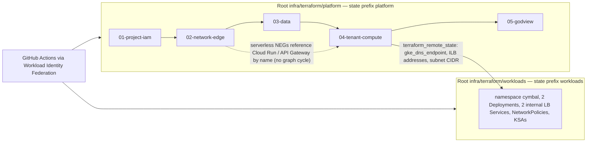
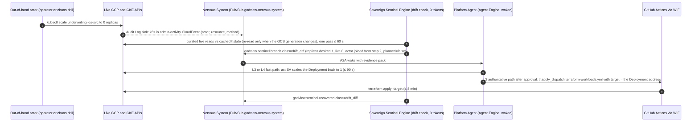

# Terraform & GitHub GitOps Specification: Two-Root IaC, Workload Identity Federation, Drift & Change Intelligence Plumbing, Operations Controls as Code

- **Document ID**: `GODVIEW-TF-GITOPS-004`
- **Version**: `4.0 (Sovereign Organism — rewritten from the validated v4 design; supersedes 2.0/3.0)`
- **Design Source**: [2026-10-16-god-view-organism-design.md](file:///usr/local/google/home/kambleashish/Documents/Projects/god-view/plans/2026-10-16-god-view-organism-design.md) — decision log #11 / #17 / #18, §9 tenant table, §12 economics, §13 SLOs, §14 security
- **Repository Root**: `/usr/local/google/home/kambleashish/Documents/Projects/god-view`
- **Target**: GCP project `general-ak` (`769002985772`), `us-central1` / `us-central1-a`; remote state `gs://general-ak-god-view-tfstate`; smallest sizes, single zone, no HA — *the architecture is never reduced, only the sizes*
- **Related Documents**:
  - [Business Requirements Document (`docs/BRD.md`)](file:///usr/local/google/home/kambleashish/Documents/Projects/god-view/docs/BRD.md)
  - [System & Solution Design Document (`docs/SDD.md`)](file:///usr/local/google/home/kambleashish/Documents/Projects/god-view/docs/SDD.md)
  - [God-View Agent Specification (`docs/GOD_VIEW_MCP_AGENT_SPEC.md`)](file:///usr/local/google/home/kambleashish/Documents/Projects/god-view/docs/GOD_VIEW_MCP_AGENT_SPEC.md)
  - [Terraform & GitHub GitOps Spec (`docs/TERRAFORM_GITOPS_SPEC.md`) — this document](file:///usr/local/google/home/kambleashish/Documents/Projects/god-view/docs/TERRAFORM_GITOPS_SPEC.md)
  - [Master Technical Design Document & Swarm Playbook (`TDD.md`)](file:///usr/local/google/home/kambleashish/Documents/Projects/god-view/TDD.md)

## 1. Terraform Layout

Two roots, one state bucket. The **platform** root (`infra/terraform/platform`, state object `platform/default.tfstate`, modules `01-project-iam` → `05-godview`) owns every Google Cloud resource; the **workloads** root (`infra/terraform/workloads`, state object `workloads/default.tfstate`) owns only the Kubernetes objects inside the GKE Autopilot cluster and is configured from platform outputs. Keeping `kubernetes_*` resources out of the root that creates `google_container_cluster` avoids the **provider-bootstrap trap** (feasibility review row 4): a Kubernetes provider cannot be configured against a cluster endpoint that does not exist at plan time, so a single root fails on first apply and on every cluster replacement. The split also lets the same workloads root target a local `kind` cluster (§8). Every label-capable resource carries `godview_managed = "true"`, `tf_module = "<module>"`, `tenant = "cymbal"` or `"godview"` (`local.labels`); the drift engine (§5) and the mutation allowlist key on these labels.

```hcl
# infra/terraform/platform/backend.tf — the workloads root is identical with prefix = "workloads"
terraform {
  required_version = ">= 1.9"
  backend "gcs" {
    bucket = "general-ak-god-view-tfstate"
    prefix = "platform"
  }
  required_providers {
    google      = { source = "hashicorp/google", version = "~> 6.0" }
    google-beta = { source = "hashicorp/google-beta", version = "~> 6.0" } # API Gateway, gateway serverless NEG
  }
}
# infra/terraform/workloads/providers.tf — fed by platform outputs, never by a cluster created in the same root
provider "kubernetes" {
  host  = "https://${data.terraform_remote_state.platform.outputs.gke_dns_endpoint}" # IAM-authenticated DNS endpoint
  token = data.google_client_config.default.access_token
}
```

| Variable (platform root unless noted) | Default | Drives |
| :-- | :-- | :-- |
| `cloud_run_cpu` / `cloud_run_memory` / `cloud_run_min_instances` / `cloud_run_max_instances` / `cloud_run_concurrency` | `"1"` / `"512Mi"` / `0` / `3` / `80` | the five tenant Cloud Run services and the cockpit |
| `gke_pod_cpu` / `gke_pod_memory` / `gke_replicas` (workloads root) | `"250m"` / `"512Mi"` / `1` | `kyc-model-armor-svc`, `underwriting-los-svc` |
| `vm_machine_type` / `vm_disk_gb` / `sql_tier` / `sql_disk_gb` / `sql_availability_type` | `"e2-micro"` / `10` / `"db-g1-small"` / `10` / `"ZONAL"` | `core-banking-cibil-vm`, `god-view-pg` |
| `sovereign_cpu` / `sovereign_min_instances` / `sovereign_memory` | `"1"` / `1` / `"1Gi"` (memory: open point) | `god-view-sovereign` |
| `traffic_resume_cron` / `traffic_pause_cron` / `scheduler_time_zone` / `traffic_weekdays_only` | `"0 9 * * *"` / `"0 17 * * *"` / `"Asia/Kolkata"` / `false` (true → `"0 9 * * 1-5"`) | Scheduled Pause: resume 09:00 IST, pause 17:00 IST |
| `hibernate` (both roots) | `false` | GKE replicas 0, VM `TERMINATED`, Cloud SQL `activation_policy = "NEVER"`, Scheduler jobs paused, sentinel interval 60 s |
| `kill_switch_armor_enforce` / `kill_switch_allowlist_cidrs` | `false` / `[]` | Cloud Armor deny rule (priority 100) preview ↔ enforce |
| `images` (map, both roots) / `enable_datastream` | placeholder `us-docker.pkg.dev/cloudrun/container/hello` / `false` | image digests pinned by CI into `images.auto.tfvars`; Datastream CDC resources (Phase 2) |
| `budget_amount_usd` / `budget_thresholds` / `iap_allowed_members` | `600` / `[0.5, 0.8, 1.0]` / `[]` | `google_billing_budget`; IAP access to `los.cymbal.ak-demos.com` and `godview.ak-demos.com` |



## 2. Module Inventory (platform root)

### 2.1 `modules/01-project-iam` — APIs, identities, federation

| Resource | Key arguments |
| :-- | :-- |
| `google_project_service.apis` (`for_each`); `google_artifact_registry_repository.containers` | APIs: `run`, `container`, `compute`, `sqladmin`, `firestore`, `bigquery`, `pubsub`, `cloudscheduler`, `apigateway`, `servicecontrol`, `servicemanagement`, `aiplatform`, `modelarmor`, `cloudasset`, `monitoring`, `cloudtrace`, `logging`, `secretmanager`, `iap`, `iam`, `iamcredentials`, `sts`, `artifactregistry`, `servicenetworking`, `dns`, `billingbudgets`, `cloudresourcemanager`, `datastream` (`disable_on_destroy = false`); registry `god-view-containers`, `format = "DOCKER"`, `us-central1`, cleanup policy keeps the 10 most recent versions per package |
| `google_service_account.{sense,act,runtime,apigw,deploy}` + `google_project_iam_member.*` | role families in the table below; `godview-sense-sa` may impersonate `godview-act-sa` only (`roles/iam.serviceAccountTokenCreator` on that SA, nothing else) |
| `google_iam_workload_identity_pool.github` + `google_iam_workload_identity_pool_provider.github` | `github-pool` / `github-provider`; `oidc { issuer_uri = "https://token.actions.githubusercontent.com" }`; `attribute_mapping` for `sub`, `repository`, `ref`; `attribute_condition = "assertion.repository == var.github_repository"`; `google_service_account_iam_member` grants `roles/iam.workloadIdentityUser` on `godview-deploy-sa` to `principalSet://…/attribute.repository/<org>/god-view` |
| **Outputs / cost** | SA emails, WIF provider resource name, Artifact Registry URL. **≈ $0–1/month** (registry storage) |

| Identity | Runs | Role families (project-scoped unless stated) |
| :-- | :-- | :-- |
| `godview-sense-sa` | Sovereign, court agents on Agent Engine, drift engine | read-only broad: `roles/viewer`, `roles/cloudasset.viewer`, `roles/monitoring.viewer`, `roles/cloudtrace.user`, `roles/logging.viewer`, `roles/storage.objectViewer` on `tfstate`; writes only to its own stores: `roles/datastore.user`, `roles/bigquery.dataEditor` + `roles/bigquery.jobUser` on `godview_ledger`, `roles/pubsub.publisher` + `roles/pubsub.subscriber` on the Nervous System, `roles/aiplatform.user`, `roles/storage.objectAdmin` on `agent-skills` and `agent-staging` |
| `godview-act-sa` | impersonated per approved or L3-eligible action | scoped write: `roles/run.developer`, `roles/container.developer`, `roles/compute.instanceAdmin.v1`, `roles/cloudsql.editor`, `roles/compute.securityAdmin` (kill-switch rule), `roles/cloudscheduler.admin` (pause / resume the simulator tick), `roles/run.invoker` on `god-view-hibernate-job` |
| `godview-runtime-sa` | tenant Cloud Run services, GKE pods (Workload Identity), `core-banking-cibil-vm` | `roles/cloudsql.client`, `roles/secretmanager.secretAccessor` (`cymbal-pg-app-password`), `roles/cloudtrace.agent`, `roles/monitoring.metricWriter`, `roles/logging.logWriter`, `roles/storage.objectUser` on `kyc-vault` / `cdn-assets`, `roles/modelarmor.user`, `roles/bigquery.dataEditor` on `godview_ledger` (OTel business-event export), `roles/run.invoker` on Utilities 3/4 and the orchestrator |
| `godview-apigw-sa` / `godview-deploy-sa` | API Gateway backend identity / GitHub Actions via WIF (no keys) | `roles/run.invoker` on `loan-orchestrator-api` only (OIDC) / admin families for both roots: `compute`, `container`, `run`, `cloudsql`, `datastore.owner`, `bigquery`, `storage`, `secretmanager`, `pubsub`, `cloudscheduler`, `monitoring`, `dns`, `apigateway`, `iap`, `artifactregistry.writer`, `iam.serviceAccountAdmin` + `iam.serviceAccountUser`, `resourcemanager.projectIamAdmin`, `serviceusage.serviceUsageAdmin`, plus `roles/billing.costsManager` on the billing account |

### 2.2 `modules/02-network-edge` — VPC, private connectivity, Global External Application LB

| Resource | Key arguments / sizes |
| :-- | :-- |
| `google_compute_network.vpc`, `google_compute_subnetwork.primary`, `google_compute_global_address.psa_range` + `google_service_networking_connection.psa` | `god-view-vpc` (custom mode); `god-view-subnet` in `us-central1`, `10.10.0.0/20` (open point), `private_ip_google_access = true`, Autopilot pod/service ranges auto-allocated, Cloud Run Direct VPC egress uses this subnet; PSA range `purpose = "VPC_PEERING"`, `prefix_length = 16`, service `servicenetworking.googleapis.com` for Cloud SQL private IP |
| `google_compute_router.nat` + `google_compute_router_nat.nat`; `google_compute_address.{kyc_ilb,los_ilb}` | `god-view-nat`, `nat_ip_allocate_option = "AUTO_ONLY"`, `source_subnetwork_ip_ranges_to_nat = "ALL_SUBNETWORKS_ALL_IP_RANGES"` — egress for private GKE nodes and the VM; two reserved **internal** addresses in `god-view-subnet` for the GKE internal LB Services (§3), so the orchestrator env is known at platform-apply time |
| `google_compute_global_address.lb_ip`, `google_compute_global_forwarding_rule.https` (443) + `.http` (80), `google_compute_target_https_proxy.edge`, `google_compute_target_http_proxy.redirect` + `google_compute_url_map.redirect`, `google_compute_managed_ssl_certificate.edge` | `god-view-lb-ip`; `load_balancing_scheme = "EXTERNAL_MANAGED"`; HTTP→HTTPS via `default_url_redirect { https_redirect = true, strip_query = false }`; `god-view-edge-cert` for `cymbal.ak-demos.com`, `los.cymbal.ak-demos.com`, `api.cymbal.ak-demos.com`, `godview.ak-demos.com`; `data.google_dns_managed_zone.ak_demos` + `google_dns_record_set.*` ×4 — zone `ak-demos-com` pre-exists in `general-ak` (**data source, never created**), `A` records `cymbal`, `los.cymbal`, `api.cymbal`, `godview` → LB IP, `ttl = 300` |
| `google_compute_url_map.edge` | `god-view-edge`; host rules: `cymbal.ak-demos.com` → portal (`/assets/*` → CDN backend bucket); `los.cymbal.ak-demos.com` → LOS; `api.cymbal.ak-demos.com` → API Gateway; `godview.ak-demos.com` → cockpit, `/api/*` → Sovereign (IAP), `/public/*` → Sovereign public backend (health check, GitHub and Chat webhooks, signature-verified) |
| `google_compute_region_network_endpoint_group.*` ×5 (`provider = google-beta` for the gateway NEG); `google_compute_backend_service.*` ×6 | `network_endpoint_type = "SERVERLESS"`: `cloud_run { service }` for `customer-loan-portal-web`, `internal-bank-los-web`, `god-view-sre-web`, `god-view-sovereign`; `serverless_deployment { platform = "apigateway.googleapis.com", resource = "god-view-loan-api-gw" }`; backends `EXTERNAL_MANAGED`, `security_policy = god-view-edge-policy` on all, `iap { enabled = true }` on `los`, `cockpit`, `sovereign_api` (Google-managed OAuth client — verify provider support), `log_config { sample_rate = 1.0 }` so Cloud Armor verdicts reach the abuse-semantics hero; `google_compute_backend_bucket.cdn_assets` on `general-ak-god-view-cdn-assets` with `enable_cdn = true`, `cdn_policy { cache_mode = "CACHE_ALL_STATIC", default_ttl = 3600 }` (vehicle catalog media) |
| `google_compute_security_policy.edge` | `god-view-edge-policy`, 3 rules + default: **100** kill switch `deny(403)` for everything except `var.kill_switch_allowlist_cidrs`, `preview = !var.kill_switch_armor_enforce`; **1000** WAF `deny(403)` on `evaluatePreconfiguredWaf` for `sqli-v33-stable`, `xss-v33-stable`, `lfi-v33-stable`, `rfi-v33-stable`; **2000** `throttle` per IP (`enforce_on_key = "IP"`, `exceed_action = "deny(429)"`, threshold `var.armor_rate_limit_per_minute` — open point); default `allow` |

| Firewall rule (`google_compute_firewall`) | Direction | From | To | Ports | Purpose |
| :-- | :-- | :-- | :-- | :-- | :-- |
| `gv-allow-subnet-to-gke-ilb` | ingress | `god-view-subnet` CIDR (Cloud Run Direct VPC egress + pods) | GKE internal LB backends | tcp 8080 | orchestrator → Utilities 1/2 |
| `gv-allow-subnet-to-cbs` | ingress | `god-view-subnet` CIDR | VM via `target_service_accounts = [godview-runtime-sa]` | tcp 8085 | GKE / orchestrator → core banking |
| `gv-allow-egress-cloudsql` | egress | all instances | PSA range | tcp 5432 | all → Cloud SQL private IP |
| `gv-allow-health-checks` | ingress | `130.211.0.0/22`, `35.191.0.0/16` | GKE internal LB backends | tcp 8080 | Google health checkers |
| `gv-allow-iap-ssh` | ingress | `35.235.240.0/20` | VM | tcp 22 | break-glass SSH through IAP TCP forwarding (no external IP) |
| **Outputs / cost** | — | — | — | — | `network_id`, `subnet_id`, `subnet_cidr`, `psa_range`, `lb_ip`, `ilb_addresses`, `security_policy_id`, backend-service ids (IAP bindings in 05). **$35–45 active / $30–40 hibernated** (forwarding rule ~$18, Cloud Armor policy + 3 rules ~$8, Cloud NAT ~$5 + data, Cloud DNS, certs free) |

### 2.3 `modules/03-data` — the tenant's database, God-View's brain and ledger, buckets, secrets

| Resource | Key arguments / sizes |
| :-- | :-- |
| `google_sql_database_instance.god_view_pg`, `google_sql_database.godview_lms`, `google_sql_user.app_user` | `god-view-pg`, `database_version = "POSTGRES_16"`; `settings { tier = "db-g1-small", availability_type = "ZONAL", disk_size = 10, disk_type = "PD_SSD", activation_policy = var.hibernate ? "NEVER" : "ALWAYS" }`; `ip_configuration { ipv4_enabled = false, private_network = vpc }`; `backup_configuration { enabled = true, point_in_time_recovery_enabled = false }`; `database_flags`: `cloudsql.logical_decoding = on` (CDC, Phase 2); `deletion_protection = true`; `pg_stat_statements` via `CREATE EXTENSION` in the seed migration; the database holds the tenant business schema only (TDD §2a) — **no telemetry tables**; password from `random_password`, stored only in Secret Manager |
| `google_firestore_database.memory` + `google_firestore_index.{service_purpose,invariant_statement,episodic_symptom,skill_trigger}` | `name = "god-view-memory-db"`, `type = "FIRESTORE_NATIVE"`, `location_id = "us-central1"`, `delete_protection_state = "DELETE_PROTECTION_ENABLED"` (the project's Datastore-mode `(default)` DB is untouched); four KNN indexes per the Agent Spec schema freeze — `discovered_services.purpose_embedding`, `invariants.statement_embedding`, `episodic_incidents.symptom_embedding`, `procedural_skills.trigger_embedding` — each `vector_config { dimension = 768  flat {} }`, `query_scope = "COLLECTION"`; 768 matches `text-embedding-005` (`us-central1`) |
| `google_bigquery_dataset.godview_ledger` + `google_bigquery_table.{events,state_transitions,journeys,kpi_rollups}` | `location = "us-central1"`; `schema = file("godview/ledger/schemas/<table>.json")` (columns owned by TDD §2b); `time_partitioning { type = "DAY" }` on each table's timestamp column; clustering per TDD |
| `google_storage_bucket.{kyc_vault,cdn_assets,agent_skills,tfstate}`; Secret Manager | `general-ak-god-view-{kyc-vault,cdn-assets,agent-skills,tfstate}`, `location = "US-CENTRAL1"`, `STANDARD`, `uniform_bucket_level_access = true`; `public_access_prevention = "enforced"` except `cdn-assets` (served by the backend bucket; `allUsers` → `roles/storage.objectViewer`); `tfstate` has `versioning` on and is created in bootstrap, then imported (§7). `google_secret_manager_secret.{cymbal_pg_app_password,godview_github_app_key,godview_github_webhook_secret}` (+ `_version` for the generated password): automatic replication; accessors: runtime SA → DB password; sense SA → GitHub App key and webhook secret |
| Datastream (Phase 2, `count = var.enable_datastream ? 1 : 0`) | `google_datastream_private_connection` (peering to `god-view-vpc`), `google_datastream_connection_profile` ×2 (PostgreSQL source over private connectivity, BigQuery destination `godview_ledger`), `google_datastream_stream` (publication + replication slot) — argument shapes to verify with design §16 item 4 |
| **Outputs / cost** | `sql_private_ip`, `sql_connection_name`, `firestore_db_name`, `ledger_dataset_id`, bucket names, secret ids. **Combined 03 + 04 row in §9: $60–80 active / $10–20 hibernated** |

### 2.4 `modules/04-tenant-compute` — Cymbal Auto Finance runtime (smallest sizes)

| Resource | Key arguments / sizes |
| :-- | :-- |
| `google_container_cluster.autopilot` | `god-view-gke-cluster`, `enable_autopilot = true`, `location = "us-central1"` (Autopilot control planes are regional; workloads are 1 replica); `private_cluster_config { enable_private_nodes = true, enable_private_endpoint = false, master_ipv4_cidr_block = "172.16.0.0/28" }`; `control_plane_endpoints_config { dns_endpoint_config { allow_external_traffic = true } }` for CI and the workloads root (verify provider support); `release_channel = "REGULAR"`; `ip_allocation_policy {}`; Workload Identity on by default; `resource_labels = local.labels` |
| `google_compute_instance.cbs_vm` | `core-banking-cibil-vm`, `machine_type = "e2-micro"`, `zone = "us-central1-a"`, 10 GB `pd-standard` boot disk (Container-Optimized OS); `network_interface { subnetwork }` **with no `access_config`** (egress via Cloud NAT); `service_account { email = godview-runtime-sa, scopes = ["cloud-platform"] }`; `desired_status = var.hibernate ? "TERMINATED" : "RUNNING"`; startup script runs the `core-banking-cibil-vm` image on port 8085; `shielded_instance_config` on |
| `google_cloud_run_v2_service.*` ×6 + `google_cloud_run_v2_service_iam_member.*` | `loan-orchestrator-api`, `commercial-fleet-credit-svc`, `motor-insurance-svc`, `customer-loan-portal-web`, `internal-bank-los-web`: `template { service_account = godview-runtime-sa; scaling { min_instance_count = 0, max_instance_count = 3 }; max_instance_request_concurrency = 80; containers { image = var.images[name]; resources { limits = { cpu = "1", memory = "512Mi" } } }; vpc_access { network_interfaces { network, subnetwork }, egress = "PRIVATE_RANGES_ONLY" } }` (Direct VPC egress); `ingress = "INGRESS_TRAFFIC_INTERNAL_LOAD_BALANCER"`; env: ILB addresses, VM internal IP, Cloud SQL private IP, secrets from Secret Manager, OTel exporter settings. `ai-customer-simulator` (TDD `cymbal/services/ai-customer-simulator`): same shape with `max_instance_count = 1`, `ingress = "INGRESS_TRAFFIC_INTERNAL"`, driven by the `godview-simulator-tick` job (§2.5), stamps `X-Synthetic: true`. `roles/run.invoker`: portal ← `allUsers` (reachable only through the LB because of the ingress setting); LOS ← IAP service agent `service-769002985772@gcp-sa-iap.iam.gserviceaccount.com`; orchestrator ← `godview-apigw-sa` + `godview-runtime-sa`; Utilities 3/4 and the simulator ← `godview-runtime-sa` — no public mutation endpoints |
| `google_api_gateway_api.loan_api`, `google_api_gateway_api_config.loan_api_cfg`, `google_api_gateway_gateway.loan_api_gw` (`provider = google-beta`) | `god-view-loan-api`; config renders `infra/api-gateway/openapi-spec.yaml.tftpl` (`x-google-backend` → orchestrator URI); `gateway_config { backend_config { google_service_account = godview-apigw-sa } }` (OIDC); gateway `god-view-loan-api-gw` in `us-central1`; SSE routes only — **no WebSocket through the gateway**; `create_before_destroy` on the config |
| `google_model_armor_template.text_guard`; `google_service_account_iam_member.gke_workload_identity` ×2 | `cymbal-text-guard` (`us-central1`): prompt-injection / jailbreak and sensitive-data filters for `loan_purpose_text`, `employment_remarks`, `applicant_notes`; images never scanned. `roles/iam.workloadIdentityUser` on `godview-runtime-sa` for `serviceAccount:general-ak.svc.id.goog[cymbal/kyc-model-armor-svc]` and `[cymbal/underwriting-los-svc]` |
| **Outputs / cost** | `gke_dns_endpoint`, `gke_cluster_name`, `cbs_vm_internal_ip`, Cloud Run URIs, `api_gateway_default_hostname`, `model_armor_template_id`. **Combined with 03 in §9** |

### 2.5 `modules/05-godview` — the Sovereign and its platform-native senses

| Resource | Key arguments / sizes |
| :-- | :-- |
| `google_cloud_run_v2_service.sovereign`; `google_cloud_run_v2_service.cockpit` | `god-view-sovereign`: `scaling { min_instance_count = 1, max_instance_count = 1 }` (one Sentinel Engine; state in Firestore), `resources { limits = { cpu = "1", memory = var.sovereign_memory }, cpu_idle = false }` (CPU always allocated for the 10 s loop), `service_account = godview-sense-sa`, `ingress = "INGRESS_TRAFFIC_INTERNAL_LOAD_BALANCER"`, Direct VPC egress (pull-scrapes internal `/metrics`), env `SENTINEL_INTERVAL_SECONDS = var.hibernate ? 60 : 10`, `GEMINI_LOCATION = "global"`, `EMBEDDING_LOCATION = "us-central1"`; `roles/run.invoker` ← `godview-sense-sa` (Scheduler / Pub/Sub OIDC) and the IAP service agent. `god-view-sre-web` (the God-View Cockpit): same shape as the tenant frontends (1 vCPU / 512 MiB, min 0, max 3), invoker ← IAP service agent only |
| `google_pubsub_topic.nervous_system` (+ `.nervous_system_dlq`), `google_pubsub_subscription.sovereign_push`; `google_logging_project_sink.audit_to_nervous_system` + `google_pubsub_topic_iam_member.sink_writer` | `godview-nervous-system`; push to the Sovereign's `/v1/nervous-system/push` with `oidc_token { service_account_email = godview-sense-sa }`, `ack_deadline_seconds = 20`, `dead_letter_policy` → `godview-nervous-system-dlq` after 5 attempts, 1-day retention. Sink: Admin Activity Audit Logs for `run`, `container`, `k8s.io`, `compute`, `sqladmin`, `iam`, `apigateway`, `secretmanager`, `cloudresourcemanager` → the topic; the sink writer identity gets `roles/pubsub.publisher` |
| `google_cloud_scheduler_job.*` ×5 | `godview-tenant-pause` `0 17 * * *` and `godview-tenant-resume` `0 9 * * *` with `time_zone = "Asia/Kolkata"` → `POST /v1/tenant/pause` and `/v1/tenant/resume` (`oidc_token` sense SA, audience = service URI); `godview-simulator-tick` `* 9-16 * * *` (every minute 09:00–16:59 IST; weekdays flag → `* 9-16 * * 1-5`) → the AI-customer simulator's IAM-only tick endpoint, which paces ≈ 300 journeys/day (one every ~100 s) and is a no-op while paused or killed; `godview-probe-run` `*/5 * * * *` → `POST /v1/probes/run` (platform-native backstop for agent-authored probe plans); `godview-agent-reflection` `30 3 * * *` = 03:30 IST → `POST /v1/court/reflect` (off-peak; hour is an open point); all `paused = var.hibernate` |
| `google_monitoring_uptime_check_config.sovereign`, `google_monitoring_alert_policy.sovereign_heartbeat`, `google_monitoring_notification_channel.{email,chat}` | HTTPS `GET https://godview.ak-demos.com/public/healthz`, `period = "60s"`, `timeout = "10s"`; the policy fires on 2 consecutive failed checks **or** `condition_absent` on `custom.googleapis.com/godview/sentinel_heartbeat` for 120 s (watcher of the watcher); channels `type = "email"` (ops address) and `type = "google_chat"` to the "God-View" space (verify provider support; email-only until verified) |
| `google_billing_budget.godview` | `budget_filter { projects = ["projects/769002985772"], labels = { godview_managed = ["true"] } }`, `amount { specified_amount { units = 600 } }`, `threshold_rules` 0.5 / 0.8 / 1.0 on `CURRENT_SPEND`, `all_updates_rule { pubsub_topic = godview-nervous-system, monitoring_notification_channels = [email, chat] }` — a budget breach is a Nervous System event |
| `google_storage_bucket.agent_staging` + IAM | `general-ak-god-view-agent-staging` (Agent Engine `staging_bucket`; open point: 5th bucket vs a prefix); `roles/storage.objectAdmin` → `godview-sense-sa`; `roles/storage.objectViewer` → Reasoning Engine service agent `service-769002985772@gcp-sa-aiplatform-re.iam.gserviceaccount.com`. **No `google_vertex_ai_*` resource is used**: the Court Manager creates and patches Reasoning Engines at runtime (`min_instances = 0`, 1 vCPU / 2 GiB) through the SDK; Terraform owns only the bucket, IAM and API enablement |
| `google_iap_web_backend_service_iam_member.*`; `google_cloud_run_v2_job.hibernate` | `roles/iap.httpsResourceAccessor` for `var.iap_allowed_members` on the `los`, `cockpit` and `sovereign_api` backend services. `god-view-hibernate-job` (`--mode hibernate` or `--mode wake`), `service_account = godview-act-sa`, 1 vCPU / 512 MiB, 15 min timeout — fast path for §6.2 |
| **Outputs / cost** | `sovereign_uri`, `cockpit_uri`, `nervous_system_topic`, `budget_name`, channel ids. **$55–80 active / $55–80 hibernated** (Sovereign always-on + Firestore + BigQuery + Pub/Sub + Monitoring, mostly free tier) |

## 3. Workloads Root (`infra/terraform/workloads`)

| Kubernetes object (Terraform resource) | Specification |
| :-- | :-- |
| `kubernetes_namespace_v1.cymbal` | `cymbal`, labels `godview_managed=true`, `tenant=cymbal`, `tf_module=workloads` |
| `kubernetes_service_account_v1.{kyc,los}` | names = service names; annotation `iam.gke.io/gcp-service-account: godview-runtime-sa@general-ak.iam.gserviceaccount.com` (Workload Identity; binding lives in module 04) |
| `kubernetes_deployment_v1.utility` (`for_each` over `kyc-model-armor-svc`, `underwriting-los-svc`) | `replicas = var.hibernate ? 0 : var.gke_replicas` (1); `resources { requests = limits = { cpu = "250m", memory = "512Mi" } }` (Autopilot bills requests); `container_port = 8080`; readiness and liveness `/healthz`; `image = var.images[each.key]` (digest pinned by CI); env from `kubernetes_config_map_v1.tenant` (Cloud SQL private IP, VM internal IP `:8085`, Model Armor template id — all from remote state); **no HorizontalPodAutoscaler** (HPA-off by design) |
| `kubernetes_service_v1.utility` ×2 | `type = "LoadBalancer"`, annotations `networking.gke.io/load-balancer-type: "Internal"` and `networking.gke.io/load-balancer-ip-addresses: <reserved address name>` (the `google_compute_address` from module 02 — verify annotation support on the cluster version) → internal passthrough LB on a stable VIP, port 8080 |
| `kubernetes_network_policy_v1.utility` ×2 | ingress only from `god-view-subnet` CIDR and the health-checker ranges on 8080; egress only to the subnet (VM 8085), the PSA range (5432) and Google APIs on 443; everything else denied |

## 4. GitHub Actions (`.github/workflows/`)

All three workflows authenticate with **Workload Identity Federation** (`google-github-actions/auth@v2`, `id-token: write`) as `godview-deploy-sa`; there are no JSON keys anywhere in the repository or its secrets. GCP → GitHub (webhooks, PRs, workflow dispatch) uses the **GitHub App** private key in Secret Manager (`godview-github-app-key`), never a personal token.

| Workflow | Trigger | Steps |
| :-- | :-- | :-- |
| `terraform-platform.yml` | `pull_request` and `push` to `main` on `infra/terraform/platform/**`; `workflow_dispatch(target, hibernate, reason)` | `fmt -check` → `init` → `validate` → `plan -out=tfplan` (plan posted as a PR comment); `apply tfplan` on `main`; on dispatch a **targeted reconcile** `plan` / `apply -target=<address>` with `reason` (evidence-pack id and approver) written to the run summary; `concurrency: terraform-platform` serializes applies |
| `terraform-workloads.yml` | same triggers on `infra/terraform/workloads/**`; `workflow_run` after a successful platform apply; `workflow_dispatch(target, hibernate)` | same gate; the kubernetes provider authenticates with the WIF-issued token against the GKE DNS endpoint; PRs also run `plan` against an ephemeral `kind` cluster (parity check, §8) |
| `services-ci-cd.yml` | `pull_request` and `push` to `main` on `shared/**`, `cymbal/**` (six tenant services, simulator, two tenant frontends) and `godview/**` (sovereign, agents, adapters, ledger, cockpit) | matrix per service: `pytest` (hermetic), `npm ci && npm run build` (frontends), `docker build` → push `us-central1-docker.pkg.dev/general-ak/god-view-containers/<svc>:<git-sha>`; on `main` a bot commit pins the new digest into `infra/terraform/platform/images.auto.tfvars` (Cloud Run, VM) or `infra/terraform/workloads/images.auto.tfvars` (GKE) — the Terraform workflows then deploy, so **tfstate always holds the desired image** (drift-engine input) |

```yaml
# .github/workflows/terraform-platform.yml (excerpt)
on:
  pull_request: { paths: ["infra/terraform/platform/**"] }
  push: { branches: [main], paths: ["infra/terraform/platform/**"] }
  workflow_dispatch:
    inputs: { target: { required: false }, hibernate: { type: boolean, default: false }, reason: { required: true } }
permissions: { id-token: write, contents: read, pull-requests: write }
concurrency: terraform-platform
jobs:
  terraform:
    runs-on: ubuntu-latest
    steps:
      - uses: actions/checkout@v4
      - uses: google-github-actions/auth@v2 # Workload Identity Federation, no JSON keys
        with: { workload_identity_provider: "${{ vars.GCP_WORKLOAD_IDENTITY_PROVIDER }}", service_account: "${{ vars.GCP_DEPLOY_SA }}" }
      - uses: hashicorp/setup-terraform@v3
      - run: terraform -chdir=infra/terraform/platform init -input=false && terraform -chdir=infra/terraform/platform fmt -check -recursive && terraform -chdir=infra/terraform/platform validate
      - run: terraform -chdir=infra/terraform/platform plan -input=false -out=tfplan -var="hibernate=${{ inputs.hibernate || false }}" ${{ inputs.target && format('-target={0}', inputs.target) || '' }}
      - if: github.ref == 'refs/heads/main' || github.event_name == 'workflow_dispatch'
        run: terraform -chdir=infra/terraform/platform apply -input=false -auto-approve tfplan
```

| Repository variable / secret | Kind | Value |
| :-- | :-- | :-- |
| `GCP_WORKLOAD_IDENTITY_PROVIDER` / `GCP_DEPLOY_SA` | variables | `projects/769002985772/locations/global/workloadIdentityPools/github-pool/providers/github-provider` / `godview-deploy-sa@general-ak.iam.gserviceaccount.com` |
| `GCP_PROJECT_ID` / `GCP_REGION` / `TF_STATE_BUCKET` | variables | `general-ak` / `us-central1` / `general-ak-god-view-tfstate` |
| `TF_VAR_github_repository` / `TF_VAR_iap_allowed_members` | variables | `<org>/god-view` (WIF attribute condition) / JSON list of `user:` and `group:` principals |
| `TF_VAR_billing_account_id` | secret | billing account for `google_billing_budget` — the only secret, and not a credential |

## 5. Drift & Change Intelligence Plumbing

HashiCorp `terraform-mcp-server` exposes registry documentation and HCP Terraform workspace APIs; it has no drift tools and cannot run `plan` / `apply` against this GCS-backed configuration (feasibility review row 7). God-View therefore ships its **own tfstate-vs-live attribute diff engine** (capability `tf.drift_diff` of the `gcp` and `kubernetes` adapters, TDD §3.7), compiled into the Sovereign's Sentinel Engine on behalf of the Platform Agent, 0 tokens, one full pass **≤ 60 s**:

1. **Desired state**: reads `platform/default.tfstate` and `workloads/default.tfstate` as `godview-sense-sa` (`roles/storage.objectViewer`), re-downloading only when the object `generation` changes; parses `resources[].instances[].attributes`; maps every address to its `tf_module`, labels and module path (`infra/terraform/platform/modules/<nn>-*/`).
2. **Live state and diff**: batched reads per resource type (table below), restricted to resources labelled `godview_managed = "true"` — the same allowlist that bounds chaos and remediation; curated attributes only (server-populated fields ignored). A finding is emitted as a CloudEvent `godview.sentinel.breach` (`class = "drift_diff"`) `{address, tf_module, attribute, desired, live, first_seen, suspected_actor, planned}` on the Nervous System; `suspected_actor` is joined from Audit Log events of the previous 15 min; `planned = true` when the Sovereign itself caused the change (kill switch, Scheduled Pause, Hibernate, earned warmth) or when the live image equals a CI-pinned digest — planned drift is annotated, never alerted or reconciled.

| Resource type in tfstate | Attributes compared | Live source |
| :-- | :-- | :-- |
| `google_cloud_run_v2_service` | `template.scaling.min/max_instance_count`, `template.max_instance_request_concurrency`, container `image` digest, `resources.limits`, `env` names and non-secret values, `template.service_account`, `ingress`, `vpc_access` | Cloud Run Admin API v2 `services.get` |
| `kubernetes_deployment_v1` / `kubernetes_service_v1` | `spec.replicas`, container `image`, `resources.requests`, `env`, `service_account_name`; Service `type`, internal-LB annotation, ports | Kubernetes API via the cluster DNS endpoint (gke-mcp `get_k8s_resource` through the adapter, or direct) |
| `google_compute_instance` | `machine_type`, `desired_status`, absence of `access_config`, `service_account.email`, startup-script hash | Compute `instances.get` |
| `google_sql_database_instance` | `settings.tier`, `activation_policy`, `availability_type`, `ip_configuration.ipv4_enabled`, `database_flags`, `backup_configuration.enabled` | SQL Admin `instances.get` |
| `google_container_cluster` / `google_api_gateway_gateway` / `google_cloud_scheduler_job` | `enable_autopilot`, `private_cluster_config.enable_private_nodes`, `release_channel`; active `api_config`; `schedule`, `paused`, target URI | Container / API Gateway / Scheduler APIs |
| `google_compute_security_policy` / `google_compute_backend_service` | rule priority, action, `preview`; attached `security_policy`, `iap.enabled` | Compute API |
| IAM members (`google_project_iam_member`, `google_cloud_run_v2_service_iam_member`, `google_service_account_iam_member`, `google_storage_bucket_iam_member`) | member/role tuples; any `allUsers` / `allAuthenticatedUsers` not present in tfstate is Sev-1 | `getIamPolicy` |

| Reconcile path | Trust level | Mechanism | Budget |
| :-- | :-- | :-- | :-- |
| **Fast API restore** | L3 (the Cymbal tenant is pre-promoted to L4) | the adapter, impersonating `godview-act-sa`, writes the desired value back: Cloud Run `services.patch`, Kubernetes scale / patch, Compute `start` / `setMachineType`, SQL `instances.patch`, `setIamPolicy` revert; re-diff confirms; action logged with evidence and reversal recipe | **≤ 90 s** (design §13 hot-fix MTTR) |
| **Authoritative `terraform apply`** | L2 approval card, or L3 by policy | capability `tf.apply_dispatch` (`git` adapter) → GitHub REST `POST /repos/{owner}/{repo}/actions/workflows/terraform-platform.yml/dispatches` (or `terraform-workloads.yml`) with `target=<address>` and `reason=<evidence-pack id>`; the run plans and applies only that address; completion returns through the `workflow_run` webhook | **≤ 8 min** (design §13 IaC reconcile) |



**Change-plane intake.** (a) `google_logging_project_sink.audit_to_nervous_system` (§2.5) turns every Admin Activity Audit Log entry on the labelled resources — including GKE `k8s.io` API-server writes — into a Nervous System event, so the Change Agent sees "deploy happened" and the drift engine gets `suspected_actor`. (b) The GitHub App subscribes to `push`, `pull_request`, `workflow_run` and `deployment_status` and posts to `https://godview.ak-demos.com/public/webhooks/github`; the Sovereign verifies `X-Hub-Signature-256` with `godview-github-webhook-secret` and republishes the payload as a CloudEvent. (c) Business canaries after a deploy run in the Sentinel Engine, not here.

**Rollback-PR recipe (capability `git.create_rollback_pr`, L3; github-mcp real tools only).** 1 `get_commit(sha)` → changed files and parent sha; 2 `get_file_contents(path, ref = parent)` for each file; 3 `create_branch("godview/rollback-<sha7>", from = main)`; 4 `push_files(branch, files, message = "Rollback <sha7>: <incident id>")`; 5 `create_pull_request(head = branch, base = main, body = evidence pack + ₹ impact)`; optionally `create_issue` for the incident record. Merging stays human (L2); `services-ci-cd.yml` then deploys and the business canary verifies recovery.

**What HashiCorp `terraform-mcp` is not used for.** It is **not** used for drift detection, state reading, `plan`, `apply`, reconcile or workflow dispatch. Its only permitted use is read-only provider/registry documentation lookup when the Platform Agent authors a Terraform PR — and it may be dropped entirely.

## 6. Operations Controls as Code

### 6.1 Scheduled Pause (17:00–09:00 IST) and Traffic Kill Switch

| Control | Element | Specification |
| :-- | :-- | :-- |
| Scheduled Pause | Jobs | `godview-tenant-pause` (`0 17 * * *`) and `godview-tenant-resume` (`0 9 * * *`; `0 9 * * 1-5` when `traffic_weekdays_only`), `time_zone = "Asia/Kolkata"` — every day by default |
| Scheduled Pause | Endpoint | `POST /v1/tenant/pause` and `/v1/tenant/resume` on `god-view-sovereign`, **IAM-only** (`roles/run.invoker` + OIDC audience); never exposed under `/public/*` |
| Scheduled Pause | Paused state | `godview-simulator-tick` paused (AI-customer scheduler off), chaos drills off, hot agents back to `min_instances = 0`; the LB keeps serving manual and human traffic; sentinels keep watching at 0 tokens |
| Scheduled Pause | Drift handling | the Sovereign stamps the resulting changes `planned = true`; the traffic drop raises no incident |
| Kill Switch | Trigger surfaces | `POST /v1/tenant/kill-switch` (IAM-only), the cockpit red button (through IAP + IAM), the Chat command — usable any time |
| Kill Switch | Immediate effects | `godview-simulator-tick` paused and the simulator halted; orchestrator rejects new transactions with `503 TENANT_PAUSED` at ingress (orchestrator admin contract in TDD §3); chaos drills pause; in-flight journeys may drain |
| Kill Switch | Cloud Armor toggle | `godview-act-sa` patches rule **100** of `god-view-edge-policy` from `preview = true` to enforced `deny(403)` for all but `kill_switch_allowlist_cidrs`; Terraform mirrors it through `kill_switch_armor_enforce` so the next apply never undoes an active kill switch; the drift engine marks the rule change `planned` |
| Kill Switch | Release | the inverse call; Armor back to preview; the pause is annotated as a *planned operator action* in the ledger |

### 6.2 Hibernate (cost floor for multi-day idle periods)

| Component | Hibernated state | Authoritative path (`hibernate = true`, both roots, via `workflow_dispatch`) | Fast path (`god-view-hibernate-job --mode hibernate`, act SA) |
| :-- | :-- | :-- | :-- |
| GKE utilities | 0 replicas | `kubernetes_deployment_v1.utility.spec.replicas = 0` | Kubernetes scale |
| `core-banking-cibil-vm` | stopped | `desired_status = "TERMINATED"` | Compute `instances.stop` |
| `god-view-pg` | storage only | `settings.activation_policy = "NEVER"` | SQL Admin `instances.patch` |
| Tenant Cloud Run, court agents | scale-to-zero / `min_instances = 0` | already the default | Sovereign PATCHes any warm agent to 0 |
| Scheduler jobs, sentinels | paused; 60 s cadence | `paused = true`; `SENTINEL_INTERVAL_SECONDS = 60` | Scheduler `jobs.pause` |

LB, Cloud Armor, DNS, certs and the Sovereign **stay up** — URLs never change and the Sovereign keeps perceiving. **Wake-up runbook (≈ 5–8 min, one command: `workflow_dispatch hibernate=false` or `--mode wake`)**: 1 Cloud SQL `activation_policy = "ALWAYS"` (1–3 min to accept connections); 2 VM start (30–60 s); 3 GKE replicas → 1 (pods Ready in 1–2 min; up to 4 min if Autopilot must provision a node); 4 Scheduler jobs unpaused, sentinel interval back to 10 s; 5 the Sovereign re-perceives (< 30 s) and agents warm on first wake; 6 smoke tests from §7.

## 7. Bootstrap & First-Apply Runbook

| # | Step | Actor | Notes / time |
| :-- | :-- | :-- | :-- |
| 0 | Pre-reqs: `roles/owner` on `general-ak`; `roles/billing.admin` (or Costs Manager) on the billing account; `gcloud auth login` + `gcloud auth application-default login`; Terraform ≥ 1.9; GitHub repository with Actions enabled | human | the Cloud DNS zone `ak-demos-com` and the Datastore-mode `(default)` Firestore DB already exist — never recreated |
| 1 | `gcloud services enable serviceusage.googleapis.com cloudresourcemanager.googleapis.com iam.googleapis.com iamcredentials.googleapis.com sts.googleapis.com storage.googleapis.com --project general-ak`; then `gcloud storage buckets create gs://general-ak-god-view-tfstate --location=us-central1 --uniform-bucket-level-access --public-access-prevention` and `gcloud storage buckets update gs://general-ak-god-view-tfstate --versioning` | human | later `terraform import module.data.google_storage_bucket.tfstate general-ak-god-view-tfstate` so it carries labels |
| 2 | Manual pre-reqs: IAP OAuth consent screen / brand (internal to the Workspace organisation); Google Chat app "God-View" (Chat API, app authentication, interactive cards, endpoint `https://godview.ak-demos.com/public/webhooks/chat`); GitHub App (Contents and Pull requests read/write, Actions read/write, Metadata read; webhook `https://godview.ak-demos.com/public/webhooks/github`); **Reasoning Engine quota increase** (`general-ak` already has 29 engines; target value is an open point) | human | console operations; quota 1–2 business days |
| 3 | First platform apply **from the workstation** (CI cannot exist before WIF): `terraform -chdir=infra/terraform/platform init -backend-config="prefix=platform"`; `terraform apply -target=module.project_iam` (APIs, SAs, WIF ≈ 3 min); then full `terraform apply` | human (Owner ADC) | Cloud SQL ≈ 10 min, GKE ≈ 8 min, managed cert `PROVISIONING` until DNS propagates (15–60 min); from here on only `godview-deploy-sa` applies |
| 4 | `gcloud secrets versions add godview-github-app-key --data-file=…` and `godview-github-webhook-secret` (the Postgres password version is written by Terraform); set the §4 variables and the one secret; push to `main` → `services-ci-cd.yml` builds every image and pins digests → `terraform-platform.yml` replaces the placeholder `us-docker.pkg.dev/cloudrun/container/hello` | human, then CI | ≈ 15 min |
| 5 | `terraform-workloads.yml` (or local `init -backend-config="prefix=workloads"` + `apply`) → namespace, 2 Deployments, 2 internal LB Services on the reserved addresses | CI / human | ≈ 5 min |
| 6 | Seed: run tenant migrations incl. `CREATE EXTENSION pg_stat_statements` (TDD), upload vehicle media to `cdn-assets`, set `iap_allowed_members`, confirm `godview-tenant-resume` is the next Scheduler run; then the smoke tests below | human | |

| Smoke test | Command | Expected |
| :-- | :-- | :-- |
| URL 1; URL 2 / URL 3 behind IAP | `curl -sI https://cymbal.ak-demos.com`; `curl -sI https://los.cymbal.ak-demos.com` and `https://godview.ak-demos.com` | `200` with the managed cert `ACTIVE`; `302` to `accounts.google.com` |
| API Gateway; Sovereign | `curl -s https://api.cymbal.ak-demos.com/v1/vehicles`; `curl -s https://godview.ak-demos.com/public/healthz` | `200` JSON (`/v1/telemetry/stream` is `text/event-stream`); `200` with `sentinel_interval_seconds: 10` |
| Private networking | `gcloud sql instances describe god-view-pg --format='value(ipAddresses)'`; `gcloud compute instances describe core-banking-cibil-vm --zone us-central1-a --format='value(networkInterfaces[0].accessConfigs)'` | only a `PRIVATE` address; empty |
| Nervous System; Scheduled Pause | `gcloud pubsub topics publish godview-nervous-system --message='{"type":"godview.test"}'`; `gcloud scheduler jobs run godview-tenant-pause --location us-central1` | Sovereign log line within 5 s; cockpit shows *paused* and no incident is raised |
| Drift | `kubectl scale deploy/underwriting-los-svc -n cymbal --replicas=0` | `godview.sentinel.breach` (`class = "drift_diff"`) ≤ 60 s; replicas back to 1 ≤ 90 s (Cymbal at L4) |

## 8. Local Environment Parity (`local-env/`)

| Terraform concept (GCP) | Local equivalent | Parity |
| :-- | :-- | :-- |
| LB, managed certs, DNS, Cloud CDN, Cloud Armor (02) | docker-compose network + one reverse-proxy container with self-signed certs; hostnames in `/etc/hosts` | topology only; no WAF / CDN |
| Tenant and God-View Cloud Run services (04, 05); `core-banking-cibil-vm` | compose services built from the same images (`loan-orchestrator-api`, Utilities 3/4, three frontends, `god-view-sovereign`); compose container on 8085 for the VM | same ports and env contract |
| GKE Autopilot + workloads root | `kind` cluster `godview`; the **same workloads root** applied with `-var kube_context=kind-godview -var service_type=NodePort` (internal-LB annotations are no-ops) | identical manifests |
| Cloud SQL `god-view-pg` | `postgres:16` container with `wal_level=logical`, same migrations | same schema; CDC via local logical replication |
| Firestore `god-view-memory-db`; BigQuery `godview_ledger` | Firestore emulator (vector KNN unsupported there → in-memory vector fallback inside the adapter); in-memory ledger fake (TDD quality-gate layer 1) | partial, reported by the `local` adapter |
| Pub/Sub Nervous System; Cloud Scheduler | Pub/Sub emulator; cron sidecar calling the same Sovereign endpoints | full |
| Secret Manager, IAP, WIF, service accounts; Agent Engine | compose `secrets:` and `.env.local`; no IAP; local ADC — identity-only perception still runs and the `gcp` adapter reports `unavailable`; agents run as local A2A processes from the same ADK code | by design; logic parity, no warmth |
| tfstate + drift engine | local file state of the kind-targeted workloads root; the engine reads it from disk | full for Kubernetes attributes |

## 9. Cost Table (design §12; ceiling $600/month)

| Module / line | Active month (traffic 09:00–17:00 IST daily) | Hibernated month |
| :-- | --: | --: |
| 01-project-iam — Artifact Registry storage | ≈ $0–1 | ≈ $0–1 |
| 02-network-edge — LB forwarding rule (~$18) + data, Cloud CDN, Cloud Armor policy + 3 rules (~$8), Cloud NAT (~$5 + data), Cloud DNS, managed certs (free) | $35–45 | $30–40 |
| 03-data + 04-tenant-compute — Autopilot cluster (management fee offset by the GKE free-tier credit) + 2 small pods (~$20), `db-g1-small` single-zone (~$30), `e2-micro` (Always Free), scale-to-zero Cloud Run, GCS, API Gateway, Secret Manager | $60–80 | $10–20 |
| 05-godview — Sovereign (1 vCPU always-on) + Firestore + BigQuery + Pub/Sub + Monitoring (mostly free tier) | $55–80 | $55–80 |
| Runtime (IAM and staging in 05) — agent fleet on Agent Engine, earned warmth 2–3 agents 8 h/day | $55–80 | $0–10 |
| Runtime — LLM tokens (300 personas/day ≈ $1; swarms, reflections, PR reviews dominate) | $30–80 | $5–15 |
| Runtime — KYC specimen images (≈ 30 journeys/day × 2 images) | $70–120 | $0 |
| **Total vs $600 ceiling** | **≈ $305–485** | **≈ $100–165** |

Controls as code: `google_billing_budget` alerts at 50 / 80 / 100 % into the Nervous System and both channels; Scheduled Pause, Traffic Kill Switch and Hibernate (§6). Levers if the ceiling is threatened: pre-generated specimen image pool (−$60–110), weekdays-only traffic (−20 %).

## 10. Open Points

1. Not in the design: `god-view-subnet` `10.10.0.0/20`, GKE control plane `172.16.0.0/28`, PSA `/16`, and the Cloud Armor per-IP rate-limit threshold (`var.armor_rate_limit_per_minute`; the design says "rate limiting per IP" without a number) — confirm.
2. Sovereign memory (`sovereign_memory`, proposed `1Gi`) and `max_instance_count = 1` (the design fixes only 1 vCPU and `min_instances = 1`); `godview-deploy-sa` (CI identity), the fifth bucket `general-ak-god-view-agent-staging` and the `ai-customer-simulator` Cloud Run service (from TDD) are not in the design's lists — alternatives are direct WIF principal grants and a `staging/` prefix inside `agent-skills`.
3. Reflection hour (`godview-agent-reflection`, proposed 03:30 IST) and probe-backstop cadence (5 min): the design says only "off-peak" and "Cloud Scheduler probes".
4. Reasoning Engine quota target: 29 engines exist in `general-ak`; the request value depends on the v1 court size.
5. Webhook intake: GitHub and Chat need a public, signature-verified path (`/public/*`); the design's "no public mutation endpoints" rule is kept because webhooks only enqueue events — confirm the reading.
6. Datastream argument shapes and the extra Cloud SQL flags (`max_replication_slots`, `max_wal_senders`): design §16 item 4; `kyc-vault` retention for specimen images is also unspecified.
7. Database and user names `godview_lms` / `app_user` are kept from v3 — align with TDD §2a.
8. Verify provider support before build: `google_chat` notification channel, Google-managed IAP OAuth client on `google_compute_backend_service`, GKE `dns_endpoint_config`, and the `networking.gke.io/load-balancer-ip-addresses` annotation; fallbacks are email-only alerting, an explicit `google_iap_client`, authorized networks, and ephemeral ILB IPs passed back through remote state.
