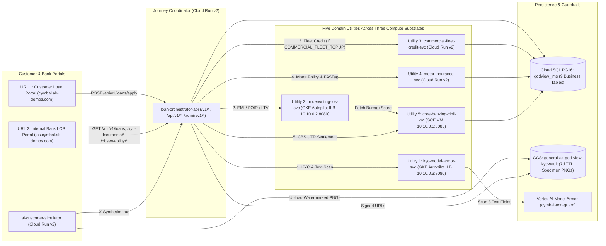

# Cymbal Auto Finance — High-Level Design (HLD)

**Plane**: Customer Application & 5-Utility Digital Vehicle Loan Origination Tenant (`cymbal/`)
**Live Customer Portal (URL 1)**: `https://cymbal.ak-demos.com`
**Live Internal Bank LOS Portal (URL 2)**: `https://los.cymbal.ak-demos.com` (IAP Protected)
**Related Docs**: [Cymbal Hub](README.md) | [Cymbal LLD](LLD.md) | [Cymbal System Design](SYSTEM_DESIGN.md) | [Master HLD](../HLD.md) | [God-View SRE HLD](../god-view/HLD.md)

---

## 1. Multi-Tier 5-Utility Architecture

Cymbal Auto Finance processes digital vehicle loans across **8 fictional vehicle models** (`VEH-EV-001` through `VEH-FLT-002`) spanning four vehicle categories (`EV_SUV`, `PASSENGER_SUV`, `TWO_WHEELER`, `COMMERCIAL_FLEET`). Every application traverses a 5-utility pipeline deployed across **Cloud Run v2**, **GKE Autopilot**, and **GCE VM**:

---

## 2. Text-Only Model Armor & Watermarked Specimen KYC Privacy Design

1. **Strict Synthetic Identity Rules (`I-08`)**:
   - All AI-generated borrowers carry `X-Synthetic: true` and W3C baggage `synthetic=true`, setting `customers.is_ai_generated = true`.
   - Synthetic PANs use checksum-invalid 4th-character holder classes so they can never collide with real Indian PAN numbers; synthetic Aadhaar numbers use the reserved `9999xxxxxxxx` prefix.
   - All generated specimen cards (`15%` of journeys via `gemini-3.1-flash-image-preview`) are watermarked with **`SPECIMEN · NOT A GOVERNMENT DOCUMENT`** and expire automatically after 7 days in `gs://general-ak-god-view-kyc-vault`.
2. **Text-Only Model Armor Guardrail (`kyc-model-armor-svc`)**:
   - Specimen PNG images undergo **only deterministic PNG magic-header (`\x89PNG\r\n\x1a\n`) and metadata validation**; image bytes are **never** sent to Model Armor or any LLM (`images_sent_to_model_armor = False`).
   - Only the 3 free-text applicant fields (`loan_purpose_text`, `employment_remarks`, `applicant_notes`) are scanned by Google Cloud Model Armor template `projects/general-ak/locations/us-central1/templates/cymbal-text-guard`.
