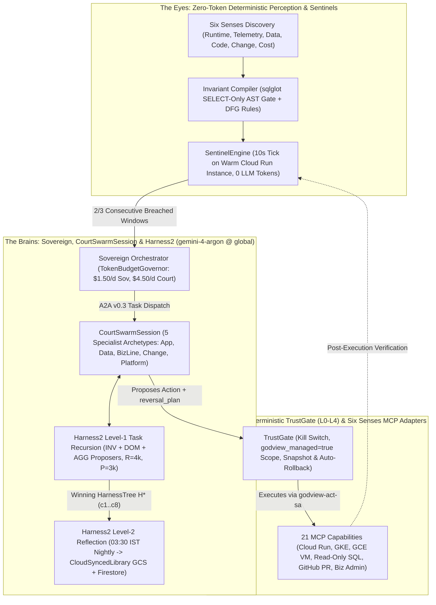

# God-View v4.0 + Harness² SRE Control Plane — High-Level Design (HLD)

**Plane**: God-View v4.0 Autonomous SRE & Business Continuity Organism (`godview/`)
**Primary Reasoning & Harness Proposer Model**: `gemini-4-argon` (`global`), with automatic HTTP 429 / quota / reserve fallback to `gemini-3.8-flash` (`global`)
**Live Cockpit URL (URL 3)**: `https://godview.ak-demos.com` (`god-view-sre-web`, IAP protected)
**Related Docs**: [God-View Hub](README.md) | [God-View LLD](LLD.md) | [God-View System Design](SYSTEM_DESIGN.md) | [Master HLD](../HLD.md) | [Customer Application HLD](../cymbal-auto-finance/HLD.md)

---

## 1. Architectural Vision: "Eyes vs. Brains" Separation

God-View v4.0 separates **continuous deterministic detection ("The Eyes")** from **event-driven recursive multi-agent reasoning ("The Brains")**:

---

## 2. The Six Senses & Living System Model

On startup and via `/v1/perceive`, `PerceptionOrgan` (`godview/sovereign/perception/__init__.py`) probes six orthogonal telemetry channels to construct a domain-neutral **Living System Model** stored in Firestore (`god-view-memory-db`):

| Sense # | Sense Name | Adapter Package | Discovered Entities & Signals |
| :--- | :--- | :--- | :--- |
| **Sense 1** | **Runtime & Topology Sense** | `godview/adapters/gcp/`, `kubernetes/` | Cloud Run v2 services (`godview_managed=true`), GKE Autopilot deployments (`namespace: cymbal`), GCE VMs (`core-banking-cibil-vm`), and health endpoints. |
| **Sense 2** | **Telemetry & Trace Sense** | `godview/ledger/exporter.py` | W3C `traceparent` + `baggage` spans (`journey.id`, `customer.id`, `synthetic`), golden signals (`p95_ms`, `error_rate_pct`, `requests_per_min`). |
| **Sense 3** | **Data & Ledger Sense** | `godview/adapters/sql/`, `godview/ledger/` | PostgreSQL `information_schema` tables/foreign keys via `godview_readonly` and BigQuery `godview_ledger` (`events`, `state_transitions`, `journeys`, `kpi_rollups`). |
| **Sense 4** | **Code & Contract Sense** | `godview/adapters/git/` | OpenAPI `/openapi.json` (`x-godview-admin-action`, `x-godview-reversal`, `x-godview-probe-safe`), recent Git commits, and file blame. |
| **Sense 5** | **Change & Audit Sense** | `godview/sovereign/nervous_system/` | Real-time Cloud Audit Logs streamed via `godview-audit-to-nervous-system` $\rightarrow$ Pub/Sub `godview-nervous-system` $\rightarrow$ `POST /v1/nervous-system/push`. |
| **Sense 6** | **Cost & Drift Sense** | `godview/adapters/gcp/drift.py` | `TokenBudgetGovernor` daily/monthly spend and live Terraform state drift against `gs://general-ak-god-view-tfstate/default.tfstate`. |

---

## 3. Harness² Recursive Agent Substrate (`godview/harness/`)

God-View v4.0 integrates Google Research's **Harness²** (`arXiv:2610.14224`) to evolve each Court Agent's 8-category **`GODVIEW_SURFACE` (`c1..c8`)**:

- **Always-On Categories (`c1..c4`, capped at `always_on_max = 12,000` chars)**:
  - `c1` (`systemprompt.md`): Specialist identity and reasoning protocol.
  - `c2` (`guardrails.md`): Non-negotiable safety rules (`I-01`..`I-12`).
  - `c3` (`LongTermMEMORY.md`): Distilled domain topology and incident patterns.
  - `c4` (`tool_descriptions/tool_guidance.md`): Symptom-to-capability routing table.
- **On-Demand & Event-Driven Categories (`c5..c8`)**:
  - `c5` (`sub_agents/<name>/AGENT.md`): Delegated sub-agent specifications.
  - `c6` (`skills/<name>/SKILL.md`): Procedural remediation playbooks.
  - `c7` (`scripts/<name>.py`): AST-sandboxed (`validate_script_ast`) diagnostic Python scripts.
  - `c8` (`hooks.json`): `PreToolUse`, `PostToolUse`, and `Stop` hooks executed by `HookRunner`.
- **Model Governance**: `VertexGeminiProposer` defaults to **`gemini-4-argon` @ `global`**, with automatic fallback to **`gemini-3.8-flash` @ `global`** on HTTP 429/503 or `TokenBudgetGovernor` reserve exhaustion.
