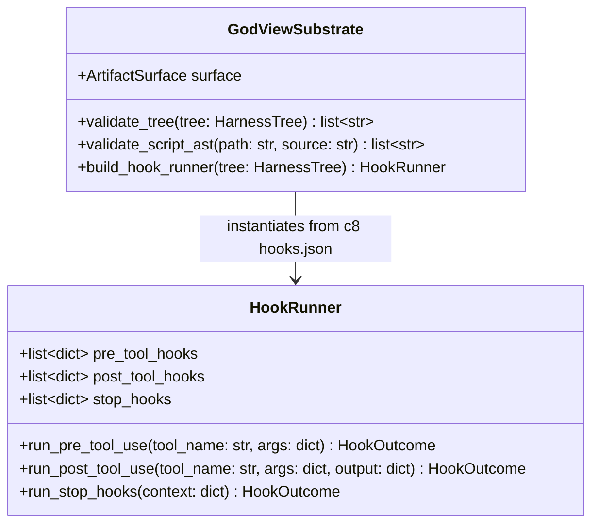

# God-View v4.0 + Harness² SRE Control Plane — Low-Level Design (LLD)

**Plane**: God-View v4.0 Autonomous SRE & Business Continuity Organism (`godview/`)
**Primary Reasoning & Harness Proposer Model**: `gemini-4-argon` (`global`), with automatic HTTP 429 / quota / reserve fallback to `gemini-3.8-flash` (`global`)
**Related Docs**: [God-View Hub](README.md) | [God-View HLD](HLD.md) | [God-View System Design](SYSTEM_DESIGN.md) | [Master LLD](../LLD.md)

---

## 1. Sovereign Control Plane API Routes (`godview/sovereign/control_api/__init__.py`)

All routes are double-mounted under `/v1/*` and `/api/v1/*` for direct API and same-origin IAP browser access (`https://godview.ak-demos.com/api/v1/*`):

| HTTP Method & Route | Handler / Component | Description & Contract |
| :--- | :--- | :--- |
| `GET /v1/me` | `get_me` | Reads `X-Goog-Authenticated-User-Email` IAP header and returns `IapUserIdentity`. |
| `GET /v1/perceive` & `POST /v1/perceive` | `PerceptionOrgan` | Returns or refreshes the Six Senses `PerceptionReport` (`tokens_at_rest == 0`, `sentinel_cadence_s == 10`). |
| `GET /v1/court` & `POST /v1/court/{agent_id}/control` | `CourtManager` | Lists all 5 Court Specialist Agents with their Trust Ladder records and handles `wake`/`suspend` actions. |
| `GET /v1/invariants` & `POST /v1/invariants/{id}/compile` | `InvariantCompiler` | Lists registered invariants and compiles SQL (`sqlglot` AST verified), DFG, and CUSUM rules into active `CompiledSentinel`s. |
| `GET /v1/sentinels` & `PATCH /v1/sentinels/{id}` | `SentinelEngine` | Lists compiled Sentinels and toggles state (`active`, `muted`). |
| `GET /v1/journeys` | `ProcessMiner` | Returns DFG process-mining conformance (`CONFORMANT`, `REORDERED`, `SKIPPED`, `STALLED`) across observed journeys. |
| `GET /v1/incidents` & `POST /v1/incidents/{id}/deliberate` | `CourtSwarmSession` | Lists incidents and triggers multi-agent consensus (`>= 0.85` confidence, `<= 4` rounds) and Harness² recursion. |
| `GET /v1/approvals` & `POST /v1/approvals/{id}/decide` | `TrustGate` | Lists pending `L3`/`L4` human-in-the-loop approval requests and executes approved actions with automatic post-verification. |
| `POST /v1/trust-records/{id}/whitelist` | `TrustGate` | Toggles operator whitelist (`whitelisted: bool`) for `L4` business saga remediation capabilities. |
| `GET /v1/changes` | `NervousSystemSubscriber` | Returns correlated Cloud Audit Log (`audit_config_change`) and Git commit timeline. |
| `GET /v1/cost` | `TokenBudgetGovernor` & `DriftScanner` | Returns daily/monthly LLM token spend and Terraform state drift diffs against `gs://general-ak-god-view-tfstate`. |
| `GET /v1/drills` & `POST /v1/drills/{id}/trigger` | `ControlAPI` | Triggers or clears opt-in Chaos Drills on `godview_managed="true"` tenant services. |
| `POST /v1/controls/kill-switch` | `TrustGate` | Engages or clears the global operator kill switch (`kill_switch_enabled`), immediately freezing all `L1–L4` autonomous actions. |
| `POST /v1/probes/run` | `SentinelEngine.evaluate_tick` | Invoked every 5 minutes (`09:00–16:59 IST`) by Cloud Scheduler job `godview-probe-run`. |
| `POST /v1/memory/reflect` & `POST /v1/sovereign/reflect` | `CourtManager` & `CloudSyncedLibrary` | Invoked nightly at `03:30 IST` by `godview-agent-reflection` to run Level-2 Harness² `run_selection` + `reflect_adoption`. |
| `POST /v1/nervous-system/push` | `NervousSystemSubscriber` | Pub/Sub push webhook for `godview-sovereign-push`; decodes base64 Cloud Audit Log `protoPayload` entries. |
| `POST /v1/lifecycle/tenant-pause` & `/tenant-resume` | `ControlAPI` | Invoked at `17:00 IST` and `09:00 IST` by Cloud Scheduler to pause/resume tenant traffic. |
| `GET /v1/agents/{agent_id}/harness` | `inspection_routes.py` | Returns the live Harness² `HarnessTree` (`c1..c8`), `always_on_tokens`, `always_on_max` (`12,000`), and SHA-256 tree digest. |
| `GET /v1/agents/{agent_id}/experience` | `inspection_routes.py` | Returns `<domain>/INDEX.md`, `<domain>/EXPERIENCE.md`, and recent `RunMark` records from `CloudSyncedLibrary`. |
| `GET /v1/incidents/{incident_id}/harness-run` | `inspection_routes.py` | Returns the per-incident Level-1 `INV`/`DOM`/`AGG` recursion trace and `BudgetLedger` ($R=4{,}000, P=3{,}000$) utilization. |

---

## 2. Harness² Substrate & AST Sandbox (`godview/harness/substrate.py`)

### 2.1 `validate_script_ast` Security Rules for Category `c7` (`scripts/*.py`)

When `DOM` or `AGG` proposers on `gemini-4-argon` synthesize or mutate a helper script under `scripts/*.py`, `validate_script_ast()` parses the Python source via `ast.parse()` and enforces:
1. **Forbidden Modules**: Rejects any `import` or `from ... import` of `subprocess`, `socket`, `http`, `httpx`, `urllib`, `requests`, `aiohttp`, `ftplib`, `smtplib`, `telnetlib`, `xmlrpc`, `shutil`, `tempfile`, `ctypes`, `multiprocessing`, `threading`, `asyncio.subprocess`, `pty`, `fcntl`, `resource`, `signal`, `sys`, `importlib`, `builtins`, `pickle`, `marshal`, `shelve`.
2. **Forbidden Builtins & Attributes**: Rejects calls to `eval()`, `exec()`, `compile()`, `__import__()`, `globals()`, `locals()`, `getattr()`, `setattr()`, `delattr()`, `os.system`, `os.popen`, `os.spawn*`, `os.exec*`, `os.remove`, `os.unlink`, `os.rmdir`, `Path.unlink`, `Path.write_text`, `Path.write_bytes`.
3. **Read-Only `open()` Enforcement**: Rejects any `open()` call whose mode argument contains `'w'`, `'a'`, `'x'`, or `'+'`.

---

## 3. URL 3: God-View SRE Cockpit (`godview/god-view-sre-web/`)

- **Entrypoint**: [`godview/god-view-sre-web/src/App.tsx`](file:///usr/local/google/home/kambleashish/Documents/Projects/god-view/godview/god-view-sre-web/src/App.tsx)
- **Resilience Architecture**:
  - Uses `cockpitApi.fetchDatasetSettled()` (`Promise.allSettled` across all 11 Sovereign API slices) so a partial failure in one slice renders a non-blocking `partial-slice-error-banner` while keeping healthy tabs and the Global Kill Switch (`#controls`) interactive.
  - Never falls back to fake or synthetic data when production API calls fail (`Sovereign Control API Error` alert banner).
  - Detects IAP session expiry (`IAP_SESSION_EXPIRED`) and renders `iap-session-expired-banner` with one-click reload.
