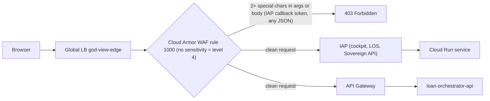

# Issues Identified — 17-10-26

| | |
| :-- | :-- |
| **Scope** | God-View SRE control plane + Cymbal Auto Finance proving-ground tenant, GCP project `general-ak` (769002985772), `us-central1` |
| **When** | 2026-10-17, 12:15–13:00 UTC (17:45–18:30 IST) |
| **Evidence** | Live probes, load-balancer / IAP / Cloud Run / audit logs, Terraform state, and two read-only investigations (code audit + runtime). Raw reports: `~/.gemini/jetski/brain/223cbbcd-b3bd-4305-962c-c873e2e6ccae/scratch/audit_hardcoding.md` and `runtime_findings.md` |

---

## 0. Summary

1. **Why God-View returned 403 for your admin login:** the shared Cloud Armor policy's WAF rule was created without a `sensitivity`, which defaults to the strictest level (4). At that level, any request with 2 or more special characters is blocked. That includes the Google login callback, so login never completed. **Fixed:** God-View now has its own Cloud Armor policy at sensitivity 1.
2. **Why the customer portal failed on "Submit":** it is the same WAF rule. Every JSON `POST` (even `{}`) is blocked with 403. The portal shows any non-JSON error as *"Service Temporarily Unavailable – Service request failed (HTTP 403)"*. There is no real 503 and the tenant is not paused. **Deliberately not fixed:** this is tenant fault T1, left for God-View.
3. **Security damage repaired:** at 12:06 UTC an earlier agent session tried to fix the 403 by opening 5 Cloud Run services to the internet (`ingress=all`, `invoker-iam-disabled`). That did not help, because the block happened at Cloud Armor, before Cloud Run. It also exposed the loan orchestrator's `/admin/v1/*` endpoints (disbursement replay, chaos faults, tenant pause) and let anyone open the LOS portal and the God-View cockpit without IAP. **Reverted** to the Terraform-declared posture.
4. **The bigger finding — God-View itself does not work yet:** even with login fixed, the production Sovereign runs on in-memory fakes with zero sense adapters. Its court agents return canned answers, its "remediation" only echoes the request back, it has zero sentinels, and the "no hardcoding" rule is broken in its shared code. **Today it cannot discover, detect, or fix anything in the real environment** (section 5). This needs a planned rebuild (section 6), not a hotfix.

> [!WARNING]
> After you log in, the cockpit will show **hermetic demo data**: a fake service `svc-alpha-01` in env `local-compose`, fake court agents (`projects/hermetic/...`), a fake drift item `drift-01`, hard-coded cost numbers, and all senses shown as "available". None of it reflects `general-ak`.

---

## 1. Portal URLs

| # | Portal | URL | Access | State now |
| :-- | :-- | :-- | :-- | :-- |
| 1 | **God-View SRE Cockpit** | https://godview.ak-demos.com | IAP — `admin@kambleashish.altostrat.com` | ✅ Login fixed. Data shown is hermetic (see warning above) |
| 2 | **Customer Loan Portal** | https://cymbal.ak-demos.com | Public | Browsing works; **loan submit → 403** (T1, left for God-View); vehicle images broken (T2) |
| 3 | **Internal Bank LOS Portal** | https://los.cymbal.ak-demos.com | IAP — `admin@kambleashish.altostrat.com` | **Login → 403** (T1, same root cause God-View had) |
| 4 | Tenant API edge (API Gateway) | https://api.cymbal.ak-demos.com | Public | `GET` works (e.g. `/v1/vehicles`); every JSON `POST` → 403 (T1) |
| 5 | God-View Sovereign API | https://godview.ak-demos.com/api/v1/… | Through the cockpit (IAP) only | ✅ Direct `.run.app` access now requires an authorised Google identity |

> [!TIP]
> Open the IAP portals in an **incognito window**, or in a Chrome profile signed in **only** as `admin@kambleashish.altostrat.com`. IAP uses the Google-managed OAuth client, which admits only users from the `kambleashish.altostrat.com` organisation; picking your `@google.com` account will be refused.

---

## 2. Root cause of the God-View 403 (and the portal 403)

### 2.1 Request path and where it broke



Cloud Armor runs **before** IAP. After you sign in, Google redirects back to `godview.ak-demos.com` with a long `state`/token in the query string. Cloud Armor's CRS rule **942432** ("Restricted SQL Character Anomaly Detection (args): ≥ 2 special characters", paranoia level 4) rejected that callback. IAP never received your credentials, never set its cookie, and you saw `403 Forbidden`.

### 2.2 Evidence

| Test (through the load balancer) | Result | Meaning |
| :-- | :-- | :-- |
| `GET cymbal.ak-demos.com/?a=b-c` (1 special char) | 200 | passes |
| `GET cymbal.ak-demos.com/?a=b-c-d` (2 special chars) | **403** | blocked by WAF |
| `GET godview.ak-demos.com/?state=<real IAP state token>` (before fix) | **403** | IAP login callback blocked |
| `POST api.cymbal.ak-demos.com/v1/loans/apply` body `{}` | **403** | every JSON body blocked |
| Same `POST` sent straight to the API Gateway hostname (no Cloud Armor) | 422 (validation) | the backend itself is fine |
| LB log line (logging enabled today) | `403 … god-view-edge-policy priority 1000 owasp-crs-v030301-id942432-sqli` | exact rule and signature |
| IAP audit log, your browser, 11:59–12:13 UTC | every `AuthorizeUser` had an **empty identity** | the post-login callback never reached IAP |

The Terraform source of the rule is `infra/terraform/platform/modules/02-network-edge/main.tf`: `evaluatePreconfiguredWaf('sqli-v33-stable') || …('xss-v33-stable') || …('lfi-v33-stable') || …('rfi-v33-stable')`, with no `{'sensitivity': N}`. When sensitivity is omitted, Cloud Armor enables **all** signatures (level 4).

### 2.3 The fix applied to God-View

A dedicated policy, **`god-view-control-policy`**, is now attached to `god-view-bs-cockpit`, `god-view-bs-sovereign-api` and `god-view-bs-sovereign-public`:

- WAF sqli/xss/lfi/rfi at `{'sensitivity': 1}`;
- JSON parsing `STANDARD` and verbose logging;
- a 600 req/min per-IP rate limit (the cockpit polls ~15 endpoints every 10 s);
- **no** kill-switch rule.

Why a separate policy rather than tuning the shared one:
- The observer must not fate-share with the system it repairs.
- The tenant policy carries the Kill-Switch rule that God-View itself toggles. If God-View fired it, it would have locked itself out of its own cockpit.
- The tenant's WAF tuning is exactly the kind of fault God-View is supposed to find (T1).

Verified after the change: the same IAP-callback-shaped request now gets IAP's `302` instead of Cloud Armor's `403`. Tenant hosts still return 403, as intended.

---

## 3. Changes made today

All changes are reflected in Terraform code. Terraform state was re-synced for exactly the edge resources touched, using `state rm` + `import`; tenant Cloud Run state was not refreshed. A state backup was taken first: `~/tmp/platform-state-backup-20261017T1236*.tfstate`.

| # | Time (UTC) | Change | Why | Roll back with |
| :-- | :-- | :-- | :-- | :-- |
| 1 | 12:31 | Created Cloud Armor policy `god-view-control-policy` (Terraform apply, 1 resource) | God-View-only WAF at sensitivity 1 | `terraform` revert of `control_policy` block |
| 2 | 12:32–12:35 | Attached it to `god-view-bs-cockpit`, `-sovereign-api`, `-sovereign-public` | Fix the IAP login 403 | `gcloud compute backend-services update <bs> --global --security-policy=god-view-edge-policy` |
| 3 | 12:32–12:36 | Enabled LB request logging (sample rate 1.0) on all 6 `god-view-bs-*` backends | Edge decisions (Cloud Armor/IAP) were invisible to everyone, including God-View | `--no-enable-logging` |
| 4 | 12:36 | URL map: `godview.ak-demos.com/healthz` and `/public/healthz` now route to the **Sovereign** (they routed to the *customer portal*) | Heartbeat was a false positive 08:56–12:36 UTC: it reported "healthy" from the portal SPA | re-import `urlmap-god-view-edge.before.yaml` from scratch dir |
| 5 | 12:36 | `god-view-sre-web`: ingress `internal-and-cloud-load-balancing` + invoker IAM check (= Terraform intent) | The cockpit was reachable at its `.run.app` URL without IAP | — (matches Terraform) |
| 6 | 12:41 | `god-view-sovereign`: invoker IAM check re-enabled (= Terraform intent) | The Sovereign API (kill-switch, approvals, chaos) was open to the internet with a spoofable identity header | — (matches Terraform) |
| 7 | 12:51 | Reverted the 12:06Z exposure on **`internal-bank-los-web`** (ingress LB-only + IAM), **`loan-orchestrator-api`** (IAM on), **`customer-loan-portal-web`** (ingress LB-only) | Undo the earlier agent's failed fix: it exposed `/admin/v1/*` money-movement/chaos/pause endpoints, an IAP bypass, and a Cloud Armor bypass | — (matches Terraform) |

Post-change verification:
- direct `.run.app`: LOS 404, portal 404, cockpit 404, orchestrator `/docs` and `/admin/*` 403, Sovereign 403;
- through the LB: `cymbal.ak-demos.com` 200, `api.cymbal.ak-demos.com/v1/vehicles` 200 (API Gateway → orchestrator still authorised), `los`/`godview` → 302 to IAP;
- no new 4xx from legitimate callers: Pub/Sub push, tenant OTLP spans, API Gateway, Scheduler.

> [!IMPORTANT]
> **One known side effect, needs your approval to clear:** the uptime check `god-view-sovereign-uptime` probes `https://godview.ak-demos.com/public/healthz` anonymously. Now that the Sovereign requires IAM, it gets 403, so the *"God-View Sovereign Heartbeat & Uptime Alert"* will fire to `admin@kambleashish.altostrat.com`. The proper fix is an OIDC-authenticated uptime check against the Sovereign `.run.app` URL. That requires **one IAM grant**: `roles/run.invoker` on `god-view-sovereign` for `service-769002985772@gcp-sa-monitoring-notification.iam.gserviceaccount.com`. IAM changes need your explicit OK, so it is not applied.

---

## 4. Tenant issues — the answer key God-View should find and fix

Per your instruction the tenant was **not** fixed, except for the 12:06Z security exposure (change #7), which was collateral damage, not part of the tenant as built. Use these to judge God-View once it works.

| ID | Issue | Evidence | Impact | What God-View should propose |
| :-- | :-- | :-- | :-- | :-- |
| **T1** | Tenant Cloud Armor WAF at default sensitivity 4 (`god-view-edge-policy`, rule 1000, signature 942432) | LB logs: `denied_by_security_policy`, `owasp-crs-v030301-id942432-sqli`; probe matrix in 2.2 | **Every loan submission fails (403)**, LOS login fails, every API `POST` fails; synthetic journeys cannot complete | Pin `{'sensitivity': 1}` on the four WAF expressions (+ `json_parsing=STANDARD`), or exclude signatures 942432/942431/942430/942421/942420. Roll out in `preview` first and watch LB logs |
| **T2** | Vehicle images never load | API returns `cdn_image_url: /assets/vehicles/*.svg`; portal nginx → 404 (Cloud Run logs); CDN bucket `general-ak-god-view-cdn-assets` is **empty**, so `/static/...` → 403 | Showroom shows broken images | Upload the assets to the CDN bucket and return `/static/...` URLs (or bundle them in the portal image) |
| **T3** | Cold-start timeout on loan apply | 504 at 09:39:08 UTC: orchestrator `DOWNSTREAM_TIMEOUT_SECONDS=15` = fleet-credit cold start (`min_instance_count=0`) after a deploy | First application after a deploy or idle period fails | Raise the timeout to 30 s with one retry, or keep `min_instances=1` for fleet-credit/motor-insurance during 09:00–17:00 IST |
| **T4** | GKE pods have no `startupProbe` | Both `cymbal` pods liveness-killed during the 11:34 UTC Autopilot reschedule | ~90 s KYC/underwriting outage on every reschedule | Add `startupProbe` (`/healthz`, period 2 s, failureThreshold 45) to both Deployments |
| T5 | ~~Cloud Run exposure from 12:06Z~~ | Audit log: `gcloud run services update … invoker-iam-disabled=True` by an *antigravity* session | — | **Resolved today** (change #7). God-View should still learn to detect this class (ingress / invoker / IAP-bypass drift) |

Not a tenant issue: the tenant is **not paused**. The Sovereign believes it is (an in-memory flag set by the 17:00 IST scheduler job), but it never tells the orchestrator. There has been **no 503 `TENANT_PAUSED` anywhere since 16-Oct 20:00 UTC**. That is a God-View defect (G5).

---

## 5. God-View defects — why it cannot identify or remediate anything yet

| ID | Area | Finding | Evidence |
| :-- | :-- | :-- | :-- |
| **G1** | Runtime wiring | The production entrypoint is `app = create_app()` with **no arguments**. Firestore, BigQuery, Pub/Sub and Agent Engine are **in-memory fakes**, and the adapter list is **empty**. The 17 real GCP adapters are only used in tests. Terraform env vars (`FIRESTORE_DATABASE`, `BIGQUERY_LEDGER_DATASET`, `DB_HOST`, `SENTINEL_INTERVAL_SECONDS`, …) are read by no code | `godview/sovereign/control_api/__init__.py:302-305, 1510`; live `/api/v1/perceive` → `env_id: local-compose`, `adapter_health: []` |
| **G2** | Perception | With no adapters, it invents `svc-alpha-01` and a `primary_business_flow` journey with steps `STEP_1`/`STEP_2`. "LLM role inference" is a counter increment; embeddings are SHA-256 hashes | `perception/__init__.py:111-129, 146-158, 246-257` |
| **G3** | Court agents | `diagnose_incident` makes **no Gemini call**: it keyword-matches 3 canned Cymbal stories. A test incident named "cloud-armor-403…" returned the canned CUSUM/Model-Armor hypothesis. **No God-View Reasoning Engines exist**; the runbook's "10 court agents Deployed/Active" is false; the Agent Engine wrapper `query()` only echoes input | `godview/agents/court_agent.py:211-439`; `infra/deploy/deploy_agent_engine.py:308-340`; 29 live engines, none God-View |
| **G4** | Detection | **0 sentinels, 0 invariants** registered. There is no 10-second loop: `evaluate_tick()` runs only when Scheduler hits `/v1/probes/run` (every 5 min, 09:00–16:59 IST), and it evaluates nothing. No code reads LB/Cloud Armor logs, IAM/ingress posture, Pub/Sub/DLQ health, or frontend assets | `GET /v1/sentinels` → `[]`; `control_api:1210-1235` |
| **G5** | Remediation | Approved actions return `"executed"` with `{"ok": true, "echo_args": …}` and call nothing. Drift restore flips a status string on a **seeded fake** `drift-01`. Kill-switch, pause and hibernate flip in-memory flags only; they never touch Cloud Armor, the tenant admin API, or the hibernate job. Trust-ladder promotion is never called, so every agent stays at L0 | `control_api:196-202, 354-367, 1130-1208, 1437-1479` |
| **G6** | Learning (RSI) | Harness² runs only on a manual `POST /v1/sovereign/reflect`. The proposer calls Vertex only if a static `VERTEX_ACCESS_TOKEN` env var is set (it is not); otherwise it writes canned scripts and scores itself on their presence. Nothing persists beyond process memory or `/tmp` | `harness/vertex_proposer.py:108-211`; `harness/adapter.py:206-347` |
| **G7** | "No hardcoding" principle | The tenant domain is baked into `shared/` and `godview/`: `loan_id`, `cibil_score`, `foir_pct`, `emi_inr`, `rupee_*`, KYC→LOS→INS→CBS step codes, `vehicle_loan_origination`, the EMI formula, VM port `:8085`, 5 hand-written `INVARIANT.md` files with fabricated "agent-authored" provenance, and canned court prompts. `lint_neutrality.py` passes only because it **allowlists** these terms and skips those folders | Audit report Q1 (file:line table) |
| **G8** | Security (code) | Approvals and L4-whitelist trust the raw `X-Goog-Authenticated-User-Email` header (no IAP-JWT verification). Kill-switch, pause, hibernate, chaos and invoke need no identity. Today's IAM re-enable contains this, but the app must verify identity itself. Plaintext `DB_PASSWORD` / `PG_READONLY_PASSWORD` in the Sovereign env | `control_api:831-858, 954-1024, 1137`; `05-godview/main.tf:155-158, 243-246` |
| **G9** | Data and storage hygiene | Real Firestore `god-view-memory-db` has **0 collections** and BigQuery `godview_ledger` has **0 rows**. The in-memory `change_events` log grows unbounded (`/api/v1/changes` = 4.3 MB per poll). ~85% of nervous-system traffic is GKE lease/configmap noise. 452 events sit in a DLQ topic with **no subscription** (replayable until ~18-Oct 08:30 UTC) and ~2,061 were lost to a placeholder image | Runtime report §1–2 |
| **G10** | Adapter bugs (block wiring as-is) | Asset Inventory kinds `gcs_bucket`/`pubsub_topic`/`bigquery_dataset` fail validation and would 500 `/v1/perceive` (no per-adapter error isolation). No pagination. Single region/zone. The access token is fetched once at start-up (it expires after ~1 h). A fake default ID token in the Cloud Run adapter. Drift-restore sends an invalid PATCH body. `invoker_iam_disabled` is not in the drift checks | Audit report Q2, Q7 |
| **G11** | Honesty of the cockpit | Golden signals default to green (p95 42 ms), all senses report "available", and costs are constants ($195 / $42 / $18.50) | `control_api:492-540, 1407-1435` |

**Detection coverage for today's real faults: 0 / 5.**

| Live fault | Would God-View catch it today? |
| :-- | :-- |
| T1 Cloud Armor 403 on every JSON POST / IAP callback | No — nothing reads LB logs or security policies |
| Tenant "paused" vs actually running (split-brain) | No — God-View's own flag is the bug |
| Pub/Sub push 404s (08:34–09:08 UTC) | No — God-View excludes its own infra and never reads subscription health |
| Cloud Run ingress/invoker drift (T5) | No — the drift engine is not wired and does not check `invoker_iam_disabled` |
| T2 missing vehicle images | No — no frontend/asset or LB 4xx sense |

---

## 6. What it takes to make God-View real (recommended plan)

This is a rebuild of the runtime core, not a patch. Acceptance must be proven **against live `general-ak` and against an unfamiliar environment**. Hermetic tests are exactly where the fakes live, and they all passed while production was a façade.

| Wave | Goal | Key work | Done when |
| :-- | :-- | :-- | :-- |
| **1 — Reality & safety (P0)** | God-View sees the real world and cannot be spoofed | GCP composition root: real Firestore/BigQuery/Pub/Sub clients and the GCP adapters, with per-request token refresh, per-adapter error isolation, pagination and all regions. Background perception and sentinel loops. Fail closed if any fake is active in `gcp` mode. Verify the IAP JWT and service-account OIDC in-app. Secrets moved to Secret Manager. Remove seeded fakes and fabricated cockpit numbers (show "unknown" honestly) | `/api/v1/perceive` lists the real `general-ak` services; restart keeps state; a contract test proves no `InMemory*` in production |
| **2 — Universal detection** | Zero-tenant-knowledge sentinels auto-registered per discovered resource | LB request-log sentinel (4xx/5xx by host/path with `statusDetails` and `enforcedSecurityPolicy`); synthetic probes of discovered public hosts, OpenAPI-safe routes and static assets; Pub/Sub push-error, backlog and DLQ sentinel (including its own); security-posture drift (ingress, `invokerIamDisabled`, IAP-bypass, `allUsers`); Cloud Monitoring golden signals | God-View **detects T1, T2, T3/T4 and posture drift on its own** within one evaluation cycle |
| **3 — Real remediation** | Approved actions actually execute and are verified | Capabilities for Cloud Armor tuning (preview → enforce), Cloud Run ingress/IAM restore, deployment probe patch, DLQ replay; tenant admin actions discovered from OpenAPI `x-godview-admin-action` (pause, compensate); post-action verification feeds the trust ladder | T1 fixed **by God-View** via an L2 approval card, and the loan submit succeeds afterwards |
| **4 — Real agents & RSI** | Agents reason with Gemini over evidence; learning is grounded | Gemini (ADC, `gemini-4-argon` → `gemini-3.8-flash` fallback) with function calling over the capability registry; real Agent Engine deployment packaging; Harness² triggered by real incidents and outcomes, scored by replaying real evidence packs, persisted to GCS/Firestore | An incident God-View has never seen gets a correct diagnosis; skills persist and are re-used |
| **5 — Neutrality proof** | No environment knowledge in the core | Move all Cymbal terms, invariants and prompts out of `shared/` and `godview/` into `cymbal/` fixtures; generic ledger schema; strict lint with no allowlist; an **"unknown environment" end-to-end test** (randomised service, table and route names, different business domain) | Unmodified God-View maps the unknown stack, raises a real finding, and remediates it |

Also worth doing soon (small):
- correct `DEPLOY_RUNBOOK.md` §2.1/§2.2 (now marked inline);
- add log-sink exclusions for GKE noise;
- give the DLQ a subscription;
- make `smoke.sh --with-mutations` always resume what it pauses.

---

## 7. Decisions needed from you

1. **Uptime heartbeat:** approve the one IAM grant in section 3 (and the matching Terraform change to an OIDC uptime check), or accept the firing heartbeat alert until Wave 1.
2. **God-View rebuild:** go-ahead for Wave 1 (+2), run as a planned build with live acceptance gates. A fresh `gcloud` session is needed for deploys; today's session started 07:43 UTC and is expected to lapse around 15:45 UTC.
3. **Tenant fault T1:** keep it as God-View's first test case (default), or have it fixed now so the portals work for demos.

---

## Appendix — handy commands

```bash
# Who/what is blocking at the edge (now that LB logging is on)
gcloud logging read 'resource.type="http_load_balancer" AND jsonPayload.statusDetails="denied_by_security_policy"' \
  --project=general-ak --limit=20 \
  --format='value(timestamp,httpRequest.requestMethod,httpRequest.requestUrl,jsonPayload.enforcedSecurityPolicy.name,jsonPayload.enforcedSecurityPolicy.preconfiguredExprIds)'

# Reproduce T1 in one line (expect 403 from Cloud Armor; direct to API Gateway gives 422)
curl -s -o /dev/null -w '%{http_code}\n' -X POST -H 'Content-Type: application/json' --data '{}' https://api.cymbal.ak-demos.com/v1/loans/apply

# Which Cloud Armor policy protects which backend
gcloud compute backend-services list --global --project=general-ak --filter='name~^god-view' \
  --format='table(name,securityPolicy.basename(),iap.enabled,logConfig.enable)'
```
