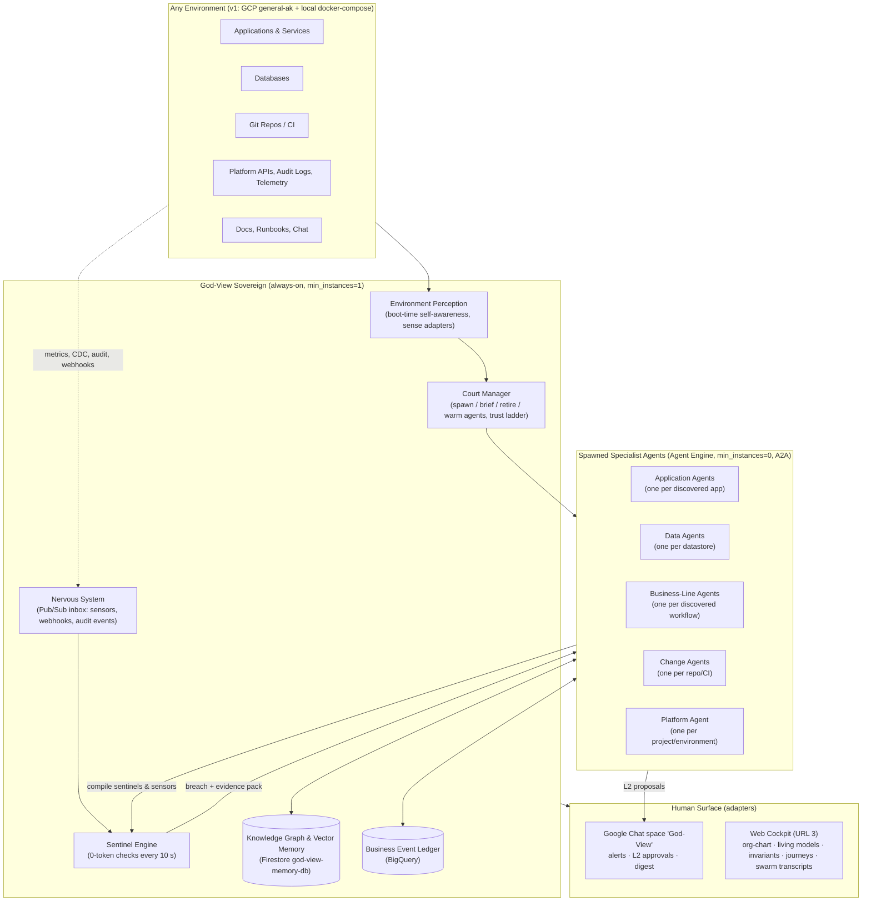
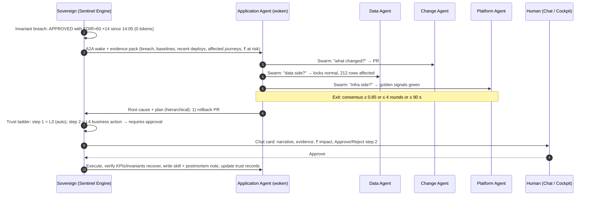

# God-View v4 Design: The Sovereign SRE Organism

- **Document ID**: `GODVIEW-DESIGN-V4-ORGANISM`
- **Status**: Validated through structured inquiry (`/grill-me` + `/brainstorming`) on 2026-10-16. **Supersedes** the v3.0 five-document suite (`docs/BRD.md`, `docs/SDD.md`, `docs/GOD_VIEW_MCP_AGENT_SPEC.md`, `docs/TERRAFORM_GITOPS_SPEC.md`, `TDD.md`), which must be rewritten to v4.0 from this design.
- **Target environment (v1)**: GCP project `general-ak` (`769002985772`, `us-central1`) + a hermetic local docker-compose environment.
- **Budget ceiling**: USD 600 / month all-in.

---

## 0. Decision Log (what was decided, in order)

| # | Decision | Outcome |
| :-- | :-- | :-- |
| 1 | Purpose | **Production-grade internal SRE tool that keeps watching `general-ak` 24/7** — not a demo, not a mock |
| 2 | Differentiator | Infra logs/metrics/traces are table stakes (AppDynamics/Dynatrace). God-View's LLMs must bring **business-logic and workflow-logic intelligence** |
| 3 | Hero capabilities | (1) LLM-authored business invariants, (2) workflow conformance / process mining, (3) business-KPI change-point + causal explanation, (5) change intelligence (PR risk review + business canary), (6) business remediation (saga replay/compensation), (7) data-integrity & abuse semantics. **Phase 2**: policy⇄code⇄runtime 3-way drift, NL "ask-the-business" console |
| 4 | Shape | **Organism**: one Sovereign agent that discovers the environment and **spawns long-lived specialist agents per application / database / business workflow / repo / platform** |
| 5 | Sub-agent runtime | **Vertex AI Agent Engine**, `deployment_spec.min_instances = 0`, A2A `AgentCard`/`AgentExecutor`, auto-catalogued in Agent Registry (when a registry exists — never assumed) |
| 6 | Collaboration pattern | **Coordinator at rest, Swarm under incident, Hierarchical + Human-in-the-loop for remediation** |
| 7 | Application-Agent senses | Code, contracts, synthetic interrogation, change-plane, scoped observability, Data Agent (replica + CDC), human docs/chat. **Nothing environment-specific hardcoded** (incl. no assumed Agent Registry) |
| 8 | Monitoring while agents sleep | **Eyes vs brains**: always-on Sovereign Sentinel Engine + platform-native sensors; agents wake with evidence packs |
| 9 | Authority | **Earned-autonomy ladder L0–L4 per agent and per action type**; hard rules on money/customer comms; probe-safety marker; kill switch; Cymbal tenant pre-promoted to L4 |
| 10 | Portability | **Environment-neutral core + discovered sense adapters**; v1 proves GCP + local docker-compose |
| 11 | Proving ground | Cymbal tenant keeps **real-world topology** (Global External LB + Cloud CDN + Cloud Armor + API Gateway + Cloud Run + GKE Autopilot + GCE VM + Cloud SQL + GCS, private networking) at the **smallest sizes**; chaos re-centred on business-logic faults *(amended by #17)* |
| 12 | Human surface | Google Chat space "God-View" (alerts, L2 approval cards, morning digest, 08:00–22:00 IST) + web cockpit rebuilt around the organism; channels are adapters |
| 13 | Budget | Hard ceiling **$600/mo**; GCP Budget alerts 50/80/100%; per-agent daily token budgets; cost is a first-class signal |
| 14 | Warmth policy | **Earned warmth**: all sub-agents `min_instances=0`; Sovereign PATCHes `min_instances=1` (1 vCPU / 2 GiB) for the 2–3 hottest agents during the tenant's 09:00–17:00 IST traffic window or after repeated incidents. Verified via the aiplatform v1beta1 discovery doc: `deploymentSpec.minInstances` *"Defaults to 1. Range: [0, 75]"*, `maxInstances` *"[1, 1000]"*, `resourceLimits` default `{cpu: 4, memory: 4Gi}` — instance counts on Agent Engine **are** configurable |
| 15 | Duty cycle | **Production-grade engineering, demo duty cycle**: not running 24/7/365. A **Traffic Kill Switch** stops all synthetic traffic and refuses new transactions instantly; a **Hibernate** mode drives infra to its cost floor between demo periods |
| 16 | Traffic & infra floor | ≈ **300 synthetic journeys/day**, only **1 in 10 with Aadhaar/PAN images** (rest text-only); **cheapest option everywhere — no HA, no multi-zone** |
| 17 | Real-world topology, small scale | Keep the load balancer and the rest of a real production edge/network (Global External Application LB with managed certs on `ak-demos.com` subdomains, Cloud CDN, Cloud Armor WAF, serverless NEGs, private-IP Cloud SQL, private GKE nodes + Cloud NAT, Secret Manager, IAP) — **reduce only instance sizes/counts**, never the architecture |
| 18 | Traffic window | **Auto-transactions run 8 h/day, 09:00–17:00 IST; the rest is scheduled pause** (traffic off, chaos off, agents cold). Sentinels keep watching 24/7 at 0 tokens |

---

## 1. Vision

God-View is **a single agent that can be deployed into any company's environment, becomes aware of that environment on its own, grows a court of specialist agents that each come to understand one application the way its long-time owner would, and reasons across them as the company's sovereign operator.** It detects what infrastructure tools cannot — *HTTP 200, pods healthy, P95 fine, business broken* — and it repairs at the level of the business workflow, not only the pod.

---

## 2. What Changes vs. the v3.0 Suite

| Area | v3.0 said | v4 says | Why |
| :-- | :-- | :-- | :-- |
| Product | Observability platform for the Cymbal demo | **Sovereign SRE organism for the whole environment**; Cymbal is the instrumented proving ground | Decision #1 |
| Intelligence | Golden signals → MCP tools → LLM diagnosis | **Business-semantic layer** (invariants, process mining, KPI causality, change intelligence, business remediation, integrity/abuse) on top of golden signals | Decision #2/#3 |
| Agents | One daemon + "specialist sub-agents" as prompts | **Long-lived Agent Engine agents spawned per discovered app/db/workflow/repo**, each with its own memory, tools, trust level | Decision #4/#5 |
| Terraform drift via `terraform-mcp` | 15-s drift detection + reconcile through `terraform-mcp` | HashiCorp `terraform-mcp` cannot do this. **Custom tfstate-vs-live attribute diff** in the Platform Agent; reconcile = fast API restore (≤45 s) + authoritative `terraform apply` via GitHub Actions `workflow_dispatch` (minutes) | Feasibility finding |
| MCP tool catalogue | Invented tool names (`fetch_single_exemplar_trace`, `gke_inspect_oom_and_restarts`, `inspect_pg_locks_blocking_tree`, …) | **Capability adapter layer** mapping capability names → real tools (`list_timeseries`, `get_trace`, `query_logs`, `get_k8s_resource`, `execute_sql`, `list_active_queries`, `create_pull_request`, …) or SDK calls | Feasibility finding |
| Telemetry store | `service_metric_rollups` + `otel_trace_spans` in the business Cloud SQL | **Never read from the patient.** Sovereign pull-scrapes `/metrics`; OTel → Cloud Monitoring/Trace; business facts → BigQuery ledger; brain → Firestore | Fate-sharing with UC-06 |
| Bootstrap credentials | 3 credentials incl. a telemetry DSN | **Zero credentials beyond identity**: God-View perceives what its identity can reach; optional hints (repo URLs) only widen scope | Decision #7/#10 |
| Utilities 3 & 4 | In-process modules of the orchestrator | **Separate Cloud Run services** so discovery sees five real utilities | Discoverability |
| Image model | `gemini-nano-banana-2.1` | **Kept** — live probe shows it resolves at `locations/global` (404 at `us-central1`); fallback `gemini-3-pro-image` (`global`). Images only for 1 in 10 journeys, watermarked specimens | Feasibility re-verified + cost |
| Edge | Cloud CDN + Global LB + API Gateway + WebSocket through gateway; public `*.run.app` URLs | **Real-world edge kept, sized small**: Global External Application LB (`cymbal.ak-demos.com`, `los.cymbal.ak-demos.com`, `api.cymbal.ak-demos.com`, `godview.ak-demos.com` via the existing Cloud DNS zone `ak-demos-com`) with Google-managed certs, Cloud CDN backend bucket, **Cloud Armor** WAF + rate limiting, serverless NEGs to Cloud Run and API Gateway; SSE instead of WebSocket through the gateway | Decision #17; API Gateway WS is Preview-only |
| "No raw log scraping" | Absolute | **No bulk log streaming into LLMs in the resting loop**; bounded, filtered log/trace queries are legitimate Tier-3 tools | Real MCPs are log/trace query tools |
| Chaos | Infra faults | **Business-logic faults first** (FOIR regression commit, insurance 200-but-no-policy, EMI rounding, CIBIL stub 900, step-order bug) + 3 infra faults (SQL lock, GKE OOM, VM latency) | Decision #11 |
| Frontends | 3 public Cloud Run URLs | URL 1/2 remain the tenant's apps; **URL 3 is IAP-protected** and rebuilt around the organism; no public mutation endpoints anywhere | Production-grade |

---

## 3. Environment Perception (how "deployed anywhere" works)

At boot the Sovereign runs a **self-awareness protocol** with no configuration:

1. **Who am I?** Resolve identity (ADC / workload identity / mounted secrets) and enumerate what that identity can reach (`testIamPermissions`-style probes per adapter).
2. **Where am I?** Detect environment signals: metadata server, Kubernetes service account, cloud API reachability, Git remotes, Docker socket, Prometheus endpoints, SQL DSNs in discovered config.
3. **What senses do I have?** Each **sense adapter** reports `available / partial / unavailable` with the evidence. Adapters never assume each other.
4. **What exists?** Run discovery through the available adapters; build the initial knowledge graph; infer business roles (one batched `gemini-3.8-flash` call); embed; persist.
5. **Who should watch it?** Court Manager decides which specialist agents to spawn (one Application Agent per app, one Data Agent per datastore, one Change Agent per repo, Business-Line Agents once journeys are discovered, one Platform Agent per environment).
6. **Re-perceive continuously**: discovery is a sentinel too (new service / table / repo → spawn; disappearance → retire with memory archived).

**Core speaks only open standards**: OpenTelemetry (traces/metrics/baggage), Prometheus `/metrics`, Kubernetes API, SQL `information_schema` + logical replication/CDC, Git + OpenAPI/proto/JSON-schema, CloudEvents, A2A, MCP.

**Adapter families in v1**:

| Family | Adapters | Notes |
| :-- | :-- | :-- |
| `gcp` | Cloud Asset Inventory, Cloud Run v2, GKE, Compute, Cloud SQL Admin, Cloud Monitoring, Cloud Trace, Cloud Logging (Audit Logs), Pub/Sub, BigQuery, Datastream, Firestore, Agent Engine, **Agent Registry (optional, discovered)**, Model Armor, IAM | Official MCP servers (`observability-mcp`, `gke-mcp`, `mcp-toolbox-for-databases`, `gcloud-mcp`, `github-mcp`) are used *through* the capability adapter layer where they fit |
| `kubernetes` | API server, events, metrics-server, Prometheus scrape | Works on GKE and kind |
| `sql` | PostgreSQL (`information_schema`, `pg_stat_*`, `pg_locks`, logical decoding) | MySQL later |
| `git` | GitHub (API + webhooks), generic Git | GitLab later |
| `channels` | Google Chat (cards), Email; Slack later | Operating-window aware |
| `local` | docker-compose discovery, kind, local Postgres, local Git | Hermetic second environment for tests and portability proof |

---

## 4. The Court: Specialist Agents

| Agent | Spawned per | Living model it owns | Default senses | Compiles for the Sovereign |
| :-- | :-- | :-- | :-- | :-- |
| **Application Agent** | discovered app/service | Entities, rules, state machines, routes, dependencies, feature flags, "what changed in business terms" per commit, empirical decision boundaries | Code (read-only repo), contracts (OpenAPI/API Gateway config, protos, schemas), **synthetic interrogation** (probe plans against probe-safe endpoints), change-plane (Audit Logs, PRs, CI, tfstate), scoped observability, human docs/chat | Invariant checks, probe plans, SLOs, KPI definitions, wake conditions |
| **Data Agent** | datastore | Schema + lineage (which app writes which table), state-transition model from CDC, integrity rules, hot paths, lock/slow-query baselines | Read replica, CDC (Datastream → BigQuery), `pg_stat_statements`, migrations | Integrity SQL, lock/slow-query sentinels, CDC schema-change wake |
| **Business-Line Agent** | discovered cross-app workflow | Process model (directly-follows graph), conformance rules, funnel KPIs, ₹ impact model, replay/compensation playbooks | Ledger + journey store; interviews Application Agents | Conformance checks, funnel change-point tests, stuck-journey detectors |
| **Change Agent** | repo / CI | Business-language diff summaries, risk model per code area, deploy ↔ incident correlation, rollback recipes | GitHub API + webhooks, CI runs, Audit Logs | "Deploy happened" events, canary windows, PR review triggers |
| **Platform Agent** | environment / project | Golden signals, tfstate-vs-live drift, quotas, **cost** (e.g., idle Reasoning Engines), IAM drift | Monitoring, Asset Inventory, Billing export, tfstate in GCS | Golden-signal gates, drift diffs, budget sentinels |

Every agent has: its own **Memory Bank** (private), a namespace in the shared **knowledge graph** (public to the court), scoped tool bindings, a **trust record** (Section 7), a daily **reflection** wake, and an **A2A card**.

---

## 5. Eyes vs. Brains: Monitoring While Agents Sleep

| Layer | Always-on | Role | Tokens |
| :-- | :-- | :-- | :-- |
| **Sovereign Sentinel Engine** | ✅ (`min_instances=1`, ~1 vCPU) | Executes compiled checks every 10 s: invariant SQL over the ledger, KPI change-point tests, journey conformance, probe plans, golden-signal gates; keeps in-flight journey state and baselines | 0 |
| **Platform-native sensors** (authored by agents) | ✅ serverless | Monitoring alert policies, log-based metrics, uptime checks, BigQuery scheduled queries, Cloud Scheduler probes, GitHub webhooks, Audit-Log sinks → one Pub/Sub "nervous system" | 0 |
| **Specialist agents** | ❌ `min_instances=0` | Woken via A2A **with an evidence pack** (what fired, since when, correlated changes, affected journeys/₹); reason, swarm, propose/act | only awake |

- **Agents compile their vigilance into the platform**: a learned rule becomes a sentinel + wake condition, so understanding keeps working while the agent sleeps.
- **Event-driven freshness**: commit → Change/App Agent wakes and re-diffs; deploy audit event → wake; CDC schema change → Data Agent wakes.
- **Daily reflection**: one off-peak wake per agent to consolidate memory, re-probe, retire stale invariants, propose new ones.
- **Earned warmth**: Sovereign `PATCH`es `min_instances` to 1 for hot apps during the tenant traffic window (09:00–17:00 IST) and back to 0 outside it.
- **Watcher of the watcher**: Monitoring uptime check + heartbeat alert policy on the Sovereign, paging via Chat/email.

---

## 6. Business-Semantic Intelligence (the heroes)

### 6.1 Substrate (derived from Decisions #3 and #7 — confirm)
- **Business Event Ledger (BigQuery, dataset `godview_ledger`)**: fed by (a) **OTel business attributes** emitted by the Cymbal tenant now (`decision`, `foir_pct`, `cibil_score`, `status_from/to`, `journey.id`, `customer.id` on spans → exported to BigQuery), and (b) **Datastream CDC** from Cloud SQL (zero app changes; every state transition with timing) via the Data Agent. Both land in the same partitioned tables (`events`, `state_transitions`, `journeys`).
- **Knowledge Graph + Vector Memory (Firestore `god-view-memory-db`)**: semantic model (services, edges, entities, rules, journeys), episodic incidents (768-dim KNN), procedural skills, trust records, agent registry of the court.
- **Per-agent Memory Bank** (Agent Engine): private working memory.

### 6.2 Capabilities

| Hero | Mechanism | 0-token runtime |
| :-- | :-- | :-- |
| **1. Business invariants** | Application/Data Agents read code + schema + policy text, author `INVARIANT.md` files (YAML frontmatter: scope, SQL/py check, severity, wake condition, provenance) → versioned in Git, indexed in Firestore, compiled into the Sentinel Engine. Examples: `APPROVED ⇒ foir ≤ 60 ∧ cibil ≥ 680`, `disbursement ⇒ sanction_letter ∧ audit.decision = APPROVED`, `insurance ⇒ loan.status ∈ {APPROVED, DISBURSED}`, step order `KYC < LOS < INS < CBS` | ✅ |
| **2. Workflow conformance** | Business-Line Agent mines the directly-follows graph from the ledger (per journey id), derives the *intended* process from code, flags skipped/reordered steps, loops, dwell-time anomalies, cohort stalls | ✅ |
| **3. KPI change-point + causal explanation** | Sentinels run CUSUM/z-score on approval rate, step conversion, ticket size, ₹/hour vs. same-hour baselines; on breach the swarm correlates with commits, config/audit events, infra incidents, data drift and produces a quantified narrative | ✅ detect / LLM explain |
| **5. Change intelligence** | Change Agent reviews PRs in business language before merge (risk, affected journeys, suggested canary), then runs a **business canary** after deploy (KPIs + invariants in the canary window) | LLM on events |
| **6. Business remediation** | Business-Line Agent plans saga replay/compensation (e.g., replay stuck disbursements after CBS recovery) through **allowlisted application admin APIs** discovered from contracts; gated by the trust ladder (money movement ≤ L2 unless whitelisted) | LLM + ladder |
| **7. Integrity & abuse semantics** | Data Agent integrity SQL (orphans, duplicates), velocity rules (same PAN × N), injection-attempt clustering (Model Armor verdict stream), PII-in-logs detectors | ✅ |

---

## 7. Authority: Earned-Autonomy Ladder

| Level | Meaning | Promotion rule |
| :-- | :-- | :-- |
| **L0 Observe** | Read-only senses, no probes that write | default for every new agent / action type |
| **L1 Recommend** | Propose actions with evidence; no execution | after the agent's model passes self-consistency checks |
| **L2 Act with approval** | Execute after a 1-click approval card in Chat / cockpit | after N₁ (default 3) recommendations judged correct |
| **L3 Autonomous reversible infra** | Restart revision, scale back, terminate blocking PID, restore tfstate attribute | after N₂ (default 5) approved executions with verified outcomes and 0 regressions |
| **L4 Autonomous business actions** | Replay/compensate workflows, data corrections | after N₃ (default 10) L3/L2 successes **and** explicit whitelist per action type |

- **Per agent AND per action type**; **instant demotion** on any bad outcome; **global kill switch**; **blast radius** = 1 resource per action; every action logged with evidence and a reversal recipe.
- **Hard rules**: money movement and customer communications capped at L2 unless whitelisted; synthetic probes only through a **discovered synthetic marker** (test tenant, `X-Synthetic: true`, probe-safe label) or non-prod endpoints; no mutations outside resources the environment owner has not excluded.
- **Cymbal proving-ground tenant starts at L4** (it is ours and chaos-safe).
- Identity split: **read SA** (senses) vs. **act SA** (impersonated only for approved/eligible actions).

---

## 8. Incident Lifecycle

---

## 9. Cymbal Proving-Ground Tenant v2 (real-world topology, smallest sizes)

| Component | Spec |
| :-- | :-- |
| **Global External Application LB** | One HTTPS LB, one global static IP, Google-managed certificate for `cymbal.ak-demos.com` (URL 1), `los.cymbal.ak-demos.com` (URL 2, behind IAP), `api.cymbal.ak-demos.com` (API Gateway), `godview.ak-demos.com` (URL 3, behind IAP); records in the existing Cloud DNS zone `ak-demos-com` (`general-ak`). Backends: **serverless NEGs** → Cloud Run frontends and API Gateway; **backend bucket with Cloud CDN** → vehicle catalog media. HTTP→HTTPS redirect |
| **Cloud Armor** | One security policy on the LB: preconfigured WAF rules (SQLi, XSS, LFI/RFI), rate limiting per IP, geo-visibility; its verdict stream feeds the abuse-semantics hero |
| **VPC & networking** | Custom-mode VPC, one `us-central1` subnet, Private Service Access (Cloud SQL private IP), **private GKE nodes + Cloud NAT** (one gateway, auto-IP), Direct VPC egress for Cloud Run, least-privilege firewall rules (orchestrator → GKE internal LBs, GKE → VM:8085, all → Cloud SQL:5432) |
| Cloud Run | `loan-orchestrator-api`, `commercial-fleet-credit-svc` (Utility 3), `motor-insurance-svc` (Utility 4), `customer-loan-portal-web` (URL 1), `internal-bank-los-web` (URL 2); **1 vCPU / 512 MiB, min 0, max 3, concurrency 80**, ingress "internal + load balancer" |
| GKE Autopilot | One cluster (`god-view-gke-cluster`, private nodes); `kyc-model-armor-svc` (Utility 1), `underwriting-los-svc` (Utility 2) at **0.25 vCPU / 512 MiB requests, 1 replica each**, internal LB Services; management fee offset by the GKE free-tier credit |
| Compute Engine | `core-banking-cibil-vm` (Utility 5), **`e2-micro`** (Always-Free-eligible in `us-central1`), 10 GB standard disk, **no external IP** (egress via Cloud NAT), port 8085 |
| Cloud SQL | PostgreSQL 16, **`db-g1-small` shared-core, single zone, no HA, private IP only, 10 GB SSD, daily backup, no PITR**, `pg_stat_statements`, logical decoding on (for CDC); credentials in **Secret Manager** |
| GCS | `kyc-vault`, `cdn-assets`, `agent-skills`, `tfstate` (Standard, single region) |
| API Gateway | `god-view-loan-api-gw` → orchestrator (OIDC), fronted by the LB; SSE for live telemetry, no WebSocket through the gateway |
| Synthetic marker | All AI-customer traffic carries `X-Synthetic: true` + `is_ai_generated=true`; probes allowed only on these paths |
| AI customer stream | **≈ 300 journeys/day inside a fixed 09:00–17:00 IST window** (≈ 37/hour, one every ~100 s; burst buttons still available); **1 in 10 journeys** carries Aadhaar/PAN images (live `gemini-nano-banana-2.1` at `global` / fallback `gemini-3-pro-image`, watermarked `SPECIMEN · NOT A GOVERNMENT DOCUMENT`, checksum-invalid numbers, no official emblems); the other 9 are **text-only KYC** (numbers + persona fields, no images). `gemini-3.8-flash` (LOW, `global`) personas |
| **Scheduled pause (17:00–09:00 IST)** | Cloud Scheduler flips the tenant to *paused* at 17:00 and back at 09:00 (every day by default; weekdays-only is a flag): AI-customer scheduler off, chaos off, hot agents back to `min_instances=0`; the LB keeps serving manual/human traffic; sentinels keep watching at 0 tokens |
| **Traffic Kill Switch** | One IAM-only control (`POST /v1/tenant/kill-switch`, cockpit red button, Chat command) usable any time: halts the AI-customer scheduler immediately, orchestrator rejects new transactions with `503 TENANT_PAUSED` at ingress (Cloud Armor can additionally deny all but allowlisted IPs), chaos drills pause, in-flight journeys may drain. God-View annotates the pause as a *planned operator action* so the traffic drop raises no incident |
| **Hibernate** | Cost floor for multi-day idle periods: GKE deployments → 0 replicas, VM stopped, Cloud SQL `activation_policy=NEVER` (storage only), Cloud Run scale-to-zero, all agents `min_instances=0`, sentinels throttled to 60 s; LB/Armor/DNS stay up so URLs never change. Wake-up ≈ 5–8 min via one command; the Sovereign stays up |
| Model Armor | Text-only on `loan_purpose_text`, `employment_remarks`, `applicant_notes`; images never scanned |
| Terraform | Two roots: `infra/terraform/platform` (project, VPC/NAT/PSA, LB/CDN/Armor/DNS/certs, SQL, Firestore, BigQuery, GCS, GKE cluster, VM, Cloud Run, API Gateway, IAP, Secret Manager, Agent Engine staging) and `infra/terraform/workloads` (Kubernetes manifests) — avoids the provider-bootstrap trap; GitHub Actions via Workload Identity Federation; **single-zone / smallest-tier defaults everywhere; the architecture is never reduced, only the sizes** |

**Chaos catalogue (opt-in drills, never a 24/7 rotation in production mode)**

| Fault | Infra view | What God-View must catch |
| :-- | :-- | :-- |
| FOIR-threshold regression commit (60→40) | Green | Invariant breach + causal link to PR; business canary fails |
| Insurance returns 200 but writes no policy | Green | Conformance: journeys complete without `insurance.issued`; integrity: loans DISBURSED without policy |
| EMI rounding bug | Green | KPI drift in EMI/ticket distribution; invariant `emi = f(principal, rate, tenure) ± 1` |
| CIBIL stub returns 900 for everyone | Green | Approval-rate change-point; decision-boundary probe moved |
| Step-order bug (insurance before KYC) | Green | Conformance violation |
| Cloud SQL lock contention | Red | Data Agent: blocking tree; L3 terminate PID; Sovereign unaffected (reads nothing from the patient) |
| GKE OOM / 503 | Red | Platform Agent via `get_k8s_resource`/`query_logs`; L3 restart |
| GCE VM latency / 504 | Red | Platform Agent; Business-Line Agent queues stuck disbursements for L4 replay after recovery |

---

## 10. Human Surface

- **Google Chat space "God-View"** (adapter): incident alerts with narrative + evidence; **L2 approval cards** (Approve / Reject / Snooze); morning digest; respects 08:00–22:00 IST (queue outside the window; page only for Sev-1 if explicitly enabled).
- **Web cockpit (URL 3, IAP-protected)**: Organism org-chart (spawned agents, trust levels, warmth), each agent's **living semantic model**, **Business Invariants board** (status, provenance, history), **Journey Explorer** (process map, conformance, ₹ at risk), **Incident swarm transcripts**, **Approvals inbox**, **Change feed** (PR reviews, canaries), **Cost & drift** panel, **Chaos drills** drawer (Cymbal only).
- Channels without Google Chat → Slack/email adapters.

---

## 11. Models & Guardrails (verified live in `general-ak` on 2026-10-16)

> [!IMPORTANT]
> In `general-ak`, **every Gemini 3.x / 4 model resolves only on the `global` location** (`aiplatform.googleapis.com`, `projects/general-ak/locations/global`); `us-central1` serves only the 2.5 family. Embeddings, Model Armor, Firestore, Agent Engine stay regional in `us-central1`.

| Role | Model (location) | Verified | Notes |
| :-- | :-- | :-- | :-- |
| Sovereign & agent reasoning, invariant/skill authoring, incident swarms | `gemini-3.8-flash` (`global`), `thinking_level=MEDIUM` | ✅ `countTokens` + `generateContent` 200; LOW/MEDIUM/HIGH all accepted | fallback `gemini-2.5-pro` (`us-central1`) |
| Deep-reasoning escalation (novel incidents, PR risk review on large diffs) | `gemini-4-argon` (`global`) | ✅ `generateContent` 200 | cost-gated by the per-agent token budget |
| AI customer personas | `gemini-3.8-flash` (`global`), `thinking_level=LOW` | ✅ | fallback `gemini-2.5-flash` |
| Specimen KYC cards (1 in 10 journeys) | `gemini-nano-banana-2.1` (`global`) | ✅ 200 at `global` (404 at `us-central1`) | fallback `gemini-3-pro-image` (`global`), then `gemini-2.5-flash-image` (`us-central1`) |
| Embeddings | `text-embedding-005` (`us-central1`) | ✅ 768-dim confirmed | Firestore KNN |
| Text guardrail | Model Armor (`us-central1`), text fields only | — | never on images |

Also available if needed: `gemini-3.7-flash`, `gemini-3.5-flash`, `gemini-3.5-flash-lite`, `gemini-3.1-pro-preview`, `gemini-3-flash-preview`, `gemini-3.1-flash-image` (all `global`); `gemini-2.5-flash-lite` (`us-central1`). Not available: `*-preview` variants of 3.8/3.7/3.5, `gemini-3.5-pro`, `imagen-4.0-*`.

---

## 12. Economics (ceiling $600/mo; real-world topology at the smallest sizes, no HA)

| Line | Active month (traffic 09:00–17:00 IST daily) | Hibernated month |
| :-- | --: | --: |
| Edge & network: Global LB forwarding rule (~\$18) + data, Cloud CDN, Cloud Armor policy + 3 rules (~\$8), Cloud NAT (≈ 4 VMs, ~\$5 + data), Cloud DNS, managed certs (free) | \$35–45 | \$30–40 |
| Compute & data: 1 Autopilot cluster (mgmt fee offset by GKE free-tier credit) + 2 small pods (~\$20), `db-g1-small` single-zone (~\$30), `e2-micro` VM (Always Free), scale-to-zero Cloud Run, GCS, API Gateway, Secret Manager | \$60–80 | \$10–20 |
| Sovereign (Cloud Run, 1 vCPU always-on) + Firestore + BigQuery + Pub/Sub + Monitoring (mostly free tier) | \$55–80 | \$55–80 |
| Agent fleet (Agent Engine, earned warmth: 2–3 agents warm 8 h/day) | \$55–80 | \$0–10 |
| LLM tokens (300 personas/day ≈ \$1; incident swarms, reflections, PR reviews dominate) | \$30–80 | \$5–15 |
| KYC images (≈ 30 journeys/day × 2 images, live generation) | \$70–120 | \$0 |
| **Total** | **≈ \$305–485** | **≈ \$100–165** |

Controls: GCP Budget alerts at 50/80/100%; per-agent daily token budgets enforced by the Sovereign (agents degrade to L1 when exhausted); scheduled pause, Traffic Kill Switch and Hibernate are first-class cost controls; Platform Agent reports cost anomalies (first task: the ~28 Reasoning Engines in `general-ak` running the 4 vCPU / 4 GiB default with `min_instances=1`). Levers if the ceiling is threatened: images from a pre-generated specimen pool (−\$60–110), weekdays-only traffic (−20 %).

---

## 13. SLOs (realistic)

| SLO | Target | Condition |
| :-- | :-- | :-- |
| Cold-start perception → court spawned | model + sentinels < 30 s; agents live ≤ 10 min | Agent Engine deploy time |
| MTTD (instrumented tenant) | ≤ 15 s | Sentinel cadence 10 s |
| MTTD (platform-metric-only services) | ≤ 4 min | Cloud Monitoring ingestion lag |
| MTTI (recall path) | ≤ 60 s | includes agent cold start |
| Hot-fix MTTR (L3 API-level) | ≤ 90 s | |
| IaC reconcile | ≤ 8 min | GitHub Actions apply |
| False-positive business alerts | < 5 % of alerts/week | invariant provenance + reflection pruning |

---

## 14. Security & Identity

- URL 3 behind **IAP**; URL 1/2 are the tenant's public apps; **no public mutation endpoints** (chaos, replay, reconcile are A2A/IAM-only).
- **Two service accounts per environment**: `godview-sense-sa` (read-only, broad) and `godview-act-sa` (scoped write, impersonated per approved action).
- GitHub Actions via **Workload Identity Federation**; GitHub App token scoped to the repos God-View discovers.
- Every action: evidence, actor (agent + trust level + approver), reversal recipe, audit log entry.

---

## 15. Phasing

| Phase | Scope | Exit criteria |
| :-- | :-- | :-- |
| **0 — Foundations** | Environment Perception + adapter contract (gcp, kubernetes, sql, git, channels, local); Sovereign with Sentinel Engine + nervous system; knowledge graph + ledger; Cymbal tenant v2 with business attributes + synthetic marker; local docker-compose environment; IAP cockpit skeleton; Chat adapter | Boot with identity only → topology + journeys discovered in both environments; sentinels running; Chat alert delivered |
| **1 — The court & heroes 1-3** | Court Manager spawning Agent Engine agents (App/Data/Change/Platform/Business-Line); living models; `INVARIANT.md` authoring + compilation; process mining; KPI change-points; incident swarm with exit conditions; ladder L0–L2; business-logic chaos drills | All 5 business-logic drills caught with infra green; approvals flow works end-to-end |
| **2 — Act & learn** | Heroes 5-7; Datastream CDC; ladder L3–L4 with trust records; earned warmth; skills; postmortems; cost intelligence; tfstate drift engine | Replay of stuck disbursements executed after approval; L3 auto-remediation verified on infra drills |
| **3 — Deferred** | Policy⇄code⇄runtime 3-way drift with regulators agent; NL console; Slack/GitLab/MySQL adapters; second cloud | — |

---

## 16. To Verify Before Build

1. ~~Vertex model IDs and `thinking_level=MEDIUM`~~ **Done 2026-10-16**: see §11 (Gemini 3.x/4 only at `global`; MEDIUM accepted; `gemini-nano-banana-2.1` valid at `global`; `text-embedding-005` 768-dim in `us-central1`). Note: publisher-model `GET` calls need `x-goog-user-project: general-ak` with ADC.
2. ~~Reasoning Engine quota~~ **Checked 2026-10-16**: `aiplatform.googleapis.com/non_regional_reasoning_engine_service_entities = 100` per project, 29 in use → room for ~70 court agents; no quota request needed for v1 (re-check if the court grows past ~60).
3. Agent Engine cold-start latency with `min_instances=0` for an ADK agent of our size.
4. Datastream on Cloud SQL PG16: `cloudsql.logical_decoding=on`, publication/replication slot, private connectivity.
5. BigQuery ledger write path from OTel (collector exporter vs. app-side streaming insert).
6. Google Chat app with interactive cards under the `kambleashish.altostrat.com` org.

---

## 17. Next Steps

1. Rewrite the five-document suite to **v4.0** from this design (BRD → "Sovereign Organism" vision & personas; SDD → perception/court/eyes-brains/ledger architecture; Agent Spec → court agents, senses, trust ladder, invariants, swarm protocol; TF Spec → two roots, slimmed tenant, Agent Engine, Datastream, IAP, WIF; TDD → schemas for ledger/graph/trust records, API contracts, use cases re-centred on business-logic drills, new ownership matrix incl. `sovereign/`, `agents/`, `adapters/`, `local-env/`).
2. Regenerate the swarm worker briefs from the v4.0 TDD.
3. Phase 0 build.
