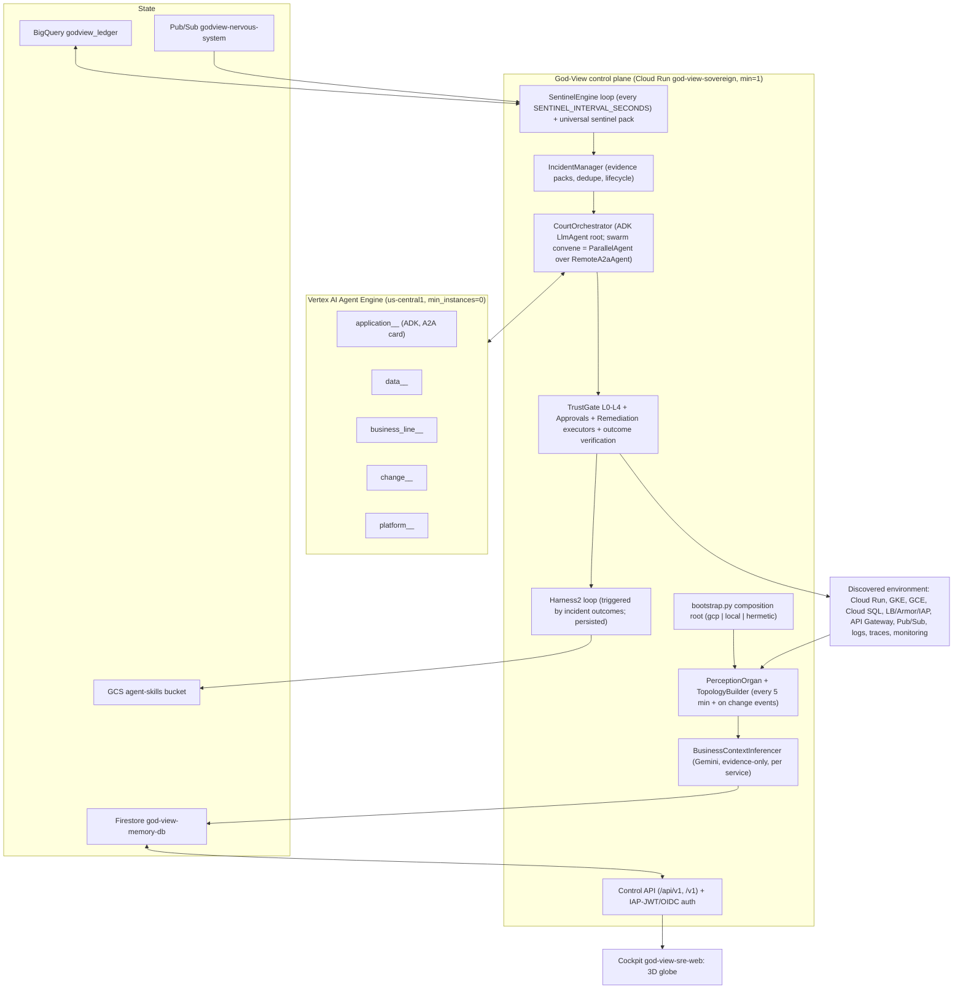

# God-View v5 Rebuild Plan — "make it real" (2026-10-17)

**Why:** `issues-identified-17-10-26.md` showed that the deployed God-View is a façade: in-memory fakes, zero sense adapters, canned agents, zero sentinels, echo remediation, no persisted learning, and the Cymbal tenant hardcoded into the "neutral" core. This plan rebuilds the runtime so that God-View, with **zero tenant knowledge**, discovers the `general-ak` estate and its business meaning by itself, detects the live faults, remediates with approval, and learns.

**Owner decisions (Ashish, 2026-10-17, binding):**
1. Audience priority: customer-facing BFSI flagship first; `general-ak` is the live proving ground.
2. Agent platform: **ADK multi-agent on Vertex AI Agent Engine** (verified: `sub_agents` + LLM `transfer_to_agent` handoffs, `ParallelAgent`, A2A `RemoteA2aAgent`/AgentCards; Google's agentic design-pattern guide lists the swarm pattern on it).
3. Business context is inferred **purely from evidence** (code, contracts/OpenAPI, traces, data, logs, docs) with **zero seed knowledge of lending**, and every inference carries a confidence and evidence refs.
4. "For now, just make things work." No rush work: quality over speed, but ship in verified increments.
5. Tenant fault **T1 (Cloud Armor WAF sensitivity 4)** stays broken on purpose. God-View must find it and fix it through its own approval flow. Nobody fixes it by hand.

---

## 0. Non-negotiables (every worker)

- **Environment neutrality.** No tenant/domain nouns in `godview/` or `shared/` source: no `loan`, `cibil`, `foir`, `emi`, `rupee`/`inr`, `kyc`, `underwriting`, `insurance`, `disbursement`, `cymbal`, `general-ak`, `ak-demos`, service names, IPs, ports, table names. Domain knowledge may exist only in **runtime data** (Firestore docs produced by inference) and in `cymbal/` (tenant) or test fixtures under `cymbal/fixtures/godview/`.
- **No fakes in production.** `GODVIEW_ENV=gcp` must fail to start if any `InMemory*` store or zero adapters would be used. Never return `"executed"` unless a real executor ran and reported.
- **Models:** reasoning `gemini-4-argon` at `location=global`, fallback `gemini-3.8-flash` at `global` on 429/budget; embeddings `text-embedding-005` at `us-central1`. Credentials via ADC / metadata server (`google.auth`), **never** static token env vars. Model IDs live in `shared/godview_shared/config.py:MODEL_TABLE`, nowhere else.
- **Identity:** verify IAP JWT (`X-Goog-IAP-JWT-Assertion`, ES256, iss `https://cloud.google.com/iap`, aud `/projects/769002985772/global/backendServices/<id>`) for operator routes; verify Google OIDC (aud = service URL) for Scheduler/Pub/Sub/agent callers. No `operator@local.dev` fallback outside hermetic mode.
- **Safety:** mutations only through the capability registry + TrustGate; `godview_managed="true"` resources only (**and** the discovered environment's resources once promoted; see §3.4); Cloud Armor Kill-Switch rule is only ever toggled on the tenant policy, never on `god-view-control-policy`.
- **Do not edit tenant code** under `cymbal/` (portals and services are "as they are"). New files under `cymbal/fixtures/godview/` are allowed.
- **Frontend bar:** real product UI, ak-demos luminous-white theme (dark-ink typography, slate borders, Google 4-colour accents), **no purple anywhere**, hash-routed tabs, explicit light/dark colour pairs, no hardcoded model strings, screenshot-verified.
- **Writing:** English; no em-dashes in code comments/docs; no fabricated provenance (`created_by: gemini-...`, fake `executions_count`).
- **Tooling:** `uv run pytest`, `uv run ruff check`, `npm test` in the cockpit; `python -c` is blocked by a hook: write scripts to files.
- **Git:** the repo is a local git repo (baseline commit `v4-facade-baseline`). Commit your slice in small commits with `[slice] message`. Do not rebase or amend others' commits. No pushes (no remote yet).

---

## 1. Target architecture (v5)



### 1.1 Runtime modes

| `GODVIEW_ENV` | Stores | Adapters | Models |
| :-- | :-- | :-- | :-- |
| `gcp` | Firestore / BigQuery / Pub/Sub / Agent Engine (real) | auto-detected GCP adapters (project from metadata/env) | Vertex via ADC |
| `local` | Firestore emulator or SQLite-backed `LocalDocumentStore`, DuckDB ledger | Kubernetes/SQL/Git/local adapters from discovered endpoints | Vertex via ADC if available, else deterministic stub flagged as such |
| `hermetic` | in-memory fakes (tests only) | fixture adapters | stub |

### 1.2 Composition root (interface every slice codes against)

`godview/sovereign/bootstrap.py` (owner: runtime-core):

```python
@dataclass
class SovereignContext:
    settings: GodViewSettings
    docs: DocumentStore            # set/get/delete/list_docs/set_subdoc/get_subdoc/list_subdocs/find_nearest (same signatures as InMemoryFirestore)
    ledger: LedgerStore            # insert_rows/get_table/query (same signatures as InMemoryBigQuery)
    bus: EventBus                  # publish(topic, event: NervousSystemEvent | dict) (same as InMemoryPubSub)
    agents: AgentRuntime           # deploy_agent/set_min_instances/retire_agent/get_agent/list_agents/send_a2a (same as InMemoryAgentEngine)
    adapters: list[SenseAdapter]
    auth: AuthService              # verify_iap_jwt(req) -> Principal | None ; verify_google_oidc(req, audience) -> Principal | None ; id_token_for(audience) -> str ; access_token() -> str
    llm: LlmClient                 # generate(model_role, contents, tools=None, response_schema=None) with Argon->Flash fallback + TokenBudgetGovernor metering
    clock: Callable[[], datetime]

def build_context(env: Mapping[str, str] | None = None) -> SovereignContext: ...
def create_app(ctx: SovereignContext | None = None) -> FastAPI: ...   # module-level `app = create_app()` stays the Docker entrypoint
```

Routers: each slice adds `godview/sovereign/control_api/routers/<slice>.py` exporting `def build_router(ctx: SovereignContext) -> APIRouter`. `create_app` auto-includes every `routers/*.py` at both `/v1` and `/api/v1`. Shared auth dependencies: `ctx.auth.require_operator` (IAP JWT), `ctx.auth.require_service(audience)` (OIDC), `ctx.auth.optional_principal`.

Protocols live in `shared/godview_shared/stores/protocols.py`; the fakes in `shared/godview_shared/fakes/` must satisfy them (they already define the method shapes).

### 1.3 Data contracts (Firestore collections; owner of schema in brackets)

| Collection | Doc | Notes |
| :-- | :-- | :-- |
| `discovered_services` | `DiscoveredServiceDoc` + `business_context: BusinessContext` + `posture: Posture` (discovery) | `doc_id = {env_id}__{kind}.{name}`; `kind` extended (see §3.2) |
| `discovered_edges` | `DiscoveredEdgeDoc` + `evidence_kind: trace\|lb_route\|env_ref\|pubsub_push\|k8s_service\|db_conn\|openapi` (discovery) | |
| `journeys` | `JourneyDoc` (discovery, inferred) | steps inferred from traces/OpenAPI, confidence |
| `sentinels` | `SentinelDefinition` (sentinels) | `scope.resource_id`, `class`, `state: shadow\|enforced` |
| `incidents` | `EpisodicIncident` + `evidence_pack` + `diagnoses[]` (sentinels/agents) | dedupe key `class:resource:signature` |
| `approvals` | `ApprovalCard` (remediation) | TTL 30 min, single-use |
| `trust_records`, `audit_records` | (remediation) | immutable append |
| `court_agents` | `CourtAgentDoc` (agents) | real `reasoning_engine` resource names |
| `skills`, `harness_trees` | (agents/RSI) | mirrored to GCS |
| `operator_state` | `tenant`, `kill_switch`, `hibernate` docs (remediation) | replaces in-memory `runtime_state` |

`BusinessContext` (discovery owns; in `shared/godview_shared/contracts`):
```python
class BusinessContext(BaseModel):
    role_summary: str                 # one paragraph, plain English, no jargon copied from names only
    domain: str                       # inferred, free text (e.g. "retail lending origination"), never from a fixed enum
    capabilities: list[str]           # what the service does, from OpenAPI/op names/code
    upstream: list[str]; downstream: list[str]   # doc_ids
    journeys: list[dict]              # {name, steps:[{service, operation}], confidence, evidence}
    kpis: list[dict]                  # {name, definition (SQL over ledger or metric filter), unit, confidence, evidence}
    invariants: list[dict]            # {statement, check (SQL/CEL/python-safe), severity, confidence, evidence}
    risk_notes: list[str]
    confidence: float                 # 0..1
    evidence: list[dict]              # {kind: openapi|env|trace|log|code|schema|doc, ref, excerpt}
    inferred_by: str                  # model id
    inferred_at: datetime
```

### 1.4 Topology API (contract for the cockpit)

`GET /api/v1/topology` →
```json
{
  "env_id": "gcp-general-ak",
  "generated_at": "...",
  "nodes": [{"id": "...", "name": "...", "kind": "cloud_run|gke_workload|gce_instance|cloud_sql|lb_frontend|backend_service|security_policy|api_gateway|pubsub_topic|pubsub_subscription|gcs_bucket|bigquery_dataset|firestore_db|secret|external|agent",
             "tier": "edge|compute|data|messaging|platform|observer|external", "status": "green|amber|red|unknown",
             "business": {"domain": "...", "role_summary": "...", "confidence": 0.0}, "incidents_open": 0, "agent_id": "application__x|null",
             "golden": {"rps": null, "p95_ms": null, "error_ratio": null}, "posture": {"ingress": "...", "iap": true, "invoker_iam": true, "waf": "sensitivity-1|unknown"}}],
  "edges": [{"id": "...", "src": "...", "dst": "...", "kind": "http|grpc|pubsub|sql|lb_route|iam", "evidence_kind": "...", "rps": null, "error_ratio": null, "confidence": 0.0}],
  "journeys": [{"name": "...", "steps": [{"node": "...", "operation": "..."}], "health": "green|amber|red", "confidence": 0.0}],
  "layout_hint": {"groups": [{"tier": "edge", "node_ids": ["..."]}]}
}
```
`GET /api/v1/business-context/{node_id}` → the full `BusinessContext` + recent incidents + invariants + KPIs with last values. `GET /api/v1/events/stream` (SSE) pushes `topology.updated`, `incident.opened|updated|closed`, `approval.created|decided`, `agent.woke|slept`.

### 1.5 Capability IDs added in v5 (registry in `shared/godview_shared/capabilities.py`, owner remediation; adapters implement)

Read: `logging.query_lb_requests`, `logging.query`, `monitoring.query_timeseries`, `edge.describe_backends`, `edge.describe_security_policies`, `apigateway.get_openapi`, `run.get_posture`, `pubsub.describe_subscriptions`, `pubsub.dlq_depth`, `http.probe` (GET-only, safe routes), `tfstate.read`, `tf.drift_diff`, `gemini.infer_business_context`.
Mutating (TrustGate-guarded, L2 by default): `armor.set_waf_sensitivity`, `armor.set_rule_preview`, `run.set_ingress`, `run.set_invoker_iam`, `run.restore_revision_config`, `pubsub.replay_dlq`, `gke.patch_probe`, `tenant.admin_action` (generic: OpenAPI operations tagged `x-godview-admin-action`), `agent.set_min_instances`.
`capabilities:invoke` must dispatch to a registered executor or raise `NoExecutorError` (HTTP 501). Never echo.

---

## 2. Slices, owners, files

> Two workers never edit the same file. If you need a change in a file you do not own, post `@owner` with the exact diff you need.

| Slice (worker) | Owns | Must not touch |
| :-- | :-- | :-- |
| **runtime-core** | `godview/sovereign/bootstrap.py` (new), `godview/sovereign/control_api/**` (refactor into `routers/` + `app.py`; keep `app = create_app()`), `shared/godview_shared/stores/**` (new real stores + protocols), `shared/godview_shared/auth.py` (new), `shared/godview_shared/llm.py` (new `LlmClient`), `shared/godview_shared/config.py`, `godview/sovereign/Dockerfile`, `godview/sovereign/pyproject.toml`, root `pyproject.toml`/`uv.lock`, `godview/sovereign/court_manager/**` (token governor stays), `godview/sovereign/nervous_system/**` | adapters, sentinels, agents, UI |
| **discovery** | `godview/adapters/gcp/**`, `godview/adapters/kubernetes/**`, `godview/adapters/sql/**`, `godview/adapters/git/**`, `godview/sovereign/perception/**`, `godview/sovereign/topology/**` (new), `godview/sovereign/business_context/**` (new), `godview/sovereign/control_api/routers/topology.py` (new) | control_api core, sentinels |
| **sentinels** | `godview/sovereign/sentinel_engine/**`, `godview/sovereign/sentinels/**` (new universal pack), `godview/sovereign/incidents/**` (new), `godview/sovereign/control_api/routers/incidents.py`, `routers/sentinels.py` | adapters (request capabilities from discovery), remediation |
| **remediation** | `godview/sovereign/trust_ladder/**`, `godview/sovereign/remediation/**` (new executors + outcome verification), `godview/sovereign/control_api/routers/approvals.py`, `routers/capabilities.py`, `routers/operator.py` (kill-switch/pause/hibernate, real), `shared/godview_shared/capabilities.py` | adapters internals (ask discovery to expose the API calls as capabilities), agents |
| **agents** | `godview/agents/**` (ADK court), `godview/harness/**` (RSI), `godview/sovereign/control_api/routers/court.py`, `routers/harness.py`, `infra/deploy/deploy_agent_engine.py`, `infra/deploy/test_deploy_agent_engine.py` | sentinels, remediation executors |
| **neutrality** | `shared/godview_shared/contracts/**` (keep names used by others; add, do not break), `shared/godview_shared/otel.py` (generic attrs, keep old API as thin shim), `godview/ledger/**`, `godview/invariants/**`, `godview/agent-skills/**` (empty it; move to `cymbal/fixtures/godview/`), `shared/tools/lint_neutrality.py`, `shared/tests/**`, `local-env/**` + `infra/tests/test_unknown_env_e2e.py` (new), `cymbal/fixtures/godview/**` (new) | any runtime module owned above (post diffs instead) |
| **cockpit** | `godview/god-view-sre-web/**` (new globe UI), Stitch project | backend |
| **infra** | `infra/terraform/**`, `infra/deploy/*.sh`, `infra/deploy/cloudbuild/**`, `infra/deploy/pin_image.py`, `infra/deploy/extract_workload_vars.py`, `infra/api-gateway/**` (read-only unless needed), `DEPLOY_RUNBOOK.md`, `infra/terraform/platform/APPLY_LOG.md` | application code |
| **deployer** | the only member allowed to run `terraform apply`, `gcloud` mutations, Cloud Build, Agent Engine deploys, DLQ replays. Works from verifier PASS posts. Owns `infra/terraform/platform/images.auto.tfvars` and `infra/terraform/workloads/images.auto.tfvars` | code |
| **verifier-core** (opus) | reviews + tests runtime-core, discovery, sentinels, remediation | writes no code |
| **verifier-edge** (opus) | reviews + tests agents, neutrality, cockpit, infra | writes no code |
| **verifier-live** (opus) | runs acceptance gates A1–A8 on `general-ak` and posts PASS/FAIL with evidence | writes no code; read-only gcloud + HTTP |
| **monitor** | stall monitor | |

---

## 3. Slice specifications

### 3.1 runtime-core

1. `shared/godview_shared/stores/`: `protocols.py` (DocumentStore, LedgerStore, EventBus, AgentRuntime); `firestore_store.py` (google-cloud-firestore, named DB from `FIRESTORE_DATABASE`, `find_nearest` via Firestore vector search on the existing 768-dim indexes; `merge=True` semantics; pagination in `list_docs`); `bigquery_ledger.py` (Storage Write API default stream or `insert_rows_json`; `query` via jobs; dataset from `BIGQUERY_LEDGER_DATASET`); `pubsub_bus.py` (publisher client, topic from `NERVOUS_SYSTEM_TOPIC`, CloudEvents attrs); `agent_engine_runtime.py` (Vertex `reasoning_engines` REST/SDK: create/patch `min_instances`/delete/list, A2A send via the engine's `:query`/A2A endpoint with ADC ID token).
2. `shared/godview_shared/auth.py`: `google.auth.default()` credentials with auto-refresh (`AuthorizedSession`/token provider), `id_token_for(audience)` (metadata or `google.oauth2.id_token`), `verify_iap_jwt` (`google.oauth2.id_token.verify_token` with IAP certs URL + audience from `IAP_BACKEND_SERVICE_IDS` env, comma-separated), `verify_google_oidc`. FastAPI dependencies `require_operator`, `require_service`, `optional_principal`. In `hermetic` mode only, allow `X-Godview-Test-Principal`.
3. `shared/godview_shared/llm.py`: `LlmClient` over `google-genai` (Vertex, ADC), `generate(role, ...)` using `MODEL_TABLE`, 429/503 → fallback model, token metering into `TokenBudgetGovernor`, structured output via `response_schema`, function-calling helper. Expose `embed(texts)` with `text-embedding-005`.
4. `godview/sovereign/bootstrap.py` as in §1.2. Auto-detect: project id from `GOOGLE_CLOUD_PROJECT` or metadata; region list from `GODVIEW_REGIONS` or Cloud Run/Compute `locations` APIs; adapters = discovery's `build_all_gcp_adapters(project_id, regions, auth=ctx.auth)` plus any `kubernetes/sql/git` adapters whose endpoints are discoverable. **Startup assertion** in `gcp` mode: no `InMemory*`, ≥1 adapter healthy; else exit 1 with a clear log.
5. `control_api` refactor: `app.py` + `routers/` auto-include; FastAPI `lifespan` starting tasks: perception loop (every `PERCEPTION_INTERVAL_SECONDS`, default 300, plus trigger on `change_events`), sentinel loop (`SENTINEL_INTERVAL_SECONDS`, default 10, 60 in hibernate), agent warmth loop, DLQ watchdog. Health: `/public/healthz` reports `mode`, `stores`, `adapters_healthy`, `sentinels_registered`, `last_perception_at`, `loop_heartbeats`. `/metrics` real gauges. Remove every placeholder constant listed in the issues doc §5 (G2, G11, fake drift, fake cost, `simulator_journeys_today=18`, etc.). `/api/v1/changes` paginated (`?limit=&cursor=`), capped at 200 per page.
6. `nervous-system/push`: verify OIDC (aud = service URL, email = `godview-sense-sa`), decode audit events, route to `IncidentManager.on_change_event` (sentinels slice exposes it) and persist `change_events` (capped TTL 7 days).
7. Dockerfile: install `google-cloud-firestore`, `google-cloud-bigquery`, `google-cloud-pubsub`, `google-cloud-aiplatform[agent_engines,adk]`, `google-genai`, `google-auth`, `PyJWT`/`cryptography`; keep MCP binaries. Env `GODVIEW_ENV=gcp`.
8. Tests: unit tests with fakes satisfying protocols; a **contract test** `test_production_entrypoint_has_no_fakes` (`GODVIEW_ENV=gcp` + fake metadata → asserts stores are real classes and adapters > 0, or startup exits).
Done when: verifier-core PASS; `uv run pytest godview/sovereign shared -q` green; deployer deploys and `verifier-live` A1 passes.

### 3.2 discovery

1. Fix adapters: pagination everywhere (`pageToken`/`nextPageToken`), all regions (`run` `locations/-`, Compute `aggregatedList`, GKE `locations/-`, SQL global), per-call token via `ctx.auth`, per-adapter error isolation (adapter failure → `AdapterHealth(state="unavailable", evidence={"error": ...})`, never a 500), extend `DiscoveredServiceKind` to the §1.4 kinds (contract change: coordinate with neutrality by posting the exact Literal), remove the hardcoded `:8085`, the fake ID token, the `cloud_run→gke` forced edge shape, India-only PII regexes (make PII detection a generic configurable set), the "own resources only" discovery in Pub/Sub/BigQuery/Firestore (discover everything, then classify observer vs observed by label/role, not by name).
2. New senses: `edge.py` (Compute: forwarding rules → target proxies → URL maps → host/path rules → backend services (IAP, security policy, logging) → NEGs → Cloud Run/API Gateway; security policies with rule expressions and whether `sensitivity` is set; managed certs), `apigateway.py` (gateways → configs → download OpenAPI; parse routes, `x-google-backend`, extensions such as `x-godview-probe-safe` / `x-godview-admin-action` generically as "vendor extensions"), Pub/Sub subscriptions (push endpoints → edges), Cloud Run env-var references to other services (`*.run.app`, internal IPs) → edges, GKE workloads via the Kubernetes API (`GkeAdapter` lists Deployments/Services; env refs → edges), Cloud SQL users/databases (names only), Cloud Trace parent/child → edges with rps, Cloud Logging LB logs availability check.
3. `topology/builder.py`: merges adapter results into the §1.4 graph; dedupes nodes across senses; classification `observer|observed|external` using labels `godview_role=observer`/`godview_managed` **or** structural evidence (the observer is the identity running the code: its own service name, its own tfstate); status from golden signals + open incidents.
4. `business_context/inferencer.py`: for each observed node (and each journey), build an **evidence bundle** (OpenAPI operations + descriptions, route names, env var names (never values), labels, schema/table names if a data adapter exposes them, sample log lines with PII scrubbed, trace neighbours, repo README if a git adapter exists) and call `ctx.llm.generate(role="reasoning", response_schema=BusinessContext)` with a prompt that forbids guessing beyond evidence and requires confidence + evidence refs. Cache by evidence hash; re-infer on change. Also infer `journeys` across services from trace DAGs + operation names. Store on the service doc. Budget: ≤ 1 call per node per evidence change.
5. `routers/topology.py`: `GET /topology`, `GET /business-context/{node_id}`, `POST /perceive` (operator), `GET /perceive`.
6. Tests with recorded fixtures (extend `gcp_api_fixtures.json`): pagination, multi-region, error isolation, edge discovery, OpenAPI parsing, inferencer prompt building (no domain words in prompt), schema validation.
Done when: verifier-core PASS; live A1 + A2 pass.

### 3.3 sentinels

1. `sentinels/pack.py`: universal sentinel templates, auto-registered per discovered resource/edge at perception time (state `enforced` for platform classes, `shadow` for inferred business invariants until promoted):
   - `lb_requests`: Cloud Logging `resource.type="http_load_balancer"` windows per host+path prefix: 4xx/5xx ratio, `statusDetails`, `enforcedSecurityPolicy{name,priority,preconfiguredExprIds,outcome}`; breach when `denied_by_security_policy` hits requests that look legitimate (JSON content-type POSTs to discovered API routes, OAuth callbacks (`/_gcp_gatekeeper/*`, `?state=`), or same-IP success/deny interleaving) or when 5xx ratio > threshold.
   - `posture`: Cloud Run `ingress`/`invokerIamDisabled`/IAM `allUsers`, LB backend IAP enabled, security policy attached and WAF sensitivity present, cert status; baseline = tfstate (if `tfstate.read` available) else first-seen snapshot; breach on change or on "public without IAP/WAF".
   - `probe`: GET-only synthetic probes of discovered public hosts and `x-godview-probe-safe` (or OpenAPI GET without side effects) routes, and of static asset URLs referenced in API responses (e.g. any field ending in `_url`/`image_url`); breach on 4xx/5xx/latency.
   - `pubsub_health`: per subscription `push_request_count` by response class, `num_undelivered_messages`, DLQ depth (incl. the observer's own).
   - `golden_signals`: Cloud Monitoring per service (request count by code, latency p95, instance count) with adaptive baselines.
   - `journey_conformance` + `kpi_changepoint`: over the ledger (OTLP spans → BigQuery) using the inferred journeys/KPIs (CUSUM on KPI series; order violations).
   - `invariant`: compiled from `BusinessContext.invariants` (SQL over ledger / CEL) in shadow until the false-positive rate < 5% over 24 h, then enforced.
2. `sentinel_engine`: real loop entry `evaluate_tick()` executed by the lifespan task; evaluation budget per tick; per-sentinel error isolation; wake decisions produce `incidents`.
3. `incidents/manager.py`: dedupe/open/update/close, evidence pack assembly (log samples, config snapshot, probe transcript, metrics window, related change events, topology neighbourhood), severity, `on_change_event` hook, SSE emission, auto-close when the breach clears for N ticks.
4. Routers: `GET /incidents`, `GET /incidents/{id}`, `POST /incidents/{id}:close`, `GET /sentinels`, `POST /sentinels`, `PATCH /sentinels/{id}`, `POST /probes/run` (manual tick, service-auth).
5. Tests with fixtures reproducing T1 (LB denies on JSON POST and IAP callback), T2 (asset 404), posture drift, Pub/Sub 404 window, cold-start 504 burst.
Done when: verifier-core PASS; live A3 passes.

### 3.4 remediation

1. Executors in `remediation/executors/`: `armor.py` (`set_waf_sensitivity`: patch the rule expression to add `{'sensitivity': N}` for each `evaluatePreconfiguredWaf` call, `preview=true` first, verify with LB logs/probes, then `preview=false`; `set_rule_preview` for kill switch), `run_posture.py` (`set_ingress`, `set_invoker_iam`, `restore_revision_config` fixed PATCH bodies), `pubsub.py` (`replay_dlq`: create subscription if missing, seek, pull/republish), `gke.py` (`patch_probe` via Kubernetes API), `tenant_admin.py` (`admin_action`: invoke an OpenAPI operation tagged `x-godview-admin-action` with OIDC as `godview-act-sa`), `agent.py` (`set_min_instances`).
2. Outcome verification: every executor returns `ExecutionResult{ok, before, after, verification: [{check, passed, evidence}]}`; failed verification → auto-rollback where reversible and `record_bad_outcome`.
3. TrustGate wiring: approvals persisted; approve/reject require `require_operator`; `record_recommendation_correct`, `record_approved_execution_verified`, `record_bad_outcome`, `promote_*` are **called** from the flow; per-agent, per-action-type ladder; money-movement/customer-comms capped at L2.
4. Operator routes: kill switch toggles the tenant edge policy rule 100 preview flag (discovered as "the security policy attached to observed public backends", never the observer's own policy), pause/resume call the discovered tenant admin action and persist `operator_state`, hibernate runs the hibernate job + sets agents to 0.
5. Resource scope rule: a mutating capability may target (a) resources labelled `godview_managed=true`, or (b) any **observed** resource for which the acting agent has reached the required ladder level for that action type; the Cymbal proving ground is pre-promoted to L2 (approval required) for platform actions, as decided.
6. Remove `svc-alpha-01` drift seeds and echo paths (coordinate with runtime-core, who deletes them from control_api).
7. Tests: executor unit tests against recorded API fixtures; approval lifecycle; ladder promotion/demotion; verification + rollback.
Done when: verifier-core PASS; live A4 passes (T1 fixed by God-View).

### 3.5 agents (ADK on Agent Engine) + RSI

1. Replace `court_agent.py` canned logic with ADK: `godview/agents/adk/specialist.py` builds an `LlmAgent` per archetype (application, data, business_line, change, platform) whose **instructions are generic** and whose knowledge comes from the evidence pack + `BusinessContext` fetched at runtime; tools = Sovereign capability invoke (read capabilities freely; mutating ones return `approval_required`), `get_business_context`, `query_ledger`, `get_incident`, `propose_remediation(capability_id, args, rationale, confidence)`. Model `gemini-4-argon` @ global with fallback.
2. `godview/agents/adk/court.py`: Sovereign-side root `LlmAgent` ("CourtOrchestrator") with `sub_agents=[RemoteA2aAgent(card_url=...) for each deployed specialist]`; swarm convene = `ParallelAgent` fan-out to the relevant specialists + a `LoopAgent` critic round (≤4 rounds, ≤90 s, consensus ≥0.85) producing `Diagnosis{hypothesis, confidence, evidence, proposed_actions}`; A2A `AgentCard`/`AgentExecutor` served by each specialist.
3. `infra/deploy/deploy_agent_engine.py`: real `agent_engines.create(...)` with `extra_packages=[godview, shared]`, `requirements` incl. `google-adk`, `deployment_spec(min_instances=0, max_instances=2, resource_limits cpu 1 / memory 2Gi)`, labels `godview_managed=true, godview_role=court, agent_type, subject`, env `GODVIEW_SOVEREIGN_URL`, `GOOGLE_CLOUD_LOCATION=global` for model calls. Roster comes from `GET /api/v1/perceive` spawn plan (no default roster). The Sovereign's `CourtManager.spawn_agent` calls `AgentRuntime.deploy_agent` (runtime-core) which runs this deployment.
4. In-process fallback: if Agent Engine deploy is pending/unavailable, the same specialist `LlmAgent` runs in the Sovereign process (flagged `runtime: in_process`), so detection→diagnosis works from the first deploy.
5. RSI (`godview/harness/`): triggers = incident closed (with outcome), approval decided, false-positive marked, nightly `/memory/reflect`; proposer uses `ctx.llm` (ADC); fitness = replay archived evidence packs with known outcomes (no keyword rubric); persist trees/skills to GCS `AGENT_SKILLS_BUCKET` + Firestore (`CloudSyncedLibrary` TypeError fixed, token provider = `ctx.auth`); hot-load winning tree into the specialist (version bump visible in `/court/{id}`). Delete `_infer_scenario_details`, `_classify_task_archetype`, `_build_scenario_context`, canned scripts, fabricated provenance.
6. Routers: `court.py` (`GET /court`, `GET /court/{id}`, `:wake|:warm|:cool|:retire`, `POST /court/convene`), `harness.py` (`GET /harness/{agent}/tree`, `POST /harness/{agent}:evolve`).
7. Tests: ADK agents with a fake LLM runner; A2A round trip locally; deploy payload test; RSI persistence with fake GCS.
Done when: verifier-edge PASS; live A5 + A6 pass.

### 3.6 neutrality

1. Contracts: generic ledger row (`event_type`, `entity_type` (free text), `entity_id`, `state_from/to`, `attributes: dict`, `numeric_attributes: dict[str, float]`, `currency: str|None`); remove domain fields; add `BusinessContext`, extended `DiscoveredServiceKind`, `Posture`, `ExecutionResult`, `Diagnosis` (coordinate names with discovery/remediation/agents on the board, post the final Literal/Model definitions as one `@all` message).
2. `otel.py`: `set_business_attributes(**attrs)` generic; keep `set_business_span_attributes(loan_id=..., ...)` as a deprecated shim mapping into generic attributes (tenant code is frozen).
3. `godview/ledger`: DDL/exporter/KPI/process-mining become schema-agnostic (entity/state/attributes), intended order learned from traces (`journeys` docs), KPIs from `BusinessContext.kpis`.
4. `godview/invariants`: generic compiler (SQL/CEL/python-safe) without `expected_emi`; vault emptied; the five Cymbal invariants + the agent skill move to `cymbal/fixtures/godview/` as **test fixtures** that the unknown-environment test must *not* need.
5. `lint_neutrality.py`: strict, no allowlist, scans `godview/`, `shared/`, prompts, base trees; banned-term list includes finance/lending vocabulary and this environment's identifiers; runs in `uv run pytest` as a test.
6. Unknown-environment E2E (`local-env/unknown/`): docker-compose stack with randomised service/table/route names and a different business domain (e.g. a fictional parcel-logistics flow: `intake→route→dispatch→proof`), OpenAPI served by each service, traces to the Sovereign; test: boot God-View in `local` mode with zero config → topology has the right nodes/edges, `BusinessContext.domain` mentions logistics/parcels, ≥1 journey inferred, ≥1 finding raised when a fault is injected (e.g. 404 route or 5xx burst).
Done when: verifier-edge PASS; lint strict green; A8 passes in CI/local.

### 3.7 cockpit (3D globe) — Stitch first, then build

1. **Stitch mockups (first 60–90 min):** read `~/.gemini/config/plugins/stitch-design/skills/stitch-design/SKILL.md` and the `stitch_generate_design` skill it points to; create project "God-View Globe Cockpit"; generate screens: (a) Globe home: full-bleed 3D sphere, nodes clustered by tier (edge ring, compute band, data core, external satellites), arcs for connections with animated traffic, incident pulses, left rail (env, agents awake/asleep, budget), right drawer "Business context" (role, domain, journeys, KPIs, invariants, incidents) for the selected node; (b) Journey Explorer (journey path drawn on the globe + step table); (c) Incident war-room (evidence pack, swarm transcript, proposed remediation, Approve/Reject); (d) Approvals inbox + Trust ladder; (e) Agent brain (Harness² tree versions, skills). Theme: luminous white canvas, dark-ink type, slate borders, Google 4-colour accents; **no purple**. Post the Stitch project id + screen ids to the board; write `scratch/scratch.stitch` per the skill so the user can open the canvas.
2. **Build:** Vite + React 19 + TypeScript + `three`/`@react-three/fiber`/`@react-three/drei` (globe = sphere with subtle meridians, nodes as instanced meshes positioned on the sphere by tier latitude bands + domain longitude clusters; arcs as great-circle tubes; hover/click picking; camera fly-to; reduced-motion fallback to a 2D force graph). Data from `/api/v1/topology`, `/business-context/{id}`, `/incidents`, `/approvals`, `/court`, SSE `/events/stream`. Hash routes: `#globe`, `#journeys`, `#incidents`, `#approvals`, `#agents`, `#cost`. Keep nginx, port 8080. Vitest + msw tests; headless screenshots (gbrowser) at 1440×900 posted to the board.
3. Honesty rule: never render fabricated numbers; unknown → "not measured yet".
Done when: verifier-edge PASS; live A7 passes.

### 3.8 infra + deployer

1. Terraform (`05-godview`): uptime check → `uptime_url` host = Sovereign `*.run.app` host, path `/public/healthz`, `service_agent_authentication { type = "OIDC_TOKEN" }`; `run.invoker` for `service-769002985772@gcp-sa-monitoring-notification.iam.gserviceaccount.com` (already granted by hand at 17:09Z; import into state); secrets → Secret Manager `secret_key_ref` for `DB_PASSWORD`/`PG_READONLY_PASSWORD` (rotate the password: `03-data` random + Cloud SQL user update); Sovereign env: `GOOGLE_CLOUD_PROJECT`, `GODVIEW_REGIONS=us-central1`, `IAP_BACKEND_SERVICE_IDS` (ids of `god-view-bs-sovereign-api`, `god-view-bs-cockpit`), `PERCEPTION_INTERVAL_SECONDS=300`; Sovereign resources 2 vCPU / 2 GiB; sense SA roles: `roles/aiplatform.user`, `roles/logging.viewer`, `roles/monitoring.viewer`, `roles/compute.viewer`, `roles/run.viewer`, `roles/pubsub.viewer`, `roles/iap.securityReviewer` or `roles/iam.securityReviewer`, `roles/apigateway.viewer`, `roles/container.viewer`, `roles/cloudsql.viewer`, `roles/cloudasset.viewer`, `roles/datastore.user` (Firestore), `roles/bigquery.dataEditor` on `godview_ledger`, `roles/bigquery.jobUser`, `roles/storage.objectAdmin` on the skills bucket; act SA roles: `roles/compute.securityAdmin` (Armor), `roles/run.admin`, `roles/pubsub.editor`, `roles/container.developer`, `roles/iam.serviceAccountUser` on runtime SA; Agent Engine: `roles/aiplatform.user` for `godview-sense-sa`, staging bucket IAM; log-sink exclusions for GKE churn (`leases`, `configmaps`, `pods.binding`, `endpointslices`); DLQ subscription `godview-nervous-system-dlq-sub` (7 d retention); `04-tenant-compute`: nothing (tenant frozen) except an optional `startup_probe` variable left **off**.
2. Deployer protocol: deploy only after the slice's verifier posts `PASS <slice> rev N`; sequence: `build_image.sh <svc> --pin` → `deploy_run.sh` → post the revision + `/public/healthz` JSON; Terraform: `plan` → post summary → `apply`; Agent Engine: run `deploy_agent_engine.py` after agents PASS; DLQ replay once sentinels are live. Record everything in `APPLY_LOG.md` and `DEPLOY_RUNBOOK.md`. gcloud/ADC session renewed 16:57Z (expires ~01:00Z); if it lapses, post `@coordinator` and leave exact commands in the runbook.

---

## 4. Live acceptance gates (verifier-live, on `general-ak`)

| Gate | Check | Pass criterion |
| :-- | :-- | :-- |
| **A1 Reality** | `GET /api/v1/perceive` and `/public/healthz` (with an ID token or via IAP) | `env_id=gcp-general-ak`; `mode=gcp`; stores = Firestore/BigQuery/PubSub classes; ≥ 14 observed nodes incl. 8 Cloud Run, 2 GKE workloads, 1 GCE, 1 Cloud SQL, LB frontends/backends/security policies, API Gateway, Pub/Sub; Firestore `discovered_services` populated; state survives a forced new revision |
| **A2 Business context** | `GET /api/v1/business-context/{node}` for each tenant node | every observed node has `business_context` with `confidence ≥ 0.5`, evidence refs, domain text that correctly describes vehicle-loan origination (judged by verifier), ≥ 1 inferred journey spanning ≥ 3 services; strict neutrality lint green on the deployed source |
| **A3 Detection** | `GET /api/v1/incidents` within 15 min of deploy | open incidents for: T1 (LB denies, evidence includes `preconfiguredExprIds` and a sample blocked JSON POST), T2 (asset 404 / empty CDN), Pub/Sub health or posture (as applicable); each has an evidence pack and a Gemini-produced diagnosis with confidence; no incident for things that are fine |
| **A4 Remediation** | Approvals inbox | God-View proposes `armor.set_waf_sensitivity` (sensitivity 1, preview first) as an L2 approval card; operator approves via IAP; executor applies, verifies via LB logs/probe; `POST https://api.cymbal.ak-demos.com/v1/loans/apply {}` → 422 (not 403); the customer portal submits a loan end-to-end; T1 incident auto-closes; trust record shows a verified execution |
| **A5 Agents** | Vertex `reasoningEngines.list` + `/api/v1/court` | ≥ 5 `godview_managed` engines (ADK), `min_instances=0`, A2A card reachable; one convened swarm transcript stored for the T1 incident; Vertex request logs show `gemini-4-argon` calls from the sense SA |
| **A6 RSI** | `/api/v1/harness/{agent}/tree` + GCS | after T1 closes, a Harness² run produced a persisted skill/tree version in GCS + Firestore and the agent reports the new version |
| **A7 Cockpit** | `https://godview.ak-demos.com` | globe renders real topology (node count equals A1), business drawer shows A2 data, incidents/approvals live, SSE connected; screenshots 1440×900 attached; no purple; vitest green |
| **A8 Unknown env** | `uv run pytest infra/tests/test_unknown_env_e2e.py` | passes with zero code changes against the randomised compose stack |

Verifier-live posts `A<n> PASS|FAIL` with command transcripts and screenshots, `@` the owning author on FAIL.

---

## 5. Board protocol

- Authors post `[slice] ready for review rev N: <files>, tests: <cmd + summary>` and `@verifier-core`/`@verifier-edge`.
- Verifiers post `PASS <slice> rev N` → `@deployer` (and `@verifier-live` once deployed) or `FAIL <slice>: <numbered findings>` → `@author`.
- Interface changes: one `@all` post with the exact code (Literal/Model/signature). Nobody changes a shared contract silently.
- Blockers/decisions: `@coordinator`.
- Deployer posts every prod mutation with timestamp and rollback command.
- No one touches tenant resources by hand; no one "fixes" T1 manually.
