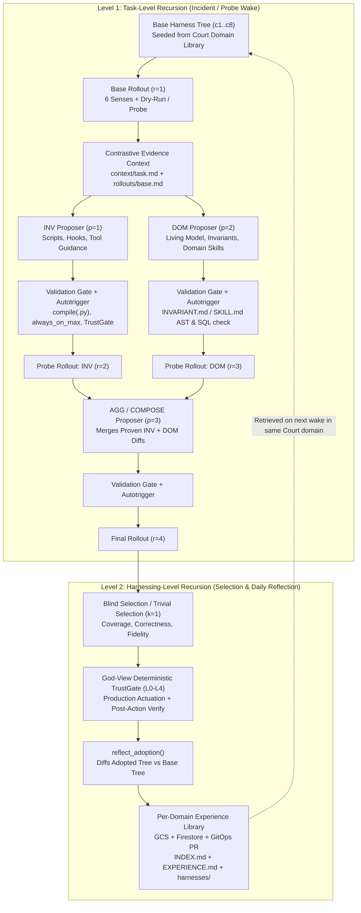

# Harness² × God-View v4.0 — Recursive Agent Harness Integration Plan

- **Date:** 2026-10-17
- **Upstream Reference:** [`google-research/harness2`](https://github.com/google-research/harness2) — *Harness²: Recursive Agent Harnessing for an Open World* (arXiv:2610.14224, Apache-2.0)
- **Target Slice:** `godview/harness/` + `godview/agents/` (Wave 3 `court-agents` & Sovereign Reflection Engine)
- **Status:** Proposed Architecture & Implementation Plan

---

## 1. Executive Summary & Architectural Fit

After inspecting the full source of `google-research/harness2` (`harness2/core/{spec,tree,recursion,library,ledger,context,selection,proposer,prompts,schedule}.py` and `harness2/substrate/{opencode,codex}.py`), **Harness² is a near-1:1 structural match for God-View v4.0's Sovereign + Court Agent organism**.

### Why Harness² Solves God-View's Hardest Agent Problem
In God-View v4.0, our 5 Court Agent archetypes (`application`, `data`, `business_line`, `change`, `platform`) must diagnose and remediate **"HTTP 200 but business broken"** incidents across an open world of evolving microservice bugs, CIBIL byte-alignment drifts, and LLM prompt regressions—while staying under a strict **$\$0.50\text{–}\$0.75/\text{day}$ per-agent token budget** (`I-09`) and never mutating production without passing the **Deterministic TrustGate** (`I-06`).

Standard prompt-only self-reflection fails in production SRE agents for three reasons that Harness² explicitly solves:
1. **Prompt Bloat Starves Reasoning Tokens:** Appending every new lesson to a system prompt eventually crowds out output tokens. Harness² enforces a hard `always_on_max` character budget (`12,000` chars) on always-loaded files (`systemprompt.md`, `guardrails.md`, `LongTermMEMORY.md`, `tool_guidance.md`) and forces detailed procedures into **on-demand `skills/<slug>/SKILL.md`** and **executable `scripts/<name>.py`** with auto-wired verbatim trigger lines (`autotrigger()`).
2. **Prose Rules Can Be Ignored; Code Hooks & Scripts Cannot:** When an agent skips a verification step (e.g., forgetting to run `verify_outcome` or forgetting `X-Synthetic: true`), prose reminders fail under long contexts. Harness² splits adaptation into two orthogonal dimensions:
   - **`INV` (Invariant / Procedure Proposer):** Authors deterministic Python helper scripts (`scripts/<name>.py`), capability pre/post `hooks.json`, and sub-agent specs (`sub_agents/<name>/AGENT.md`).
   - **`DOM` (Domain / Practitioner Proposer):** Authors domain rules, living-model facts (`LongTermMEMORY.md`), and domain diagnostic skills (`skills/<slug>/SKILL.md` + `INVARIANT.md`).
3. **Cross-Incident Knowledge Accumulation without Fine-Tuning:** Harness²'s **Two-Level Recursion** separates:
   - **Level 1 — Task-Level Recursion (`run_parallel` / `run_sequential`):** During an incident wake or synthetic boundary probe, the agent runs **Propose $\rightarrow$ Probe $\rightarrow$ Compose** over candidate harness trees under a hard rollout/proposal ledger (`BudgetLedger`: $R = 4k$ rollouts, $P = 3k$ proposals).
   - **Level 2 — Harnessing-Level Recursion (`run_selection` + `reflect_adoption` + `Library`):** Compares the winning harness against `base_harness`, distills structured `<edits>` and `<experience>` (`cue`, `lesson`, `evidence`, `confidence`), and persists the full adopted component tree (`<domain>/harnesses/<incident_id>/harness/`) plus an auto-indexed `INDEX.md` and `EXPERIENCE.md` per Court domain.

---

## 2. Deep-Dive: How `google-research/harness2` Works Internally

From reading `harness2/core/`, the library is clean, zero-dependency Python 3.12 (~1,400 LOC across 12 modules) organized around a **Three-Axis Seam**:

| Axis | Upstream Module(s) | Responsibility |
| :--- | :--- | :--- |
| **1. Method (`harness2.core`)** | `recursion.py`, `selection.py`, `library.py`, `ledger.py`, `context.py`, `prompts.py`, `tree.py` | Substrate-agnostic **Propose–Probe–Compose** loop (`run_parallel`, `run_sequential`), `INV` + `DOM` prompt templates, contrastive workspace builder (`context/`), blind SHA-1 shuffled selection (`run_selection`), experience distillation (`reflect_adoption`), and `BudgetLedger` ($R=4k, P=3k$). |
| **2. Substrate (`SurfaceSpec`)** | `spec.py`, `tree.py`, `substrate/{opencode,codex}.py` | Defines the **editable component surface** (`always_on`, `guardrails_key`, `skills_glob`, `agents_glob`, `scripts_glob`, `hooks_key`, `always_on_max`) and deterministic **Validation Gate** (`validate()` + `autotrigger()`). |
| **3. Benchmark / Runtime Adapter (`BenchmarkAdapter`)** | `spec.py` (`BenchmarkAdapter`), `proposer.py` (`Proposer`) | Executes a single rollout of a `HarnessTree` against the target environment (`execute(task_id, tree, work_dir) -> RolloutResult`), classifies the task domain (`domain_of(task_id)`), and runs the meta-agent proposer (`Proposer.run()`). |



---

## 3. Mapping Harness²'s `c1..c8` Editable Surface to God-View (`GODVIEW_SURFACE`)

In Harness², an agent is defined by a `HarnessTree` (`files: dict[str, str]`) governed by a `SurfaceSpec`. Below is the exact mapping from Harness²'s `c1..c8` components to God-View's Sovereign and Court Agents (`godview/harness/substrate.py`):

| Component | Relative Path in `HarnessTree` | God-View v4.0 Mapping | Validation Gate Rule (`validate` + `GodViewAdapter.validate_tree`) |
| :--- | :--- | :--- | :--- |
| **`c1` System Prompt** | `systemprompt.md` | Court Agent archetype role (`application`, `data`, `business_line`, `change`, `platform`), A2A interrogation contract, and target `managed_resource_uri` scope. | Counted in `always_on_max` (`<= 12,000` chars combined across `c1+c2+c3+c4`). |
| **`c2` Guardrails & Skill Triggers** | `guardrails.md` | Immutable constitutional pointers (`I-01..I-10`) + **auto-triggered `When <cue>, load skills/<slug>/SKILL.md`** routing table managed by `autotrigger()`. | Every `skills/<slug>/SKILL.md` must have a matching trigger line in `always_on`; `autotrigger()` auto-inserts missing lines if budget permits. |
| **`c3` Long-Term Memory** | `LongTermMEMORY.md` | Markdown projection of the agent's **Living Semantic Model** (`LivingModelDocument` in Firestore `god-view-memory-db`: discovered entities, state machines, field contracts, decision boundaries). | Must parse into valid Living Model sections; bidirectionally synced with Firestore `court_agents/{agent_id}/living_model`. |
| **`c4` Tool Guidance** | `tool_descriptions/tool_guidance.md` | Operational rules for God-View's **Capability Adapter Layer** (`CAPABILITY_REGISTRY`): e.g., `pageSize <= 50` on Cloud Logging, read-only SQL bounds (`LIMIT 1000`), `X-Synthetic: true` headers on `http.synthetic_probe`. | Verifies only registered capability names from `CAPABILITY_REGISTRY` are referenced. |
| **`c5` Sub-Agents** | `sub_agents/<name>/AGENT.md` | Specialist A2A sub-delegation specs (e.g., `cibil-byte-inspector`, `prompt-drift-bisector`, `git-blame-correlator`) spawned inside an investigation. | Frontmatter must declare `description`, `allowed_capabilities`, and `max_turns`. |
| **`c6` Procedural Skills** | `skills/<slug>/SKILL.md` | God-View **`SKILL.md`** procedural runbooks (`godview/agent-skills/<slug>/SKILL.md`), synced to `gs://general-ak-god-view-agent-skills` and indexed by 768-dim embeddings in Firestore `procedural_skills`. | Validated by both `harness2.core.tree.validate` (requires `description:`) AND `godview.invariants.skills.validate_skill_package`. |
| **`c7` Helper Scripts** | `scripts/<name>.py` | Deterministic Python diagnostic scripts & **Python-dialect business invariants** (`INVARIANT.md` / `scripts/check_*.py`)—e.g., verifying 120-byte CIBIL fixed-width offsets, computing CUSUM/EWMA drift, or checking DFG transitions. | `compile(src, path, "exec")` syntax check + AST sandbox check (no `os.system`/`subprocess` shell escapes; only approved standard-library + `godview_shared` helpers). |
| **`c8` Tool-Loop Hooks** | `hooks.json` | Pre-capability and post-capability lifecycle hooks (`PreToolUse`, `PostToolUse`, `Stop`) executed by the Court Agent runner before/after every `CapabilityAdapter.execute()` call. | Validated JSON schema (`{"hooks": {"PreToolUse": [...], "PostToolUse": [...], "Stop": [...]}}`); every referenced `scripts/*.py` must exist in `tree.files`. |

### Concrete Example: Why `c7` (`scripts/`) + `c8` (`hooks.json`) Transform Cymbal Auto Finance Triage
Consider **Failure Scenario 1 (Silent CIBIL Fixed-Width Byte Shift)**:
- **Without Harness²:** The Court Agent queries logs, sees HTTP 200s, guesses why prime borrowers are getting rejected, and writes a prose note in memory.
- **With Harness²:**
  - The **`INV` Proposer** writes `scripts/check_cibil_segment_offsets.py` (which inspects the raw 120-byte CIBIL string at `[0:24]` name, `[24:34]` PAN, `[34:37]` score) and wires a `PostToolUse` hook in `hooks.json` so whenever `logs.read` or `sql.read_only_query` returns a CIBIL payload, the script automatically flags byte-offset shift `pan_field_overflow=2`.
  - The **`DOM` Proposer** writes `skills/cibil-fixed-width-shift-triage/SKILL.md` and updates `LongTermMEMORY.md` with the exact boundary invariant (`pan_raw` max 10 chars, score `[34:37]` must be numeric `300..900`).
  - The **`AGG` Composer** merges both into the winning `HarnessTree`, which passes `validate_tree()` and is distilled into the `application` / `data` Court Library!

---

## 4. Adapting Harness² from CLI Subprocesses to Vertex AI Native Execution

### What We Keep Verbatim vs. What We Replace from `google-research/harness2`

In the upstream research repo, `harness2/core/proposer.py` invokes either the `claude` CLI or `opencode` (`bun` TypeScript binary) via `subprocess.Popen`, and `demo.py` grades static SWE-bench/math problems. In God-View v4.0 running on **Cloud Run + Vertex AI Agent Engine** under Constitutional Invariants `I-02`, `I-06`, and `I-09`:

| Upstream Component | Action in God-View | Implementation in `godview/harness/` |
| :--- | :--- | :--- |
| `harness2/core/{spec,tree,recursion,selection,library,ledger,context,prompts,schedule,runmark}.py` | **Keep Core Algorithm Verbatim** | Vendored cleanly into `godview/harness/core/` (Apache-2.0 license header preserved). Zero external dependencies; pure Python 3.12 data structures and recursion orchestration. |
| `harness2/substrate/{opencode,codex}.py` | **Replace with `GODVIEW_SURFACE`** | New `godview/harness/substrate.py` defining `GODVIEW_SURFACE: SurfaceSpec` (`c1..c8` mapped to Court Agent files) + hook runner (`execute_pre_hooks`, `execute_post_hooks`, `execute_stop_hooks`). |
| `harness2/core/proposer.py` (`Proposer` CLI subprocess) | **Replace with `VertexGeminiProposer`** | New `godview/harness/vertex_proposer.py` implementing the `Proposer` interface on top of **Vertex AI Gemini (`gemini-4-argon` @ `global` default, with `gemini-3.8-flash` @ `global` as 429/quota fallback)** with scoped file-editing tools (`read_context_file`, `write_harness_file`, `delete_harness_file`, `run_harness_script`, `search_library`) inside `work_dir/context/` and metered by `TokenBudgetGovernor`! |
| `BenchmarkAdapter` (`demo.py` toy adapter) | **Implement `GodViewCourtAdapter`** | New `godview/harness/adapter.py` implementing `BenchmarkAdapter` where `execute(task_id, tree, work_dir)` runs a Court Agent rollout against an Incident `EvidencePack` or Synthetic Boundary Probe using the 6 Senses + `CapabilityRegistry` + `TrustGate` (in shadow/probe mode during candidate probing, and gated live mode upon adoption). |
| Local-disk-only `Library(root: Path)` | **Extend with `CloudSyncedLibrary`** | New `godview/harness/cloud_library.py` subclassing `Library` so every `adopt()` and `reflect_adoption()` writes to local disk (`/tmp/godview-harness-library` or repo `godview/agent-skills/harness-library/`) AND syncs to **`gs://general-ak-god-view-agent-skills/harness2/`** and **Firestore `god-view-memory-db`** (`procedural_skills` + `court_agents/{id}/living_model`). |

---

## 5. Two Operating Modes & Token Budget Alignment (`I-09`)

A critical design question is: **How does Harness²'s $R = 4k, P = 3k$ budget fit inside God-View's $\$0.50\text{–}\$0.75/\text{day}$ per-agent token budget (`I-09`)?**

Harness² natively supports two schedules (`schedule.py`) and parameterized budget $k$:

### Mode A: Fast Online Incident Wake ($k=1$ Sequential or Warm-Library Single Rollout)
1. **Routine Wake (Known Pattern in `Library`):**
   - When an `IncidentEvent` or `InvariantResult(BREACH)` wakes a Court Agent, it loads its current adopted `HarnessTree` from `CloudSyncedLibrary` (which already includes all previously learned `skills/`, `scripts/`, `hooks.json`, and `LongTermMEMORY.md`).
   - If the base rollout (`r=1`) on **`gemini-4-argon` @ `global`** diagnoses the root cause with confidence $\ge 0.85$ and all `Stop` hooks pass, **zero recursive proposal stages run** ($R=1, P=0$).
2. **Novel / Ambiguous Incident Wake (Task-Level Recursion at $k=1$):**
   - Triggered when the base rollout (`r=1`) has low confidence ($< 0.85$), hits a `Stop` hook verification failure, or encounters a novel business-logic anomaly ("HTTP 200 but business broken").
   - Runs Harness² `run_parallel(k=1)` (or `run_sequential(k=1)`):
     - `r=1`: Base rollout produces `[ACTION]/[OBSERVATION]/[ERROR]` trace in `context/rollouts/base.md`.
     - `p=1` (`INV`) & `p=2` (`DOM`): Run in parallel on **`gemini-4-argon` @ `global`** (falling back to `gemini-3.8-flash` @ `global` only on HTTP 429 / quota exhaustion via `TokenBudgetGovernor`), proposing a diagnostic script/hook (`INV`) and a domain hypothesis/skill (`DOM`).
     - `r=2` & `r=3`: Shadow probe rollouts test the `INV` and `DOM` trees against read-only capabilities (`logs.read`, `sql.read_only_query`, `traces.read`, `http.synthetic_probe` with `X-Synthetic: true`).
     - `p=3` (`AGG`): Composes the proven edits from `INV` and `DOM` into `final_tree`.
     - `r=4`: Final rollout produces the verified root-cause `AgentProposal` + remediation plan, which is handed to the **Sovereign Deterministic TrustGate (`L0–L4`)**.
   - Bounded at $k=1$ ($4$ rollouts + $3$ proposals $\approx 28\text{K}$ tokens) and governed by `TokenBudgetGovernor` under the daily per-agent ceiling!

### Mode B: Scheduled Reflection & Synthetic Boundary Discovery (`schedule.reflection`, Level 2 Recursion)
- Triggered by the Sovereign Reflection Engine (`POST /api/v1/sovereign/reflect` or daily schedule) after an incident resolves or after synthetic boundary probing:
  1. Calls `reflect_adoption(proposer, adapter, library, task_id, base_tree, best_tree, base_rollout, best_rollout, work_dir)`.
  2. Distills `<edits>` (`component`, `change`, `observed`, `verdict`) and `<experience>` (`cue`, `lesson`, `evidence`, `confidence`).
  3. Updates `<domain>/EXPERIENCE.md`, `<domain>/harnesses/<incident_id>/harness/`, and rebuilds `<domain>/INDEX.md`.
  4. Syncs any newly authored `skills/<slug>/SKILL.md` and `scripts/<name>.py` to `gs://general-ak-god-view-agent-skills`, indexes embeddings in Firestore `procedural_skills`, and opens a GitOps PR via `GitCapabilityAdapter` (`git.open_pr`).

---

## 6. Concrete Module Layout & Interfaces

We will place the Harness² engine in `godview/harness/` and wire it directly into `godview/agents/` (Court Agents) and `godview/sovereign/` (Sovereign Orchestrator + Reflection Engine):

```text
godview/
├── harness/
│   ├── __init__.py              # Public exports: GODVIEW_SURFACE, GodViewCourtAdapter, VertexGeminiProposer, CloudSyncedLibrary, run_court_harness
│   ├── core/                    # Clean vendor of google-research/harness2/harness2/core/ (Apache-2.0)
│   │   ├── __init__.py
│   │   ├── spec.py              # SurfaceSpec, HarnessTree, RolloutResult, BenchmarkAdapter
│   │   ├── tree.py              # validate(), autotrigger(), diff_summary(), render_tree()
│   │   ├── ledger.py            # BudgetLedger (R=4k, P=3k), BudgetExhausted
│   │   ├── context.py           # Contrastive evidence workspace builder (context/task.md, rollouts/, pool/, library/)
│   │   ├── prompts.py           # INV, DOM, AGG, SEQ, SELECT, DISTIL prompt builders
│   │   ├── proposer.py          # Base Proposer protocol + parse_control / parse_choice / parse_distil
│   │   ├── recursion.py         # run_parallel(), run_sequential(), TaskRun
│   │   ├── selection.py         # run_selection(), trivial_selection(), reflect_adoption(), SelectionOutcome
│   │   ├── library.py           # Library (INDEX.md, EXPERIENCE.md, harnesses/<task>/harness/)
│   │   ├── schedule.py          # SchedulePreset (parallel, sequential, blind_select, reflection)
│   │   └── runmark.py           # RunWatermark integrity check
│   ├── substrate.py             # GODVIEW_SURFACE (c1..c8), AST script sandbox validator, PreToolUse/PostToolUse/Stop hook executor
│   ├── vertex_proposer.py       # VertexGeminiProposer(Proposer) using gemini-3.8-flash / gemini-4-argon + TokenBudgetGovernor
│   ├── adapter.py               # GodViewCourtAdapter(BenchmarkAdapter) executing Court Agent rollouts over the 6 Senses & CapabilityRegistry
│   └── cloud_library.py         # CloudSyncedLibrary(Library) syncing INDEX.md, EXPERIENCE.md, and trees to GCS + Firestore + GitOps
└── agents/                      # Wave 3 slice (court-agents) built natively on godview/harness/
    ├── __init__.py
    ├── base_trees/              # Seed HarnessTrees (c1..c8) for the 5 Court archetypes
    │   ├── application/
    │   ├── data/
    │   ├── business_line/
    │   ├── change/
    │   └── platform/
    ├── court_agent.py           # CourtAgent runtime executing a HarnessTree with hooks.json + skills/ + scripts/
    ├── archetypes.py            # 5 Court Specialist factory bindings + A2A message handlers
    └── server.py                # FastAPI / Agent Engine A2A entrypoint + Harness² inspection endpoints for the SRE Cockpit
```

---

## 7. SRE Cockpit (`god-view-sre-web`) Observability Integration

Because Harness² produces clean, human-readable artifacts for every recursion step, we can expose them directly to the SRE operator in the **God-View SRE Cockpit (URL 3)**:
- **`GET /api/v1/agents/{agent_id}/harness`:** Returns the Court Agent's live `HarnessTree` (`c1..c8` files), `always_on` character utilization (`used / 12,000`), active `hooks.json`, and `diff_summary(seed_tree, current_tree)`.
- **`GET /api/v1/agents/{agent_id}/experience`:** Returns the Court domain's `INDEX.md` and `EXPERIENCE.md` entries (`cue`, `lesson`, `evidence`, `confidence`, and `<edits>` verdict table: `helped | neutral | hurt`).
- **`GET /api/v1/incidents/{incident_id}/harness-run`:** Returns the `BudgetLedger` consumption ($r / 4k$ rollouts, $p / 3k$ proposals) and the `INV` vs `DOM` vs `AGG` diff trail for that incident.

---

## 8. Step-by-Step Implementation & Verification Plan

| Phase | Owner / Worker | Deliverables | Verification Gate |
| :--- | :--- | :--- | :--- |
| **Phase 1: Core & Substrate (`godview/harness/`)** | `court-agents` | 1. Vendor `harness2/core/` into `godview/harness/core/` with Apache-2.0 attribution.<br/>2. Implement `GODVIEW_SURFACE` (`substrate.py`) with `c1..c8` paths, AST script sandbox check, and `PreToolUse`/`PostToolUse`/`Stop` hook runner.<br/>3. Implement `VertexGeminiProposer` (`vertex_proposer.py`), `GodViewCourtAdapter` (`adapter.py`), and `CloudSyncedLibrary` (`cloud_library.py`). | Unit + integration suite (`tests/unit/test_harness2_core.py`, `tests/unit/test_godview_substrate.py`, `tests/unit/test_vertex_proposer.py`):<br/>- Verifies `R=4k, P=3k` budget enforcement (`BudgetExhausted`).<br/>- Verifies `validate()` + `autotrigger()` + AST script check rejects unsafe/broken scripts and repairs skill trigger lines.<br/>- Verifies `run_parallel(k=1)` and `reflect_adoption()` end-to-end. |
| **Phase 2: Seed Trees & 5 Court Agents (`godview/agents/`)** | `court-agents` | 1. Author initial seed `HarnessTree`s (`c1..c8`) for all 5 Court archetypes (`application`, `data`, `business_line`, `change`, `platform`).<br/>2. Implement `CourtAgent` runtime executing a `HarnessTree` over the 6 Senses, `CapabilityRegistry`, and `TrustGate`.<br/>3. Wire Sovereign Reflection Engine (`sovereign/reflection.py`) to call `reflect_adoption()` + `CloudSyncedLibrary`. | Unit + scenario suite (`tests/unit/test_court_agents_harness2.py`):<br/>- Tests all 3 Cymbal Auto Finance failure scenarios (Scenario 1 CIBIL 120-byte shift, Scenario 2 Prompt Drift + Model Armor bypass, Scenario 3 Fleet PDF OOM + dead-letter stall) through the Harness² loop.<br/>- Independent audit by `backend-verifier` (`PASS` required before deploy). |
| **Phase 3: Cloud Build & Live Verification in `general-ak`** | `infra-platform` + `e2e-verifier` | Build & push `sovereign-orchestrator` / `court-agents` image to Artifact Registry, sync seed Harness² library to `gs://general-ak-god-view-agent-skills/harness2/`, and verify live in `general-ak`. | Live E2E test confirming Court Agents load their `HarnessTree`, execute `PreToolUse`/`PostToolUse`/`Stop` hooks, and write `EXPERIENCE.md` + `INDEX.md` to GCS and Firestore. |
